# 📚 ClaudeBook — Notatki z nauki

> Generowane automatycznie przez Claude podczas sesji `/nauka`

---

# 🔁 Disaster Recovery w AWS

## Co to jest Disaster Recovery?

Disaster Recovery (DR) = plan przywrócenia systemu po awarii (awaria datacenter, błąd ludzki, cyberatak, klęska żywiołowa).

Dwa kluczowe parametry:

| Metryka | Pełna nazwa | Co mierzy |
|---|---|---|
| **RPO** | Recovery Point Objective | Ile danych możemy stracić? (czas wstecz) |
| **RTO** | Recovery Time Objective | Jak szybko musimy wrócić do działania? |

```
Awaria
  │
  ▼
[Ostatni backup] ←── RPO ──→ [Awaria]
                              │
                              ▼
                         [System działa] ←── RTO ──→ [Awaria]
```

Im niższe RPO i RTO → tym droższe rozwiązanie.

---

## 🔑 4 Strategie DR w AWS (od najtańszej do najdroższej)

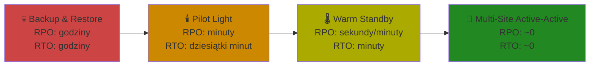

---

## 1. 💾 Backup & Restore (Kopia zapasowa i przywracanie)

**Najprostsza, najtańsza, ale najwolniejsza.**

Jak dom, gdzie masz kopię kluczy u sąsiada — musisz do niego pojechać, zanim wejdziesz.

### Jak działa:
- Dane backupowane regularnie do **S3 / S3 Glacier**
- Po awarii: uruchamiasz nową infrastrukturę z backupu
- Brak działającej infrastruktury w regionie DR w normalnym czasie

### AWS narzędzia:
```bash
# Backup EC2 (snapshot EBS)
aws ec2 create-snapshot \
  --volume-id vol-0abc123 \
  --description "DR backup $(date +%Y-%m-%d)"

# AWS Backup - zarządzanie backupami centralnie
aws backup start-backup-job \
  --backup-vault-name MyDRVault \
  --resource-arn arn:aws:ec2:us-east-1:123456789:instance/i-0abc123 \
  --iam-role-arn arn:aws:iam::123456789:role/AWSBackupRole
```

### Parametry:
| RPO | RTO | Koszt |
|-----|-----|-------|
| godziny | godziny | 💰 najniższy |

---

## 2. 🕯️ Pilot Light (Iskra pilotowa)

**Minimalna infrastruktura działa zawsze — jak palnik pilotowy w piecu gazowym.**

Analogia: masz zapasowy dom, ale tylko fundamenty i gaz podłączony — meble dopiero zwieziesz po awarii.

### Jak działa:
- **Dane replikowane na bieżąco** (np. RDS Multi-Region replication)
- Minimalne komponenty działają (tylko DB, nie aplikacje)
- Po awarii: uruchamiasz serwery aplikacyjne ze snapshotów/AMI
- Skalowanie od zera do produkcji zajmuje 10–30 minut

### AWS narzędzia:
```bash
# RDS Read Replica w innym regionie (dane zawsze aktualne)
aws rds create-db-instance-read-replica \
  --db-instance-identifier prod-db-dr \
  --source-db-instance-identifier arn:aws:rds:us-east-1:123456789:db:prod-db \
  --db-instance-class db.t3.medium \
  --region eu-west-1

# Promote replica podczas awarii (failover)
aws rds promote-read-replica \
  --db-instance-identifier prod-db-dr \
  --region eu-west-1
```

### Parametry:
| RPO | RTO | Koszt |
|-----|-----|-------|
| sekundy-minuty | 10-30 minut | 💰💰 niski |

---

## 3. 🌡️ Warm Standby (Ciepłe czuwanie)

**Zmniejszona, ale działająca kopia produkcji — zawsze online.**

Analogia: masz drugi dom w pełni umeblowany, ale mniejszy — po awarii przenosisz się tam natychmiast i dokupujesz meble żeby pomieścić całą rodzinę.

### Jak działa:
- **Pełna infrastruktura, ale w minimalnej skali** (np. 20% ruchu produkcyjnego)
- Dane replikowane w czasie rzeczywistym
- Po awarii: **auto-scaling** podnosi moc do 100% w minutach
- Load balancer przełącza ruch (Route 53 health checks)

### AWS narzędzia:
```bash
# Route 53 — failover routing
aws route53 change-resource-record-sets \
  --hosted-zone-id ZXXXXXXXXXXXXX \
  --change-batch '{
    "Changes": [{
      "Action": "CREATE",
      "ResourceRecordSet": {
        "Name": "app.example.com",
        "Type": "A",
        "Failover": "PRIMARY",
        "HealthCheckId": "abc-123",
        "TTL": 60,
        "ResourceRecords": [{"Value": "1.2.3.4"}]
      }
    }]
  }'

# Auto Scaling w regionie DR — skaluj podczas failoveru
aws autoscaling set-desired-capacity \
  --auto-scaling-group-name dr-asg \
  --desired-capacity 10 \
  --region eu-west-1
```

### Parametry:
| RPO | RTO | Koszt |
|-----|-----|-------|
| sekundy | minuty | 💰💰💰 średni |

---

## 4. 🚀 Multi-Site Active-Active (Wiele aktywnych lokalizacji)

**Produkcja działa jednocześnie w wielu regionach — brak przestoju.**

Analogia: masz wiele domów i mieszkasz we wszystkich jednocześnie. Jak jeden spłonie — reszta działa bez przerwy.

### Jak działa:
- **Ruch produkcyjny rozłożony** na kilka regionów AWS jednocześnie
- Dane synchronizowane między regionami (Aurora Global Database, DynamoDB Global Tables)
- Awaria regionu → Route 53 automatycznie przekierowuje ruch
- Użytkownik nic nie zauważa

### AWS narzędzia:
```bash
# DynamoDB Global Tables — replikacja multi-region
aws dynamodb create-global-table \
  --global-table-name MyGlobalTable \
  --replication-group \
    RegionName=us-east-1 \
    RegionName=eu-west-1 \
    RegionName=ap-southeast-1

# Aurora Global Database
aws rds create-global-cluster \
  --global-cluster-identifier my-global-aurora \
  --engine aurora-mysql \
  --engine-version 8.0.mysql_aurora.3.02.0
```

### Route 53 — latency-based routing:
```bash
aws route53 change-resource-record-sets \
  --hosted-zone-id ZXXXXX \
  --change-batch '{
    "Changes": [
      {
        "Action": "CREATE",
        "ResourceRecordSet": {
          "Name": "api.example.com",
          "Type": "A",
          "Region": "us-east-1",
          "SetIdentifier": "US",
          "TTL": 60,
          "ResourceRecords": [{"Value": "1.2.3.4"}]
        }
      },
      {
        "Action": "CREATE",
        "ResourceRecordSet": {
          "Name": "api.example.com",
          "Type": "A",
          "Region": "eu-west-1",
          "SetIdentifier": "EU",
          "TTL": 60,
          "ResourceRecords": [{"Value": "5.6.7.8"}]
        }
      }
    ]
  }'
```

### Parametry:
| RPO | RTO | Koszt |
|-----|-----|-------|
| ~0 (sekundy) | ~0 (sekundy) | 💰💰💰💰 najwyższy |

---

## 📊 Porównanie wszystkich strategii

| Strategia | RPO | RTO | Koszt miesięczny (przykład) | Kiedy używać |
|-----------|-----|-----|----------------------------|--------------|
| Backup & Restore | godziny | godziny | ~$50-200 | Dev/Test, niekrytyczne dane |
| Pilot Light | minuty | 10-30 min | ~$500-2000 | Aplikacje biznesowe, tolerancja na 30 min |
| Warm Standby | sekundy | minuty | ~$3000-10000 | E-commerce, finanse z tolerancją na minuty |
| Multi-Site Active-Active | ~0 | ~0 | ~$15000+ | Banking, healthcare, krytyczne systemy |

---

## 🔧 Dodatkowe narzędzia AWS dla DR

### AWS Elastic Disaster Recovery (DRS)
Następca CloudEndure — replikacja serwerów na poziomie bloków:
```bash
# Inicjalizacja DRS w regionie
aws drs initialize-service --region eu-west-1

# Lista replikowanych serwerów
aws drs describe-source-servers --region eu-west-1
```

### AWS Resilience Hub
Analiza odporności aplikacji:
```bash
# Dodaj aplikację do analizy
aws resiliencehub create-app \
  --name "MyProductionApp" \
  --description "Critical e-commerce application"
```

---

## ☁️ Porównanie z innymi chmurami

| Strategia | AWS | Azure | GCP |
|-----------|-----|-------|-----|
| Backup | AWS Backup, S3 | Azure Backup | Cloud Backup |
| Pilot Light / Warm Standby | CloudFormation + RDS replika | Site Recovery | Cloud DR |
| Active-Active | Aurora Global, DynamoDB Global Tables | Traffic Manager + Cosmos DB | Cloud Spanner (globalny) |
| Managed DR service | Elastic Disaster Recovery (DRS) | Azure Site Recovery | Google Cloud DR orchestration |

> **GCP Cloud Spanner** — jedyna managed baza danych z natywną replikacją multi-region i zewnętrznie spójnymi transakcjami. Odpowiednik AWS Aurora Global Database ale bardziej zaawansowany.

---

## 🔗 Dokumentacja

- [AWS DR Whitepaper](https://docs.aws.amazon.com/whitepapers/latest/disaster-recovery-workloads-on-aws/disaster-recovery-workloads-on-aws.html)
- [AWS Elastic Disaster Recovery](https://aws.amazon.com/disaster-recovery/)
- [AWS Resilience Hub](https://aws.amazon.com/resilience-hub/)
- [Route 53 Failover Routing](https://docs.aws.amazon.com/Route53/latest/DeveloperGuide/dns-failover.html)
- [Aurora Global Database](https://docs.aws.amazon.com/AmazonRDS/latest/AuroraUserGuide/aurora-global-database.html)
- [DynamoDB Global Tables](https://docs.aws.amazon.com/amazondynamodb/latest/developerguide/GlobalTables.html)

---
*Ostatnia aktualizacja: 2026-10-26*

---

# 🪟 PowerShell — JSON i porównywanie plików

## 📄 JSON w PowerShell

JSON (JavaScript Object Notation) to format wymiany danych — jak listy zakupów w ustrukturyzowanej formie. PowerShell ma wbudowane narzędzia do czytania, edycji i zapisywania JSON.

### Czytanie JSON

```powershell
# Z pliku
$data = Get-Content "config.json" -Raw | ConvertFrom-Json

# Z API/stringa
$data = '{"name":"Jan","age":30}' | ConvertFrom-Json

# Dostęp do pól
$data.name        # Jan
$data.age         # 30
```

### Tworzenie i zapis JSON

```powershell
# Utwórz obiekt
$obj = [PSCustomObject]@{
    name = "Jan"
    age  = 30
    city = "Warszawa"
}

# Zapisz do pliku
$obj | ConvertTo-Json -Depth 10 | Set-Content "output.json"
```

> ⚠️ **`-Depth 10`** zawsze używaj przy zagnieżdżonych obiektach. Domyślna głębokość to **2** — głębsze struktury są obcinane do stringa.

### Modyfikacja — dodaj/zmień pole

```powershell
$json = Get-Content "config.json" -Raw | ConvertFrom-Json

# Dodaj nowe pole
$json | Add-Member -NotePropertyName "region" -NotePropertyValue "eu-west-1"

# Zmień istniejące pole
$json.name = "Piotr"

# Zapisz
$json | ConvertTo-Json -Depth 10 | Set-Content "config.json"
```

### Modyfikacja — usuń pole

```powershell
$json = Get-Content "config.json" -Raw | ConvertFrom-Json

# Usuń właściwość
$json.PSObject.Properties.Remove("nazwaKlucza")

$json | ConvertTo-Json -Depth 10 | Set-Content "config.json"
```

### JSON jako tablica — filtrowanie i usuwanie elementów

```powershell
$json = Get-Content "users.json" -Raw | ConvertFrom-Json

# Usuń element gdzie name = "Jan"
$json = $json | Where-Object { $_.name -ne "Jan" }

# Dodaj element
$json += [PSCustomObject]@{ name = "Anna"; age = 25 }

$json | ConvertTo-Json -Depth 10 | Set-Content "users.json"
```

---

## 🔍 Porównywanie plików w PowerShell

### Metoda 1 — `Compare-Object` (linia po linii)

```powershell
Compare-Object (Get-Content plik1.txt) (Get-Content plik2.txt)
```

| Symbol | Znaczenie |
|--------|-----------|
| `<=`   | Linia tylko w plik1 |
| `=>`   | Linia tylko w plik2 |
| brak outputu | Pliki identyczne |

### Metoda 2 — hash (czy pliki identyczne binarnie)

```powershell
(Get-FileHash plik1.txt).Hash -eq (Get-FileHash plik2.txt).Hash
# Zwraca: True / False
```

### Metoda 3 — szczegółowe z oznaczeniem różnic

```powershell
$a = Get-Content plik1.txt
$b = Get-Content plik2.txt

Compare-Object $a $b -IncludeEqual | ForEach-Object {
    [PSCustomObject]@{
        Linia  = $_.InputObject
        Status = switch ($_.SideIndicator) {
            "==" { "identyczna" }
            "<=" { "tylko w plik1" }
            "=>" { "tylko w plik2" }
        }
    }
} | Format-Table -AutoSize
```

### Porównanie plików JSON (strukturalnie)

```powershell
$a = Get-Content plik1.json -Raw | ConvertFrom-Json | ConvertTo-Json -Depth 10
$b = Get-Content plik2.json -Raw | ConvertFrom-Json | ConvertTo-Json -Depth 10

Compare-Object ($a -split "`n") ($b -split "`n")
```

> Konwersja przez `ConvertFrom-Json | ConvertTo-Json` normalizuje formatowanie przed porównaniem — inaczej różne wcięcia dałyby fałszywe różnice.

### Porównanie dwóch katalogów

```powershell
$dir1 = Get-ChildItem "C:\folder1" -Recurse | Select-Object Name, Length, LastWriteTime
$dir2 = Get-ChildItem "C:\folder2" -Recurse | Select-Object Name, Length, LastWriteTime

Compare-Object $dir1 $dir2 -Property Name, Length
```

---

## 📊 Podsumowanie metod porównywania

| Metoda | Kiedy używać | Szybkość |
|--------|-------------|----------|
| `Compare-Object` | Pliki tekstowe, linia po linii | średnia |
| `Get-FileHash` | Szybka weryfikacja identyczności | szybka |
| JSON normalize + Compare | Pliki JSON z różnym formatowaniem | średnia |
| Compare katalogów | Synchronizacja folderów | wolna |

---

## 🔗 Dokumentacja

- [ConvertFrom-Json](https://learn.microsoft.com/en-us/powershell/module/microsoft.powershell.utility/convertfrom-json)
- [ConvertTo-Json](https://learn.microsoft.com/en-us/powershell/module/microsoft.powershell.utility/convertto-json)
- [Compare-Object](https://learn.microsoft.com/en-us/powershell/module/microsoft.powershell.utility/compare-object)
- [Get-FileHash](https://learn.microsoft.com/en-us/powershell/module/microsoft.powershell.utility/get-filehash)

---

# 🔀 AWS Step Functions

## Co to jest? (prosto)

Wyobraź sobie przepis kulinarny — każdy krok musi się wykonać po kolei, niektóre kroki zależą od poprzednich, a jeśli coś się nie uda, wiesz dokładnie gdzie. Step Functions to właśnie to, ale dla aplikacji chmurowych.

## Definicja techniczna

AWS Step Functions = serverless **orkiestrator workflows**. Łączy serwisy AWS (Lambda, ECS, SNS, SQS, DynamoDB i inne) w **state machine** (maszynę stanów). Każdy krok = stan. Stany połączone tranzycjami.

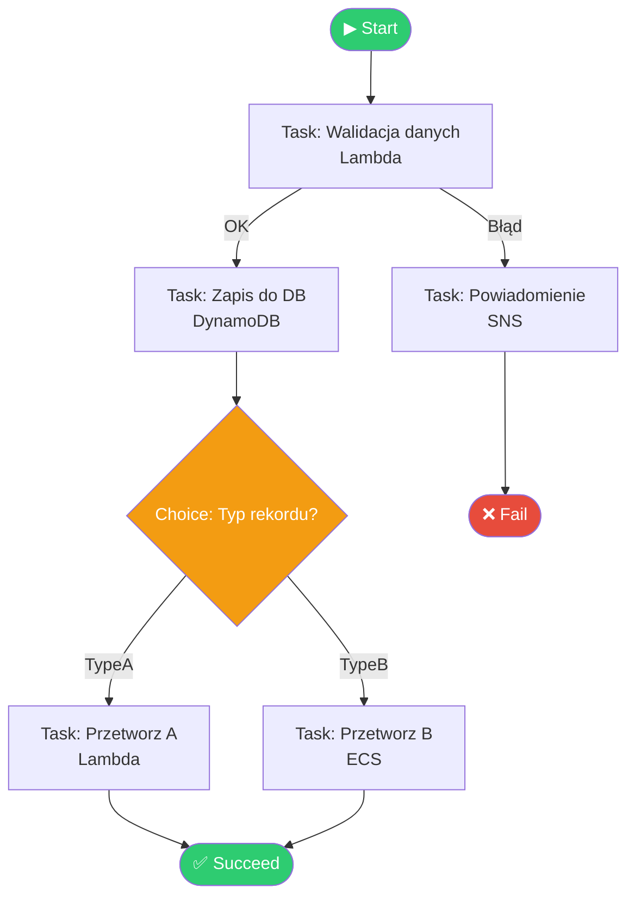

## Typy stanów (States)

| Stan | Opis | Przykład użycia |
|------|------|-----------------|
| `Task` | Wywołuje serwis AWS | Lambda, ECS, API Gateway |
| `Choice` | Rozgałęzienie logiki (if/else) | Routing na podstawie danych |
| `Wait` | Pauza czasowa | Czekaj 5 min przed retry |
| `Parallel` | Równoległe gałęzie | Przetwarza kilka rzeczy naraz |
| `Map` | Iteracja po tablicy | Przetwórz każdy element listy |
| `Pass` | Przepuść input dalej | Debug, transformacja danych |
| `Succeed` | Zakończ sukcesem | Terminal state |
| `Fail` | Zakończ błędem | Terminal state z komunikatem |

## Typy workflow

| Typ | Latencja | Cena | Użycie |
|-----|----------|------|--------|
| **Standard** | ms | za przejście stanu | Długie procesy, audyt, max 1 rok |
| **Express** | ms | za czas trwania + liczba wykonań | Krótkie, high-volume (IoT, streaming) |

## Przykład — definicja ASL (Amazon States Language)

```json
{
  "Comment": "Prosty workflow",
  "StartAt": "WalidacjaDanych",
  "States": {
    "WalidacjaDanych": {
      "Type": "Task",
      "Resource": "arn:aws:lambda:eu-west-1:123456789:function:validate",
      "Next": "ZapisDoDB",
      "Retry": [
        {
          "ErrorEquals": ["Lambda.ServiceException"],
          "IntervalSeconds": 2,
          "MaxAttempts": 3,
          "BackoffRate": 2
        }
      ]
    },
    "ZapisDoDB": {
      "Type": "Task",
      "Resource": "arn:aws:states:::dynamodb:putItem",
      "Parameters": {
        "TableName": "MojaTabela",
        "Item": {
          "id": { "S.$": "$.userId" }
        }
      },
      "End": true
    }
  }
}
```

## CLI — tworzenie i uruchamianie

```bash
# Utwórz state machine
aws stepfunctions create-state-machine \
  --name "MojWorkflow" \
  --definition file://definition.json \
  --role-arn arn:aws:iam::123456789:role/StepFunctionsRole

# Uruchom wykonanie
aws stepfunctions start-execution \
  --state-machine-arn arn:aws:states:eu-west-1:123456789:stateMachine:MojWorkflow \
  --input '{"userId": "abc123"}'

# Sprawdź status wykonania
aws stepfunctions describe-execution \
  --execution-arn arn:aws:states:eu-west-1:123456789:execution:MojWorkflow:exec-id

# Lista wykonań
aws stepfunctions list-executions \
  --state-machine-arn arn:aws:states:eu-west-1:123456789:stateMachine:MojWorkflow \
  --status-filter RUNNING
```

## Porównanie z innymi chmurami

| Feature | AWS Step Functions | Azure Durable Functions | GCP Workflows | OpenStack |
|---|---|---|---|---|
| Typ | State machine (wizualny) | Kod (C#/JS/Python) | YAML-based | Brak natywnego odpowiednika |
| Wizualizacja | ✅ Wbudowana | ⚠️ Ograniczona | ✅ | ❌ |
| Max czas | 1 rok (Standard) | Nieograniczony | 1 rok | — |
| Retry logic | ✅ Wbudowany | ✅ | ✅ | — |
| Cena (Standard) | $0.025 / 1k tranzycji | Per wykonanie | $0.01 / 1k kroków | — |

## Kiedy używać?

✅ **Używaj gdy:**
- Workflow ma wiele kroków z warunkami
- Potrzebujesz retry logic i error handling
- Chcesz wizualny audit trail
- Długo działające procesy (minuty → dni)
- Koordynacja wielu serwisów AWS

❌ **Nie używaj gdy:**
- Prosta jedna Lambda
- Real-time streaming (użyj Kinesis)
- Bardzo high-frequency + ultra-low latency

## 🔗 Dokumentacja

- [AWS Step Functions Developer Guide](https://docs.aws.amazon.com/step-functions/latest/dg/welcome.html)
- [Amazon States Language](https://states-language.net/spec.html)
- [Step Functions Workshop](https://catalog.workshops.aws/stepfunctions)

---

# ⚡ Azure Functions vs Azure Durable Functions

## Prosto na start

**Azure Function** = jeden pracownik, który dostaje zadanie, wykonuje je i zapomina o wszystkim. Bezstanowy (stateless).

**Durable Function** = brygadzista, który pamięta cały plan pracy, pilnuje kolejności, czeka na innych i wie, co już zrobione. Stanowy (stateful).

Durable Functions to **rozszerzenie** (extension) na bazie zwykłych Azure Functions — nie osobny serwis.

---

## Różnica techniczna

| Cecha | Azure Function | Durable Function |
|-------|----------------|------------------|
| Stan (state) | Stateless | **Stateful** (zapisuje postęp) |
| Czas działania | Krótki (max 5–10 min zwykle) | Długi (godziny, dni, miesiące) |
| Orkiestracja | ❌ brak | ✅ łączy wiele funkcji |
| Pamięta progres | ❌ nie | ✅ tak (checkpoint) |
| Czeka na input/event | ❌ trudne | ✅ natywnie |
| Bazuje na | — | Durable Task Framework |

---

## Typy funkcji w Durable Functions

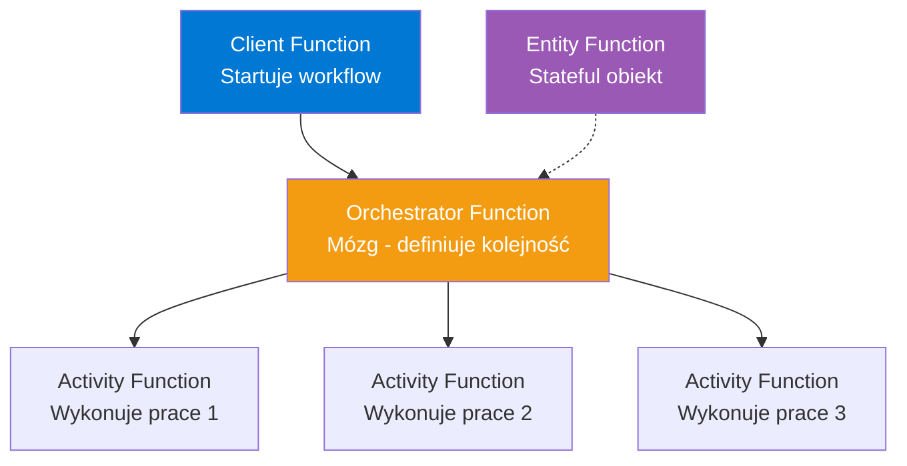

| Typ | Rola |
|-----|------|
| **Client** | Uruchamia orkiestrację (trigger: HTTP, timer, queue) |
| **Orchestrator** | Definiuje workflow w kodzie — kolejność, warunki, równoległość. **Musi być deterministyczny** |
| **Activity** | Wykonuje faktyczną pracę (I/O, API call, DB) |
| **Entity** | Mały stanowy obiekt (licznik, agregat) — jak aktor |

---

## Jak to działa — mechanizm

Orchestrator "śpi" i budzi się tylko gdy trzeba. Postęp zapisywany w **Azure Storage** (event sourcing). Przy każdym wznowieniu kod orkiestratora jest **odtwarzany (replay)** od początku — dlatego musi być deterministyczny (bez `DateTime.Now`, bez random, bez bezpośrednich wywołań I/O).

```
await ctx.CallActivityAsync("KrokA")   → zapis checkpoint → uśpienie
   ... (czeka) ...
await ctx.CallActivityAsync("KrokB")   → replay + nowy checkpoint
```

---

## Wzorce aplikacji (Application Patterns)

| Wzorzec | Opis |
|---------|------|
| **Function Chaining** | A → B → C sekwencyjnie |
| **Fan-out/Fan-in** | Równolegle N zadań, potem zbierz wyniki |
| **Async HTTP APIs** | Długi proces + endpoint do sprawdzania statusu |
| **Monitor** | Pętla sprawdzająca stan co X czasu |
| **Human Interaction** | Czeka na akcję człowieka (approval) z timeoutem |

---

## Przykład — Function Chaining (C#)

```
[FunctionName("Orchestrator")]
public static async Task<List<string>> Run(
    [OrchestrationTrigger] IDurableOrchestrationContext ctx)
{
    var outputs = new List<string>();
    outputs.Add(await ctx.CallActivityAsync<string>("SayHello", "Tokyo"));
    outputs.Add(await ctx.CallActivityAsync<string>("SayHello", "Seattle"));
    outputs.Add(await ctx.CallActivityAsync<string>("SayHello", "London"));
    return outputs;
}

[FunctionName("SayHello")]
public static string SayHello([ActivityTrigger] string name)
    => $"Hello {name}!";

```


## Przykład — Fan-out/Fan-in

```
var tasks = new List<Task<int>>();
foreach (var item in workItems)
    tasks.Add(ctx.CallActivityAsync<int>("ProcessItem", item));

await Task.WhenAll(tasks);          // czeka na wszystkie
int total = tasks.Sum(t => t.Result);
```

---

## CLI — zarządzanie

```bash
# Utwórz Function App (bazowa infra dla obu typów)
az functionapp create \
  --name mojafunkcja \
  --resource-group mojaRG \
  --storage-account mojestorage \
  --consumption-plan-location westeurope \
  --runtime dotnet \
  --functions-version 4

# Deploy kodu (z folderu projektu)
func azure functionapp publish mojafunkcja
```

> Uwaga: Durable wymaga **Azure Storage account** (tam trzyma stan). Zwykła Function może działać bez niego (choć zwykle też go ma).

---

## Odpowiedniki w innych chmurach

| | Azure | AWS | GCP |
|---|-------|-----|-----|
| Stateless FaaS | Azure Functions | Lambda | Cloud Functions |
| Stateful orkiestracja | **Durable Functions** | Step Functions | Workflows |
| Różnica podejścia | Kod (C#/JS/Python) | JSON state machine | YAML |

Kluczowa różnica filozofii: **Durable = orkiestracja w kodzie**, AWS Step Functions = orkiestracja w deklaratywnym JSON.

---

## Kiedy co?

| Użyj zwykłej Function | Użyj Durable Function |
|----------------------|----------------------|
| Prosty trigger → akcja | Wieloetapowy workflow |
| Webhook, API endpoint | Czeka na approval/event |
| Przetwarzanie 1 wiadomości z queue | Fan-out na setki zadań |
| Krótkie, bezstanowe | Długie, stanowe (saga, ETL) |

---

## 🔗 Dokumentacja

- [Durable Functions overview](https://learn.microsoft.com/en-us/azure/azure-functions/durable/durable-functions-overview)
- [Application patterns](https://learn.microsoft.com/en-us/azure/azure-functions/durable/durable-functions-overview#application-patterns)
- [Orchestrator code constraints (determinizm)](https://learn.microsoft.com/en-us/azure/azure-functions/durable/durable-functions-code-constraints)

---

# 🧩 Step Functions — State Machines, Stany i Przepływ Danych

## Co to State Machine? (prosto)

**State machine** = schemat blokowy zapisany w JSON. To "mapa" workflow: zbiór **stanów** (states) połączonych strzałkami. Wykonanie (execution) to jedno "przejście" tej mapy od startu do końca, jak kulka tocząca się po torze z rozgałęzieniami.

Jeden state machine = jedna definicja. Możesz ją uruchomić (execution) wiele razy równolegle, każda z innym inputem.

---

## Język definicji — ASL

State machine opisujesz w **Amazon States Language (ASL)** — formacie JSON. Szkielet:

```json
{
  "Comment": "Opis",
  "StartAt": "PierwszyStan",
  "States": {
    "PierwszyStan": { ... },
    "DrugiStan": { ... }
  }
}
```

- `StartAt` — który stan startuje
- `States` — słownik wszystkich stanów
- Każdy stan ma `Next` (następny) albo `End: true` (koniec)

---

## 📋 Wszystkie możliwe typy stanów (8)

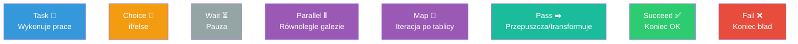

| # | Stan | Typ | Co robi | Terminalny? |
|---|------|-----|---------|-------------|
| 1 | **Task** | Robi pracę | Wywołuje Lambda, ECS, SNS, DynamoDB, inny state machine... | nie |
| 2 | **Choice** | Logika | Rozgałęzienie if/else na podstawie danych | nie |
| 3 | **Wait** | Opóźnienie | Czeka X sekund / do konkretnej daty | nie |
| 4 | **Parallel** | Współbieżność | Uruchamia kilka gałęzi naraz, czeka na wszystkie | nie |
| 5 | **Map** | Pętla | Iteruje po tablicy — ten sam krok dla każdego elementu | nie |
| 6 | **Pass** | Dane | Przepuszcza/wstrzykuje/transformuje dane (bez pracy) | nie |
| 7 | **Succeed** | Koniec | Zatrzymuje execution — sukces | ✅ tak |
| 8 | **Fail** | Koniec | Zatrzymuje execution — błąd (z `Error` i `Cause`) | ✅ tak |

Stany **terminalne** (Succeed, Fail) nie mają `Next` — kończą wykonanie.

---

## 🔄 Jak stany wymieniają input/output?

To najważniejsza i najtrudniejsza część. Każdy stan dostaje **input (JSON)** i produkuje **output (JSON)**, który staje się inputem następnego stanu. Pomiędzy nimi działa **pipeline przetwarzania danych** (data flow).

```mermaid
graph LR
    IN[Input JSON] --> IP[InputPath\nwybór fragmentu]
    IP --> PAR[Parameters\nbudowa inputu dla zadania]
    PAR --> TASK[((Praca\nLambda etc.))]
    TASK --> RS[ResultSelector\nfiltr wyniku]
    RS --> RP[ResultPath\ngdzie wstawić wynik]
    RP --> OP[OutputPath\nwybór outputu]
    OP --> OUT[Output JSON\n= input nast. stanu]

    style TASK fill:#3498db,color:#fff
```

### Pola filtrujące dane (kolejność przetwarzania)

| Pole | Co robi | Analogia |
|------|---------|----------|
| `InputPath` | Wybiera **część** inputu do dalszej obróbki | "weź tylko `$.dane`" |
| `Parameters` | Buduje **nowy** obiekt przekazany do zadania | "zbuduj payload dla Lambda" |
| `ResultSelector` | Filtruje **surowy wynik** zadania | "z odpowiedzi weź tylko `$.Payload`" |
| `ResultPath` | Gdzie **wstawić wynik** względem inputu | "dopisz wynik do `$.result`, zachowaj resztę" |
| `OutputPath` | Wybiera **część** do przekazania dalej | "przekaż tylko `$.result`" |

### Składnia ścieżek — JSONPath

- `$` — cały bieżący JSON
- `$.pole.podpole` — zagnieżdżona wartość
- `$.lista[0]` — element tablicy
- `.$` (sufiks w kluczu) — "ta wartość to ścieżka, nie literał"

```json
"Parameters": {
  "userId.$": "$.user.id",        // weź dynamicznie z inputu
  "static": "zawsze-ta-sama"       // literał
}
```

### Kluczowa różnica: ResultPath

| `ResultPath` | Efekt |
|--------------|-------|
| `"$.result"` | Wynik dopisany do inputu pod `result`, reszta zachowana |
| `"$"` (default) | Wynik **zastępuje** cały input |
| `null` | Wynik **odrzucony**, input przechodzi bez zmian |

---

## Przykład przepływu danych

Input do stanu:
```json
{ "user": { "id": "abc", "name": "Jan" }, "meta": "x" }
```

Definicja stanu:
```json
"PobierzDane": {
  "Type": "Task",
  "Resource": "arn:aws:lambda:...:function:getData",
  "Parameters": { "id.$": "$.user.id" },
  "ResultPath": "$.result",
  "OutputPath": "$",
  "End": true
}
```

Lambda dostaje: `{ "id": "abc" }` → zwraca: `{ "score": 99 }`

Output stanu:
```json
{ "user": {...}, "meta": "x", "result": { "score": 99 } }
```

---

## Obsługa błędów — Retry i Catch

```json
"PobierzDane": {
  "Type": "Task",
  "Resource": "arn:aws:lambda:...",
  "Retry": [
    { "ErrorEquals": ["States.Timeout"], "IntervalSeconds": 2,
      "MaxAttempts": 3, "BackoffRate": 2.0 }
  ],
  "Catch": [
    { "ErrorEquals": ["States.ALL"], "Next": "ObslugaBledu",
      "ResultPath": "$.error" }
  ],
  "End": true
}
```

- `Retry` — ponów przy błędzie (z backoff)
- `Catch` — jeśli retry nie pomoże, skocz do stanu ratunkowego
- `States.ALL` — łapie każdy błąd

---

## 📊 Gdzie są logi?

Step Functions **nie loguje domyślnie** — musisz włączyć. Trzy źródła:

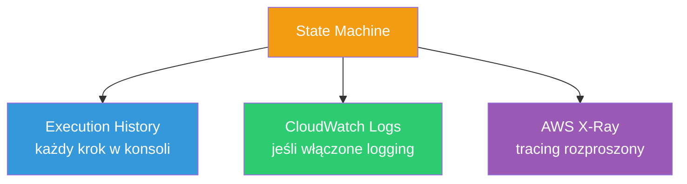

| Źródło | Co zawiera | Jak włączyć |
|--------|-----------|-------------|
| **Execution History** | Pełna historia każdego stanu (input/output/błędy) każdego wykonania. Widoczne w konsoli + API | Zawsze dostępne (Standard) |
| **CloudWatch Logs** | Logi strukturalne, konfigurowalny poziom (ALL/ERROR/FATAL) | Trzeba włączyć + rola IAM |
| **X-Ray** | Tracing — gdzie czas spędzony, mapa serwisów | Flaga przy tworzeniu |

> Uwaga: **Express workflows** NIE mają Execution History — dla nich CloudWatch Logs to jedyne źródło. Dlatego przy Express logging jest praktycznie obowiązkowy.

### CLI — przeglądanie historii i logów

```bash
# Historia wykonania (każdy krok z input/output)
aws stepfunctions get-execution-history \
  --execution-arn arn:aws:states:eu-west-1:123:execution:MojWorkflow:exec-id

# Włączenie logowania do CloudWatch przy update
aws stepfunctions update-state-machine \
  --state-machine-arn arn:aws:states:...:stateMachine:MojWorkflow \
  --logging-configuration '{
    "level": "ALL",
    "includeExecutionData": true,
    "destinations": [{
      "cloudWatchLogsLogGroup": {
        "logGroupArn": "arn:aws:logs:eu-west-1:123:log-group:/aws/sfn/MojWorkflow:*"
      }
    }]
  }'

# Czytanie logów z CloudWatch
aws logs tail /aws/sfn/MojWorkflow --follow
```

---

## 🔗 Dokumentacja

- [States (typy stanów)](https://docs.aws.amazon.com/step-functions/latest/dg/concepts-states.html)
- [Input and Output Processing (data flow)](https://docs.aws.amazon.com/step-functions/latest/dg/concepts-input-output-filtering.html)
- [Error handling (Retry/Catch)](https://docs.aws.amazon.com/step-functions/latest/dg/concepts-error-handling.html)
- [Logging with CloudWatch](https://docs.aws.amazon.com/step-functions/latest/dg/cw-logs.html)

---

# ⚔️ Pilot Light vs Warm Standby — pojedynek

> Nawiązanie do sekcji [🔁 Disaster Recovery w AWS](#-disaster-recovery-w-aws) — tu głębiej o różnicy między dwiema środkowymi strategiami.

## Jedno zdanie na start

| Strategia | W skrócie |
|-----------|-----------|
| 🕯️ **Pilot Light** | Działa tylko **rdzeń danych**. Serwery aplikacji są **wyłączone** — trzeba je uruchomić po awarii. |
| 🌡️ **Warm Standby** | Działa **cała aplikacja**, ale w **małej skali**. Już przyjmuje ruch — po awarii tylko skalujesz w górę. |

Kluczowa różnica: **czy serwery aplikacyjne są włączone czy wyłączone** w normalnym czasie.

---

## Analogia życiowa

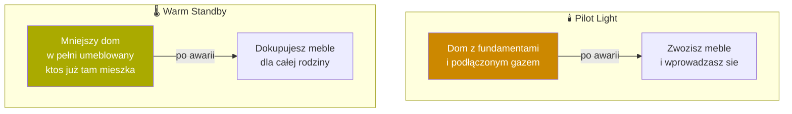

- **Pilot Light** = masz fundamenty + gaz (dane), ale meble (serwery) zwozisz dopiero po awarii.
- **Warm Standby** = dom już umeblowany i zamieszkany, tylko za mały — po awarii dokupujesz meble.

---

## Porównanie techniczne

| Cecha | 🕯️ Pilot Light | 🌡️ Warm Standby |
|-------|----------------|------------------|
| Baza danych | ✅ replikowana, działa | ✅ replikowana, działa |
| Serwery aplikacji | ❌ **wyłączone** (AMI/snapshot gotowe) | ✅ **włączone**, mała skala |
| Przyjmuje ruch w normalnym czasie? | ❌ nie | ✅ tak (np. 10–20%) |
| Co robisz po awarii? | **Uruchamiasz** serwery od zera + skalujesz | **Tylko skalujesz** istniejące w górę |
| RTO (czas powrotu) | 10–30 min | kilka minut |
| RPO (utrata danych) | sekundy–minuty | sekundy |
| Koszt | 💰💰 niski | 💰💰💰 średni |
| Ryzyko "zimnego startu" | ⚠️ większe (coś może nie wstać) | ✅ mniejsze (już działa) |

---

## Oś strategii DR — gdzie leżą

```
TANIEJ, WOLNIEJ  ◄───────────────────────────────►  DROŻEJ, SZYBCIEJ

Backup&Restore ── Pilot Light ── Warm Standby ── Active-Active
   godziny         10-30 min        minuty           ~0
                      ▲                 ▲
                      │                 │
            serwery WYŁĄCZONE    serwery WŁĄCZONE
                                    (mała skala)
```

Warm Standby to "ulepszony Pilot Light" — ta sama replikacja danych, ale dodatkowo serwery aplikacyjne już chodzą.

---

## Różnica w akcji failover (CLI)

**Pilot Light** — musisz najpierw URUCHOMIĆ infrastrukturę:
```bash
# 1. Promote repliki DB
aws rds promote-read-replica --db-instance-identifier prod-db-dr --region eu-west-1

# 2. Uruchom serwery od zera (były wyłączone!)
aws autoscaling update-auto-scaling-group \
  --auto-scaling-group-name dr-asg \
  --min-size 4 --desired-capacity 4 \
  --region eu-west-1
# ↑ z 0 na 4 — "zimny start"
```

**Warm Standby** — serwery już chodzą, tylko SKALUJESZ:
```bash
# Serwery działają od dawna (np. 2 szt.) — podnieś do produkcji
aws autoscaling set-desired-capacity \
  --auto-scaling-group-name dr-asg \
  --desired-capacity 10 \
  --region eu-west-1
# ↑ z 2 na 10 — "ciepły start", szybszy i pewniejszy
```

Zauważ: Pilot Light startuje **z zera** (`min-size 0`), Warm Standby **z małej liczby** (już >0).

---

## Kiedy co wybrać?

| Wybierz Pilot Light gdy | Wybierz Warm Standby gdy |
|-------------------------|--------------------------|
| Budżet ograniczony | RTO musi być w minutach |
| RTO 10–30 min akceptowalne | Krytyczna aplikacja biznesowa |
| Rzadkie awarie, tolerancja na zimny start | Chcesz pewności że failover zadziała |
| Aplikacja szybko się uruchamia | Aplikacja wolno startuje / złożona |

---

## 🔗 Dokumentacja

- [AWS DR whitepaper — Disaster Recovery Options](https://docs.aws.amazon.com/whitepapers/latest/disaster-recovery-workloads-on-aws/disaster-recovery-options-in-the-cloud.html)
- [Pilot Light and Warm Standby](https://aws.amazon.com/blogs/architecture/disaster-recovery-dr-architecture-on-aws-part-iii-pilot-light-and-warm-standby/)

---

# 🔑 Git — wymuszenie nowego PAT przy push do GitLab

## Co to jest PAT? (prosto)

**PAT (Personal Access Token)** = token zastępujący hasło przy logowaniu do GitLab/GitHub przez HTTPS. Jak jednorazowy klucz do mieszkania — możesz go nadać, odebrać i ograniczyć (np. tylko do odczytu). GitLab wyłączył logowanie hasłem — PAT jest obowiązkowy.

---

## Problem: dlaczego git nie pyta o nowy PAT?

Git **cache'uje** dane logowania w **credential helperze**, żeby nie pytać przy każdym push. Gdy wygenerujesz nowy PAT, git wciąż używa starego z cache → błąd `403` / `authentication failed`.

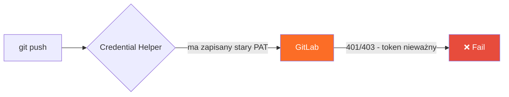

Rozwiązanie: **usunąć stary token z cache**, żeby git zapytał o nowy.

---

## Krok 1 — sprawdź jaki masz helper

```bash
git config --list | grep credential
```

| Helper | Gdzie trzyma dane | Jak wyczyścić |
|--------|-------------------|---------------|
| `osxkeychain` | macOS Keychain | `git credential-osxkeychain erase` |
| `manager` / `manager-core` | Windows Credential Manager / GCM | `git credential-manager erase` |
| `store` | plik `~/.git-credentials` (plaintext) | usuń linię z pliku |
| `cache` | RAM (tymczasowo) | `git credential-cache exit` |
| `libsecret` | Linux keyring | przez narzędzie keyring (Seahorse) |

---

## Krok 2 — wyczyść stary token

### macOS (Keychain) — najczęstsze
```bash
git credential-osxkeychain erase
host=gitlab.com
protocol=https
```
Po wpisaniu tych 3 linii naciśnij **Enter**, potem **Ctrl+D**. Alternatywnie przez GUI: aplikacja **Keychain Access** → szukaj `gitlab` → usuń wpis.

### Windows (Git Credential Manager)
```bash
git credential-manager erase
protocol=https
host=gitlab.com
```
Lub: **Panel sterowania → Menedżer poświadczeń → Poświadczenia Windows** → usuń `git:https://gitlab.com`.

### Linux / helper `store`
```bash
# Usuń linię z gitlab.com z pliku
sed -i '/gitlab\.com/d' ~/.git-credentials
```

---

## Krok 3 — push z nowym PAT

```bash
git push
```
Git zapyta o dane. Wpisz:
- **Username** = twój login GitLab
- **Password** = **NOWY PAT** (nie hasło konta!)

Nowy token zostanie zapisany w helperze na przyszłość.

---

## 🔀 Metody alternatywne

### A. PAT bezpośrednio w remote URL (szybkie, jednorazowe)
```bash
git remote set-url origin https://oauth2:<NOWY_PAT>@gitlab.com/user/repo.git
git push
```
- `oauth2` = stały username dla tokenu w GitLab
- ⚠️ **Wada:** PAT zapisany plaintext w `.git/config` — widoczny dla każdego z dostępem do repo

### B. Push bez zapisywania (test tokenu)
```bash
git -c credential.helper= push https://gitlab.com/user/repo.git
```
Pusty helper → git pyta za każdym razem, nic nie cache'uje. Dobre do weryfikacji czy nowy PAT działa.

### C. Jednorazowy header (bez dotykania remote)
```bash
git -c http.extraHeader="PRIVATE-TOKEN: <NOWY_PAT>" push
```

---

## 🌐 Różnice między providerami

| Provider | Username dla PAT w URL | Nazwa tokenu |
|----------|------------------------|--------------|
| **GitLab** | `oauth2` lub login | Personal Access Token |
| **GitHub** | login lub `x-access-token` | Personal Access Token (classic/fine-grained) |
| **Bitbucket** | login | App Password |
| **Azure DevOps** | dowolny (np. `pat`) | Personal Access Token |

> Mechanizm credential helpera jest **taki sam** niezależnie od providera — różni się tylko host i username.

---

## ✅ Najlepsze praktyki

- **Nie wklejaj PAT do URL** w repo współdzielonym (zostaje w `.git/config`)
- Nadawaj PAT **minimalne uprawnienia** (scope `write_repository` wystarczy do push)
- Ustaw **datę wygaśnięcia** tokenu
- Rozważ **SSH zamiast HTTPS** — klucz SSH nie wygasa, nie trzeba zarządzać tokenami:
  ```bash
  git remote set-url origin git@gitlab.com:user/repo.git
  ```

---

## 🔗 Dokumentacja

- [GitLab PAT](https://docs.gitlab.com/ee/user/profile/personal_access_tokens.html)
- [Git credential storage](https://git-scm.com/book/en/v2/Git-Tools-Credential-Storage)
- [git-credential-osxkeychain](https://git-scm.com/docs/git-credential-osxkeychain)

---

# 🛡️ AWS IAM — Identity-Based vs Resource-Based Policies

## Prosto na start

Wyobraź sobie klub z ochroniarzem. Są dwa sposoby decydowania kto wejdzie:
- **Identity-Based policy** = lista w ręku gościa ("ja mogę wejść do VIP i do baru") — przypięta do **osoby**.
- **Resource-Based policy** = lista na drzwiach pokoju ("wpuszczam Jana i Anię") — przypięta do **miejsca**.

W AWS "osoba" = user/group/role (**principal**), "miejsce" = zasób (S3 bucket, SQS queue, Lambda, KMS key).

---

## Fundament — co to IAM policy?

Każda policy to dokument **JSON** mówiący: *kto* może zrobić *co* na *czym* i *w jakich warunkach*.

```json
{
  "Version": "2012-10-17",
  "Statement": [{
    "Effect": "Allow",
    "Action": "s3:GetObject",
    "Resource": "arn:aws:s3:::my-bucket/*",
    "Condition": { "IpAddress": { "aws:SourceIp": "10.0.0.0/24" } }
  }]
}
```

| Element | Znaczenie | Tylko resource-based |
|---------|-----------|----------------------|
| `Effect` | `Allow` / `Deny` | |
| `Action` | Operacja (`s3:GetObject`) | |
| `Resource` | Na czym | |
| `Condition` | Warunki (IP, MFA, tagi) | |
| **`Principal`** | **KTO** (user/role/konto) | ✅ **tylko tu** |

🔑 Kluczowa różnica składni: **resource-based policy ma pole `Principal`**, identity-based NIE (bo principal to już ten, do kogo policy jest przypięta).

---

## 🗺️ Mapa rodzajów policies

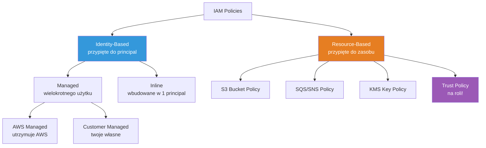

---

## 1️⃣ Identity-Based Policies

Przypięte do **tożsamości**: IAM user, group, lub role. Mówią "co ta tożsamość może robić".

### A. Managed Policies (zarządzane, wielokrotnego użytku)

Samodzielny obiekt z własnym ARN. Przypinasz do wielu principals. Wersjonowane (do 5 wersji, rollback możliwy).

| Podtyp | Kto utrzymuje | Przykład |
|--------|---------------|----------|
| **AWS Managed** | AWS (auto-update) | `AmazonS3ReadOnlyAccess`, `AdministratorAccess` |
| **Customer Managed** | Ty | `MojaPolicyDlaDevów` |

```bash
# Przypnij AWS managed policy do usera
aws iam attach-user-policy \
  --user-name jan \
  --policy-arn arn:aws:iam::aws:policy/AmazonS3ReadOnlyAccess

# Stwórz własną customer managed policy
aws iam create-policy \
  --policy-name MojaS3Policy \
  --policy-document file://policy.json
```

### B. Inline Policies (wbudowane)

Wtopione **bezpośrednio** w jednego principala. Brak własnego ARN, brak ponownego użycia. Usuwasz principala → policy znika razem z nim (relacja 1:1, "życie i śmierć").

```bash
# Dodaj inline policy do usera
aws iam put-user-policy \
  --user-name jan \
  --policy-name OnlyThisUserPolicy \
  --policy-document file://inline.json
```

### Managed vs Inline — kiedy co?

| | Managed | Inline |
|---|---------|--------|
| Ponowne użycie | ✅ wiele principals | ❌ jeden principal |
| Własny ARN | ✅ | ❌ |
| Wersjonowanie/rollback | ✅ | ❌ |
| Powiązanie z principalem | luźne | **sztywne (1:1)** |
| Kiedy używać | **domyślnie, prawie zawsze** | gdy policy MUSI zniknąć z principalem (ścisła relacja) |

> Best practice AWS: **używaj Managed**. Inline tylko gdy naprawdę chcesz relacji 1:1 (np. policy specyficzna dla jednej roli, która nie powinna istnieć bez niej).

---

## 2️⃣ Resource-Based Policies

Przypięte **do zasobu**, nie do tożsamości. Zawierają `Principal` — mówią "kto z zewnątrz może dotknąć TEN zasób". Zawsze **inline** (nie ma resource-based managed policies).

```json
{
  "Version": "2012-10-17",
  "Statement": [{
    "Effect": "Allow",
    "Principal": { "AWS": "arn:aws:iam::111122223333:root" },
    "Action": "s3:GetObject",
    "Resource": "arn:aws:s3:::my-bucket/*"
  }]
}
```

Typowe zasoby z resource-based policies: **S3 buckets, SQS, SNS, Lambda, KMS keys, ECR, Secrets Manager**.

🌟 **Super-moc:** umożliwiają **cross-account access** (dostęp z innego konta AWS) bez tworzenia userów w obu kontach.

---

## 🔄 Role i Assume Role — serce IAM

**IAM Role** = tożsamość bez stałych haseł/kluczy. Zamiast tego dostajesz **tymczasowe credentials** (ważne np. 1h). Rolę się "zakłada" (assume), jak kostium — chwilowo przejmujesz jej uprawnienia.

Rola ma **DWIE policies** — i tu wszystko się łączy:

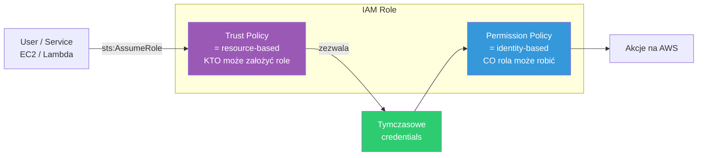

| Policy na roli | Typ | Odpowiada na pytanie |
|----------------|-----|----------------------|
| **Trust Policy** | resource-based (ma `Principal`!) | KTO może założyć tę rolę? |
| **Permission Policy** | identity-based (managed/inline) | CO rola może robić po założeniu? |

### Trust Policy — przykład
```json
{
  "Version": "2012-10-17",
  "Statement": [{
    "Effect": "Allow",
    "Principal": { "Service": "ec2.amazonaws.com" },
    "Action": "sts:AssumeRole"
  }]
}
```
To mówi: "EC2 może założyć tę rolę". Dlatego np. EC2 instance profile działa bez kluczy w kodzie.

### Assume Role w praktyce (CLI)
```bash
# Załóż rolę — dostajesz tymczasowe credentials
aws sts assume-role \
  --role-arn arn:aws:iam::123456789:role/MojaRola \
  --role-session-name sesja1

# Zwraca AccessKeyId, SecretAccessKey, SessionToken (ważne X minut)
```

---

## 🧮 Jak AWS ocenia dostęp? (evaluation logic)

Gdy identity-based i resource-based się nakładają:

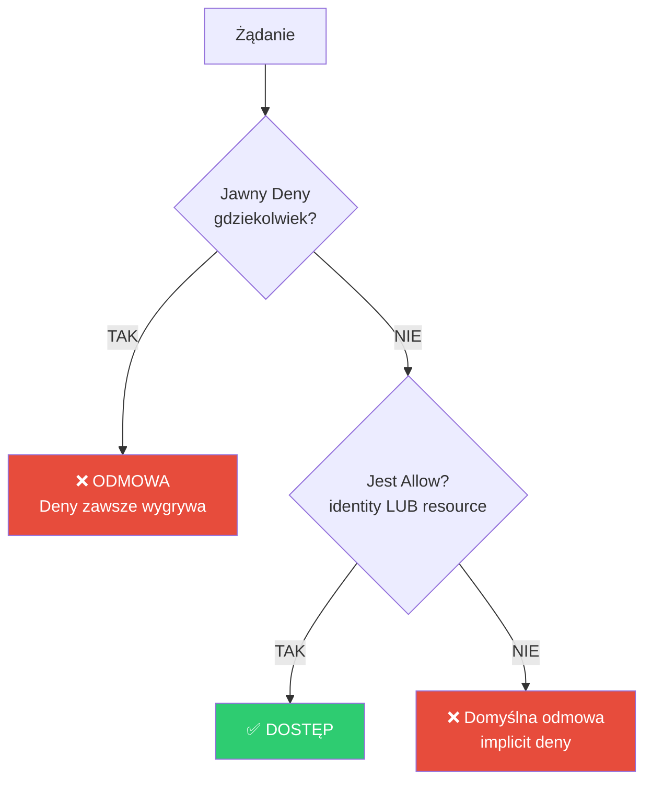

Zasady:
1. **Explicit Deny** zawsze wygrywa (nadrzędne nad wszystkim)
2. W **tym samym koncie**: wystarczy Allow w identity-based **LUB** resource-based
3. **Cross-account**: potrzeba Allow w **OBU** (identity po stronie usera + resource po stronie zasobu)
4. Brak Allow = **implicit deny** (domyślnie wszystko zabronione)

---

## 🌐 Porównanie z innymi chmurami

| Koncept AWS | Azure | GCP | OpenStack |
|-------------|-------|-----|-----------|
| Identity-based policy | Azure RBAC role assignment | IAM role binding | Keystone roles |
| Resource-based policy | rzadko (głównie RBAC scope) | IAM policy na zasobie | — |
| IAM Role + AssumeRole | Managed Identity | Service Account | Keystone trust |
| Trust policy | — (tożsamość zarządzana) | SA impersonation | trust delegation |

> AWS jest wyjątkowy w ostrym rozdziale identity-based vs resource-based. Azure/GCP mocniej stawiają na model przypisań ról (RBAC) z hierarchicznym scope.

---

## ✅ Best practices

- **Managed > Inline** domyślnie (wersjonowanie, reużywalność)
- **Role > długoterminowe access keys** (tymczasowe credentials bezpieczniejsze)
- **Least privilege** — minimalne uprawnienia
- Resource-based policies do **cross-account** zamiast kopiowania userów
- Używaj `Condition` (MFA, IP, tagi) do zawężania

---

## 🔗 Dokumentacja

- [Policies and permissions in IAM](https://docs.aws.amazon.com/IAM/latest/UserGuide/access_policies.html)
- [Identity-based vs resource-based](https://docs.aws.amazon.com/IAM/latest/UserGuide/access_policies_identity-vs-resource.html)
- [IAM Roles](https://docs.aws.amazon.com/IAM/latest/UserGuide/id_roles.html)
- [Policy evaluation logic](https://docs.aws.amazon.com/IAM/latest/UserGuide/reference_policies_evaluation-logic.html)

---

# 👤 AWS — Principal i przykłady Resource-Based Policies

## Czym jest Principal? (prosto)

**Principal** = "KTO" w świecie IAM. To byt, który wykonuje akcję — człowiek, aplikacja, serwis AWS, albo całe konto. Jak imię na zaproszeniu: mówi dokładnie komu wolno wejść.

Pole `Principal` występuje **tylko w resource-based policies** (i trust policies). W identity-based go nie ma — bo principal to już ten, do kogo policy jest przypięta.

---

## Typy Principal

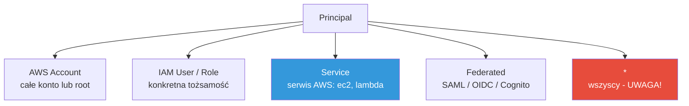

| Typ | Składnia JSON | Znaczenie |
|-----|---------------|-----------|
| **AWS account** | `"AWS": "arn:aws:iam::123456789012:root"` | Całe konto (każdy principal w nim) |
| **IAM user** | `"AWS": "arn:aws:iam::123456789012:user/jan"` | Konkretny user |
| **IAM role** | `"AWS": "arn:aws:iam::123456789012:role/MojaRola"` | Konkretna rola |
| **Service** | `"Service": "lambda.amazonaws.com"` | Serwis AWS działający w twoim imieniu |
| **Federated** | `"Federated": "cognito-identity.amazonaws.com"` | Użytkownik z zewnętrznego IdP |
| **Anonymous** | `"*"` | ⚠️ **KAŻDY na świecie** — publiczny dostęp |

```json
// Jeden statement, wielu principals
"Principal": {
  "AWS": [
    "arn:aws:iam::111122223333:role/App",
    "arn:aws:iam::444455556666:root"
  ]
}
```

> ⚠️ `"Principal": "*"` bez warunków = zasób publiczny. Najczęstsza przyczyna wycieków danych z S3. Zawsze zawężaj `Condition`.

---

## 1️⃣ S3 Bucket Policy

### Przykład A — cross-account read
```json
{
  "Version": "2012-10-17",
  "Statement": [{
    "Sid": "CrossAccountRead",
    "Effect": "Allow",
    "Principal": { "AWS": "arn:aws:iam::111122223333:root" },
    "Action": ["s3:GetObject", "s3:ListBucket"],
    "Resource": [
      "arn:aws:s3:::my-bucket",
      "arn:aws:s3:::my-bucket/*"
    ]
  }]
}
```

### Przykład B — publiczny read TYLKO z firmowego IP
```json
{
  "Effect": "Allow",
  "Principal": "*",
  "Action": "s3:GetObject",
  "Resource": "arn:aws:s3:::public-assets/*",
  "Condition": { "IpAddress": { "aws:SourceIp": "203.0.113.0/24" } }
}
```

### Przykład C — wymuszenie HTTPS (częsty wzorzec bezpieczeństwa)
```json
{
  "Effect": "Deny",
  "Principal": "*",
  "Action": "s3:*",
  "Resource": "arn:aws:s3:::my-bucket/*",
  "Condition": { "Bool": { "aws:SecureTransport": "false" } }
}
```

```bash
# Nałóż bucket policy
aws s3api put-bucket-policy --bucket my-bucket --policy file://policy.json
```

---

## 2️⃣ KMS Key Policy

KMS **wymaga** key policy (inaczej klucz jest nieużywalny). Standardowy wzorzec: root konta zarządza, konkretne role używają.

```json
{
  "Version": "2012-10-17",
  "Statement": [
    {
      "Sid": "Administracja kluczem",
      "Effect": "Allow",
      "Principal": { "AWS": "arn:aws:iam::123456789012:root" },
      "Action": "kms:*",
      "Resource": "*"
    },
    {
      "Sid": "Uzycie klucza do szyfrowania",
      "Effect": "Allow",
      "Principal": { "AWS": "arn:aws:iam::123456789012:role/AppRole" },
      "Action": ["kms:Encrypt", "kms:Decrypt", "kms:GenerateDataKey"],
      "Resource": "*"
    }
  ]
}
```

> `"Resource": "*"` w key policy = "ten właśnie klucz" (policy już jest przypięta do klucza, więc gwiazdka nie oznacza wszystkich kluczy).

---

## 3️⃣ SQS Queue Policy — pozwól SNS publikować

```json
{
  "Version": "2012-10-17",
  "Statement": [{
    "Effect": "Allow",
    "Principal": { "Service": "sns.amazonaws.com" },
    "Action": "sqs:SendMessage",
    "Resource": "arn:aws:sqs:eu-west-1:123456789012:MyQueue",
    "Condition": {
      "ArnEquals": { "aws:SourceArn": "arn:aws:sns:eu-west-1:123456789012:MyTopic" }
    }
  }]
}
```

---

## 4️⃣ Lambda Resource Policy — pozwól API Gateway wywołać

Lambda używa resource policy do kontroli KTO może ją wywołać. Zwykle dodajesz przez `add-permission`:

```bash
aws lambda add-permission \
  --function-name MyFunction \
  --statement-id apigw-invoke \
  --action lambda:InvokeFunction \
  --principal apigateway.amazonaws.com \
  --source-arn "arn:aws:execute-api:eu-west-1:123456789012:abc123/*/GET/"
```

Wygenerowana policy pod spodem:
```json
{
  "Effect": "Allow",
  "Principal": { "Service": "apigateway.amazonaws.com" },
  "Action": "lambda:InvokeFunction",
  "Resource": "arn:aws:lambda:eu-west-1:123456789012:function:MyFunction"
}
```

---

## 5️⃣ Trust Policy roli — przypomnienie

To też resource-based (ma `Principal`). Odpowiada: KTO może założyć rolę. Patrz sekcja [🛡️ IAM](#-aws-iam--identity-based-vs-resource-based-policies).

```json
{
  "Effect": "Allow",
  "Principal": { "Service": "ec2.amazonaws.com" },
  "Action": "sts:AssumeRole"
}
```

---

## 📋 Gdzie są resource-based policies?

| Zasób | Jak się nazywa | Obowiązkowa? |
|-------|----------------|--------------|
| S3 | Bucket Policy | nie |
| KMS | Key Policy | ✅ tak |
| SQS / SNS | Access Policy | nie |
| Lambda | Resource-based policy | nie |
| ECR | Repository Policy | nie |
| Secrets Manager | Resource Policy | nie |
| IAM Role | Trust Policy | ✅ tak |
| API Gateway | Resource Policy | nie |

---

## ✅ Zasady bezpieczeństwa

- **Nigdy `Principal: "*"` bez `Condition`** (publiczny zasób = ryzyko wycieku)
- Preferuj **konkretny ARN roli** zamiast `root` całego konta (least privilege)
- Używaj `aws:SourceArn` / `aws:SourceAccount` by zapobiec **confused deputy** (podszywanie się)
- Wymuszaj `aws:SecureTransport` (HTTPS) na wrażliwych zasobach

---

## 🔗 Dokumentacja

- [AWS JSON policy: Principal](https://docs.aws.amazon.com/IAM/latest/UserGuide/reference_policies_elements_principal.html)
- [Bucket policy examples](https://docs.aws.amazon.com/AmazonS3/latest/userguide/example-bucket-policies.html)
- [KMS key policies](https://docs.aws.amazon.com/kms/latest/developerguide/key-policies.html)
- [Confused deputy prevention](https://docs.aws.amazon.com/IAM/latest/UserGuide/confused-deputy.html)

---

# 🕵️ Confused Deputy Problem

## Prosto na start

**Confused deputy** = zastępca, który został oszukany, by nadużyć swoich uprawnień w imieniu kogoś złego.

Analogia życiowa: dajesz portierowi klucz uniwersalny (ma dostęp do wszystkich pokoi). Ktoś podchodzi i mówi "otwórz pokój 302". Portier nie sprawdza czy to twój pokój — po prostu otwiera, bo MA klucz. Złodziej właśnie użył uprawnień portiera, których sam nie miał.

**Deputy (zastępca)** = byt z uprawnieniami (portier, serwis AWS).
**Confused (zdezorientowany)** = nadużywa ich, bo nie weryfikuje kto naprawdę prosi.

---

## W kontekście AWS

Problem pojawia się przy **cross-account access**, gdy serwis AWS działa w twoim imieniu i uzyskuje dostęp do zasobów innego konta.

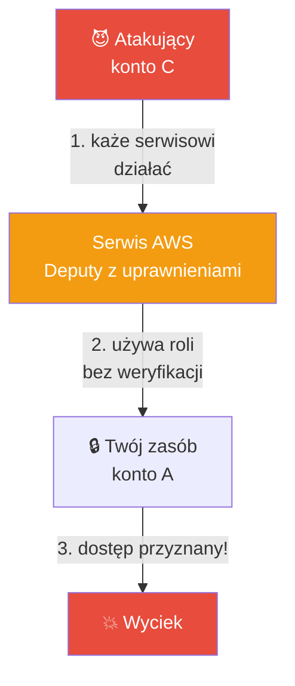

### Scenariusz konkretny
1. Tworzysz rolę pozwalającą serwisowi (np. CloudTrail, Config) zapisywać do **twojego** S3/konta.
2. Trust policy mówi tylko: `"Principal": { "Service": "cloudtrail.amazonaws.com" }`.
3. **Problem:** KAŻDY klient tego serwisu — także atakujący z innego konta — może poprosić serwis, by działał na twoim zasobie, jeśli zna/zgadnie ARN.
4. Serwis (deputy) wykonuje akcję, bo trust policy nie sprawdza **które konto** go uruchomiło.

---

## Rozwiązanie — warunki `aws:SourceArn` i `aws:SourceAccount`

Zawężasz trust/resource policy tak, by serwis działał TYLKO gdy żądanie pochodzi z twojego konkretnego zasobu/konta.

### ❌ Podatna policy
```json
{
  "Effect": "Allow",
  "Principal": { "Service": "cloudtrail.amazonaws.com" },
  "Action": "sts:AssumeRole"
}
```

### ✅ Zabezpieczona policy
```json
{
  "Effect": "Allow",
  "Principal": { "Service": "cloudtrail.amazonaws.com" },
  "Action": "sts:AssumeRole",
  "Condition": {
    "StringEquals": {
      "aws:SourceAccount": "123456789012"
    },
    "ArnLike": {
      "aws:SourceArn": "arn:aws:cloudtrail:eu-west-1:123456789012:trail/MyTrail"
    }
  }
}
```

Teraz serwis użyje roli **tylko** gdy prawdziwym źródłem żądania jest trail z konta `123456789012`. Atakujący z konta C zostanie odrzucony.

| Warunek | Co sprawdza |
|---------|-------------|
| `aws:SourceAccount` | Z którego konta pochodzi oryginalne żądanie |
| `aws:SourceArn` | Który konkretny zasób wywołał serwis |

---

## 🔗 Powiązanie — External ID (dla third-party)

Przy dostępie dla **zewnętrznej firmy** (np. SaaS monitoring, który assume'uje rolę w twoim koncie) używa się **External ID** — sekretnego ciągu uzgodnionego z dostawcą:

```json
{
  "Effect": "Allow",
  "Principal": { "AWS": "arn:aws:iam::VENDOR-ACCOUNT:root" },
  "Action": "sts:AssumeRole",
  "Condition": {
    "StringEquals": { "sts:ExternalId": "unikalny-sekret-12345" }
  }
}
```

Chroni przed confused deputy w scenariuszu, gdy ten sam dostawca obsługuje wielu klientów — bez External ID klient X mógłby podszyć się pod klienta Y u tego samego dostawcy.

---

## 📊 Porównanie mechanizmów ochrony

| Scenariusz | Mechanizm | Kiedy |
|------------|-----------|-------|
| Serwis AWS działa w twoim imieniu | `aws:SourceArn` + `aws:SourceAccount` | CloudTrail, Config, SNS → S3/SQS |
| Zewnętrzny dostawca (SaaS) assume'uje rolę | `sts:ExternalId` | Datadog, monitoring 3rd-party |

---

## 🌐 Czy to tylko AWS?

Nie — **confused deputy to ogólny problem bezpieczeństwa** (termin z 1988, Norm Hardy). Występuje wszędzie gdzie pośrednik działa z wyższymi uprawnieniami:
- **GCP** — podobnie przez `serviceAccount` impersonation, zabezpieczane warunkami
- **CSRF w webie** — przeglądarka (deputy) wysyła cookie użytkownika do złośliwego żądania
- **Setuid w Unix** — program z podwyższonymi prawami oszukany, by działał na cudzych plikach

---

## ✅ Esencja

- **Deputy** = byt z uprawnieniami działający w czyimś imieniu
- **Confused** = nie weryfikuje KTO naprawdę go prosi → nadużycie
- Ochrona AWS: `aws:SourceArn` + `aws:SourceAccount` (serwisy), `sts:ExternalId` (third-party)
- Zasada: zawsze zawężaj KTO i SKĄD, nie ufaj samemu `Service` principalowi

---

## 🔗 Dokumentacja

- [The confused deputy problem (AWS)](https://docs.aws.amazon.com/IAM/latest/UserGuide/confused-deputy.html)
- [How to use external ID](https://docs.aws.amazon.com/IAM/latest/UserGuide/id_roles_create_for-user_externalid.html)

---

# 📜 AWS IAM Policies — struktura, Actions, Conditions

## Prosto na start

**IAM Policy** = dokument JSON, który jest regulaminem dostępu. Mówi: *kto* może zrobić *co*, na *czym* i *pod jakimi warunkami*. Jak regulamin basenu: "dzieci (kto) mogą pływać (co) w brodziku (na czym) tylko pod opieką dorosłego (warunek)".

---

## 🧱 Z czego składa się policy?

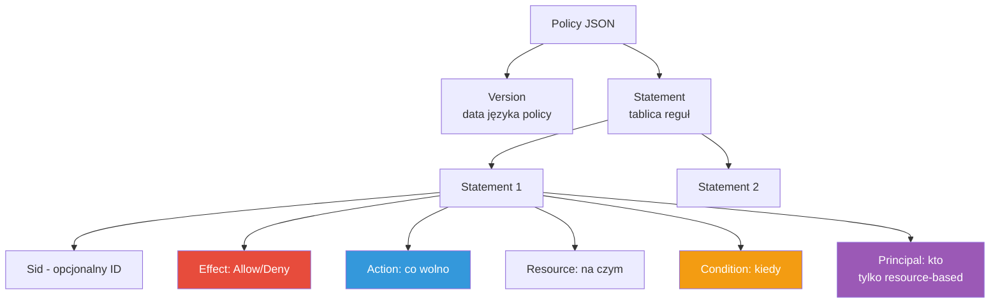

| Element | Obowiązkowy? | Opis |
|---------|--------------|------|
| `Version` | ✅ | Wersja języka policy — zawsze `"2012-10-17"` (najnowsza) |
| `Statement` | ✅ | Tablica reguł (jedna lub wiele) |
| `Sid` | ❌ | Statement ID — etykieta opisowa |
| `Effect` | ✅ | `Allow` lub `Deny` |
| `Action` | ✅ | Jakie operacje |
| `Resource` | ✅* | Na jakich zasobach (*w resource-based może być `"*"`) |
| `Principal` | tylko resource-based | KTO |
| `Condition` | ❌ | Dodatkowe warunki |

---

## Szkielet policy

```json
{
  "Version": "2012-10-17",
  "Statement": [
    {
      "Sid": "PozwolNaOdczytS3",
      "Effect": "Allow",
      "Action": ["s3:GetObject", "s3:ListBucket"],
      "Resource": ["arn:aws:s3:::my-bucket", "arn:aws:s3:::my-bucket/*"]
    }
  ]
}
```

---

## 🎬 Actions — co można zrobić

**Action** = konkretna operacja API danego serwisu. Format: `serwis:Operacja`.

```
s3:GetObject          sqs:SendMessage       ec2:StartInstances
│  │                  │   │
serwis operacja       serwis operacja
```

### Przykłady Actions
| Action | Co robi |
|--------|---------|
| `s3:GetObject` | Pobierz plik z S3 |
| `s3:PutObject` | Wgraj plik do S3 |
| `ec2:RunInstances` | Uruchom instancję EC2 |
| `dynamodb:Query` | Zapytanie do DynamoDB |
| `iam:CreateUser` | Stwórz usera IAM |

### Wildcardy w Action
```json
"Action": "s3:*"              // wszystkie operacje S3
"Action": "s3:Get*"           // wszystkie zaczynające się od Get (GetObject, GetBucketAcl...)
"Action": ["s3:GetObject", "s3:PutObject"]   // lista konkretnych
"Action": "*"                 // ⚠️ WSZYSTKO — tylko dla AdministratorAccess
```

### NotAction (rzadziej)
```json
"NotAction": "s3:DeleteObject"   // wszystko OPRÓCZ tej akcji
```

> Kiedy używać Action: **zawsze** — to serce policy. Zasada least privilege: wymieniaj konkretne akcje, unikaj `*`.

---

## 🎚️ Conditions — kiedy reguła obowiązuje

**Condition** = dodatkowy warunek, który musi być spełniony, by policy zadziałała. To filtr kontekstu żądania (IP, czas, MFA, tagi, szyfrowanie).

Struktura: `operator → klucz → wartość`.

```json
"Condition": {
  "IpAddress": {                    // operator
    "aws:SourceIp": "203.0.113.0/24"  // klucz: wartość
  }
}
```

### Popularne operatory i klucze

| Operator | Klucz przykładowy | Znaczenie |
|----------|-------------------|-----------|
| `StringEquals` | `aws:PrincipalTag/dept` | Dokładne dopasowanie stringa |
| `StringLike` | `s3:prefix` | Z wildcardami |
| `IpAddress` | `aws:SourceIp` | Żądanie z danego IP/CIDR |
| `DateGreaterThan` | `aws:CurrentTime` | Po konkretnej dacie |
| `Bool` | `aws:SecureTransport` | HTTPS tak/nie |
| `Bool` | `aws:MultiFactorAuthPresent` | Czy użyto MFA |
| `ArnLike` | `aws:SourceArn` | Dopasowanie ARN (confused deputy) |

### Przykłady Conditions

**Wymuś MFA:**
```json
"Condition": { "Bool": { "aws:MultiFactorAuthPresent": "true" } }
```

**Tylko z firmowej sieci:**
```json
"Condition": { "IpAddress": { "aws:SourceIp": ["203.0.113.0/24", "198.51.100.0/24"] } }
```

**Dostęp tylko do plików w folderze usera (tagi/zmienne):**
```json
"Condition": {
  "StringLike": { "s3:prefix": "${aws:username}/*" }
}
```

**Wymuś szyfrowanie przy uploadzie:**
```json
"Condition": {
  "StringNotEquals": { "s3:x-amz-server-side-encryption": "aws:kms" }
}
```

> Kiedy używać Condition: gdy chcesz **zawęzić** dostęp poza samym "kto/co/gdzie" — bezpieczeństwo (MFA, IP, HTTPS), multi-tenancy (tagi), ochrona (SourceArn). Opcjonalne, ale kluczowe dla least privilege.

---

## 📦 Pełne przykłady policies

### 1. Developer — pełny S3 do jednego bucketa, tylko z MFA
```json
{
  "Version": "2012-10-17",
  "Statement": [{
    "Sid": "S3FullAccessWithMFA",
    "Effect": "Allow",
    "Action": "s3:*",
    "Resource": ["arn:aws:s3:::dev-bucket", "arn:aws:s3:::dev-bucket/*"],
    "Condition": { "Bool": { "aws:MultiFactorAuthPresent": "true" } }
  }]
}
```

### 2. Read-only wszystko + jawny Deny na usuwanie
```json
{
  "Version": "2012-10-17",
  "Statement": [
    { "Effect": "Allow", "Action": ["s3:Get*", "s3:List*"], "Resource": "*" },
    { "Effect": "Deny", "Action": "s3:DeleteObject", "Resource": "*" }
  ]
}
```
> Drugi statement (Deny) nadpisuje pierwszy — explicit deny zawsze wygrywa.

### 3. Ogranicz region i wymuś HTTPS
```json
{
  "Version": "2012-10-17",
  "Statement": [{
    "Effect": "Allow",
    "Action": "ec2:*",
    "Resource": "*",
    "Condition": {
      "StringEquals": { "aws:RequestedRegion": "eu-west-1" },
      "Bool": { "aws:SecureTransport": "true" }
    }
  }]
}
```

---

## 🧪 Walidacja i testowanie

```bash
# Symuluj czy policy pozwoli na akcję (bez realnego wywołania)
aws iam simulate-principal-policy \
  --policy-source-arn arn:aws:iam::123456789012:user/jan \
  --action-names s3:GetObject \
  --resource-arns arn:aws:s3:::my-bucket/file.txt

# Sprawdź składnię customer managed policy przy tworzeniu
aws iam create-policy --policy-name Test --policy-document file://p.json
```

> W konsoli: **IAM Policy Simulator** i **Access Analyzer** sprawdzają policy przed wdrożeniem.

---

## 🌐 Porównanie z innymi chmurami

| Koncept | AWS | Azure | GCP |
|---------|-----|-------|-----|
| Jednostka uprawnienia | Action (`s3:GetObject`) | Operation (`Microsoft.Storage/.../read`) | Permission (`storage.objects.get`) |
| Dokument | JSON Policy | Role Definition (JSON) | IAM Policy binding |
| Warunki | `Condition` | Conditions (ABAC) | IAM Conditions (CEL) |
| Logika | Allow/Deny explicit | Allow + Deny assignments | głównie Allow (binding) |

---

## ✅ Esencja

- Policy = **Version + Statement[]**; każdy statement = Effect + Action + Resource (+ Condition, +Principal dla resource-based)
- **Action** = co wolno (`serwis:Operacja`); używaj konkretnych, unikaj `*`
- **Condition** = kiedy reguła działa (IP, MFA, HTTPS, tagi); opcjonalne, ale kluczowe dla least privilege
- **Explicit Deny** zawsze wygrywa nad Allow

---

## 🔗 Dokumentacja

- [IAM JSON policy elements reference](https://docs.aws.amazon.com/IAM/latest/UserGuide/reference_policies_elements.html)
- [IAM policy condition keys](https://docs.aws.amazon.com/IAM/latest/UserGuide/reference_policies_condition-keys.html)
- [Actions, resources, condition keys per service](https://docs.aws.amazon.com/service-authorization/latest/reference/reference_policies_actions-resources-contextkeys.html)
- [Policy Simulator](https://docs.aws.amazon.com/IAM/latest/UserGuide/access_policies_testing-policies.html)

---

# 🧱 AWS — Security Boundaries, Credential Reports, Federacja (SAML/OIDC)

## Część 1: Security Boundaries (granice uprawnień)

### Prosto na start

**Security boundary** = sufit uprawnień. Nawet jeśli dasz komuś policy "możesz wszystko", boundary mówi "ale nie wyżej niż tu". Jak limit na karcie: masz pensję 10 000, ale karta ma dzienny limit 500 — nie przebijesz go, nawet mając kasę.

AWS ma dwa główne mechanizmy sufitu: **Permissions Boundaries** i **Service Control Policies (SCP)**.

### Jak działają razem — model warstw

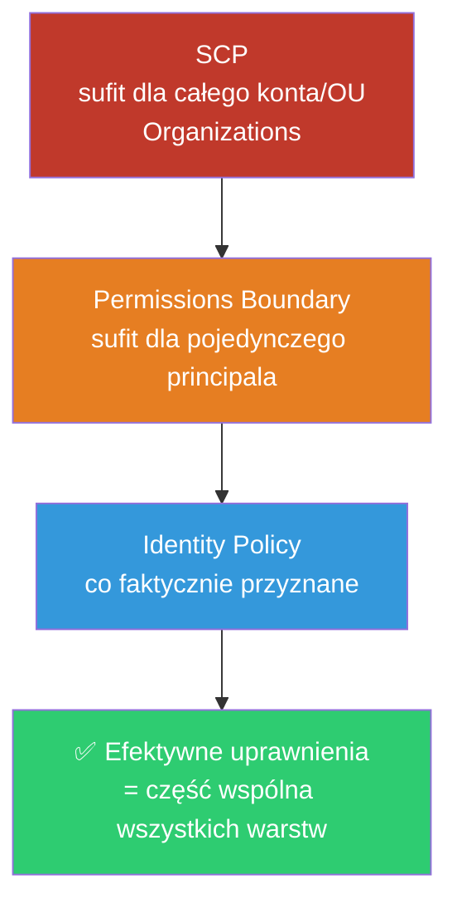

Efektywne uprawnienia = **przecięcie (AND)** wszystkich warstw. Akcja dozwolona tylko jeśli pozwala ją KAŻDA warstwa.

| Mechanizm | Zakres | Kto ustawia | Cel |
|-----------|--------|-------------|-----|
| **SCP** | Całe konto / OU w Organizations | Admin organizacji | Sufit dla wszystkich w koncie |
| **Permissions Boundary** | Pojedynczy user/role | Admin IAM | Sufit dla delegacji uprawnień |

### Permissions Boundary — przykład

Boundary to policy przypięta jako "sufit":
```json
{
  "Version": "2012-10-17",
  "Statement": [{
    "Effect": "Allow",
    "Action": ["s3:*", "cloudwatch:*"],
    "Resource": "*"
  }]
}
```
Jeśli user ma identity policy z `ec2:*`, ale boundary pozwala tylko `s3:*` + `cloudwatch:*` → **EC2 zablokowane** (poza sufitem).

```bash
# Przypnij permissions boundary do usera
aws iam put-user-permissions-boundary \
  --user-name dev-jan \
  --permissions-boundary arn:aws:iam::123456789012:policy/DevBoundary
```

> Typowy use case: pozwalasz juniorom tworzyć role, ale boundary gwarantuje że nie stworzą roli silniejszej niż sufit (zapobiega privilege escalation).

### SCP — przykład (Organizations)
```json
{
  "Version": "2012-10-17",
  "Statement": [{
    "Sid": "DenyPozaEuropa",
    "Effect": "Deny",
    "Action": "*",
    "Resource": "*",
    "Condition": {
      "StringNotEquals": { "aws:RequestedRegion": ["eu-west-1", "eu-central-1"] }
    }
  }]
}
```
> SCP **nie przyznaje** uprawnień — tylko ogranicza. To czysty sufit. Nawet root konta nie przebije SCP.

---

## Część 2: AWS Credential Reports (raporty bezpieczeństwa)

### Prosto na start

**Credential Report** = raport CSV o stanie wszystkich kont i kluczy w twoim koncie AWS. Jak przegląd techniczny samochodu: pokazuje co stare, co niezabezpieczone, co trzeba wymienić (hasła, klucze, MFA).

### Co zawiera?

| Kolumna | Co pokazuje | Czerwona flaga |
|---------|-------------|----------------|
| `password_enabled` | Czy user ma hasło do konsoli | — |
| `password_last_used` | Kiedy ostatnio logowanie | dawno = martwe konto |
| `mfa_active` | Czy włączone MFA | `false` = ryzyko |
| `access_key_1_active` | Czy klucz aktywny | — |
| `access_key_1_last_rotated` | Kiedy rotowano klucz | dawno = rotuj! |
| `access_key_1_last_used_date` | Ostatnie użycie klucza | nieużywany = usuń |

### Generowanie i pobieranie
```bash
# Wygeneruj raport (asynchronicznie)
aws iam generate-credential-report

# Pobierz (base64 → CSV)
aws iam get-credential-report \
  --query 'Content' --output text | base64 --decode > report.csv
```

### Powiązane narzędzia bezpieczeństwa
| Narzędzie | Do czego |
|-----------|----------|
| **Credential Report** | Stan kont/kluczy/MFA (CSV) |
| **Access Advisor** | Kiedy ostatnio użyto usługi (last accessed) — do przycinania uprawnień |
| **IAM Access Analyzer** | Wykrywa zasoby dostępne z zewnątrz / nieużywany dostęp |
| **CloudTrail** | Audyt kto co zrobił (log zdarzeń) |

```bash
# Access Advisor — co ta rola faktycznie używała
aws iam generate-service-last-accessed-details \
  --arn arn:aws:iam::123456789012:role/MojaRola
```

> Praktyka: regularnie czytaj credential report → znajdź klucze starsze niż 90 dni, konta bez MFA, nieużywane access keys → rotuj/usuwaj.

---

## Część 3: Federacja z zewnętrznymi IdP (SAML i OIDC)

### Prosto na start

**Federacja** = logowanie do AWS tożsamością z innego systemu (Google, Azure AD, Okta, GitHub), BEZ tworzenia userów IAM. Jak "Zaloguj przez Google" na stronach — AWS ufa zewnętrznemu dostawcy, że cię zweryfikował.

**IdP (Identity Provider)** = system który potwierdza twoją tożsamość. AWS = **Service Provider** (ufa IdP).

### Po co?
- Jedno logowanie (SSO) do wielu systemów
- Brak zarządzania setkami userów IAM
- Centralne zarządzanie w korporacyjnym katalogu (Azure AD / Okta)
- Tymczasowe credentials zamiast stałych kluczy

### SAML 2.0 vs OIDC

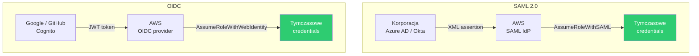

| Cecha | **SAML 2.0** | **OIDC (OpenID Connect)** |
|-------|--------------|---------------------------|
| Format tokenu | XML assertion | JWT (JSON) |
| Typ scenariusza | Korporacyjny SSO (pracownicy) | Web/mobile apps, CI/CD |
| Typowi dostawcy | Azure AD, Okta, ADFS, Ping | Google, GitHub, Cognito, Auth0 |
| STS API | `AssumeRoleWithSAML` | `AssumeRoleWithWebIdentity` |
| Wiek/styl | Starszy, enterprise | Nowoczesny, lekki (OAuth 2.0) |

### Jak to działa — przepływ

1. Tworzysz **Identity Provider** w IAM (rejestrujesz metadata IdP).
2. Tworzysz **rolę** z trust policy ufającą temu IdP.
3. User loguje się u IdP → dostaje token (SAML assertion / JWT).
4. AWS wymienia token na **tymczasowe credentials** przez STS.

### Trust policy dla OIDC (np. GitHub Actions — bardzo popularne)
```json
{
  "Version": "2012-10-17",
  "Statement": [{
    "Effect": "Allow",
    "Principal": {
      "Federated": "arn:aws:iam::123456789012:oidc-provider/token.actions.githubusercontent.com"
    },
    "Action": "sts:AssumeRoleWithWebIdentity",
    "Condition": {
      "StringEquals": {
        "token.actions.githubusercontent.com:aud": "sts.amazonaws.com"
      },
      "StringLike": {
        "token.actions.githubusercontent.com:sub": "repo:MyOrg/MyRepo:ref:refs/heads/main"
      }
    }
  }]
}
```
> To pozwala GitHub Actions z konkretnego repo/brancha wejść do AWS **bez przechowywania access keys** w sekretach — nowoczesny best practice.

### Trust policy dla SAML
```json
{
  "Effect": "Allow",
  "Principal": { "Federated": "arn:aws:iam::123456789012:saml-provider/AzureAD" },
  "Action": "sts:AssumeRoleWithSAML",
  "Condition": {
    "StringEquals": { "SAML:aud": "https://signin.aws.amazon.com/saml" }
  }
}
```

### Rejestracja IdP (CLI)
```bash
# OIDC provider (np. GitHub)
aws iam create-open-id-connect-provider \
  --url https://token.actions.githubusercontent.com \
  --client-id-list sts.amazonaws.com \
  --thumbprint-list <THUMBPRINT>

# SAML provider
aws iam create-saml-provider \
  --name AzureAD \
  --saml-metadata-document file://metadata.xml
```

### 🌐 Odpowiedniki w chmurach

| | AWS | Azure | GCP |
|---|-----|-------|-----|
| Federacja korporacyjna | IAM SAML/OIDC Identity Provider | Entra ID (natywnie IdP) | Workload Identity Federation |
| SSO zarządzane | IAM Identity Center (dawniej SSO) | Entra ID | Cloud Identity |
| Web/mobile tożsamości | Cognito | Azure AD B2C | Identity Platform |

> AWS rekomenduje dziś **IAM Identity Center** (dawniej AWS SSO) jako nadrzędny sposób federacji dla organizacji — zamiast ręcznego konfigurowania SAML provider per konto.

---

## ✅ Esencja całości

- **Security boundary** = sufit uprawnień. SCP (konto/OU), Permissions Boundary (principal). Efekt = przecięcie warstw.
- **Credential Report** = CSV o stanie kluczy/MFA/haseł → audyt i rotacja. Uzupełnij Access Advisor + Access Analyzer.
- **Federacja** = logowanie zewnętrzną tożsamością bez userów IAM. **SAML** (XML, enterprise SSO) vs **OIDC** (JWT, web/CI/CD). Oba kończą się tymczasowymi credentials przez STS.

---

## 🔗 Dokumentacja

- [Permissions boundaries](https://docs.aws.amazon.com/IAM/latest/UserGuide/access_policies_boundaries.html)
- [Service Control Policies](https://docs.aws.amazon.com/organizations/latest/userguide/orgs_manage_policies_scps.html)
- [Getting credential reports](https://docs.aws.amazon.com/IAM/latest/UserGuide/id_credentials_getting-report.html)
- [SAML federation](https://docs.aws.amazon.com/IAM/latest/UserGuide/id_roles_providers_saml.html)
- [OIDC federation](https://docs.aws.amazon.com/IAM/latest/UserGuide/id_roles_providers_oidc.html)
- [GitHub Actions OIDC](https://docs.github.com/en/actions/deployment/security-hardening-your-deployments/configuring-openid-connect-in-amazon-web-services)

---

# 🎫 AWS STS + Federacja z Keycloak

## Część 1: Co to jest STS?

### Prosto na start

**STS (Security Token Service)** = automat wydający **tymczasowe przepustki** do AWS. Zamiast stałego klucza (który może wyciec i działa wiecznie), dostajesz bilet ważny np. 1 godzinę, po czym wygasa. Jak karta hotelowa: działa tylko na czas pobytu, potem bezużyteczna.

### Co zwraca STS?

Zestaw **3 tymczasowych credentials**:

| Element | Rola |
|---------|------|
| `AccessKeyId` | Identyfikator (jak login) |
| `SecretAccessKey` | Sekret (jak hasło) |
| `SessionToken` | Dodatkowy token potwierdzający tymczasowość |
| `Expiration` | Data wygaśnięcia (15 min – 12h) |

### Główne operacje STS

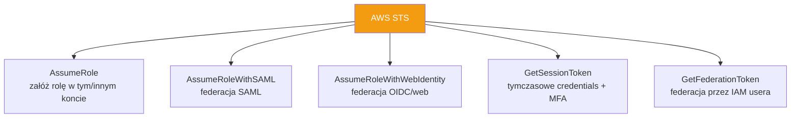

| Operacja | Kiedy użyć |
|----------|------------|
| `AssumeRole` | Cross-account, przełączanie ról, EC2/Lambda z rolą |
| `AssumeRoleWithSAML` | Logowanie korporacyjne (Azure AD, Okta) |
| `AssumeRoleWithWebIdentity` | OIDC (Google, GitHub, **Keycloak**, Cognito) |
| `GetSessionToken` | Wzmocnienie sesji IAM usera o MFA |
| `GetCallerIdentity` | "Kim jestem?" — debug tożsamości |

### Przykłady CLI

```bash
# Kim jestem teraz? (bardzo przydatne do debug)
aws sts get-caller-identity

# Załóż rolę → dostań tymczasowe credentials
aws sts assume-role \
  --role-arn arn:aws:iam::123456789012:role/MojaRola \
  --role-session-name sesja-jan \
  --duration-seconds 3600
```

### Dlaczego STS to best practice?

| Stałe access keys | Tymczasowe (STS) |
|-------------------|------------------|
| Nigdy nie wygasają | Wygasają automatycznie |
| Wyciek = trwałe ryzyko | Wyciek = ryzyko tylko do expiry |
| Trzeba ręcznie rotować | Auto-rotacja |
| Trudny audyt | Każda sesja identyfikowalna |

> STS jest fundamentem **całej federacji i ról** w AWS. Każde `AssumeRole*` pod spodem woła STS.

---

## Część 2: Federacja AWS z Keycloak

### Co to Keycloak?

**Keycloak** = open-source Identity Provider (IdP) od Red Hat. Obsługuje **OIDC** i **SAML**. Self-hosted alternatywa dla Okta/Azure AD. Zarządzasz userami, grupami, rolami w jednym miejscu, a aplikacje (w tym AWS) mu ufają.

### Architektura federacji

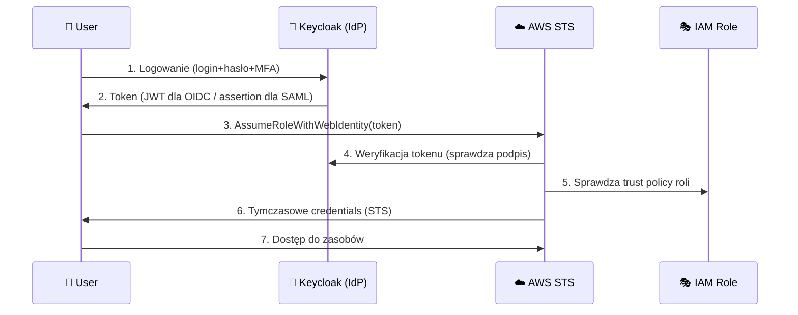

### Dwie drogi: OIDC vs SAML z Keycloak

| | OIDC z Keycloak | SAML z Keycloak |
|---|-----------------|-----------------|
| Token | JWT | XML assertion |
| STS call | `AssumeRoleWithWebIdentity` | `AssumeRoleWithSAML` |
| Konfiguracja AWS | OIDC provider | SAML provider |
| Typowe użycie | Aplikacje, API, konsola przez broker | Dostęp do konsoli AWS (SSO) |
| Zalecane dla | Nowe wdrożenia | Klasyczne SSO do konsoli |

---

### Wariant A — OIDC (nowoczesny)

#### Krok 1: W Keycloak
- Utwórz **realm** (np. `company`)
- Utwórz **client** (np. `aws-client`) typu OIDC
- Keycloak wystawia OIDC discovery URL:
  `https://keycloak.example.com/realms/company/.well-known/openid-configuration`

#### Krok 2: W AWS — zarejestruj Keycloak jako OIDC provider
```bash
aws iam create-open-id-connect-provider \
  --url https://keycloak.example.com/realms/company \
  --client-id-list aws-client \
  --thumbprint-list <THUMBPRINT_CERTYFIKATU>
```

#### Krok 3: Trust policy roli — ufa Keycloak
```json
{
  "Version": "2012-10-17",
  "Statement": [{
    "Effect": "Allow",
    "Principal": {
      "Federated": "arn:aws:iam::123456789012:oidc-provider/keycloak.example.com/realms/company"
    },
    "Action": "sts:AssumeRoleWithWebIdentity",
    "Condition": {
      "StringEquals": {
        "keycloak.example.com/realms/company:aud": "aws-client"
      }
    }
  }]
}
```

#### Krok 4: Wymiana tokenu na credentials
```bash
# Po zdobyciu JWT z Keycloak:
aws sts assume-role-with-web-identity \
  --role-arn arn:aws:iam::123456789012:role/KeycloakUserRole \
  --role-session-name jan-sesja \
  --web-identity-token <JWT_Z_KEYCLOAK>
```

---

### Wariant B — SAML (do konsoli AWS)

#### Krok 1: W Keycloak
- Dodaj **SAML client** z entity ID: `urn:amazon:webservices`
- Skonfiguruj mapper ról (Keycloak wysyła ARN roli w assertion)
- Pobierz **metadata XML** Keycloaka

#### Krok 2: W AWS — zarejestruj SAML provider
```bash
aws iam create-saml-provider \
  --name Keycloak \
  --saml-metadata-document file://keycloak-metadata.xml
```

#### Krok 3: Trust policy roli
```json
{
  "Effect": "Allow",
  "Principal": { "Federated": "arn:aws:iam::123456789012:saml-provider/Keycloak" },
  "Action": "sts:AssumeRoleWithSAML",
  "Condition": {
    "StringEquals": { "SAML:aud": "https://signin.aws.amazon.com/saml" }
  }
}
```

#### Mapowanie grup Keycloak → role AWS
Keycloak w assertion wysyła atrybut `https://aws.amazon.com/SAML/Attributes/Role` z parą:
```
arn:aws:iam::123456789012:role/Admins,arn:aws:iam::123456789012:saml-provider/Keycloak
```
Dzięki temu grupa `admins` w Keycloak → rola `Admins` w AWS. Zarządzasz dostępem **przez grupy w Keycloak**, nie dotykając IAM.

---

### 🔑 Kluczowe elementy do dopasowania

| Po stronie Keycloak | Po stronie AWS | Musi się zgadzać |
|---------------------|----------------|------------------|
| Realm URL / issuer | OIDC provider URL | ✅ dokładnie |
| Client ID (`aud`) | Condition `aud` w trust policy | ✅ |
| Certyfikat podpisujący | Thumbprint (OIDC) / metadata (SAML) | ✅ |
| Mapper ról | ARN roli w trust policy | ✅ |

---

### Porównanie — Keycloak vs managed IdP

| | Keycloak | Azure AD / Okta |
|---|----------|-----------------|
| Hosting | Self-hosted (ty zarządzasz) | SaaS (dostawca) |
| Koszt | Darmowy (ale własna infra) | Licencja/subskrypcja |
| OIDC + SAML | ✅ oba | ✅ oba |
| Kontrola | Pełna | Ograniczona |
| Utrzymanie | Na tobie (patche, HA) | Na dostawcy |

> Keycloak popularny gdy: chcesz kontroli, masz już Keycloak dla innych aplikacji, lub unikasz vendor lock-in. AWS traktuje go jak każdego innego OIDC/SAML IdP — mechanizm identyczny.

---

## ✅ Esencja

- **STS** = automat tymczasowych credentials (AccessKey + Secret + SessionToken + Expiration). Fundament ról i federacji. Każde `AssumeRole*` woła STS.
- **Keycloak** = self-hosted IdP (OIDC + SAML). AWS ufa mu jak każdemu IdP.
- **OIDC path**: `create-open-id-connect-provider` → trust policy z `AssumeRoleWithWebIdentity` → wymiana JWT na credentials.
- **SAML path**: `create-saml-provider` → trust policy z `AssumeRoleWithSAML` → mapowanie grup Keycloak na role AWS (SSO do konsoli).
- Najważniejsze: **issuer, client ID (aud) i certyfikat muszą się zgadzać** po obu stronach.

---

## 🔗 Dokumentacja

- [AWS STS](https://docs.aws.amazon.com/STS/latest/APIReference/welcome.html)
- [Temporary security credentials](https://docs.aws.amazon.com/IAM/latest/UserGuide/id_credentials_temp.html)
- [Keycloak docs](https://www.keycloak.org/documentation)
- [AssumeRoleWithWebIdentity](https://docs.aws.amazon.com/STS/latest/APIReference/API_AssumeRoleWithWebIdentity.html)

---

# 👥 AWS IAM — Tożsamości i Role (przekrojowo)

## Mapa pojęć na start

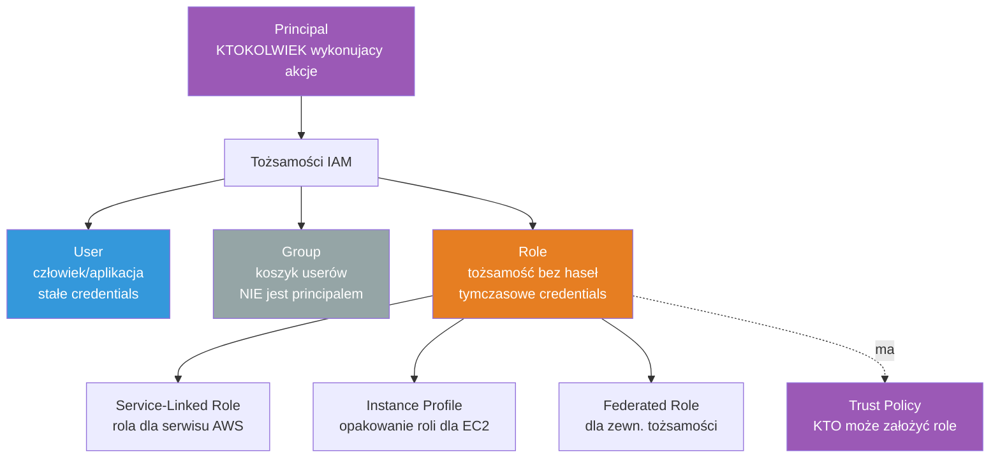

---

## 1️⃣ Principal — fundament

**Principal** = ktokolwiek/cokolwiek wykonujący akcję w AWS. To pojęcie **nadrzędne**, nie konkretny obiekt. Principalem może być:
- IAM User
- IAM Role (po założeniu)
- Serwis AWS (`ec2.amazonaws.com`)
- Użytkownik federowany
- Root konta

> Principal to "aktor" w systemie. User/Role to konkretne **typy** principali. Jak "pojazd" (principal) vs "samochód/motor" (user/role).

---

## 2️⃣ User — tożsamość człowieka/aplikacji

**IAM User** = trwała tożsamość ze **stałymi credentials**:
- Hasło (konsola) i/lub access keys (CLI/API)
- Credentials **nie wygasają** same

```bash
aws iam create-user --user-name jan
aws iam create-access-key --user-name jan   # klucze CLI/API
```

| Zalety | Wady |
|--------|------|
| Proste | Stałe klucze = ryzyko wycieku |
| Działa od razu | Trudna rotacja na skalę |

> Best practice: **unikaj userów** dla ludzi — używaj federacji/SSO. User tylko gdy naprawdę potrzeba stałych kluczy (np. legacy system).

---

## 3️⃣ Group — koszyk userów

**IAM Group** = kontener grupujący userów, by nadać im wspólne policies. ⚠️ **Group NIE jest principalem** — nie można "działać jako grupa", nie można do niej assume'ować.

```bash
aws iam create-group --group-name Developers
aws iam add-user-to-group --user-name jan --group-name Developers
aws iam attach-group-policy \
  --group-name Developers \
  --policy-arn arn:aws:iam::aws:policy/AmazonS3ReadOnlyAccess
```

| Fakt | Szczegół |
|------|----------|
| Nie jest principalem | Policy grupy dziedziczą userzy, ale akcję wykonuje user |
| Brak zagnieżdżania | Grupa nie może zawierać grupy |
| Brak credentials | Grupa nie ma kluczy/haseł |

---

## 4️⃣ Role — tożsamość bez stałych haseł

**IAM Role** = tożsamość, którą się **zakłada (assume)** tymczasowo. Zamiast stałych kluczy → **tymczasowe credentials** z STS (wygasają). Jak kostium przejmowany na chwilę.

Rola ma **dwie policies**:
| Policy | Typ | Odpowiada na |
|--------|-----|--------------|
| **Trust Policy** | resource-based | KTO może założyć rolę? |
| **Permission Policy** | identity-based | CO rola może robić? |

```bash
aws iam create-role \
  --role-name MojaRola \
  --assume-role-policy-document file://trust.json   # trust policy

aws iam attach-role-policy \
  --role-name MojaRola \
  --policy-arn arn:aws:iam::aws:policy/AmazonS3ReadOnlyAccess   # permission
```

> Role to **domyślny, zalecany** sposób dawania uprawnień — aplikacjom, serwisom, ludziom (przez SSO). Brak stałych kluczy = bezpieczniej.

---

## 5️⃣ Trust Policy — brama do roli

**Trust Policy** = resource-based policy przypięta do roli. Definiuje **KTO może ją założyć** (principal + warunki). Bez trust policy rola jest bezużyteczna — nikt nie wejdzie.

```json
{
  "Version": "2012-10-17",
  "Statement": [{
    "Effect": "Allow",
    "Principal": { "Service": "lambda.amazonaws.com" },
    "Action": "sts:AssumeRole"
  }]
}
```

Principal w trust policy decyduje o typie roli:
| Principal | Typ roli |
|-----------|----------|
| `"Service": "ec2.amazonaws.com"` | Rola dla serwisu (EC2) |
| `"AWS": "arn:...:role/Inna"` | Cross-account / role chaining |
| `"Federated": "...saml-provider/..."` | Rola federowana |

---

## 6️⃣ Service-Linked Role — rola należąca do serwisu

**Service-Linked Role (SLR)** = specjalna rola **predefiniowana i zarządzana przez konkretny serwis AWS**. Serwis sam wie, jakich uprawnień potrzebuje. Ty jej (zwykle) nie edytujesz ani nie usuwasz ręcznie.

Przykłady: `AWSServiceRoleForAutoScaling`, `AWSServiceRoleForElasticLoadBalancing`.

```bash
# Tworzenie SLR (często robione automatycznie przy włączeniu usługi)
aws iam create-service-linked-role --aws-service-name autoscaling.amazonaws.com
```

| Zwykła Role | Service-Linked Role |
|-------------|---------------------|
| Ty definiujesz policies | Serwis definiuje (predefiniowane) |
| Ty zarządzasz | Serwis zarządza |
| Dowolny trust | Trust tylko dla tego serwisu |
| Usuwasz kiedy chcesz | Usuwa się dopiero gdy serwis nie używa |

> SLR upraszcza setup — zamiast ręcznie klepać uprawnienia dla np. AutoScaling, serwis dostaje gotową, poprawną rolę.

---

## 7️⃣ Instance Profile — opakowanie roli dla EC2

**Instance Profile** = kontener na rolę, który przypinasz do **instancji EC2**. EC2 nie może "mieć roli" bezpośrednio — potrzebuje instance profile jako pośrednika.

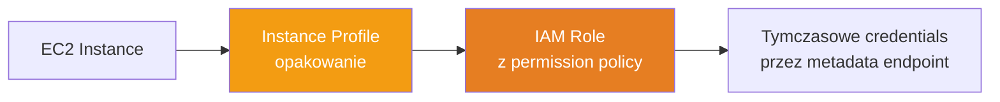

Dzięki temu aplikacja na EC2 dostaje credentials **automatycznie** (przez instance metadata `169.254.169.254`) — bez kluczy w kodzie.

```bash
aws iam create-instance-profile --instance-profile-name MojProfile
aws iam add-role-to-instance-profile \
  --instance-profile-name MojProfile --role-name MojaRola

# Przy uruchamianiu EC2 podajesz instance profile
aws ec2 run-instances --iam-instance-profile Name=MojProfile ...
```

> W konsoli AWS tworzy instance profile **automatycznie** gdy przypinasz rolę do EC2 — przez CLI/IaC często trzeba zrobić to jawnie. 1 instance profile = 1 rola.

---

## 8️⃣ Federated Identity Role — rola dla zewnętrznych tożsamości

**Federated Role** = rola, którą zakładają użytkownicy z **zewnętrznego IdP** (SAML/OIDC: Azure AD, Google, Keycloak, GitHub). Trust policy ufa providerowi federacji zamiast konkretnym userom AWS.

```json
{
  "Effect": "Allow",
  "Principal": {
    "Federated": "arn:aws:iam::123456789012:saml-provider/AzureAD"
  },
  "Action": "sts:AssumeRoleWithSAML",
  "Condition": {
    "StringEquals": { "SAML:aud": "https://signin.aws.amazon.com/saml" }
  }
}
```

> To "most" między światem zewnętrznym a AWS. Zero userów IAM — tożsamości żyją w IdP, AWS tylko wydaje tymczasowe credentials po weryfikacji. Patrz sekcja [🎫 STS + Keycloak](#-aws-sts--federacja-z-keycloak).

---

## 📊 Tabela zbiorcza

| Pojęcie | Principal? | Credentials | Główny cel |
|---------|-----------|-------------|------------|
| **Principal** | — (nadrzędne) | — | Abstrakcja "aktora" |
| **User** | ✅ | Stałe | Człowiek/legacy app |
| **Group** | ❌ | Brak | Grupowanie userów |
| **Role** | ✅ (po assume) | Tymczasowe | Zalecany dostęp |
| **Trust Policy** | — (element roli) | — | KTO wejdzie do roli |
| **Service-Linked Role** | ✅ | Tymczasowe | Serwis AWS działa sam |
| **Instance Profile** | — (kontener) | Tymczasowe (dla EC2) | Rola → EC2 |
| **Federated Role** | ✅ (po assume) | Tymczasowe | Zewnętrzny IdP → AWS |

---

## ✅ Esencja

- **Principal** = aktor (pojęcie nadrzędne); User i Role to jego typy
- **User** = stałe klucze (unikaj dla ludzi); **Group** = tylko koszyk policies, NIE principal
- **Role** = tymczasowe credentials, domyślny zalecany sposób; ma **Trust** (kto wejdzie) + **Permission** (co robi)
- **Service-Linked Role** = rola zarządzana przez serwis AWS
- **Instance Profile** = adapter rola→EC2 (EC2 nie trzyma roli wprost)
- **Federated Role** = most dla tożsamości z zewnętrznego IdP

---

## 🔗 Dokumentacja

- [IAM Identities](https://docs.aws.amazon.com/IAM/latest/UserGuide/id.html)
- [IAM Roles](https://docs.aws.amazon.com/IAM/latest/UserGuide/id_roles.html)
- [Service-linked roles](https://docs.aws.amazon.com/IAM/latest/UserGuide/using-service-linked-roles.html)
- [Instance profiles](https://docs.aws.amazon.com/IAM/latest/UserGuide/id_roles_use_switch-role-ec2_instance-profiles.html)

---

# 🔎 Analiza — Trust Policy dla Keycloak SAML SSO

## Policy którą analizujemy

```json
{
  "Version": "2012-10-17",
  "Statement": [{
    "Sid": "",
    "Effect": "Allow",
    "Principal": { "Federated": "arn:aws:iam::753386176131:saml-provider/KeycloakSSO" },
    "Action": "sts:AssumeRoleWithSAML",
    "Condition": { "StringEquals": { "SAML:aud": "https://signin.aws.amazon.com/saml" } }
  }]
}
```

## Co to w jednym zdaniu

To **trust policy roli** mówiąca: *"Użytkownik zalogowany przez Keycloak (SAML) może założyć tę rolę, pod warunkiem że jego token SAML był przeznaczony do logowania do konsoli AWS."*

To **nie** jest permission policy — nie mówi CO rola robi. Mówi tylko KTO może ją założyć. Uprawnienia są w osobnej permission policy przypiętej do tej roli.

---

## Rozbiór linia po linii

```mermaid
graph TD
    V[Version: 2012-10-17\njęzyk policy] --> E[Effect: Allow\npozwól]
    E --> P[Principal: Federated\nKeycloakSSO provider]
    P --> A[Action: AssumeRoleWithSAML\nzałóż role przez SAML]
    A --> C[Condition: SAML:aud\nmusi być dla konsoli AWS]
    C --> OK[✅ User z Keycloak\nwchodzi do roli]

    style P fill:#9b59b6,color:#fff
    style A fill:#3498db,color:#fff
    style C fill:#f39c12,color:#fff
    style OK fill:#2ecc71,color:#fff
```

| Linia | Znaczenie |
|-------|-----------|
| `"Version": "2012-10-17"` | Wersja języka policy (standard, zawsze ta) |
| `"Sid": ""` | Statement ID — pusty, opcjonalna etykieta |
| `"Effect": "Allow"` | Reguła zezwalająca |
| `"Principal": { "Federated": "...:saml-provider/KeycloakSSO" }` | **KTO:** tożsamości federowane przez SAML provider o nazwie `KeycloakSSO`, zarejestrowany w koncie `753386176131` |
| `"Action": "sts:AssumeRoleWithSAML"` | **CO wolno:** założyć tę rolę używając SAML assertion |
| `"Condition": { "StringEquals": { "SAML:aud": "..." } }` | **WARUNEK:** pole `aud` (audience) w assertion musi być dokładnie URL konsoli AWS |

---

## Kluczowe elementy wyjaśnione

### `Principal: Federated`
```
arn:aws:iam::753386176131:saml-provider/KeycloakSSO
            └──────┬──────┘              └────┬────┘
              ID konta AWS          nazwa SAML providera
```
To odwołanie do **SAML Identity Provider** zarejestrowanego wcześniej w IAM (przez `create-saml-provider`). Keycloak został dodany pod nazwą `KeycloakSSO`. Rola ufa **każdemu** kogo ten provider uwierzytelni.

### `Action: sts:AssumeRoleWithSAML`
Konkretne wywołanie STS dla federacji SAML. Różni się od:
- `sts:AssumeRole` (zwykłe/cross-account)
- `sts:AssumeRoleWithWebIdentity` (OIDC)

Keycloak w trybie SAML → zawsze `AssumeRoleWithSAML`.

### `Condition: SAML:aud`
**`aud` = audience** — "dla kogo przeznaczony jest ten token". Wartość `https://signin.aws.amazon.com/saml` to standardowy endpoint logowania do konsoli AWS.

To zabezpieczenie: assertion wygenerowana dla logowania do konsoli AWS **nie zadziała** przypadkiem gdzie indziej, a token dla innej aplikacji nie wejdzie tutaj. Chroni przed reużyciem tokenu w złym kontekście.

---

## Czego ta policy NIE robi (ważne!)

| Nie robi | Gdzie to jest |
|----------|---------------|
| Nie nadaje uprawnień do S3/EC2 itd. | Osobna **permission policy** na roli |
| Nie określa którzy userzy Keycloak | Mapowanie ról w **Keycloak** (atrybut Role w assertion) |
| Nie konfiguruje samego providera | `create-saml-provider` + metadata XML |

---

## Pełny obraz — gdzie ta policy pasuje

```mermaid
sequenceDiagram
    participant U as 👤 User
    participant K as 🔐 Keycloak
    participant AWS as ☁️ AWS STS
    participant R as 🎭 Rola (TA trust policy)

    U->>K: Login SSO
    K->>U: SAML assertion (aud=signin.aws.amazon.com/saml)
    U->>AWS: AssumeRoleWithSAML + assertion
    Note over AWS,R: TA policy sprawdza:<br/>1. provider = KeycloakSSO ✅<br/>2. aud = konsola AWS ✅
    AWS->>U: Tymczasowe credentials
    U->>AWS: Dostęp (wg permission policy roli)
```

---

## ⚠️ Obserwacja bezpieczeństwa

Ta policy ufa **całemu** providerowi KeycloakSSO — każdy user którego Keycloak uwierzytelni i który dostanie assertion dla konsoli AWS, może założyć tę rolę. Zawężenie "którzy userzy dostają którą rolę" dzieje się po stronie **Keycloak** (mapper ról) oraz ewentualnie dodatkowymi condition keys, np.:

```json
"Condition": {
  "StringEquals": {
    "SAML:aud": "https://signin.aws.amazon.com/saml"
  },
  "StringLike": {
    "SAML:sub": "*@mojafirma.com"
  }
}
```

Można też ograniczyć czas sesji (`Duration`) czy wymagać konkretnych atrybutów SAML. Obecna policy jest standardowa i poprawna dla typowego SSO do konsoli — po prostu warto wiedzieć, że kontrola "kto dostaje admina" leży głównie w Keycloak.

---

## ✅ Esencja

- To **trust policy** roli dla **Keycloak SAML SSO** — definiuje KTO może wejść, nie CO robi
- **Principal Federated** → ufa SAML providerowi `KeycloakSSO` w koncie `753386176131`
- **Action `AssumeRoleWithSAML`** → wejście przez SAML assertion
- **Condition `SAML:aud`** → assertion musi być dla konsoli AWS (zabezpieczenie przed reużyciem tokenu)
- Uprawnienia = osobna permission policy; mapowanie userów = w Keycloak

---

# 🏢 AWS Directory Service + fundamenty Active Directory

## Prosto na start

**Active Directory (AD)** = korporacyjna "książka telefoniczna + ochroniarz" firmy Microsoft. Trzyma userów, komputery, grupy i decyduje kto ma do czego dostęp w sieci firmowej. **AWS Directory Service** = rodzina usług dających AD w chmurze (zamiast utrzymywać własne serwery kontrolerów domeny).

---

## 🗺️ Trzy opcje AWS Directory Service

```mermaid
graph TD
    DS[AWS Directory Service] --> MMAD[Managed Microsoft AD\nprawdziwy AD w chmurze]
    DS --> ADC[AD Connector\nproxy do on-premises AD]
    DS --> SAD[Simple AD\ntani Samba, podstawowy]

    style MMAD fill:#2ecc71,color:#fff
    style ADC fill:#3498db,color:#fff
    style SAD fill:#95a5a6,color:#fff
```

| Opcja | Co to | Kiedy użyć |
|-------|-------|------------|
| **Managed Microsoft AD** | Pełny, prawdziwy Microsoft AD zarządzany przez AWS | Produkcja, potrzeba GPO, trusts, apps wymagające AD |
| **AD Connector** | Proxy przekierowujące do twojego AD on-premises | Masz już AD w firmie, chcesz tylko bramkę do AWS |
| **Simple AD** | Lekki AD oparty na Samba 4 (Linux) | Małe środowiska, podstawowe potrzeby, tanio |

---

## 1️⃣ AWS Managed Microsoft AD

**Prawdziwy Microsoft Active Directory** uruchomiony i zarządzany przez AWS (AWS robi patche, backupy, HA w wielu AZ). To nie emulacja — to natywny AD, więc wszystkie funkcje AD działają.

| Cecha | Szczegół |
|-------|----------|
| Silnik | Prawdziwy Windows Server AD |
| GPO | ✅ pełne wsparcie |
| Trusts | ✅ do on-premises AD |
| Schema extensions | ✅ |
| Edycje | Standard (~5k userów) / Enterprise (~500k) |
| HA | Multi-AZ automatycznie |

```bash
aws ds create-microsoft-ad \
  --name corp.example.com \
  --password "SuperSecret123!" \
  --vpc-settings VpcId=vpc-abc,SubnetIds=subnet-1,subnet-2 \
  --edition Standard
```

> Wybierasz gdy aplikacje (SharePoint, SQL Server, .NET apps, RDS SQL) wymagają prawdziwego AD, lub potrzebujesz GPO i relacji zaufania.

---

## 2️⃣ AD Connector

**Nie przechowuje tożsamości** — to tylko **proxy/brama**, która przekazuje żądania uwierzytelnienia do twojego istniejącego AD **on-premises**. Userzy zostają w firmowym AD, AWS tylko pyta "czy ten user może?".

```mermaid
graph LR
    AWS[Usługi AWS\nWorkSpaces, RDS, EC2] --> ADC[AD Connector\nproxy w VPC]
    ADC -->|VPN/Direct Connect| ONPREM[🏢 Twój AD\non-premises]

    style ADC fill:#3498db,color:#fff
    style ONPREM fill:#e67e22,color:#fff
```

| Zalety | Ograniczenia |
|--------|--------------|
| Tożsamości zostają on-prem (zgodność, kontrola) | Wymaga łączności do on-prem (VPN/DX) |
| Brak replikacji danych | Nie działa gdy on-prem AD padnie |
| Szybkie wdrożenie | Brak GPO/trusts po stronie AWS (to nie AD) |

> Wybierasz gdy **już masz AD w firmie** i chcesz, by usługi AWS (WorkSpaces, Amazon RDS, EC2 join) używały tych samych userów — bez kopiowania ich do chmury.

---

## 3️⃣ Simple AD

**Lekki katalog oparty na Samba 4** (open-source implementacja protokołów AD na Linux). Kompatybilny z podstawowymi funkcjami AD, ale **to nie prawdziwy Microsoft AD**.

| Obsługuje | NIE obsługuje |
|-----------|---------------|
| Logowanie userów, grupy | ❌ Trusts (relacje zaufania) |
| Podstawowe GPO (ograniczone) | ❌ Schema extensions |
| Join komputerów do domeny | ❌ MFA natywne |
| Kerberos/LDAP | ❌ PowerShell AD cmdlets w pełni |

> Najtańsza opcja. Dla małych firm / dev / prostych potrzeb bez zaawansowanych funkcji AD. Rozmiary: Small (~500 userów), Large (~5000).

---

## 📊 Porównanie trzech

| | Managed Microsoft AD | AD Connector | Simple AD |
|---|---------------------|--------------|-----------|
| Przechowuje tożsamości | ✅ w AWS | ❌ (proxy do on-prem) | ✅ w AWS |
| Prawdziwy MS AD | ✅ | — (używa twojego) | ❌ (Samba) |
| GPO | ✅ pełne | przez on-prem | ⚠️ ograniczone |
| Trusts | ✅ | — | ❌ |
| Koszt | 💰💰💰 | 💰💰 | 💰 |
| Wymaga on-prem AD | ❌ | ✅ | ❌ |

---

## 🏛️ AWS Enterprise Services (kontekst)

Katalog zasila szereg usług "enterprise" w AWS, które wymagają tożsamości:

| Usługa | Jak używa katalogu |
|--------|--------------------|
| **Amazon WorkSpaces** | Wirtualne desktopy — logowanie userów z AD |
| **Amazon WorkDocs/WorkMail** | Dokumenty/poczta — tożsamości z AD |
| **Amazon RDS for SQL Server** | Windows Authentication przez AD |
| **Amazon FSx for Windows** | Udziały plików z uprawnieniami AD |
| **EC2 Windows** | Domain join do AD |
| **IAM Identity Center** | Może używać AD jako źródła tożsamości dla SSO |

> "Enterprise services" = usługi AWS projektowane pod korporacje, które integrują się z AD/katalogiem jako źródłem tożsamości, zamiast własnych userów.

---

## 🧩 Fundamenty AD — GPO i Trusts

### GPO (Group Policy Object)

**GPO** = zestaw reguł/ustawień narzucanych centralnie na userów i komputery w domenie. Jak regulamin szkoły egzekwowany automatycznie na wszystkich.

Przykłady co GPO może wymusić:
- Polityka haseł (min. długość, złożoność)
- Blokada panelu sterowania
- Mapowanie dysków sieciowych
- Instalacja oprogramowania
- Ustawienia zabezpieczeń (firewall, screen lock)

```
GPO przypięte do:
├── Site (lokalizacja fizyczna)
├── Domain (cała domena)
└── OU (Organizational Unit) ← najczęściej
```

> Managed Microsoft AD = pełne GPO. Simple AD = ograniczone. AD Connector = GPO żyje w on-prem.

### Trusts (relacje zaufania)

**Trust** = relacja między dwiema domenami AD, pozwalająca userom z jednej domeny dostać się do zasobów drugiej. Jak umowa między dwoma firmami: "ufamy waszym pracownikom".

```mermaid
graph LR
    A[Domena A\ncorp.com] <-->|two-way trust| B[Domena B\npartner.com]
    A -->|one-way trust| C[Domena C\nvendor.com]

    style A fill:#3498db,color:#fff
    style B fill:#2ecc71,color:#fff
    style C fill:#95a5a6,color:#fff
```

Typy:
| Typ | Kierunek | Opis |
|-----|----------|------|
| **One-way** | A ufa B (nie odwrotnie) | A pozwala userom B na dostęp |
| **Two-way** | A↔B | Obie ufają sobie nawzajem |
| **Forest trust** | między lasami | Łączy całe forests AD |
| **External trust** | punktowy | Do jednej konkretnej domeny |

### AD Transitive Trusts (zaufanie przechodnie)

**Transitive** = zaufanie przechodzi dalej automatycznie. Jeśli **A ufa B**, a **B ufa C**, to **A automatycznie ufa C** — bez ręcznego ustawiania A→C.

```mermaid
graph LR
    A[Domena A] -->|ufa| B[Domena B]
    B -->|ufa| C[Domena C]
    A -.->|AUTOMATYCZNIE ufa\n przechodnio| C

    style A fill:#3498db,color:#fff
    style C fill:#e67e22,color:#fff
```

| Transitive | Non-transitive |
|------------|----------------|
| Zaufanie "przeskakuje" dalej | Tylko między dwoma wskazanymi domenami |
| Domyślne wewnątrz forest (parent-child) | External trusts są non-transitive |
| A ufa B ufa C → A ufa C | A ufa B, B ufa C → A NIE ufa C |

Analogia: transitive = "przyjaciel mojego przyjaciela jest moim przyjacielem". Non-transitive = "ufam tylko temu konkretnemu, nie jego znajomym".

> Wewnątrz jednego AD forest wszystkie trusts parent-child są **two-way transitive** automatycznie. Trusts do zewnętrznych domen zwykle trzeba konfigurować i często są non-transitive.

---

## 🌐 Odpowiedniki w innych chmurach

| | AWS | Azure | GCP |
|---|-----|-------|-----|
| Managed AD | Managed Microsoft AD | Entra Domain Services | Managed Microsoft AD (Google) |
| Natywny katalog cloud | IAM Identity Center | Entra ID (Azure AD) | Cloud Identity |
| Brama do on-prem | AD Connector | Entra Connect (sync) | Directory Sync |

> Uwaga: Azure "Entra ID" (dawniej Azure AD) to NIE to samo co Windows AD — to katalog cloud-native. Odpowiednikiem Windows AD w Azure jest **Entra Domain Services**.

---

## ✅ Esencja

- **Managed Microsoft AD** = prawdziwy AD w AWS (GPO, trusts, HA). Produkcja.
- **AD Connector** = proxy do on-prem AD (tożsamości zostają w firmie). Masz już AD.
- **Simple AD** = tani Samba, podstawy, bez trusts/schema. Małe środowiska.
- **GPO** = centralne reguły na userów/komputery (hasła, blokady, oprogramowanie).
- **Trust** = jedna domena ufa drugiej (one-way/two-way).
- **Transitive trust** = zaufanie przechodnie (A→B→C ⟹ A→C), domyślne wewnątrz forest.

---

## 🔗 Dokumentacja

- [AWS Directory Service](https://docs.aws.amazon.com/directoryservice/latest/admin-guide/what_is.html)
- [Managed Microsoft AD](https://docs.aws.amazon.com/directoryservice/latest/admin-guide/directory_microsoft_ad.html)
- [AD Connector](https://docs.aws.amazon.com/directoryservice/latest/admin-guide/directory_ad_connector.html)
- [AD trusts (Microsoft)](https://learn.microsoft.com/en-us/windows-server/identity/ad-ds/manage/understand-trust-relationships)

---
*Ostatnia aktualizacja: 2026-10-26*
