# 📚 AWS SAP-C02 — Księga Nauki

> Generowane przez Claude | Aktualizowane na bieżąco | Egzamin: AWS Certified Solutions Architect – Professional

---

## 📋 Spis Treści

- [1. AWS Directory Services, Identity Federation, IAM Identity Center](#1-aws-directory-services-identity-federation-iam-identity-center)
  - [1.1 Przegląd i kontekst](#11-przegląd-i-kontekst)
  - [1.2 AWS Managed Microsoft AD](#12-aws-managed-microsoft-ad)
  - [1.3 Simple AD](#13-simple-ad)
  - [1.4 AD Connector](#14-ad-connector)
  - [1.5 Identity Federation](#15-identity-federation)
  - [1.6 IAM Identity Center (SSO)](#16-iam-identity-center-sso)
  - [1.7 Porównanie usług](#17-porównanie-usług)
  - [1.8 4 Domeny egzaminacyjne](#18-4-domeny-egzaminacyjne)
  - [1.9 Checks — 30 pytań z odpowiedziami](#19-checks--30-pytań-z-odpowiedziami)
- [2. RADIUS, Amazon Cognito i AWS STS](#2-radius-amazon-cognito-i-aws-sts)
  - [2.1 RADIUS — protokół uwierzytelniania sieciowego](#21-radius--protokół-uwierzytelniania-sieciowego)
  - [2.2 Amazon Cognito — przegląd](#22-amazon-cognito--przegląd)
  - [2.3 Cognito User Pools](#23-cognito-user-pools)
  - [2.4 Cognito Identity Pools](#24-cognito-identity-pools)
  - [2.5 User Pools vs Identity Pools — porównanie](#25-user-pools-vs-identity-pools--porównanie)
  - [2.6 AWS STS — Security Token Service](#26-aws-sts--security-token-service)
  - [2.7 STS API — porównanie wywołań](#27-sts-api--porównanie-wywołań)
  - [2.8 4 Domeny egzaminacyjne](#28-4-domeny-egzaminacyjne)
  - [2.9 Checks — 30 pytań z odpowiedziami](#29-checks--30-pytań-z-odpowiedziami)
- [3. VPC, Subnets, Route Tables, Security Groups](#3-vpc-subnets-route-tables-security-groups)
  - [3.1 VPC — Virtual Private Cloud](#31-vpc--virtual-private-cloud)
  - [3.2 Subnets — podsieci](#32-subnets--podsieci)
  - [3.3 Route Tables](#33-route-tables)
  - [3.4 Internet Gateway i NAT](#34-internet-gateway-i-nat)
  - [3.5 Security Groups](#35-security-groups)
  - [3.6 Network ACL (NACL)](#36-network-acl-nacl)
  - [3.7 Security Group vs NACL — porównanie](#37-security-group-vs-nacl--porównanie)
  - [3.8 VPC Flow Logs](#38-vpc-flow-logs)
  - [3.9 4 Domeny egzaminacyjne](#39-4-domeny-egzaminacyjne)
  - [3.10 Checks — 30 pytań z odpowiedziami](#310-checks--30-pytań-z-odpowiedziami)
- [4. Public Subnet, IGW, NAT i alternatywne metody dostępu do Internetu](#4-public-subnet-igw-nat-i-alternatywne-metody-dostępu-do-internetu)
  - [4.1 Public Subnet — czy każda maszyna musi mieć publiczne IP?](#41-public-subnet--czy-każda-maszyna-musi-mieć-publiczne-ip)
  - [4.2 Internet Gateway — szczegóły](#42-internet-gateway--szczegóły)
  - [4.3 NAT Gateway — szczegóły](#43-nat-gateway--szczegóły)
  - [4.4 NAT Instance (legacy)](#44-nat-instance-legacy)
  - [4.5 Inne rozwiązania dostępu do Internetu i usług AWS](#45-inne-rozwiązania-dostępu-do-internetu-i-usług-aws)
  - [4.6 VPC Endpoints — Gateway i Interface](#46-vpc-endpoints--gateway-i-interface)
  - [4.7 Porównanie wszystkich rozwiązań](#47-porównanie-wszystkich-rozwiązań)
  - [4.8 4 Domeny egzaminacyjne](#48-4-domeny-egzaminacyjne)
  - [4.9 Checks — 30 pytań z odpowiedziami](#49-checks--30-pytań-z-odpowiedziami)
- [5. VPC Router, DNS, Route Tables, Routing wewnątrz VPC i między VPC](#5-vpc-router-dns-route-tables-routing-wewnątrz-vpc-i-między-vpc)
  - [5.1 VPC Router — czym jest i jak działa](#51-vpc-router--czym-jest-i-jak-działa)
  - [5.2 VPC DNS Server (Route 53 Resolver)](#52-vpc-dns-server-route-53-resolver)
  - [5.3 Route Tables — Main vs Custom, Association](#53-route-tables--main-vs-custom-association)
  - [5.4 Local Route — fundament routingu VPC](#54-local-route--fundament-routingu-vpc)
  - [5.5 Routing wewnątrz VPC krok po kroku](#55-routing-wewnątrz-vpc-krok-po-kroku)
  - [5.6 VPC Peering — routing między VPC](#56-vpc-peering--routing-między-vpc)
  - [5.7 Cross-AZ i Cross-Region transfer — koszty](#57-cross-az-i-cross-region-transfer--koszty)
  - [5.8 VPC Router vs Internet Gateway — porównanie](#58-vpc-router-vs-internet-gateway--porównanie)
  - [5.9 4 Domeny egzaminacyjne](#59-4-domeny-egzaminacyjne)
  - [5.10 Checks — 30 pytań z odpowiedziami](#510-checks--30-pytań-z-odpowiedziami)
- [6. Zaawansowane pytania o VPC — Route Tables, NAT Instance, CloudHub, Dual Stack, PrivateLink](#6-zaawansowane-pytania-o-vpc)
  - [6.1 Ile Route Tables ma subnet?](#61-ile-route-tables-ma-subnet)
  - [6.2 Czy każda VM w public subnet musi mieć publiczny IP?](#62-czy-każda-vm-w-public-subnet-musi-mieć-publiczny-ip)
  - [6.3 Source/Destination Check w NAT Instance](#63-sourcedestination-check-w-nat-instance)
  - [6.4 VPN CloudHub](#64-vpn-cloudhub)
  - [6.5 Private Subnets — jak działają szczegółowo](#65-private-subnets--jak-działają-szczegółowo)
  - [6.6 Dual Stack — IPv4 + IPv6 w VPC](#66-dual-stack--ipv4--ipv6-w-vpc)
  - [6.7 Delegated Subnets — odpowiednik Azure w AWS](#67-delegated-subnets--odpowiednik-azure-w-aws)
  - [6.8 PrivateLink i VPC Endpoints vs Azure Private Link i Service Endpoints](#68-privatelink-i-vpc-endpoints-vs-azure-private-link-i-service-endpoints)
  - [6.9 Czy subnet jest regionalny?](#69-czy-subnet-jest-regionalny)
  - [6.10 4 Domeny egzaminacyjne](#610-4-domeny-egzaminacyjne)
  - [6.11 Checks — 30 pytań z odpowiedziami](#611-checks--30-pytań-z-odpowiedziami)
- [7. AWS ARM — Graviton i Architektura ARM w EC2](#7-aws-arm--graviton-i-architektura-arm-w-ec2)
  - [7.1 Co to jest ARM i Graviton?](#71-co-to-jest-arm-i-graviton)
  - [7.2 Generacje Graviton](#72-generacje-graviton)
  - [7.3 Typy instancji EC2 ARM (rodziny g-suffix)](#73-typy-instancji-ec2-arm-rodziny-g-suffix)
  - [7.4 Graviton vs x86 — porównanie szczegółowe](#74-graviton-vs-x86--porównanie-szczegółowe)
  - [7.5 Kiedy używać Graviton, kiedy x86?](#75-kiedy-używać-graviton-kiedy-x86)
  - [7.6 Usługi AWS wspierające Graviton](#76-usługi-aws-wspierające-graviton)
  - [7.7 Migracja z x86 na ARM — strategie](#77-migracja-z-x86-na-arm--strategie)
  - [7.8 Bezpieczeństwo i niezawodność na Graviton](#78-bezpieczeństwo-i-niezawodność-na-graviton)
  - [7.9 Graviton w kontekście Well-Architected Framework](#79-graviton-w-kontekście-well-architected-framework)
  - [7.10 4 Domeny egzaminacyjne](#710-4-domeny-egzaminacyjne)
  - [7.11 Checks — 60 pytań z odpowiedziami](#711-checks--60-pytań-z-odpowiedziami)
- [8. DHCP Option Sets, NACLs, Security Groups, VPC Peering, Elastic IP, NAT Gateway, Transit VPC, EC2 Router](#8-dhcp-nacl-sg-peering-eip-nat-transit)
  - [8.1 DHCP Option Sets](#81-dhcp-option-sets)
  - [8.2 Network ACL (NACL) — szczegóły](#82-network-acl-nacl--szczegóły)
  - [8.3 Security Groups — szczegóły](#83-security-groups--szczegóły)
  - [8.4 NACL vs Security Group — porównanie i kontekst Azure/ARM](#84-nacl-vs-security-group--porównanie-i-kontekst-azurearm)
  - [8.5 VPC Peering — zaawansowane](#85-vpc-peering--zaawansowane)
  - [8.6 Elastic IP (EIP)](#86-elastic-ip-eip)
  - [8.7 NAT Gateway — szczegóły, koszty, security context](#87-nat-gateway--szczegóły-koszty-security-context)
  - [8.8 Private NAT Gateway](#88-private-nat-gateway)
  - [8.9 Transit VPC (legacy) i Transit Gateway](#89-transit-vpc-legacy-i-transit-gateway)
  - [8.10 EC2 jako router — jak EC2 routuje ruch](#810-ec2-jako-router--jak-ec2-routuje-ruch)
  - [8.11 ARM — Resource Access Manager, sharing VPC resources](#811-arm--resource-access-manager-sharing-vpc-resources)
  - [8.12 Well-Architected Framework](#812-well-architected-framework)
  - [8.13 4 Domeny egzaminacyjne](#813-4-domeny-egzaminacyjne)
  - [8.14 Checks — 60 pytań z odpowiedziami](#814-checks--60-pytań-z-odpowiedziami)

---

## 1. AWS Directory Services, Identity Federation, IAM Identity Center

### 1.1 Przegląd i kontekst

> **Kontekst:** Każda firma ma użytkowników. Zarządzanie tymi użytkownikami to katalog (directory). W świecie on-premises dominuje **Microsoft Active Directory (AD)**. AWS oferuje kilka usług, które albo replikują AD w chmurze, albo łączą się z istniejącym AD, albo zastępują go uproszczoną wersją.

```
Użytkownicy → uwierzytelnianie → katalog → autoryzacja → zasoby
```

**Kluczowe pytanie egzaminacyjne:** Czy firma ma już AD on-premises? Czy potrzebuje pełnego AD w AWS? Czy wystarczy prosty LDAP? Odpowiedź determinuje wybór usługi.

**Odpowiedniki:**
| AWS | On-premises / Open Source | Azure |
|-----|--------------------------|-------|
| AWS Managed Microsoft AD | Windows Server Active Directory | Azure Active Directory Domain Services (AAD DS) |
| Simple AD | Samba 4 / OpenLDAP | brak bezpośredniego odpowiednika |
| AD Connector | AD proxy / ADFS Proxy | Azure AD Application Proxy |
| IAM Identity Center | ADFS + MIM / Okta | Azure Active Directory (Entra ID) |

---

### 1.2 AWS Managed Microsoft AD

**🔵 Co to jest?**
Zarządzana implementacja **Microsoft Active Directory** uruchomiona bezpośrednio w AWS (Region). AWS zarządza infrastrukturą (DC, replikacja, patching). Ty zarządzasz użytkownikami, grupami, GPO, Trust.

**Architektura:**
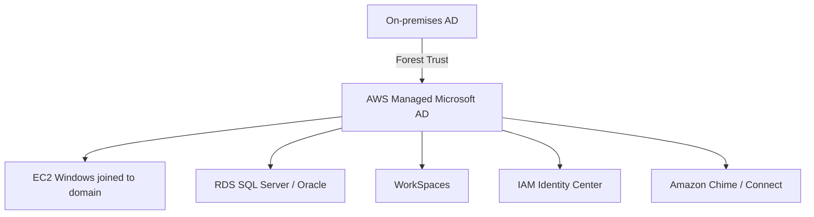

**Tiery:**

| Feature | Standard Edition | Enterprise Edition |
|---------|-----------------|-------------------|
| Obiekty (users/groups/computers) | do 30 000 | do 500 000 |
| Przeznaczenie | małe/średnie firmy | duże enterprise |
| Multi-Region replication | ❌ | ✅ |
| Cena (Region us-east-1) | ~$0.10/h per DC | ~$0.35/h per DC |

**Kiedy używać:**
- ✅ Potrzebujesz pełnego AD w AWS (GPO, Kerberos, LDAP, DNS)
- ✅ Chcesz domain-join EC2, RDS, WorkSpaces
- ✅ Budujesz Trust z on-premises AD (obydwa katalogi żyją niezależnie)
- ✅ Potrzebujesz MFA z RADIUS

**Kiedy NIE używać:**
- ❌ Masz istniejące AD on-prem i chcesz go tylko rozszerzyć → użyj **AD Connector**
- ❌ Potrzebujesz prostego LDAP bez pełnego AD → użyj **Simple AD**

**Bezpieczeństwo:**
- Domain Admins i Enterprise Admins — AWS zarządza, **ty nie masz dostępu** do tych kont
- Możesz tworzyć własnych adminów w dedykowanej OU
- Szyfrowanie ruchu LDAPS (port 636) — włącz certyfikat
- Multi-AZ domyślnie (2 Domain Controllers w różnych AZ)
- Logi do CloudWatch Logs (Security Event logs)
- Integracja z AWS CloudTrail

**Niezawodność:**
- AWS automatycznie wykrywa i zastępuje uszkodzone DC
- Snapshot automatyczny co 24h (retencja 5 dni)
- Multi-AZ — brak single point of failure

**Integracja z innymi serwisami:**

```
AWS Managed Microsoft AD
├── EC2 (domain join)
├── RDS (Windows Auth dla SQL Server, Oracle, PostgreSQL)
├── WorkSpaces / AppStream 2.0
├── IAM Identity Center (identity source)
├── Amazon Chime / Connect / QuickSight
└── FSx for Windows File Server (wymagane!)
```

> ⚠️ **Egzamin:** `FSx for Windows File Server` **wymaga** AWS Managed Microsoft AD lub trust z on-prem AD. Simple AD i AD Connector **nie działają** z FSx for Windows.

---

### 1.3 Simple AD

**🟢 Co to jest?**
Lekka, tania, zarządzana usługa katalogowa oparta na **Samba 4** — kompatybilna z podzbiorem API Microsoft AD. Nie jest prawdziwym AD.

**Architektura:**
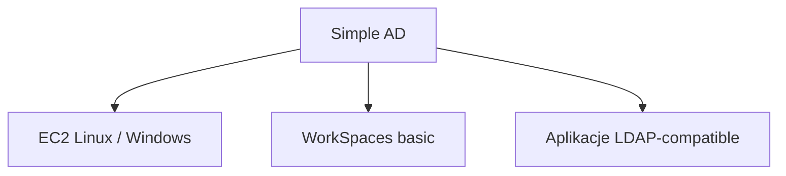

**Tiery:**

| Feature | Small | Large |
|---------|-------|-------|
| Użytkownicy | do 500 | do 5000 |
| Cena (us-east-1) | ~$0.05/h | ~$0.15/h |

**Co NIE działa z Simple AD:**
- ❌ Trust z Microsoft AD (on-prem lub AWS Managed)
- ❌ MFA (RADIUS)
- ❌ FSx for Windows File Server
- ❌ RDS SQL Server Windows Authentication
- ❌ PowerShell ADWS (AD Web Services)
- ❌ Schema extensions

**Kiedy używać:**
- ✅ Tania, prosta usługa LDAP/Kerberos dla małych aplikacji
- ✅ Nie masz on-premises AD i nie potrzebujesz pełnego AD
- ✅ Podstawowy domain-join dla EC2 (Linux + Windows)

**Linux analogy:** Samba 4 w trybie Active Directory Domain Controller — dokładnie to napędza Simple AD.

---

### 1.4 AD Connector

**🟡 Co to jest?**
**Proxy** — nie przechowuje żadnych danych katalogowych. Przekierowuje zapytania uwierzytelniania i autoryzacji do **istniejącego on-premises Active Directory** przez VPN lub Direct Connect.

**Architektura:**
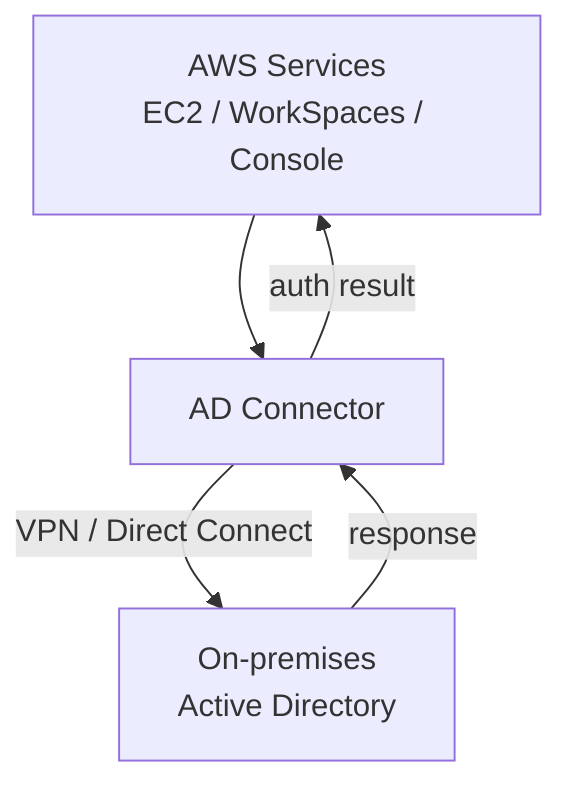

**Tiery:**

| Feature | Small | Large |
|---------|-------|-------|
| Concurrent auth | do 500 | do 5000 |

**Kiedy używać:**
- ✅ Masz AD on-premises i chcesz używać go do logowania do AWS Console / WorkSpaces
- ✅ Nie chcesz synchronizować/replikować danych katalogowych do AWS
- ✅ Compliance wymaga, żeby dane użytkowników zostały on-premises
- ✅ Domain-join EC2 do on-premises AD

**Kiedy NIE używać:**
- ❌ VPN/Direct Connect niedostępny → wszystko przestaje działać
- ❌ Chcesz AWS-native AD (nie masz on-prem) → AWS Managed Microsoft AD
- ❌ FSx for Windows → nie wspierany

**Ograniczenia:**
- Wymaga działającego VPN lub Direct Connect (single point of failure jeszcze przed AWS)
- Nie przechowuje kont → nie działa offline
- Nie możesz robić domain-join jeśli on-prem AD niedostępny

> ⚠️ **Egzamin:** AD Connector = "bridge" do on-prem AD. Żadne dane NIE są przechowywane w AWS.

---

### 1.5 Identity Federation

**🔴 Co to jest?**
Mechanizm umożliwiający **zewnętrznym tożsamościom** (spoza AWS IAM) dostęp do zasobów AWS **bez tworzenia kont IAM**. Firma używa własnego IdP (Identity Provider), AWS mu ufa.

**Protokoły federacji:**

| Protokół | Opis | Przykłady IdP |
|----------|------|---------------|
| **SAML 2.0** | XML-based, enterprise SSO | ADFS, Okta, Azure AD, PingFederate |
| **OpenID Connect (OIDC)** | Token-based (JWT), web/mobile | Google, Facebook, Amazon Cognito |
| **Web Identity** | OIDC dla aplikacji mobilnych | Amazon, Google, Facebook |
| **AWS SSO / IAM Identity Center** | Managed federation w AWS | AD, External IdP |

#### SAML 2.0 Federation — przepływ

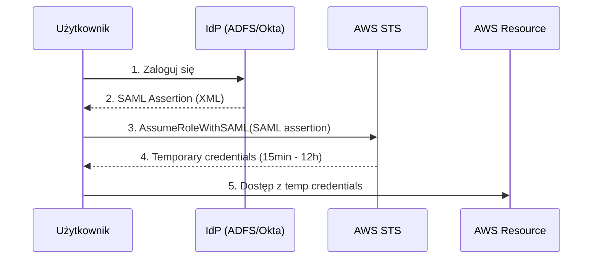

**Kluczowe API:**

| API Call | Protokół | Kto wywołuje |
|----------|----------|-------------|
| `AssumeRoleWithSAML` | SAML 2.0 | Aplikacja po otrzymaniu SAML assertion |
| `AssumeRoleWithWebIdentity` | OIDC/Web Identity | Aplikacja mobilna/web |
| `AssumeRole` | IAM → IAM | Konto AWS do konta AWS |
| `GetFederationToken` | - | Legacy, dla proxy apps |

#### SAML Federation dla AWS Console

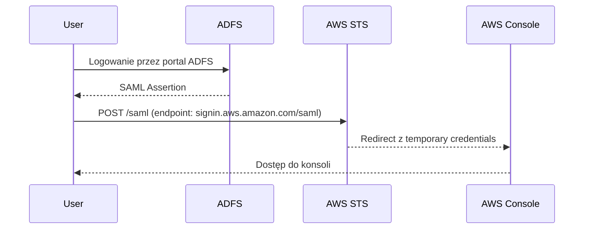

> ⚠️ **Egzamin:** URL do konsoli przez SAML to `https://signin.aws.amazon.com/saml`

#### Web Identity Federation (Cognito)

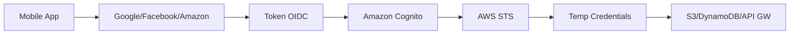

> ⚠️ **Egzamin:** Dla aplikacji mobilnych zawsze preferuj **Amazon Cognito** zamiast bezpośredniego `AssumeRoleWithWebIdentity`. Cognito dodaje: user pools, synchronizację danych, offline access.

**Custom Identity Broker:**
Gdy IdP nie obsługuje SAML/OIDC — budujesz własny broker który:
1. Uwierzytelnia użytkownika
2. Wywołuje `GetFederationToken` lub `AssumeRole`
3. Zwraca tymczasowe credentials

---

### 1.6 IAM Identity Center (SSO)

**🟣 Co to jest?**
Centralny serwis do zarządzania **dostępem SSO** do wielu kont AWS i aplikacji biznesowych (Salesforce, Office 365, itp.). Następca AWS Single Sign-On (AWS SSO).

**Architektura:**
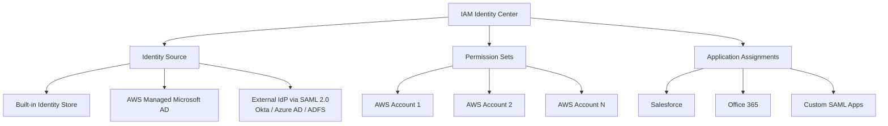

**Kluczowe pojęcia:**

| Pojęcie | Opis |
|---------|------|
| **Permission Set** | Zestaw uprawnień (jak rola IAM) przypisany użytkownikowi/grupie do konta |
| **Assignment** | Powiązanie: user/group + permission set + account |
| **Identity Store** | Wbudowany katalog użytkowników (jeśli nie używasz zewnętrznego) |
| **SCIM** | Protokół automatycznej synchronizacji użytkowników z zewnętrznego IdP |
| **MFA** | Wymuszanie MFA na poziomie IAM Identity Center |

**Identity Sources — porównanie:**

| Źródło | Sync użytkowników | Trust | Uwagi |
|--------|-------------------|-------|-------|
| Identity Center directory | Wbudowany | - | Najprostsze, brak integracji z AD |
| AWS Managed Microsoft AD | Automatyczny | Kerberos | Najlepsza integracja AD w AWS |
| External IdP (Okta, Azure AD) | SCIM 2.0 | SAML 2.0 | Dla istniejących enterprise IdP |

**Przepływ logowania:**
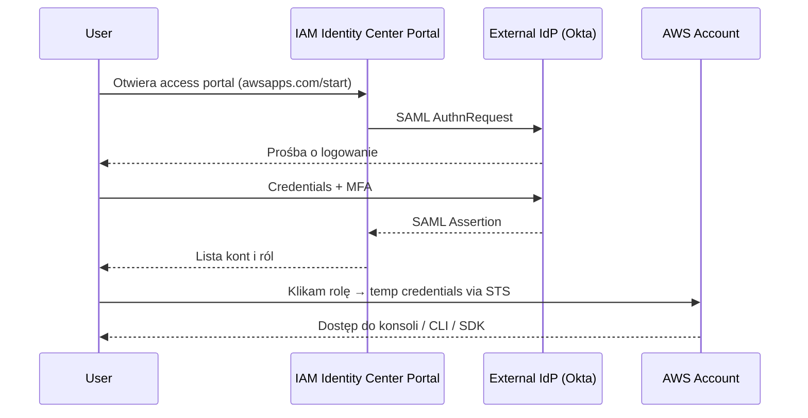

**CLI Integration:**
```bash
# Konfiguracja profilu SSO
aws configure sso
# SSO start URL: https://your-domain.awsapps.com/start
# SSO Region: eu-west-1

# Logowanie
aws sso login --profile my-dev-account

# Użycie profilu
aws s3 ls --profile my-dev-account
```

**Kiedy używać IAM Identity Center:**
- ✅ Multi-account AWS Organizations — zarządzasz wieloma kontami
- ✅ SSO do aplikacji SaaS (Salesforce, Box, Dropbox)
- ✅ Centralizacja dostępu zamiast per-konto IAM users
- ✅ Audyt: kto ma dostęp do czego w całej organizacji

**Bezpieczeństwo:**
- Temporary credentials (STS) — nie ma long-term keys dla użytkowników
- MFA enforcement — per user lub per account
- CloudTrail logi wszystkich logowań
- Access Reviews przez AWS IAM Access Analyzer

---

### 1.7 Porównanie usług

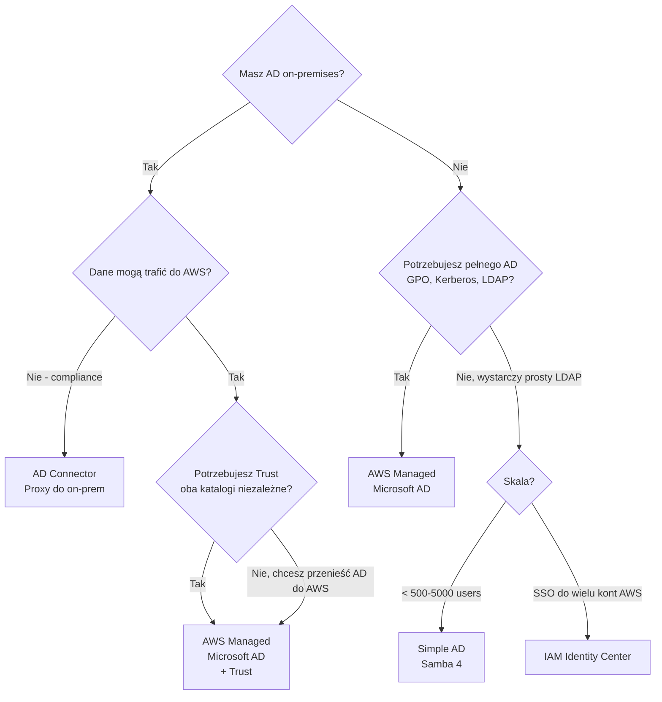

**Tabela porównawcza:**

| Feature | AWS Managed Microsoft AD | Simple AD | AD Connector | IAM Identity Center |
|---------|--------------------------|-----------|--------------|---------------------|
| Prawdziwe Microsoft AD | ✅ | ❌ (Samba 4) | ❌ (proxy) | ❌ (federation) |
| Przechowuje dane w AWS | ✅ | ✅ | ❌ | ✅ (identity store) |
| Trust z on-prem AD | ✅ | ❌ | ✅ (przekazuje) | ✅ (przez SAML/AD) |
| FSx for Windows | ✅ | ❌ | ❌ | ❌ |
| RDS Windows Auth | ✅ | ❌ | ❌ | ❌ |
| WorkSpaces | ✅ | ✅ | ✅ | ✅ |
| MFA (RADIUS) | ✅ | ❌ | ✅ | ✅ |
| GPO | ✅ | ❌ | ❌ | ❌ |
| SSO do aplikacji SaaS | ❌ (wymaga IC) | ❌ | ❌ | ✅ |
| Multi-account SSO | ❌ (wymaga IC) | ❌ | ❌ | ✅ |
| Wymaga VPN/DX do działania | ❌ | ❌ | ✅ | ❌ |
| Cena (relative) | $$$ | $ | $$ | $ |

---

### 1.8 4 Domeny egzaminacyjne

#### 🏗️ Domain 1: Design Solutions for Organizational Complexity

**Scenariusz:** Firma ma 500 kont AWS w Organizations, ADFS on-premises, i chce centralnego SSO.

**Rozwiązanie:**
```
ADFS on-prem → IAM Identity Center (External IdP via SAML) → Permission Sets → 500 kont
```
- SCIM 2.0 do automatycznej synchronizacji grup z ADFS
- Permission Sets mapują grupy AD na role IAM per konto
- Access Portal daje użytkownikom self-service widok kont

#### 🆕 Domain 2: Design for New Solutions

**Scenariusz:** Nowa aplikacja multi-tenant na EKS. Użytkownicy logują się przez Google/Facebook.

**Rozwiązanie:**
```
Mobile/Web App → Amazon Cognito (User Pools + Identity Pools) → STS → AWS Resources
```
- Cognito User Pools: federacja z Google/Facebook
- Cognito Identity Pools: mapowanie na IAM Role
- Nie używaj bezpośrednio `AssumeRoleWithWebIdentity` → Cognito jako best practice

#### 📈 Domain 3: Continuous Improvement for Existing Solutions

**Scenariusz:** Firma ma AWS Managed Microsoft AD. WorkSpaces działają. Chcą dodać MFA.

**Rozwiązanie:**
- Dodaj RADIUS server (np. AWS MFA lub zewnętrzny)
- Skonfiguruj MFA w AWS Managed Microsoft AD settings
- Alternatywnie: migruj do IAM Identity Center (ma wbudowane MFA TOTP/WebAuthn)

#### 🚀 Domain 4: Accelerate Workload Migration and Modernization

**Scenariusz:** Migracja 2000 Windows serwerów. Wszystkie są domain-joined do on-prem AD.

**Strategia:**
```
Faza 1: AD Connector → szybkie domain-join w AWS, dane zostają on-prem
Faza 2: AWS Managed Microsoft AD + Trust → stopniowa migracja katalogów
Faza 3: IAM Identity Center → SSO dla wszystkich kont AWS
```

---

### 1.9 Checks — 30 pytań z odpowiedziami

**Pytanie 1:** Która usługa AWS Directory Services wymaga aktywnego VPN lub Direct Connect do działania?

> **Odpowiedź:** AD Connector. Jest proxy — jeśli VPN/DX padnie, uwierzytelnianie przestaje działać.

---

**Pytanie 2:** Chcesz użyć FSx for Windows File Server. Jakiej usługi katalogowej potrzebujesz?

> **Odpowiedź:** AWS Managed Microsoft AD (lub on-prem AD przez Trust z AWS Managed Microsoft AD). Simple AD i AD Connector NIE działają z FSx for Windows.

---

**Pytanie 3:** Jaka jest różnica między SAML 2.0 a OpenID Connect (OIDC) w kontekście federacji?

> **Odpowiedź:** SAML 2.0 to XML-based enterprise SSO (ADFS, Okta, Azure AD). OIDC to token-based (JWT) używany głównie w aplikacjach web/mobile (Google, Facebook). AWS STS obsługuje oba przez `AssumeRoleWithSAML` i `AssumeRoleWithWebIdentity`.

---

**Pytanie 4:** Firma ma compliance requirement: dane użytkowników nie mogą opuszczać centrum danych on-premises. Potrzebuje jednak domain-join EC2 w AWS. Które rozwiązanie wybrać?

> **Odpowiedź:** AD Connector. Przechowuje zero danych katalogowych w AWS — jest tylko proxy do on-prem AD.

---

**Pytanie 5:** Co to jest Permission Set w IAM Identity Center?

> **Odpowiedź:** Zestaw polityk IAM (jak rola) przypisany użytkownikowi lub grupie do konkretnego konta AWS. Tworzy faktyczną rolę IAM w docelowym koncie przy pierwszym użyciu.

---

**Pytanie 6:** Jakie API STS wywoływane jest gdy użytkownik loguje się przez ADFS do AWS Console?

> **Odpowiedź:** `AssumeRoleWithSAML` — wywoływane z SAML Assertion. URL endpointu konsoli to `https://signin.aws.amazon.com/saml`.

---

**Pytanie 7:** Ile Domain Controllerów tworzy AWS Managed Microsoft AD?

> **Odpowiedź:** Minimum 2, w różnych AZ (Multi-AZ domyślnie). AWS zarządza ich lifecycle automatycznie.

---

**Pytanie 8:** Jaka jest różnica między Standard Edition a Enterprise Edition AWS Managed Microsoft AD?

> **Odpowiedź:** Standard: do 30 000 obiektów, brak Multi-Region replication. Enterprise: do 500 000 obiektów, obsługuje Multi-Region replication. Enterprise dla large-scale deployments.

---

**Pytanie 9:** Firma korzysta z Okta jako IdP. Chce automatycznej synchronizacji użytkowników do IAM Identity Center. Jakiego protokołu potrzebujesz?

> **Odpowiedź:** SCIM 2.0 (System for Cross-domain Identity Management). Okta synchronizuje użytkowników i grupy do IAM Identity Center automatycznie.

---

**Pytanie 10:** Simple AD jest oparte na jakiej technologii open-source?

> **Odpowiedź:** Samba 4 — implementacja AD/DC kompatybilna ze standardami Microsoft, ale bez pełnych funkcji AD.

---

**Pytanie 11:** Aplikacja mobilna iOS musi pobierać dane z S3 dla zalogowanych użytkowników (Google/Facebook). Jak zaprojektować uwierzytelnianie?

> **Odpowiedź:** Amazon Cognito: User Pools (federacja z Google/Facebook) + Identity Pools (mapowanie na IAM Role). Nie używaj bezpośrednio `AssumeRoleWithWebIdentity` — Cognito jest rekomendowanym rozwiązaniem.

---

**Pytanie 12:** Co to jest Custom Identity Broker?

> **Odpowiedź:** Własna aplikacja, która uwierzytelnia użytkowników i wywołuje `GetFederationToken` lub `AssumeRole` w STS, aby zwrócić tymczasowe credentials. Używane gdy IdP nie obsługuje SAML/OIDC.

---

**Pytanie 13:** Czy IAM Identity Center może być źródłem tożsamości dla AWS Managed Microsoft AD?

> **Odpowiedź:** Odwrotnie — AWS Managed Microsoft AD może być **źródłem tożsamości** dla IAM Identity Center. IAM Identity Center konsumuje tożsamości z AD lub zewnętrznego IdP.

---

**Pytanie 14:** Firma ma 300 kont AWS w Organizations. Chce, żeby użytkownicy logowali się jednym loginem do wszystkich kont. Co wdrożyć?

> **Odpowiedź:** IAM Identity Center z Organizations. Centralnie zarządza dostępem do wszystkich kont przez Permission Sets bez tworzenia IAM users per konto.

---

**Pytanie 15:** Jaki jest maksymalny czas życia tymczasowych credentials z STS?

> **Odpowiedź:** Zależy od API: `AssumeRole` max 12h (domyślnie 1h), `GetFederationToken` max 36h, `GetSessionToken` max 36h. Minimalnie 15 minut dla wszystkich.

---

**Pytanie 16:** AD Connector wspiera MFA. Jak jest zaimplementowane?

> **Odpowiedź:** Przez RADIUS — AD Connector przekazuje żądania MFA do RADIUS servera (np. zewnętrznego lub AWS MFA).

---

**Pytanie 17:** Jaka jest różnica między Forest Trust a External Trust w AWS Managed Microsoft AD?

> **Odpowiedź:** Forest Trust: dotyczy całego lasu AD (wszystkie domeny). External Trust: dotyczy tylko konkretnej domeny. AWS Managed Microsoft AD obsługuje oba typy.

---

**Pytanie 18:** Czy Simple AD obsługuje Trust relationships z Microsoft AD?

> **Odpowiedź:** NIE. Simple AD (Samba 4) nie obsługuje Trust z prawdziwym Microsoft AD. Jest to jedno z kluczowych ograniczeń Simple AD.

---

**Pytanie 19:** Które serwisy AWS mogą używać AWS Managed Microsoft AD jako identity source? (podaj 4)

> **Odpowiedź:** EC2 (domain join), Amazon WorkSpaces, Amazon RDS (Windows Auth), FSx for Windows File Server, Amazon Chime, Amazon Connect, QuickSight, IAM Identity Center.

---

**Pytanie 20:** Czym różni się IAM Identity Center od bezpośredniej federacji SAML z IAM?

> **Odpowiedź:** SAML z IAM = każde konto AWS konfiguruje federation osobno, zarządzanie rozproszone. IAM Identity Center = centralne zarządzanie dostępem do wszystkich kont Organizations, jeden punkt konfiguracji, lepsza audytowalność.

---

**Pytanie 21:** Firma migruje do AWS. Ma on-prem AD. Chce stopniowo migrować serwery. Jaka strategia wdrożenia katalogów?

> **Odpowiedź:** Faza 1: AD Connector (szybki start, dane zostają on-prem). Faza 2: AWS Managed Microsoft AD z Two-way Forest Trust (oba katalogi aktywne). Faza 3: opcjonalnie migracja do pełnego AWS Managed Microsoft AD.

---

**Pytanie 22:** Co robi SCIM 2.0 w kontekście IAM Identity Center?

> **Odpowiedź:** Automatycznie synchronizuje użytkowników i grupy z zewnętrznego IdP (Okta, Azure AD) do IAM Identity Center. Zmiany w IdP (dodanie/usunięcie usera) są automatycznie odzwierciedlane.

---

**Pytanie 23:** Dlaczego nie należy używać IAM Users dla pracowników firmy w środowisku enterprise?

> **Odpowiedź:** IAM Users mają long-term credentials (access key/secret), są zarządzani per konto, brak SSO, trudna rotacja credentials, brak federacji z firmowym IdP. IAM Identity Center + federacja daje temporary credentials i centralne zarządzanie.

---

**Pytanie 24:** Jaki jest Azure AD odpowiednik dla IAM Identity Center?

> **Odpowiedź:** Azure Active Directory (Entra ID) — centralny IdP, SSO do aplikacji, federation. Azure AD DS (AAD DS) to odpowiednik AWS Managed Microsoft AD (domain services w chmurze).

---

**Pytanie 25:** Firma chce, żeby użytkownicy zalogowani przez ADFS mogli używać AWS CLI. Jak to skonfigurować?

> **Odpowiedź:** IAM Identity Center z ADFS jako External IdP + `aws configure sso` w CLI. Po `aws sso login` użytkownik otrzymuje tymczasowe credentials automatycznie odświeżane.

---

**Pytanie 26:** Czym różni się `GetFederationToken` od `AssumeRole`?

> **Odpowiedź:** `GetFederationToken`: wywołuje IAM User (nie rola), credentials do 36h, używane w proxy apps (legacy). `AssumeRole`: wywołuje rola, credentials do 12h, preferred approach, obsługuje MFA, cross-account.

---

**Pytanie 27:** AWS Managed Microsoft AD Enterprise Edition — co daje Multi-Region replication?

> **Odpowiedź:** Replikuje katalog do dodatkowych regionów AWS. EC2/WorkSpaces w innym regionie mogą autentykować się lokalnie bez cross-region traffic. Ważne dla disaster recovery i globalnych deploymentów.

---

**Pytanie 28:** Simple AD obsługuje `WorkSpaces`. Kiedy wybrać Simple AD zamiast AWS Managed Microsoft AD dla WorkSpaces?

> **Odpowiedź:** Tylko gdy: mała liczba użytkowników (<500), nie potrzebujesz GPO, nie potrzebujesz MFA przez RADIUS, niski budżet. W każdym innym przypadku — AWS Managed Microsoft AD.

---

**Pytanie 29:** Jaki protokół używa IAM Identity Center do komunikacji z zewnętrznym IdP?

> **Odpowiedź:** SAML 2.0 dla uwierzytelniania (AuthnRequest/Response). SCIM 2.0 dla synchronizacji użytkowników/grup (provisioning).

---

**Pytanie 30:** Firma ma wymaganie: użytkownicy muszą się uwierzytelniać MFA gdy dostęp do produkcyjnych kont AWS, ale nie do dev. Jak to osiągnąć w IAM Identity Center?

> **Odpowiedź:** Skonfiguruj **Context-Aware Access** lub ustaw MFA jako `Required` w konfiguracji IAM Identity Center dla konkretnych Permission Sets/kont produkcyjnych. Można też użyć Session Policies w Permission Sets z warunkiem `aws:MultiFactorAuthPresent`.

---

*Ostatnia aktualizacja: 2026-10-26 | Temat: AWS Directory Services, Identity Federation, IAM Identity Center*

---

## 2. RADIUS, Amazon Cognito i AWS STS

### 2.1 RADIUS — protokół uwierzytelniania sieciowego

**🔵 Co to jest?**
**RADIUS** (Remote Authentication Dial-In User Service) to protokół sieciowy z 1991 roku (RFC 2865) służący do **centralnego uwierzytelniania, autoryzacji i rozliczania (AAA)** dla użytkowników łączących się z siecią. Działa w modelu klient-serwer na UDP port **1812** (auth) i **1813** (accounting).

**Analogia z życia:** RADIUS to jak portier w dużej firmie. Ktokolwiek chce wejść (VPN, WiFi, VoIP, AWS MFA) — pyta portiera. Portier sprawdza listę w swoim systemie i mówi: "wpuść" lub "nie wpuść".

**Architektura RADIUS:**
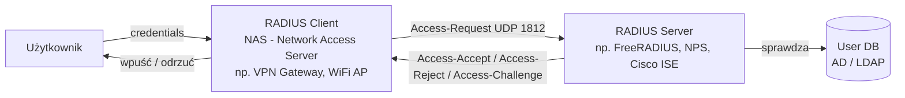

**AAA w RADIUS:**

| Litera | Funkcja | Opis |
|--------|---------|------|
| **A**uthentication | Uwierzytelnianie | Kto jesteś? (login/hasło, OTP, cert) |
| **A**uthorization | Autoryzacja | Co możesz robić? (VLAN, ACL, bandwidth) |
| **A**ccounting | Rozliczanie | Co zrobiłeś? (logi sesji, czas, transfer) |

**Kody odpowiedzi RADIUS:**
- `Access-Accept` — uwierzytelnianie OK
- `Access-Reject` — odmowa
- `Access-Challenge` — wymagany dodatkowy krok (np. OTP) — **to właśnie MFA!**

**RADIUS w AWS — gdzie jest używany:**

| Serwis AWS | Rola RADIUS |
|-----------|-------------|
| **AWS Managed Microsoft AD** | MFA dla domain-joined usług (WorkSpaces, console) |
| **AD Connector** | MFA przekazywane do on-prem RADIUS |
| **AWS Client VPN** | Uwierzytelnianie użytkowników VPN |
| **Amazon WorkSpaces** | MFA przez RADIUS serwer |

**Jak AWS Managed Microsoft AD używa RADIUS (MFA):**
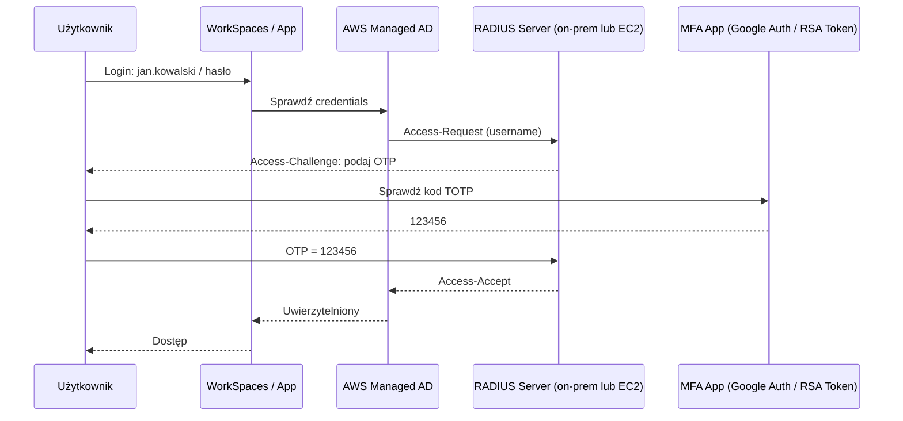

**RADIUS vs inne protokoły MFA:**

| Protokół | Transport | MFA typ | Używany w AWS |
|----------|-----------|---------|---------------|
| **RADIUS** | UDP, stary, prosty | OTP, token, TOTP | AD, AD Connector, Client VPN |
| **SAML 2.0** | HTTPS/XML | Dowolny (przez IdP) | IAM Identity Center, federacja |
| **FIDO2/WebAuthn** | HTTPS | Hardware key, biometria | IAM Identity Center |
| **TOTP (Virtual MFA)** | App-based | TOTP RFC 6238 | IAM Identity Center, IAM Users |

**Open-source / Linux odpowiednik:** `FreeRADIUS` — najpopularniejszy open-source RADIUS server. AWS nie oferuje zarządzanego RADIUS — używasz FreeRADIUS na EC2 lub on-prem NPS (Windows Network Policy Server).

> ⚠️ **Egzamin:** Gdy widzisz "MFA dla WorkSpaces / AWS Managed Microsoft AD" → myśl RADIUS. IAM Identity Center ma wbudowane MFA i **nie potrzebuje** RADIUS.

---

### 2.2 Amazon Cognito — przegląd

**🟣 Co to jest?**
Amazon Cognito to zarządzana usługa **uwierzytelniania i autoryzacji dla aplikacji web i mobilnych**. Składa się z dwóch niezależnych komponentów z różnymi zadaniami:

```
Amazon Cognito
├── User Pools      → KTO jesteś? (uwierzytelnianie, zarządzanie użytkownikami)
└── Identity Pools  → CO możesz robić? (autoryzacja, tymczasowe credentials AWS)
```

**Odpowiedniki:**

| AWS | Azure | Open-source / Self-hosted |
|-----|-------|--------------------------|
| Cognito User Pools | Azure AD B2C | Keycloak, Auth0 (SaaS) |
| Cognito Identity Pools | Azure Managed Identity | AWS STS bezpośrednio |

---

### 2.3 Cognito User Pools

**🔵 Co to jest?**
User Pool to **katalog użytkowników** + **serwer uwierzytelniania** dla Twojej aplikacji. Zarządza rejestracją, logowaniem, hasłami, MFA, weryfikacją email/telefonu. Po udanym logowaniu zwraca **JWT tokeny**.

**Tokeny JWT zwracane przez User Pool:**

| Token | Zawartość | Ważność | Użycie |
|-------|-----------|---------|--------|
| **ID Token** | Tożsamość użytkownika (name, email, custom attrs) | 1h domyślnie | Backend: kto to jest |
| **Access Token** | Uprawnienia (scopes, groups) | 1h domyślnie | Wywołanie chronionych API |
| **Refresh Token** | Odświeżenie Access/ID Token | 30 dni domyślnie | Nowe tokeny bez re-logowania |

**Architektura User Pool:**
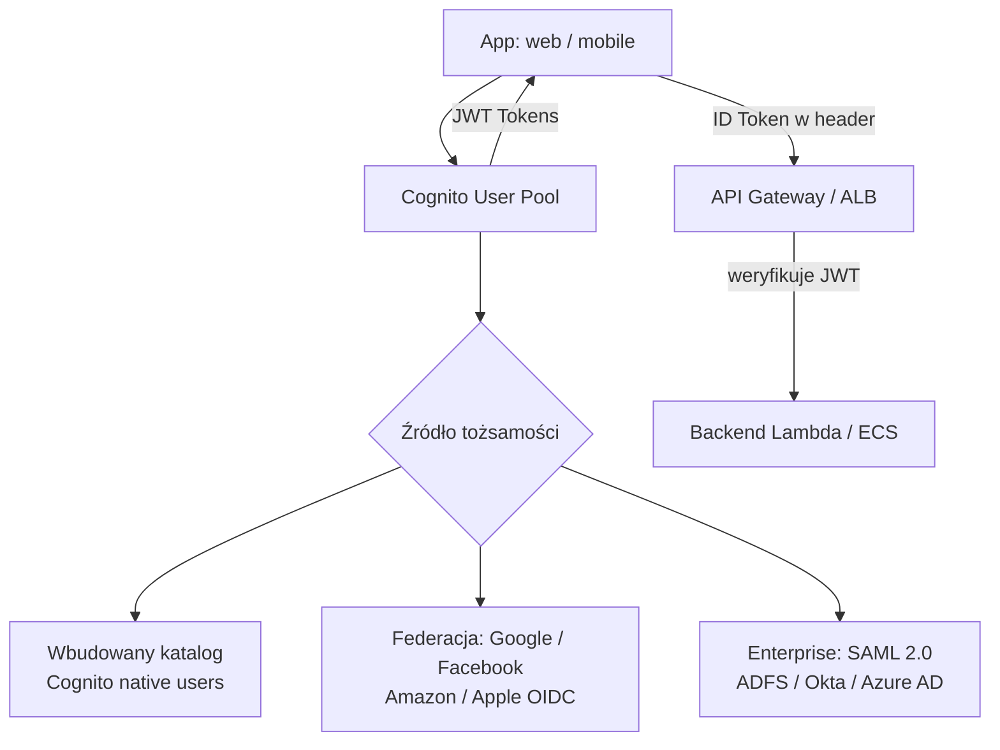

**Kluczowe features User Pool:**

| Feature | Opis |
|---------|------|
| **User directory** | Przechowuje username, email, phone, custom attributes |
| **Sign-up / Sign-in** | Hosted UI lub custom UI przez Amplify/SDK |
| **MFA** | TOTP (Google Authenticator), SMS |
| **Password policy** | Min length, complexity, expiry |
| **Account recovery** | Email / SMS |
| **Lambda Triggers** | Pre/post auth hooks, custom messages, migration |
| **Advanced Security** | Risk-based auth, adaptive MFA, compromised credentials |
| **Groups** | Mapowanie użytkowników na role (przez ID Token `cognito:groups`) |

**Lambda Triggers (ważne na egzamin):**

| Trigger | Kiedy odpala | Przykład użycia |
|---------|-------------|-----------------|
| Pre Sign-Up | Przed rejestracją | Blokuj domenę email |
| Post Confirmation | Po potwierdzeniu konta | Dodaj do DynamoDB |
| Pre Authentication | Przed logowaniem | Blokuj według IP |
| Post Authentication | Po logowaniu | Log do CloudWatch |
| Pre Token Generation | Przed wydaniem tokenu | Dodaj custom claims do JWT |
| User Migration | Logowanie nieistniejącego usera | Migruj z legacy systemu |
| Custom Message | Weryfikacja email/SMS | Własna treść wiadomości |

**User Pool + API Gateway:**
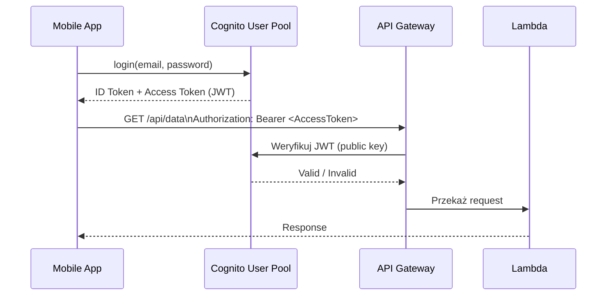

**User Pool + ALB (Application Load Balancer):**
ALB ma wbudowaną integrację z Cognito — może wymagać logowania przed dostępem do backendu. Bez pisania kodu!

```
Browser → ALB → Redirect do Cognito Hosted UI → Login → ALB przekazuje JWT → Target (ECS/EC2)
```

---

### 2.4 Cognito Identity Pools

**🟢 Co to jest?**
Identity Pool (zwany też **Federated Identity**) daje uwierzytelnionym (lub anonimowym) użytkownikom **tymczasowe credentials AWS (STS)** do bezpośredniego dostępu do serwisów AWS (S3, DynamoDB, API GW itp.).

**Kluczowa różnica:** User Pool mówi "kto to jest". Identity Pool mówi "co może robić w AWS".

**Architektura Identity Pool:**
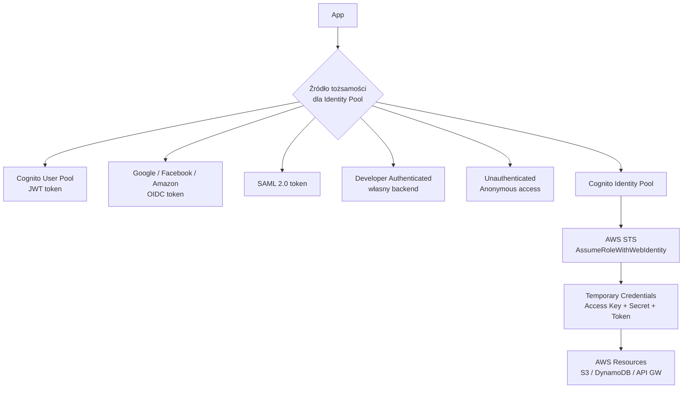

**Role w Identity Pool:**

| Rola | Kiedy przypisana |
|------|-----------------|
| **Authenticated Role** | Użytkownik zalogowany (przez User Pool lub external IdP) |
| **Unauthenticated Role** | Anonimowy gość (opcjonalne, zawęź uprawnienia!) |
| **Role Mapping (Rules)** | Różne role na podstawie claims w tokenie (np. admins → admin-role) |

**Przykład: Role Mapping na podstawie grupy Cognito:**
```json
// Jeśli cognito:groups zawiera "admins" → przypisz AdminRole
// Jeśli cognito:groups zawiera "readers" → przypisz ReadOnlyRole
```

**Przykładowa polityka IAM dla Authenticated Role (per-user S3):**
```json
{
  "Version": "2012-10-17",
  "Statement": [{
    "Effect": "Allow",
    "Action": ["s3:GetObject", "s3:PutObject"],
    "Resource": "arn:aws:s3:::my-app-bucket/${cognito-identity.amazonaws.com:sub}/*"
  }]
}
```
> `${cognito-identity.amazonaws.com:sub}` — dynamicznie podstawia Identity ID użytkownika. Każdy user widzi tylko swój "folder" w S3.

---

### 2.5 User Pools vs Identity Pools — porównanie

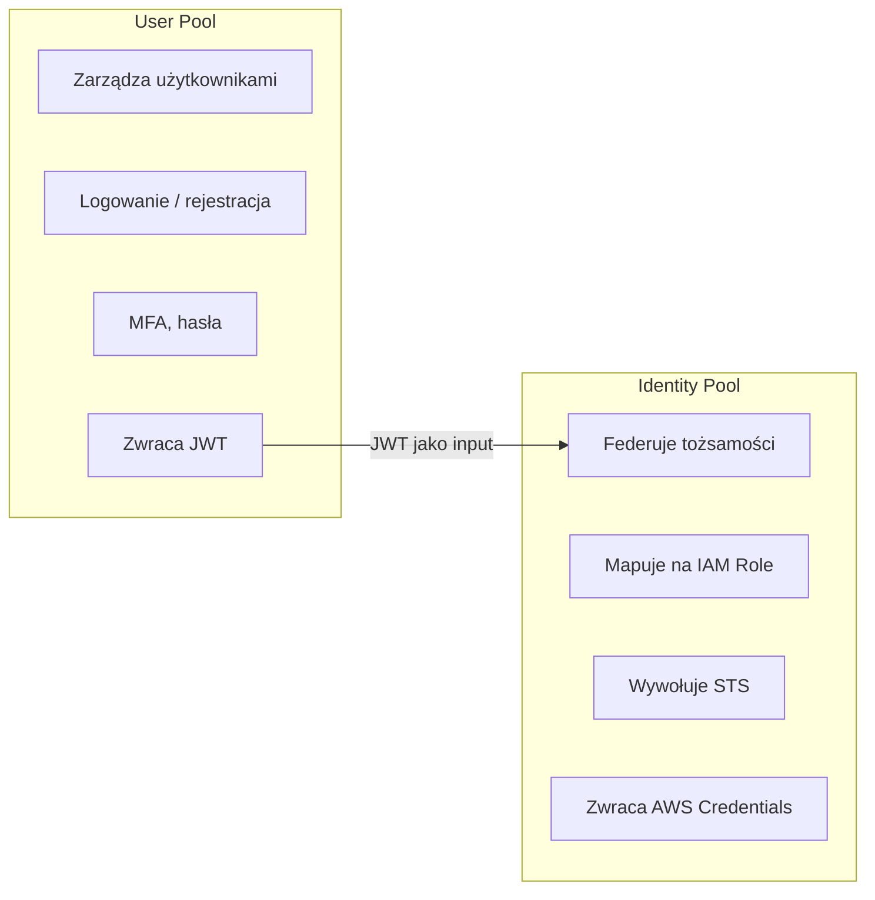

**Tabela porównawcza:**

| Aspekt | User Pool | Identity Pool |
|--------|-----------|---------------|
| **Cel** | Uwierzytelnianie użytkowników aplikacji | Autoryzacja dostępu do AWS |
| **Co zwraca** | JWT (ID/Access/Refresh Token) | Tymczasowe credentials AWS (STS) |
| **Protokół** | OIDC / OAuth 2.0 | AWS STS (AssumeRoleWithWebIdentity) |
| **Przechowuje użytkowników** | ✅ Własny katalog | ❌ Tylko Identity ID (UUID) |
| **Federacja zewnętrzna** | Google, FB, SAML, OIDC | User Pool, Google, FB, SAML, Custom |
| **Dostęp anonimowy** | ❌ | ✅ (Unauthenticated role) |
| **Integracja API GW/ALB** | ✅ bezpośrednio | ❌ (przez STS credentials) |
| **Odpowiednik Azure** | Azure AD B2C | Azure Managed Identity |

**Typowy pattern — oba razem:**
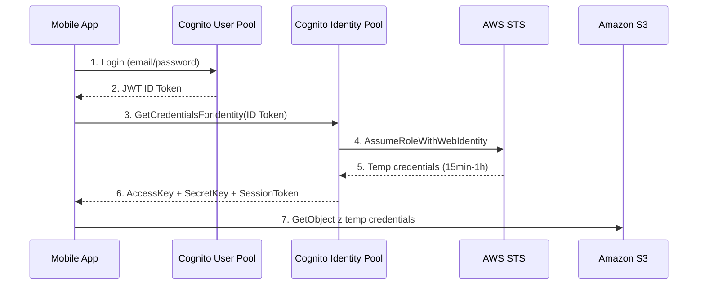

---

### 2.6 AWS STS — Security Token Service

**🔴 Co to jest?**
AWS Security Token Service to **globalny serwis** wydający **tymczasowe, ograniczone credentials** dla AWS. Każde tymczasowe poświadczenie to trójka:
- `AccessKeyId` (ASIA...)
- `SecretAccessKey`
- `SessionToken` (wymagany razem z kluczem)

**Kluczowa zasada:** STS **nie przechowuje tożsamości** — on tylko wydaje tymczasowe credentials na podstawie zaufania (trust policy).

**Architektura STS:**
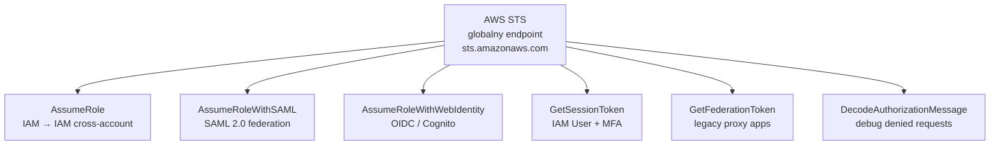

**Jak działają tymczasowe credentials:**
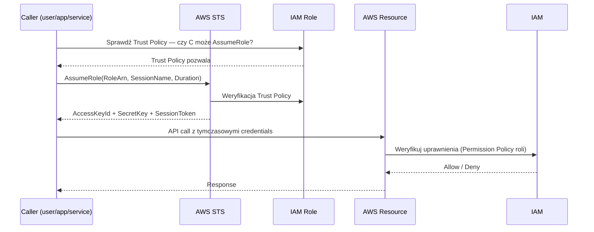

**Endpoint STS — regionalne vs globalne:**

| Typ | Endpoint | Uwagi |
|-----|----------|-------|
| Global | `sts.amazonaws.com` | us-east-1, starszy |
| Regional | `sts.<region>.amazonaws.com` | Zalecane — wyższy availability, niższe latency |

> ⚠️ **Egzamin:** Używaj **regionalnych endpointów STS** dla lepszej dostępności. Jeśli us-east-1 ma problemy, globalny endpoint może nie działać.

---

### 2.7 STS API — porównanie wywołań

| API | Caller | Protokół | Max duration | Kiedy użyć |
|-----|--------|----------|-------------|------------|
| **AssumeRole** | IAM User, Role, Service | IAM Trust | 15min – 12h | Cross-account, service delegation |
| **AssumeRoleWithSAML** | Zewnętrzny user (SAML) | SAML 2.0 | 15min – 12h | ADFS, Okta → AWS |
| **AssumeRoleWithWebIdentity** | Zewnętrzny user (OIDC) | OIDC/JWT | 15min – 12h | Cognito, Google, mobile apps |
| **GetSessionToken** | IAM User | IAM + MFA | 15min – 36h | IAM User z MFA, wymuszenie MFA |
| **GetFederationToken** | IAM User | IAM | 15min – 36h | Legacy proxy app, custombrokery |
| **DecodeAuthorizationMessage** | Dowolny | - | - | Debug "Access Denied" |

**AssumeRole — cross-account:**
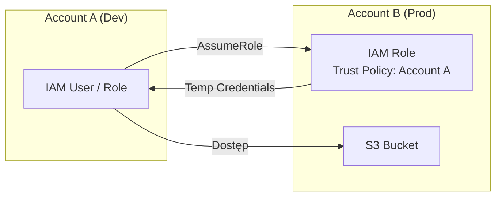

**Trust Policy dla cross-account AssumeRole:**
```json
{
  "Version": "2012-10-17",
  "Statement": [{
    "Effect": "Allow",
    "Principal": {
      "AWS": "arn:aws:iam::111122223333:root"
    },
    "Action": "sts:AssumeRole",
    "Condition": {
      "BoolIfExists": {
        "aws:MultiFactorAuthPresent": "true"
      }
    }
  }]
}
```

**GetSessionToken — wymuszanie MFA dla IAM Users:**
```bash
# Pobierz tymczasowe credentials z MFA
aws sts get-session-token \
  --serial-number arn:aws:iam::123456789:mfa/jan.kowalski \
  --token-code 123456 \
  --duration-seconds 3600
# Zwraca: AccessKeyId, SecretAccessKey, SessionToken, Expiration
```

**AssumeRole z External ID (ochrona przed confused deputy):**
```json
{
  "Condition": {
    "StringEquals": {
      "sts:ExternalId": "unique-customer-id-12345"
    }
  }
}
```
> **Confused Deputy Problem:** Bez External ID złośliwa firma mogłaby użyć Twojego AWS konta do ataku przez współdzielonego AWS partnera. External ID to secret znany tylko Tobie i partnerowi.

**Session Policies — zawężanie uprawnień w locie:**
```bash
# AssumeRole z dodatkową session policy (zawęża uprawnienia roli)
aws sts assume-role \
  --role-arn arn:aws:iam::123456789:role/AdminRole \
  --role-session-name my-session \
  --policy '{"Version":"2012-10-17","Statement":[{"Effect":"Allow","Action":"s3:*","Resource":"*"}]}'
# Wynikowe uprawnienia = AdminRole AND s3:* (intersection, nie union)
```

**STS Condition Keys (ważne na egzamin):**

| Condition Key | Znaczenie |
|--------------|-----------|
| `aws:MultiFactorAuthPresent` | Czy użyto MFA |
| `aws:MultiFactorAuthAge` | Ile sekund temu MFA było użyte |
| `sts:ExternalId` | External ID dla cross-account |
| `sts:RoleSessionName` | Nazwa sesji (audyt w CloudTrail) |
| `aws:RequestedRegion` | Region API call |

---

### 2.8 4 Domeny egzaminacyjne

#### 🏗️ Domain 1: Design Solutions for Organizational Complexity

**Scenariusz:** Korporacja ma 50 000 pracowników w Azure AD. Chce dostępu do AWS bez tworzenia IAM users.

**Rozwiązanie:**
```
Azure AD (IdP SAML 2.0) → IAM Identity Center → Permission Sets → AWS Accounts
```
Lub dla starszego podejścia:
```
Azure AD → SAML Assertion → STS AssumeRoleWithSAML → Temp Credentials → AWS
```
SCIM 2.0 synchronizuje grupy z Azure AD do IAM Identity Center.

#### 🆕 Domain 2: Design for New Solutions

**Scenariusz:** Aplikacja mobilna (iOS/Android) z 1M użytkowników. Login Google/Facebook. Dane użytkownika w DynamoDB, media w S3.

**Rozwiązanie:**
```
App → Cognito User Pool (Google/Facebook federation)
    → JWT Token
    → Cognito Identity Pool
    → STS (per-user IAM Role)
    → S3: bucket/cognito-identity-id/*
    → DynamoDB: tylko wiersze gdzie userId = cognito:sub
```
Policy DynamoDB z variable substitution:
```json
"Condition": {"ForAllValues:StringEquals": {"dynamodb:LeadingKeys": ["${cognito-identity.amazonaws.com:sub}"]}}
```

#### 📈 Domain 3: Continuous Improvement for Existing Solutions

**Scenariusz:** Firma używa direct `AssumeRoleWithWebIdentity` z Google w aplikacji mobilnej. Chcą dodać rejestrację, MFA, offline sync.

**Rozwiązanie:** Migracja do Cognito User Pools + Identity Pools:
- User Pools: rejestracja, MFA, password reset, session management
- Identity Pools: zachowanie mapowania na AWS role
- Brak zmian w backendzie S3/DynamoDB — tylko credentials source zmieniony

#### 🚀 Domain 4: Accelerate Workload Migration and Modernization

**Scenariusz:** Legacy app ma własną bazę użytkowników (MySQL). Migracja do cloud-native auth bez wymuszania re-rejestracji.

**Rozwiązanie:** Cognito User Pool z **User Migration Lambda Trigger**:
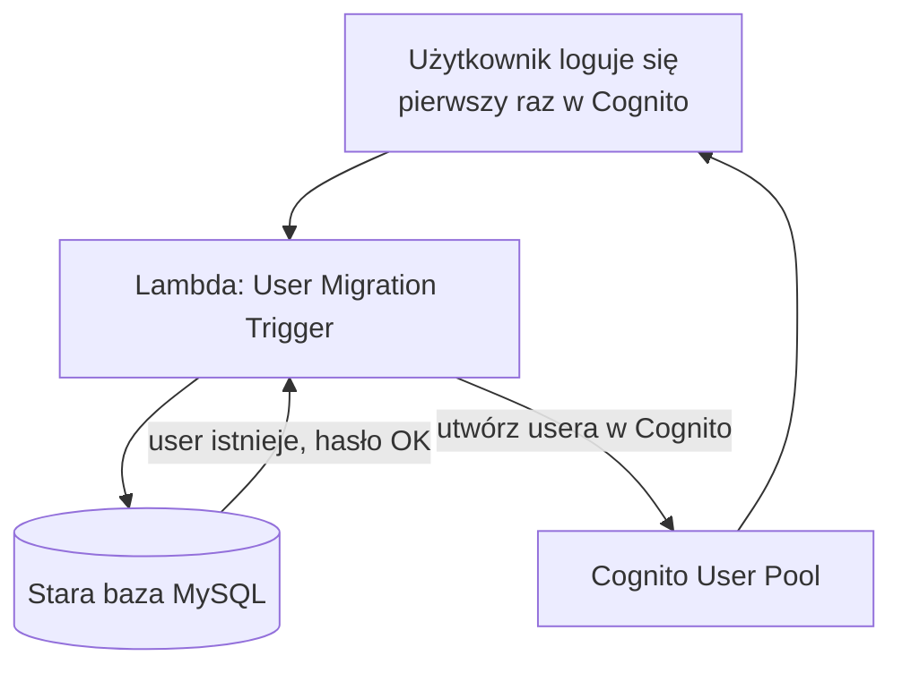
Zero downtime migration — użytkownicy migrują "lazy" przy pierwszym logowaniu.

---

### 2.9 Checks — 30 pytań z odpowiedziami

**Pytanie 1:** Jakie porty UDP używa RADIUS?

> **Odpowiedź:** Port 1812 dla Authentication/Authorization, port 1813 dla Accounting.

---

**Pytanie 2:** Co oznacza odpowiedź `Access-Challenge` od RADIUS serwera?

> **Odpowiedź:** Wymaga dodatkowego kroku — np. podania kodu OTP/TOTP. To fundament implementacji MFA przez RADIUS.

---

**Pytanie 3:** Jaka jest różnica między Cognito User Pool a Identity Pool?

> **Odpowiedź:** User Pool = katalog użytkowników + uwierzytelnianie, zwraca JWT. Identity Pool = federuje tożsamości (w tym JWT z User Pool) na tymczasowe credentials AWS przez STS. User Pool odpowiada na "kto to jest", Identity Pool na "co może robić w AWS".

---

**Pytanie 4:** Aplikacja potrzebuje, żeby zalogowany użytkownik mógł uploadować tylko do swojego folderu w S3. Jak użyć Identity Pool?

> **Odpowiedź:** Polityka IAM z `${cognito-identity.amazonaws.com:sub}` jako zmienna w Resource ARN. Każdy użytkownik dostaje temp credentials z rolą, której zakres jest ograniczony do `bucket/cognito-sub-id/*`.

---

**Pytanie 5:** Jaki Lambda Trigger w Cognito użyjesz do migracji użytkowników z legacy systemu?

> **Odpowiedź:** `User Migration` trigger — odpala przy próbie logowania nieistniejącego w Cognito usera. Lambda sprawdza starą bazę, jeśli user istnieje i hasło OK → tworzy go w Cognito.

---

**Pytanie 6:** Co zawiera `ID Token` z Cognito User Pool?

> **Odpowiedź:** Dane tożsamości użytkownika: sub (UUID), email, phone, name, custom attributes, cognito:groups. Format JWT, podpisany przez User Pool.

---

**Pytanie 7:** Co zawiera `Access Token` z Cognito User Pool?

> **Odpowiedź:** Uprawnienia: scopes OAuth 2.0, cognito:groups. Używany do autoryzacji wywołań chronionych API (np. API Gateway). Nie zawiera danych osobowych jak ID Token.

---

**Pytanie 8:** Jak długo ważny jest Refresh Token w Cognito (domyślnie)?

> **Odpowiedź:** 30 dni (konfigurowalne: 60 minut do 10 lat). Pozwala odświeżać Access i ID Token bez ponownego logowania.

---

**Pytanie 9:** Dlaczego należy używać regionalnych endpointów STS zamiast globalnego `sts.amazonaws.com`?

> **Odpowiedź:** Wyższa dostępność — awaria us-east-1 nie blokuje regionalnych endpointów. Niższe latency — endpoint blisko Twojego regionu. Globalny endpoint to alias dla us-east-1.

---

**Pytanie 10:** Co to jest "Confused Deputy Problem" w STS?

> **Odpowiedź:** Atak gdzie złośliwy podmiot (np. inna firma korzystająca z tego samego partnera AWS) używa Twojej roli IAM przez współdzielonego pośrednika. Ochrona: `sts:ExternalId` w Trust Policy — unikalna wartość znana tylko Tobie i partnerowi.

---

**Pytanie 11:** Jakie jest ograniczenie `GetFederationToken` vs `AssumeRole`?

> **Odpowiedź:** `GetFederationToken` wywołuje IAM User (nie rola), max duration 36h, nie obsługuje MFA condition, legacy. `AssumeRole` jest nowszy, wywołuje rolę, obsługuje MFA, cross-account, session policies. Preferuj `AssumeRole`.

---

**Pytanie 12:** Co się stanie jeśli application używa RADIUS dla MFA, ale RADIUS server jest niedostępny?

> **Odpowiedź:** Logowanie nie powiedzie się — RADIUS jest w krytycznej ścieżce uwierzytelniania. Dlatego RADIUS servers są wdrażane w HA (Multi-AZ), np. 2 instancje FreeRADIUS lub NPS.

---

**Pytanie 13:** Aplikacja mobilna używa bezpośrednio `AssumeRoleWithWebIdentity` z Google. Dlaczego AWS rekomenduje zamiast tego Cognito?

> **Odpowiedź:** Cognito dodaje: zarządzanie sesjami, refresh token, synchronizację danych (Cognito Sync), unified API dla wielu IdP, user management (rejestracja, reset hasła, MFA), protection przed token replay.

---

**Pytanie 14:** Jak Identity Pool obsługuje anonimowych użytkowników?

> **Odpowiedź:** Przez Unauthenticated Role — opcjonalna konfiguracja, daje temp credentials bez logowania. Użyteczne dla "tryb gościa" w aplikacji. Zawsze ogranicz uprawnienia tej roli do minimum (np. tylko read-only publiczne dane).

---

**Pytanie 15:** Co to jest `Pre Token Generation` Lambda Trigger w Cognito?

> **Odpowiedź:** Odpala się przed wystawieniem JWT tokenów. Możesz dodać/usunąć/zmienić claims w ID lub Access Token. Np. dodaj custom claim `role: "premium"` na podstawie danych z DynamoDB.

---

**Pytanie 16:** Jak ALB (Application Load Balancer) integruje się z Cognito User Pool?

> **Odpowiedź:** ALB może wymuszać uwierzytelnianie Cognito przed forwarding requestu do target group. Użytkownik jest przekierowywany do Cognito Hosted UI, po zalogowaniu ALB weryfikuje JWT i dodaje claims jako headers do backendu (X-Amzn-Oidc-Identity, X-Amzn-Oidc-Data).

---

**Pytanie 17:** Ile maksymalnie może trwać sesja z `AssumeRole`?

> **Odpowiedź:** Domyślnie 1 godzina, maksymalnie 12 godzin (jeśli rola ma ustawiony `MaxSessionDuration`). Minimum 15 minut.

---

**Pytanie 18:** Co to są Session Policies w STS i jak wpływają na uprawnienia?

> **Odpowiedź:** Opcjonalna polityka dołączana do `AssumeRole`. Wynikowe uprawnienia = `INTERSECTION(Permission Policy roli, Session Policy)` — nigdy więcej niż rola, zawsze mniej lub tyle samo. Pozwala zawęzić uprawnienia bez modyfikacji roli.

---

**Pytanie 19:** Firma chce, żeby użytkownik mógł AssumeRole tylko jeśli użył MFA w ciągu ostatnich 5 minut. Jak to wymusić?

> **Odpowiedź:** Trust Policy z condition: `"aws:MultiFactorAuthAge": {"NumericLessThan": "300"}`. Wartość 300 sekund = 5 minut od ostatniego użycia MFA.

---

**Pytanie 20:** Co to jest SCIM 2.0 i kiedy jest używany z Cognito?

> **Odpowiedź:** SCIM (System for Cross-domain Identity Management) to protokół automatycznej synchronizacji użytkowników między systemami. Cognito User Pool obsługuje SCIM jako target dla zewnętrznych IdP (Okta, Azure AD) — automatyczny provisioning/deprovisioning użytkowników.

---

**Pytanie 21:** Jaka jest różnica w sposobie uwierzytelniania między RADIUS a SAML?

> **Odpowiedź:** RADIUS: protokół sieciowy UDP, prosty challenge-response, używany dla urządzeń sieciowych (VPN, WiFi) i legacy systemów. SAML: XML-based, HTTPS, dla aplikacji webowych, rich assertions z atrybutami użytkownika. SAML ma SSO, RADIUS nie.

---

**Pytanie 22:** Cognito User Pool — jak skonfigurować różne IAM Role dla różnych grup użytkowników?

> **Odpowiedź:** Identity Pool → Role Mapping → Rules. Na podstawie claim `cognito:groups` z ID Token (np. group=admins → arn:role/AdminRole, group=users → arn:role/UserRole).

---

**Pytanie 23:** Co zwraca `sts:DecodeAuthorizationMessage`?

> **Odpowiedź:** Odkodowuje zaszyfrowany komunikat "Access Denied" z encoded message — zwraca szczegóły dlaczego odmówiono dostępu (który serwis, akcja, resource, polityka). Używane do debugowania IAM permission errors.

---

**Pytanie 24:** Czy Cognito User Pool może być używany jako Identity Provider (IdP) dla innej aplikacji przez OIDC?

> **Odpowiedź:** TAK — Cognito User Pool eksponuje OIDC-compliant endpoints. Inna aplikacja może używać User Pool jako IdP i akceptować jego JWT tokeny. User Pool ma `.well-known/openid-configuration` endpoint.

---

**Pytanie 25:** Firma chce zablokować dostęp do AWS Console poza godzinami pracy (9-17). Jak użyć STS?

> **Odpowiedź:** Trust Policy z condition na czas: `"aws:CurrentTime"` lub permission policy z `StringLike` na `aws:CurrentTime`. Alternatywnie IAM Identity Center z session duration limits. STS sam w sobie nie ma scheduler — warunek sprawdzany w momencie wywołania `AssumeRole`.

---

**Pytanie 26:** Jaka jest różnica między `AccessKeyId` zaczynającym się od `AKIA` a `ASIA`?

> **Odpowiedź:** `AKIA` = long-term credentials (IAM User). `ASIA` = tymczasowe credentials z STS. Jeśli widzisz `ASIA` w logach CloudTrail — to sesja STS (role, federation, Cognito).

---

**Pytanie 27:** Cognito obsługuje TOTP MFA. Co to jest TOTP i jaki jest algorytm?

> **Odpowiedź:** TOTP (Time-based One-Time Password) — RFC 6238. Algorytm: HMAC-SHA1(secret_key, floor(time/30)). Kod zmienia się co 30 sekund. Implementacje: Google Authenticator, Authy, Microsoft Authenticator.

---

**Pytanie 28:** Aplikacja potrzebuje odświeżyć credentials AWS przed wygaśnięciem. Jak to zautomatyzować z Cognito Identity Pool?

> **Odpowiedź:** AWS SDK automatycznie odświeża credentials przez Identity Pool przed wygaśnięciem (credential provider chains). Refresh Token z User Pool jest używany do pobrania nowego ID Token, który następnie jest wymieniony na nowe STS credentials.

---

**Pytanie 29:** Co to jest Cognito Hosted UI?

> **Odpowiedź:** Gotowa strona logowania/rejestracji hostowana przez AWS (sub-domena `auth.<domain>.amazoncognito.com`). Obsługuje OAuth 2.0 flows, federację społecznościową. Konfigurowalny wygląd (CSS, logo). Alternatywa: własny UI przez Amplify SDK.

---

**Pytanie 30:** Firma używa on-prem FreeRADIUS z RSA SecurID tokenami dla VPN. Migruje VPN do AWS Client VPN. Czy mogą zachować tę samą infrastrukturę MFA?

> **Odpowiedź:** TAK — AWS Client VPN obsługuje RADIUS authentication. Skonfiguruj Client VPN endpoint z RADIUS server pointing do on-prem FreeRADIUS (przez Direct Connect/VPN). Użytkownicy nadal używają RSA SecurID bez zmian po ich stronie.

---

*Ostatnia aktualizacja: 2026-10-26 | Tematy: RADIUS, Amazon Cognito (User Pools + Identity Pools), AWS STS*

---

## 3. VPC, Subnets, Route Tables, Security Groups

### 3.1 VPC — Virtual Private Cloud

**🔵 Co to jest?**
VPC to **logicznie izolowana sieć wirtualna** w AWS, w której uruchamiasz zasoby (EC2, RDS, Lambda w VPC itd.). Pełna kontrola nad przestrzenią adresową, routingiem, bramami i regułami bezpieczeństwa.

**Analogia:** VPC to Twoje własne centrum danych w AWS — masz własną sieć, własne podsieci, własne firewalle — ale bez fizycznego hardware.

**Odpowiedniki:**

| AWS | Azure | GCP | On-prem |
|-----|-------|-----|---------|
| VPC | Virtual Network (VNet) | VPC Network | LAN / VLAN segment |
| Subnet | Subnet | Subnet | VLAN |
| Security Group | NSG (Network Security Group) | Firewall Rules | Stateful Firewall |
| NACL | NSG na poziomie subnetu | VPC Firewall (stateless rules) | ACL na routerze |
| IGW | Internet Gateway (wbudowany) | Cloud Router | Router brzegowy |
| NAT Gateway | NAT Gateway | Cloud NAT | NAT Router |

**Limity VPC (ważne na egzamin):**

| Zasób | Limit domyślny | Max (po zwiększeniu) |
|-------|---------------|---------------------|
| VPC per Region | 5 | 100+ |
| Subnets per VPC | 200 | 200 |
| IPv4 CIDR blocks per VPC | 5 | 5 |
| IPv6 CIDR blocks per VPC | 1 | 1 |
| Route Tables per VPC | 200 | 200 |
| Security Groups per VPC | 2500 | 2500 |
| Rules per Security Group | 60 inbound + 60 outbound | 1000 |
| Security Groups per ENI | 5 | 16 |

**Default VPC:**
Każde konto AWS ma **Default VPC** per Region (tworzony automatycznie):
- CIDR: `172.31.0.0/16`
- Default subnet per AZ: `/20` (np. `172.31.0.0/20`, `172.31.16.0/20`, ...)
- Internet Gateway podłączony
- Wszystkie subnety są publiczne (route do IGW)
- Default Security Group, Default NACL, Default Route Table

> ⚠️ **Egzamin:** Nigdy nie używaj Default VPC w produkcji. Stwórz własne VPC z przemyślanym CIDR.

**Projektowanie CIDR:**

```
RFC 1918 — prywatne zakresy IP:
10.0.0.0/8      → 16 777 214 hostów  (duże enterprise)
172.16.0.0/12   → 1 048 574 hostów   (medium)
192.168.0.0/16  → 65 534 hostów      (małe sieci)

Zalecenia AWS:
- Min VPC CIDR: /28 (14 adresów)
- Max VPC CIDR: /16 (65 536 adresów)
- Planuj na przyszłość — za małe CIDR = ból
- Unikaj nakładania się z on-prem i innymi VPC (VPC Peering, TGW)
```

**Architektura typowego VPC (3-tier):**
```mermaid
graph TB
    subgraph VPC ["VPC: 10.0.0.0/16"]
        subgraph AZ1 ["AZ: eu-west-1a"]
            PUB1["Public Subnet\n10.0.1.0/24"]
            PRV1["Private Subnet\n10.0.3.0/24"]
            DATA1["Data Subnet\n10.0.5.0/24"]
        end
        subgraph AZ2 ["AZ: eu-west-1b"]
            PUB2["Public Subnet\n10.0.2.0/24"]
            PRV2["Private Subnet\n10.0.4.0/24"]
            DATA2["Data Subnet\n10.0.6.0/24"]
        end
        IGW["Internet Gateway"]
        NAT1["NAT Gateway\n(AZ1)"]
        NAT2["NAT Gateway\n(AZ2)"]
    end
    INET((Internet)) --> IGW
    IGW --> PUB1
    IGW --> PUB2
    PUB1 --> NAT1
    PUB2 --> NAT2
    NAT1 --> PRV1
    NAT2 --> PRV2
    PRV1 --> DATA1
    PRV2 --> DATA2
```

---

### 3.2 Subnets — podsieci

**🟢 Co to jest?**
Subnet to **podział CIDR VPC na mniejsze bloki** przypisane do konkretnej **Availability Zone**. Zasoby (EC2, RDS itd.) żyją w subnetach, nie w VPC.

**Kluczowa zasada:** Subnet = 1 AZ. Jeden AZ może mieć wiele subnetów.

**Zarezerwowane adresy IP (każdy subnet):**
AWS rezerwuje **5 adresów** w każdym subnecie:

| Adres | Przykład dla 10.0.1.0/24 | Opis |
|-------|--------------------------|------|
| Sieciowy | 10.0.1.0 | Adres sieci |
| Router VPC | 10.0.1.1 | AWS VPC Router |
| DNS | 10.0.1.2 | Amazon DNS (Route 53 Resolver) |
| Przyszłe | 10.0.1.3 | Zarezerwowany przez AWS |
| Broadcast | 10.0.1.255 | Broadcast (AWS go nie używa, ale rezerwuje) |

> ⚠️ **Egzamin:** `/28` (16 adresów) – 5 zarezerwowanych = **11 użytkowych**. To minimum dla większości zasobów.

**Typy subnetów:**

| Typ | Definicja | Route do IGW | Przykład użytku |
|-----|-----------|-------------|-----------------|
| **Public** | Ma route `0.0.0.0/0 → IGW` | ✅ | ALB, Bastion, NAT GW |
| **Private** | Brak route do IGW | ❌ | EC2 app servers, ECS tasks |
| **Isolated** | Brak route do IGW i NAT | ❌ | RDS, ElastiCache (tylko wewnętrzna komunikacja) |

> ⚠️ **Ważne:** Subnet nie jest "publiczny" przez samą nazwę — jest publiczny gdy Route Table ma route `0.0.0.0/0 → IGW`. To Route Table decyduje!

**Auto-assign Public IP:**
- Ustawienie na poziomie subnetu
- Jeśli włączone → EC2 w tym subnecie dostaje publiczne IP automatycznie
- Public subnet = route do IGW + auto-assign public IP = typowa konfiguracja

**IPv6 w subnetach:**
- VPC może mieć `/56` IPv6 CIDR (z AWS-provided lub BYOIP)
- Subnet dostaje `/64` IPv6 CIDR
- IPv6 adresy są z natury publiczne (nie ma NAT dla IPv6)
- Subnet dual-stack = ma oba IPv4 i IPv6

---

### 3.3 Route Tables

**🟡 Co to jest?**
Route Table to **zbiór reguł routingu** (routes) określających dokąd idzie ruch z subnetu. Każdy subnet musi być powiązany z dokładnie jedną Route Table.

**Anatomia Route Table:**

| Destination | Target | Opis |
|-------------|--------|------|
| `10.0.0.0/16` | `local` | Ruch wewnątrz VPC — zawsze obecny, nieusuwalna |
| `0.0.0.0/0` | `igw-xxx` | Ruch internetowy → Internet Gateway |
| `0.0.0.0/0` | `nat-xxx` | Ruch internetowy → NAT Gateway |
| `10.1.0.0/16` | `vpcx-xxx` | Ruch do VPC Peering |
| `10.2.0.0/16` | `tgw-xxx` | Ruch do Transit Gateway |
| `192.168.0.0/16` | `vgw-xxx` | Ruch do VPN / Direct Connect |

**Priorytet routingu — Longest Prefix Match:**
AWS (jak każdy router) wybiera **najbardziej specyficzną trasę**:
```
Pakiet do 10.0.1.50:
- 10.0.0.0/16 → local    (/16 - mniej specyficzny)
- 10.0.1.0/24 → tgw-xxx  (/24 - bardziej specyficzny) ← WYGRYWA
```

**Main Route Table vs Custom:**

| Typ | Opis |
|-----|------|
| **Main Route Table** | Domyślna dla nowych subnetów bez explict association. Modyfikuj ostrożnie! |
| **Custom Route Table** | Tworzysz ręcznie i przypisujesz do wybranych subnetów. Best practice. |

**Typowe Route Tables (3-tier):**
```
Public Route Table:
  10.0.0.0/16  → local
  0.0.0.0/0    → igw-xxx
→ Przypisany do: Public Subnet AZ1, Public Subnet AZ2

Private Route Table AZ1:
  10.0.0.0/16  → local
  0.0.0.0/0    → nat-xxx-az1   ← NAT GW w AZ1
→ Przypisany do: Private Subnet AZ1

Private Route Table AZ2:
  10.0.0.0/16  → local
  0.0.0.0/0    → nat-xxx-az2   ← NAT GW w AZ2 (HA!)
→ Przypisany do: Private Subnet AZ2

Data Route Table:
  10.0.0.0/16  → local
  (brak 0.0.0.0/0)
→ Przypisany do: Data Subnet AZ1, Data Subnet AZ2
```

> ⚠️ **Egzamin:** Jeśli Private Subnet AZ1 i AZ2 mają tę **samą** Route Table z jednym NAT GW → Single Point of Failure + cross-AZ data transfer costs. Best practice: osobna Route Table per AZ, każda z własnym NAT GW.

---

### 3.4 Internet Gateway i NAT

**Internet Gateway (IGW):**
- Poziomowo skalowana, redundantna, HA brama do Internetu
- **1 IGW per VPC** (limit twardy)
- Obsługuje IPv4 (NAT 1:1 dla publicznych IP) i IPv6
- Bezstanowy dla celów routingu (sam nie filtruje)
- Nie ma przepustowości limitu — "unlimited"

**NAT Gateway:**
Daje prywatnym subnetom możliwość wychodzącego dostępu do Internetu (egress-only), blokując przychodzące połączenia z zewnątrz.

| Feature | NAT Gateway | NAT Instance (EC2) |
|---------|-------------|-------------------|
| Zarządzanie | AWS managed | Ty zarządzasz |
| Availability | Multi-AZ (jeśli 1 per AZ) | Single EC2 — SPOF |
| Przepustowość | 5 Gbps → 45 Gbps (auto-scale) | Zależy od typu EC2 |
| Koszt | ~$0.045/h + $0.045/GB | Koszt EC2 + transfer |
| Security Groups | ❌ Nie obsługuje | ✅ Obsługuje |
| Port forwarding | ❌ | ✅ |
| Bastion host | ❌ | ✅ (podwójna rola) |

**Typy NAT Gateway:**

| Typ | Opis | Kiedy użyć |
|-----|------|------------|
| **Public** | EIP, ruch wychodzący do Internetu | Prywatne subnety potrzebują Internetu |
| **Private** | Brak EIP, ruch między VPC przez TGW | Centralized NAT w hub-and-spoke |

**Egress-Only Internet Gateway:**
- Tylko dla **IPv6**
- Pozwala IPv6 na ruch wychodzący (egress) bez ruchu przychodzącego z Internetu
- Odpowiednik NAT GW ale dla IPv6 (bo IPv6 jest publiczne, nie ma NAT 1:many)

---

### 3.5 Security Groups

**🔴 Co to jest?**
Security Group (SG) to **stateful firewall na poziomie zasobu** (ENI — Elastic Network Interface). Działa jako wirtualna zapora przypisana bezpośrednio do EC2, RDS, Lambda, ALB itp.

**Kluczowe cechy:**

| Cecha | Wartość |
|-------|---------|
| **Stateful** | ✅ Return traffic automatycznie dozwolony |
| **Poziom** | ENI (Elastic Network Interface) — nie subnet |
| **Default behavior** | Deny all inbound, Allow all outbound |
| **Reguły** | Tylko Allow (nie ma Deny) |
| **Ocena** | Wszystkie reguły oceniane razem (union) |
| **Chainable** | ✅ SG jako source/destination innej SG |

**Anatomia reguły Security Group:**
```
Inbound Rule:
  Type:       Custom TCP
  Protocol:   TCP
  Port Range: 8080
  Source:     sg-0123456789abcdef  ← inna Security Group!
  Description: Allow from ALB

Outbound Rule:
  Type:       HTTPS
  Protocol:   TCP
  Port Range: 443
  Destination: 0.0.0.0/0
```

**Security Group Chaining (best practice):**
```mermaid
graph LR
    I((Internet)) -->|443| ALB_SG[ALB\nsg-alb]
    ALB_SG -->|8080\nSource: sg-alb| APP_SG[App Server\nsg-app]
    APP_SG -->|5432\nSource: sg-app| DB_SG[RDS PostgreSQL\nsg-db]
```
Reguła w `sg-app`: `Allow TCP 8080 from sg-alb` — tylko ruch z ALB dozwolony, nie z całego Internetu. Gdy dodajesz nowy ALB → automatycznie dostaje ten sam SG → dostęp bez zmiany reguł.

**Stateful — przykład:**
```
EC2 wysyła request do 8.8.8.8:53 (DNS):
  Outbound: Allow UDP 53 → 0.0.0.0/0 ✅
  Return traffic (8.8.8.8:53 → EC2): automatycznie dozwolone (stateful)
  Nawet jeśli brak reguły Inbound dla UDP ephemeral ports!
```

**Ważne defaults:**
- Nowy SG (custom): **Deny all inbound, Allow all outbound**
- Default SG (tworzony z VPC): Allow all inbound **from same SG**, Allow all outbound
- EC2 bez custom SG → dostaje Default SG

**Security Group References — kiedy używać IP vs SG:**

| Sytuacja | Użyj |
|----------|------|
| Dostęp z konkretnego IP (on-prem, biuro) | CIDR (np. `203.0.113.0/24`) |
| Dostęp z innego zasobu AWS w tym samym VPC | Security Group ID |
| Dostęp z innego VPC (Peering) | Security Group ID (działa cross-VPC przez Peering) |
| Dostęp z Internetu | `0.0.0.0/0` |

---

### 3.6 Network ACL (NACL)

**🟠 Co to jest?**
Network ACL to **stateless firewall na poziomie subnetu**. Kontroluje ruch wchodzący i wychodzący z całego subnetu.

**Kluczowe cechy:**

| Cecha | Wartość |
|-------|---------|
| **Stateless** | ❌ Return traffic NIE jest automatyczny — potrzeba obu reguł |
| **Poziom** | Subnet |
| **Default behavior** | Allow all (default NACL), Deny all (nowy custom NACL) |
| **Reguły** | Allow i Deny |
| **Ocena** | Numerycznie po kolei (1, 100, 200...) — FIRST MATCH wins |
| **Zakres** | 1 NACL → wiele subnetów, 1 subnet → 1 NACL |

**Anatomia reguły NACL:**
```
Rule #100 — Inbound:
  Type:     HTTPS
  Protocol: TCP (6)
  Port:     443
  Source:   0.0.0.0/0
  Action:   ALLOW

Rule #200 — Inbound:
  Type:     Custom TCP
  Protocol: TCP (6)
  Port:     1024-65535  ← ephemeral ports (return traffic!)
  Source:   0.0.0.0/0
  Action:   ALLOW

Rule #*   — Inbound:
  (Default deny — wszystko inne)
  Action:   DENY
```

**Ephemeral Ports — kluczowe dla NACL:**
```
Klient (np. przeglądarka) otwiera połączenie TCP:
  - Docelowy port: 443 (HTTPS)
  - Źródłowy (ephemeral) port: np. 49152-65535 (losowy)

W NACL musi być reguła:
  Inbound:  Allow TCP 443 from 0.0.0.0/0      (żądanie klienta)
  Outbound: Allow TCP 1024-65535 to 0.0.0.0/0 (odpowiedź — ephemeral port klienta)
```

---

### 3.7 Security Group vs NACL — porównanie

```mermaid
graph TB
    INET((Internet)) -->|ruch| NACL1[NACL Inbound\n— subnet border]
    NACL1 --> SG1[Security Group Inbound\n— ENI border]
    SG1 --> EC2[EC2 Instance]
    EC2 --> SG2[Security Group Outbound\n— ENI border]
    SG2 --> NACL2[NACL Outbound\n— subnet border]
    NACL2 --> INET
```

**Tabela porównawcza:**

| Cecha | Security Group | Network ACL |
|-------|---------------|-------------|
| **Poziom** | ENI / zasób | Subnet |
| **Stateful** | ✅ Tak | ❌ Nie |
| **Reguły Allow** | ✅ | ✅ |
| **Reguły Deny** | ❌ | ✅ |
| **Kolejność reguł** | Wszystkie razem | Numeryczna (first match) |
| **Default nowy** | Deny all in, Allow all out | Deny all (in + out) |
| **Default VPC** | Allow same-SG, Allow all out | Allow all (in + out) |
| **Stosowany do** | EC2, RDS, ALB, Lambda... | Wszystko w subnecie |
| **Ephemeral ports** | Automatyczne (stateful) | Musisz dodać ręcznie |
| **Analogia Linux** | `iptables` stateful (conntrack) | `iptables` stateless (bez conntrack) |
| **Analogia Azure** | NSG na NIC | NSG na subnet |

**Kiedy używać NACL:**
- Dodatkowa warstwa obrony (defense in depth)
- **Blokowanie konkretnych IP** (Security Group nie ma Deny!) — np. blokowanie złośliwego IP
- Zgodność z regulacjami wymagającymi stateless firewall
- Szybkie blokowanie subsieci podczas incydentu

> ⚠️ **Egzamin:** Chcesz zablokować konkretny IP atakujący EC2? → **NACL** (ma Deny). Security Group nie ma Deny — możesz tylko nie dodawać Allow.

---

### 3.8 VPC Flow Logs

**Co to jest?**
Przechwytuje metadane ruchu sieciowego w VPC (nie payload — tylko nagłówki). Używane do audytu, troubleshootingu, threat detection.

**Poziomy zbierania:**
- VPC level (wszystkie ENI w VPC)
- Subnet level (wszystkie ENI w subnecie)
- ENI level (konkretny interfejs)

**Format rekordu Flow Log:**
```
version account-id interface-id srcaddr dstaddr srcport dstport protocol packets bytes windowstart windowend action flow-direction log-status
2 123456789012 eni-abc123 10.0.1.5 10.0.2.10 12345 443 6 10 4500 1609459200 1609459260 ACCEPT INGRESS OK
```

**Destynacje:**
- CloudWatch Logs (query z Logs Insights)
- S3 (Athena queries, długoterminowe przechowywanie)
- Kinesis Data Firehose (real-time processing)

**Pola custom (V5+):**
`vpc-id`, `subnet-id`, `instance-id`, `tcp-flags`, `pkt-srcaddr`, `pkt-dstaddr`, `region`, `az-id`, `sublocation-type`

> ⚠️ **Egzamin:** Flow Logs **nie przechwytują**: DNS queries (port 53 do Route 53 Resolver, 169.254.169.253), DHCP traffic, metadata traffic (169.254.169.254), Windows license activation traffic.

---

### 3.9 4 Domeny egzaminacyjne

#### 🏗️ Domain 1: Design Solutions for Organizational Complexity

**Scenariusz:** 50 kont AWS, każde ma własne VPC. Centralne usługi bezpieczeństwa (firewall, DNS, logging) muszą być dostępne dla wszystkich.

**Rozwiązanie — Hub-and-Spoke z Transit Gateway:**
```mermaid
graph TB
    HUB["Hub VPC\n(Security/Shared Services)\n10.0.0.0/16"] --> TGW[Transit Gateway]
    TGW --> S1["Spoke VPC 1\nDev - 10.1.0.0/16"]
    TGW --> S2["Spoke VPC 2\nProd - 10.2.0.0/16"]
    TGW --> S3["Spoke VPC 3\nTest - 10.3.0.0/16"]
    HUB --> FW[AWS Network Firewall\nCentralized Egress]
    HUB --> DNS[Route 53 Resolver\nCentralized DNS]
```
Kluczowe: CIDR każdego VPC musi być **unikalny** — brak nakładania się!

#### 🆕 Domain 2: Design for New Solutions

**Scenariusz:** Aplikacja 3-tier (ALB → ECS → RDS). Projektowanie VPC od zera.

**Best practice:**
```
VPC: 10.0.0.0/16

Public Subnets  (ALB):  10.0.1.0/24, 10.0.2.0/24   (po 1 per AZ)
Private Subnets (ECS):  10.0.11.0/24, 10.0.12.0/24
Data Subnets    (RDS):  10.0.21.0/24, 10.0.22.0/24

Security Groups:
  sg-alb  → Allow 443 from 0.0.0.0/0
  sg-ecs  → Allow 8080 from sg-alb
  sg-rds  → Allow 5432 from sg-ecs

NACL Data Subnet: Deny all inbound except from Private Subnet CIDRs
```

#### 📈 Domain 3: Continuous Improvement for Existing Solutions

**Scenariusz:** EC2 w private subnet nie może połączyć się z S3. Troubleshooting.

**Diagnostyka:**
```bash
# Sprawdź Flow Logs — szukaj REJECT dla ruchu do S3
# Sprawdź Route Table — czy jest trasa 0.0.0.0/0 → NAT GW (lub VPC Endpoint!)
# Sprawdź Security Group — czy outbound 443 dozwolony
# Sprawdź NACL — czy outbound 443 i inbound ephemeral ports dozwolone

# Rozwiązanie preferowane: VPC Gateway Endpoint dla S3 (bez NAT, darmowy!)
aws ec2 create-vpc-endpoint \
  --vpc-id vpc-xxx \
  --service-name com.amazonaws.eu-west-1.s3 \
  --route-table-ids rtb-xxx
```

#### 🚀 Domain 4: Accelerate Workload Migration and Modernization

**Scenariusz:** Migracja 200 serwerów on-prem. Sieć on-prem: `192.168.0.0/16`. Projektuj VPC.

**Kluczowe decyzje:**
- VPC CIDR nie może być `192.168.0.0/16` — koliduje z on-prem
- Użyj `10.0.0.0/16` lub `172.16.0.0/16`
- VPN/Direct Connect → VGW (Virtual Private Gateway) lub TGW
- Route Tables: dodaj route `192.168.0.0/16 → vgw-xxx`
- Security Groups: rozszerz reguły o CIDR on-prem dla migrowanych usług

---

### 3.10 Checks — 30 pytań z odpowiedziami

**Pytanie 1:** Ile adresów IP jest zarezerwowanych przez AWS w każdym subnecie?

> **Odpowiedź:** 5 adresów: sieciowy (.0), VPC router (.1), DNS (.2), zarezerwowany AWS (.3), broadcast (.255). Subnet `/28` (16 adresów) → 11 użytkowych.

---

**Pytanie 2:** Co decyduje o tym, czy subnet jest "publiczny"?

> **Odpowiedź:** Route Table powiązana z subnetem — jeśli ma route `0.0.0.0/0 → Internet Gateway`, subnet jest publiczny. Sama nazwa subnetu nic nie znaczy.

---

**Pytanie 3:** Firma chce zablokować konkretny IP atakujący EC2. Security Group czy NACL?

> **Odpowiedź:** **NACL** — ma reguły Deny. Security Group ma tylko Allow — nie można zablokować konkretnego IP. Dodaj regułę Deny dla atakującego IP w NACL z numerem **niższym** niż Allow rules (first match wins).

---

**Pytanie 4:** Security Group jest stateful — co to oznacza praktycznie?

> **Odpowiedź:** Return traffic jest automatycznie dozwolony. Jeśli EC2 wysyła pakiet wychodzący (i jest reguła Allow outbound), odpowiedź wróci bez potrzeby reguły inbound. Nie musisz otwierać ephemeral portów.

---

**Pytanie 5:** NACL jest stateless — jakie dodatkowe reguły musisz dodać dla ruchu HTTPS?

> **Odpowiedź:** Inbound: Allow TCP 443 from `0.0.0.0/0`. **Plus** Outbound: Allow TCP `1024-65535` to `0.0.0.0/0` (ephemeral ports dla odpowiedzi do klientów).

---

**Pytanie 6:** Ile Internet Gatewayów może mieć jedno VPC?

> **Odpowiedź:** Dokładnie **1** — limit twardy AWS. IGW jest już sam w sobie HA i horizontally scaled — nie potrzebujesz więcej niż jednego.

---

**Pytanie 7:** Dlaczego powinieneś tworzyć osobny NAT Gateway per AZ zamiast jednego dla całego VPC?

> **Odpowiedź:** HA i koszt. Jeden NAT GW = Single AZ failure → private subnety w innych AZ tracą Internet. Osobny NAT GW per AZ eliminuje cross-AZ traffic charges i daje niezależność od awarii AZ.

---

**Pytanie 8:** Jaka jest domyślna reguła nowego (custom) NACL?

> **Odpowiedź:** Deny all inbound i Deny all outbound (reguła `*`). Nowy custom NACL blokuje **wszystko** — trzeba ręcznie dodać Allow rules. To różni się od Default NACL który allow all.

---

**Pytanie 9:** Co to jest "Longest Prefix Match" w kontekście Route Table?

> **Odpowiedź:** AWS wybiera trasę z **najdłuższym** (najbardziej specyficznym) prefixem CIDR. `/24` wygrywa nad `/16` dla pakietu pasującego do obu. To standardowe zachowanie routerów IP.

---

**Pytanie 10:** Ile VPC możesz mieć domyślnie per Region?

> **Odpowiedź:** 5 (soft limit — można zwiększyć przez Service Quotas request). Nie mylić z 5 CIDR blocks per VPC.

---

**Pytanie 11:** EC2 w private subnet chce komunikować się z S3. Jakie są dwa sposoby (jeden przez Internet, jeden bez)?

> **Odpowiedź:** (1) NAT Gateway w public subnet + Route `0.0.0.0/0 → NAT GW` — ruch wychodzi przez Internet. (2) **VPC Gateway Endpoint dla S3** — ruch pozostaje w sieci AWS, darmowy, dodaje route w Route Table automatycznie. **Preferuj Endpoint** — bezpieczniejsze, tańsze.

---

**Pytanie 12:** Jaka jest różnica między Default VPC a custom VPC jeśli chodzi o subnet routing?

> **Odpowiedź:** Default VPC: wszystkie subnety są publiczne (mają route do IGW) i EC2 dostają publiczne IP automatycznie. Custom VPC: subnety są prywatne domyślnie, brak IGW o ile nie dodasz.

---

**Pytanie 13:** Security Group może mieć drugą Security Group jako source. Kiedy to jest użyteczne?

> **Odpowiedź:** Gdy chcesz zezwolić na ruch z konkretnych zasobów (np. ALB) niezależnie od ich IP. IP ALB mogą się zmieniać (scale out). Referencja SG → zawsze aktualna niezależnie od liczby/IP instancji za tym SG. Działa też cross-VPC (przez VPC Peering).

---

**Pytanie 14:** Co to jest Egress-Only Internet Gateway i kiedy go używać?

> **Odpowiedź:** Brama dla IPv6 umożliwiająca ruch wychodzący (egress) z prywatnych zasobów IPv6 bez umożliwiania ruchu przychodzącego z Internetu. Odpowiednik NAT Gateway dla IPv6. Używaj gdy masz dual-stack VPC i chcesz prywatne IPv6 subnety.

---

**Pytanie 15:** Ile reguł może mieć jedna Security Group (inbound + outbound)?

> **Odpowiedź:** 60 inbound + 60 outbound (domyślnie), max 1000 reguł łącznie (po zwiększeniu). Do jednej ENI można przypisać max 5 SG (domyślnie), max 16.

---

**Pytanie 16:** Jakie typy ruchu Flow Logs **nie** przechwytują?

> **Odpowiedź:** DNS queries do Route 53 Resolver (169.254.169.253), DHCP traffic, traffic do metadata service (169.254.169.254), Windows license activation traffic (KMS traffic).

---

**Pytanie 17:** Czy NACL numer reguły 100 może zablokować ruch który Allow reguła 200 przepuszcza?

> **Odpowiedź:** TAK — NACL ewaluuje reguły **numerycznie od najniższej**. Jeśli reguła 100 Deny matches → ruch zablokowany, reguła 200 nigdy nie jest sprawdzana. First match wins.

---

**Pytanie 18:** Co się stanie z istniejącymi połączeniami jeśli usuniesz Security Group rule?

> **Odpowiedź:** Istniejące ustanowione połączenia są zrywane natychmiast (SG jest stateful ale zmiany reguł działają od razu). Nowe połączenia będą blokowane.

---

**Pytanie 19:** Firma ma VPC `10.0.0.0/16` i chce połączyć się VPC Peeringiem z VPC `10.0.0.0/16` innego konta. Czy to możliwe?

> **Odpowiedź:** **NIE** — VPC Peering wymaga **non-overlapping CIDR**. Oba VPC mają ten sam CIDR — Peering jest niemożliwy. Rozwiązanie: zmień CIDR jednego VPC lub użyj AWS PrivateLink zamiast Peering.

---

**Pytanie 20:** Jaka jest różnica między NAT Gateway Public a NAT Gateway Private?

> **Odpowiedź:** Public NAT GW: ma Elastic IP, ruch wychodzi do Internetu. Private NAT GW: brak EIP, nie ma dostępu do Internetu, używany w hub-and-spoke przez Transit Gateway do komunikacji między VPC z nakładającymi się CIDR (overlapping CIDR workaround).

---

**Pytanie 21:** Route Table ma dwie routes: `10.0.0.0/16 → local` i `10.0.1.0/24 → tgw-xxx`. Pakiet do `10.0.1.100` — dokąd trafi?

> **Odpowiedź:** Do `tgw-xxx` (Transit Gateway) — reguła `/24` jest bardziej specyficzna niż `/16`. Longest prefix match wygrywa.

---

**Pytanie 22:** Ile subnetów może być przypisanych do jednej Route Table?

> **Odpowiedź:** Wiele subnetów może używać tej samej Route Table. Ale jeden subnet może być przypisany tylko do **jednej** Route Table naraz.

---

**Pytanie 23:** Dlaczego AWS rezerwuje adres `.2` w każdym subnecie?

> **Odpowiedź:** Dla Amazon DNS (Route 53 Resolver) — `VPC_CIDR_base + 2`. Np. w VPC `10.0.0.0/16` DNS to `10.0.0.2`. Alternatywnie dostępny jako `169.254.169.253`.

---

**Pytanie 24:** Aplikacja na EC2 nie może połączyć się z RDS w tym samym VPC. Co sprawdzić?

> **Odpowiedź:** (1) Security Group RDS — czy Allow inbound na port DB (5432/3306) z SG EC2 lub CIDR subnetu EC2. (2) NACL subnetu RDS — czy Allow inbound z CIDR subnetu EC2. (3) Route Table — route `local` obecny (automatyczny). (4) RDS subnet group — czy RDS jest w odpowiednim subnecie.

---

**Pytanie 25:** Co to jest VPC CIDR block? Ile można ich dodać do jednego VPC?

> **Odpowiedź:** Blok CIDR IPv4 lub IPv6 przypisany do VPC. VPC może mieć **do 5 IPv4 CIDR blocks** (primary + 4 secondary) i **1 IPv6 CIDR block**. Dodawanie secondary CIDR pozwala rozszerzyć przestrzeń adresową bez rekreacji VPC.

---

**Pytanie 26:** Default Security Group nowego VPC — jakie ma reguły?

> **Odpowiedź:** Inbound: Allow all traffic from same Security Group (self-reference). Outbound: Allow all traffic to `0.0.0.0/0`. Nie używaj Default SG dla zasobów — stwórz dedykowane SG dla każdej warstwy.

---

**Pytanie 27:** Jaka jest różnica między VPC Flow Logs wysyłanymi do CloudWatch vs S3?

> **Odpowiedź:** CloudWatch: real-time, CloudWatch Logs Insights queries, alerty (Metric Filters), wyższy koszt przechowywania. S3: tańsze długoterminowe przechowywanie, Athena queries, integracja z SIEM przez S3 events. Dla compliance/long-term → S3. Dla operacyjnego monitoringu → CloudWatch.

---

**Pytanie 28:** Subnet ma NACL Allow TCP 22 inbound od `0.0.0.0/0`. Security Group EC2 ma Deny TCP 22? Czy SSH zadziała?

> **Odpowiedź:** **Nie zadziała** — Security Group nie ma Deny rules! Jeśli Security Group nie ma reguły Allow dla TCP 22 → ruch jest blokowany przez SG niezależnie od NACL. NACL Allow nie "przebija" braku reguły SG Allow. Obie warstwy muszą przepuszczać ruch.

---

**Pytanie 29:** Firma chce, żeby EC2 w private subnet mogła pobierać updates z Internetu, ale żadne zewnętrzne połączenie nie mogło dotrzeć do EC2. Jak to osiągnąć?

> **Odpowiedź:** NAT Gateway w public subnet. Route Table private subnetu: `0.0.0.0/0 → nat-gw-id`. NAT GW transluje wychodzące pakiety (wiele prywatnych IP → 1 Elastic IP) i blokuje inicjowanie połączeń z zewnątrz (tylko established connections przechodzą).

---

**Pytanie 30:** Ile Security Groups można przypisać do jednej EC2 instance (domyślnie)?

> **Odpowiedź:** **5 Security Groups per ENI** (domyślnie), max 16 po zwiększeniu. EC2 może mieć wiele ENI, każda z własnym zestawem SG. Reguły ze wszystkich przypisanych SG są sumowane (union).

---

*Ostatnia aktualizacja: 2026-10-26 | Tematy: VPC, Subnets, Route Tables, Internet Gateway, NAT Gateway, Security Groups, NACL, VPC Flow Logs*

---

## 4. Public Subnet, IGW, NAT i alternatywne metody dostępu do Internetu

### 4.1 Public Subnet — czy każda maszyna musi mieć publiczne IP?

**Krótka odpowiedź: NIE.**

Public subnet definiuje Route Table (route do IGW), nie IP maszyny. Te dwie rzeczy są **niezależne**.

```
Public Subnet = Route Table z 0.0.0.0/0 → IGW
                                    ≠
Publiczne IP  = Elastic IP lub auto-assign Public IP na instancji
```

**Macierz możliwości:**

| Subnet | Publiczne IP | Rezultat | Typowy użytek |
|--------|-------------|----------|---------------|
| Public (route → IGW) | ✅ Tak | ✅ Dwukierunkowy dostęp Internet ↔ EC2 | Web serwer, Bastion, ALB |
| Public (route → IGW) | ❌ Nie | ✅ Wychodzący do Internetu przez IGW, ❌ brak przychodzącego z Internetu | EC2 który inicjuje połączenia outbound, nie przyjmuje inbound |
| Private (brak route IGW) | ✅ Tak (EIP) | ❌ Bezużyteczne — nie ma trasy przez IGW, IP "wisi" | Błąd projektowy, nie rób tego |
| Private (brak route IGW) | ❌ Nie | ✅ Izolowana od Internetu | App servers, RDS, ElastiCache |

> ⚠️ **Egzamin:** EC2 w public subnet **bez publicznego IP** może inicjować połączenia outbound przez IGW (działa jak prywatna maszyna z dostępem do Internetu). Internet **nie może** nawiązać połączenia do niej (brak publicznego IP = brak celu).

**Auto-assign Public IP — gdzie się konfiguruje:**

Trzy poziomy, każdy może nadpisać poprzedni:

```
1. Subnet-level setting (domyślne dla nowych instancji w tym subnecie)
   aws ec2 modify-subnet-attribute --subnet-id subnet-xxx \
     --map-public-ip-on-launch

2. EC2 launch — można nadpisać ustawienie subnetu (enable/disable)

3. Elastic IP (EIP) — statyczny publiczny IP, przypisany ręcznie do ENI
```

**Elastic IP (EIP) vs Auto-assigned Public IP:**

| Cecha | Auto-assigned Public IP | Elastic IP (EIP) |
|-------|------------------------|-----------------|
| Trwałość | Zmienia się przy stop/start | ✅ Stały, przypisany do konta |
| Koszt | Darmowy (gdy przypisany) | Bezpłatny gdy **przypisany do running instancji**, $0.005/h gdy nieprzypisany |
| Limit | Nieograniczony | 5 per Region (soft limit) |
| Re-assign | ❌ Nie można przenieść | ✅ Można odpiąć i przypiąć do innej ENI |
| DNS | Dynamiczny | Stały (ptr record) |
| Failover | ❌ | ✅ Przenieś EIP na inną instancję |

**Kiedy NIE dawać publicznego IP (nawet w public subnet):**
- EC2 za ALB — ALB ma publiczne IP, EC2 nie potrzebuje
- EC2 w Auto Scaling Group za ALB — to samo
- Bastion Host tylko do zarządzania wewnętrznego
- Każda maszyna gdzie ruch wychodzi tylko przez NAT GW lub VPC Endpoint

---

### 4.2 Internet Gateway — szczegóły

**Co to dokładnie robi IGW?**

IGW pełni **dwie funkcje** jednocześnie:
1. **Router** — jest celem w Route Table (`0.0.0.0/0 → igw-xxx`)
2. **NAT 1:1** — tłumaczy prywatne IP instancji na jej publiczne IP (i odwrotnie)

**Jak działa NAT 1:1 w IGW:**
```
EC2: prywatne IP 10.0.1.50, publiczne IP 54.1.2.3

Pakiet wychodzący:
  EC2 wysyła:     src=10.0.1.50  dst=8.8.8.8
  IGW transluje:  src=54.1.2.3   dst=8.8.8.8   ← podmienia src na publiczne IP
  Pakiet w Internecie widoczny jako: 54.1.2.3 → 8.8.8.8

Pakiet przychodzący:
  Internet wysyła: src=8.8.8.8   dst=54.1.2.3
  IGW transluje:   src=8.8.8.8   dst=10.0.1.50 ← podmienia dst na prywatne IP
  EC2 widzi:       src=8.8.8.8   dst=10.0.1.50
```

> ⚠️ **Ważne:** EC2 **nie wie** o swoim publicznym IP — nie widzi go na interfejsie sieciowym (`ip addr show`). Widzi tylko prywatne IP. Translacja odbywa się w IGW, poza instancją.

**IGW — cechy techniczne:**

| Cecha | Wartość |
|-------|---------|
| Availability | Redundantny, HA z definicji (AWS managed) |
| Limit per VPC | **1** (twardy limit) |
| Przepustowość | Brak limitu — skaluje się automatycznie |
| Koszt | **Darmowy** (płacisz tylko za transfer danych) |
| IPv6 | ✅ Obsługuje (bez NAT — IPv6 jest end-to-end) |
| Odłączanie | Można odpiąć od VPC i przypiąć do innego |

**Warunki żeby IGW działał dla instancji:**
```
1. IGW podłączony do VPC
2. Route Table subnetu ma: 0.0.0.0/0 → igw-xxx
3. Instancja ma publiczne IP (EIP lub auto-assign)
4. Security Group pozwala na ruch
5. NACL pozwala na ruch
```
Brak **któregokolwiek** z powyższych → brak dostępu z/do Internetu.

---

### 4.3 NAT Gateway — szczegóły

**Cel:** Prywatne zasoby (EC2, Lambda, ECS) mogą **inicjować** połączenia do Internetu (download packages, call external APIs), ale Internet **nie może inicjować** połączeń do nich.

**Jak działa NAT Gateway (PAT — Port Address Translation):**
```
Prywatna EC2: 10.0.3.50

Pakiet wychodzący:
  EC2 wysyła:       src=10.0.3.50:52341  dst=8.8.8.8:443
  NAT GW transluje: src=52.18.100.1:50001  dst=8.8.8.8:443
  (NAT GW EIP: 52.18.100.1, nowy port: 50001)

Pakiet powrotny:
  Internet wysyła:    src=8.8.8.8:443    dst=52.18.100.1:50001
  NAT GW transluje:   src=8.8.8.8:443    dst=10.0.3.50:52341
  EC2 dostaje odpowiedź

Wiele EC2 za jednym NAT GW → wiele prywatnych IP → 1 publiczny EIP
(różnicowane przez port — PAT/NAPT)
```

**NAT Gateway — przepływ w VPC:**
```mermaid
graph LR
    EC2["EC2\n10.0.3.50\nPrivate Subnet"] -->|"0.0.0.0/0\nRoute Table"| NATGW["NAT Gateway\nEIP: 52.18.100.1\nPublic Subnet"]
    NATGW -->|"0.0.0.0/0\nRoute Table"| IGW["Internet\nGateway"]
    IGW --> INET((Internet))
```

**Kluczowe:** NAT Gateway **sam musi być w public subnet** i mieć route do IGW. Instancje w private subnet mają route do NAT GW.

**NAT Gateway — parametry techniczne:**

| Parametr | Wartość |
|----------|---------|
| Przepustowość | 5 Gbps → auto-scale do 45 Gbps |
| Concurrent connections | 55 000 per destination IP:port |
| Porty źródłowe | 1024–65535 |
| Availability | Per-AZ (1 NAT GW = 1 AZ) |
| Elastic IP | Wymagany (1 per NAT GW) |
| Protokoły | TCP, UDP, ICMP |
| Security Groups | ❌ Nie można przypisać |
| Zarządzanie | AWS managed (patching, scaling) |
| Koszt | ~$0.045/h + $0.045/GB processed |

**Connection tracking w NAT Gateway:**
NAT GW śledzi 55 000 równoczesnych połączeń **per destination IP + port**. Jeśli przekroczysz → packet loss. Rozwiązanie: rozkładaj ruch na wiele NAT GW lub wiele destination IPs.

**NAT Gateway Public vs Private (ponownie, więcej detali):**

```mermaid
graph TB
    subgraph "Public NAT Gateway"
        EIP["Elastic IP"] --> NPUB["NAT GW\n(public subnet)"]
        NPUB --> IGW["IGW"] --> INET((Internet))
        PRIV["Private EC2"] --> NPUB
    end

    subgraph "Private NAT Gateway"
        NPRIV["NAT GW\n(private subnet)\nBrak EIP"]
        VPC1["VPC A\n10.1.0.0/16"] --> NPRIV
        NPRIV --> TGW["Transit Gateway"]
        TGW --> VPC2["VPC B\n10.1.0.0/16\nTen sam CIDR!"]
    end
```

**Private NAT GW** rozwiązuje problem komunikacji między VPC z **nakładającymi się CIDR** (overlapping) — jedyny natywny sposób bez PrivateLink.

---

### 4.4 NAT Instance (legacy)

EC2 z własnym procesem NAT. AWS nie tworzy już nowych — historyczne, ale może pojawić się na egzaminie.

**Jak uruchomić:**
```bash
# Wyłącz Source/Destination Check (OBOWIĄZKOWE!)
aws ec2 modify-instance-attribute \
  --instance-id i-xxx \
  --no-source-dest-check
# Bez tego Linux NAT nie działa — EC2 odrzuca pakiety nie adresowane do siebie
```

**NAT Instance vs NAT Gateway:**

| Feature | NAT Gateway | NAT Instance |
|---------|-------------|-------------|
| Managed | ✅ AWS | ❌ Ty |
| HA | ✅ (per-AZ) | ❌ Single EC2 — SPOF |
| Bandwidth | 5→45 Gbps auto | Zależy od EC2 type |
| Security Group | ❌ | ✅ |
| Port forwarding | ❌ | ✅ |
| Bastion host | ❌ | ✅ (może być jednocześnie) |
| Cost | Per hour + GB | EC2 cost + transfer |
| Source/dest check | N/A | Wyłączyć obowiązkowo |

> ⚠️ **Egzamin:** NAT Instance pojawia się w pytaniach jako "zła odpowiedź" lub pytanie "co trzeba zrobić żeby NAT Instance działał" → wyłączyć Source/Destination Check.

---

### 4.5 Inne rozwiązania dostępu do Internetu i usług AWS

#### AWS PrivateLink (VPC Interface Endpoint)

**Co to jest:** Prywatne połączenie do usług AWS (lub własnych usług) **bez przechodzenia przez Internet**. Ruch zostaje w sieci AWS.

```mermaid
graph LR
    EC2["EC2\nPrivate Subnet"] --> ENI["ENI z prywatnym IP\n(Interface Endpoint)"]
    ENI --> PL["AWS PrivateLink"]
    PL --> SVC["AWS Service\n(np. S3, SQS, SNS...)"]
    style PL fill:#f96,color:#000
```

Tworzy **ENI w Twoim subnecie** z prywatnym IP → DNS przekierowuje zapytania do usługi na ten ENI.

#### VPC Gateway Endpoint

**Tylko dla S3 i DynamoDB.** Darmowy. Nie tworzy ENI — dodaje wpis w Route Table.

```
Route Table po dodaniu Gateway Endpoint:
  10.0.0.0/16          → local
  0.0.0.0/0            → nat-xxx
  pl-xxxxx (S3 prefix) → vpce-xxx  ← nowy wpis
```

Ruch do S3 → omija NAT GW → oszczędność kosztów.

#### AWS VPN (Site-to-Site)

Połączenie szyfrowane przez Internet między on-prem a VPC. Używa IPsec.

```
On-prem Router ←—IPsec VPN—→ Virtual Private Gateway (VGW) ←→ VPC
```

- Przepustowość: do 1.25 Gbps per tunnel (2 tunele per connection dla HA)
- Koszt: ~$0.05/h per connection
- Szybkość wdrożenia: minuty (vs Direct Connect = tygodnie/miesiące)

#### AWS Direct Connect

Dedykowane fizyczne łącze między on-prem a AWS. Nie przez Internet.

```
On-prem ←—dedykowane łącze—→ AWS Direct Connect Location ←→ VPC
```

- Przepustowość: 1 Gbps, 10 Gbps, 100 Gbps (hosted: 50 Mbps – 10 Gbps)
- Latency: przewidywalne, niskie
- Koszt: wyższy niż VPN, ale niższy data transfer
- Wdrożenie: tygodnie do miesięcy

#### AWS Transit Gateway (TGW)

Centralny hub routingu między wieloma VPC, VPN, Direct Connect. Hub-and-spoke.

```
VPC 1 ─┐
VPC 2 ─┤
VPC 3 ─┼─→ Transit Gateway ←─ On-prem (VPN/DX)
VPN   ─┤
DX    ─┘
```

- Zastępuje mesh peeringu VPC (N*(N-1)/2 peeringów → N połączeń do TGW)
- Routing między VPC przez TGW Route Tables
- Wspiera multicast

#### AWS VPN CloudHub

Łączenie wielu on-prem lokalizacji przez **jeden VGW** (Virtual Private Gateway). Każda lokalizacja może komunikować się z innymi przez AWS.

```
Biuro Warsaw ─┐
Biuro Berlin ─┼─→ Virtual Private Gateway (AWS) → VPC
Biuro Paris  ─┘
(+ Warsaw ↔ Berlin przez AWS, nie bezpośrednio)
```

Tanie rozwiązanie HA dla połączeń multi-site (nie zastąpi MPLS ale tańszy backup).

#### AWS Client VPN

VPN dla **użytkowników** (nie site-to-site). OpenVPN-based.

```
Laptop pracownika ←—OpenVPN—→ Client VPN Endpoint (w VPC) ←→ zasoby w VPC
```

- Uwierzytelnianie: Cognito User Pool, Active Directory (RADIUS/AD), certyfikaty
- Split tunnel: tylko VPC traffic przez VPN, reszta bezpośrednio
- Koszt: per subnet association + per connection-hour

---

### 4.6 VPC Endpoints — Gateway i Interface

**Dwa typy endpoint, fundamentalnie różne:**

| Cecha | Gateway Endpoint | Interface Endpoint (PrivateLink) |
|-------|-----------------|----------------------------------|
| Usługi | **Tylko S3 i DynamoDB** | 100+ usług AWS + własne |
| Implementacja | Wpis w Route Table | ENI z prywatnym IP w subnecie |
| DNS | Bez zmian | Prywatny DNS (opcja) |
| Koszt | **Darmowy** | ~$0.01/h per AZ + $0.01/GB |
| Security Group | ❌ | ✅ (na ENI) |
| Dostęp cross-account | ❌ | ✅ |
| Dostęp cross-region | ❌ | ❌ (per-region) |
| On-prem dostęp (przez DX/VPN) | ❌ | ✅ |

**Kiedy Gateway Endpoint (S3):**
```bash
# EC2 w private subnet chce pisać do S3 — bez Gateway Endpoint:
#   EC2 → NAT GW ($0.045/GB) → IGW → S3

# Z Gateway Endpoint:
#   EC2 → Gateway Endpoint (DARMOWY) → S3
# Oszczędność: 100% kosztów NAT dla ruchu S3

aws ec2 create-vpc-endpoint \
  --vpc-id vpc-xxx \
  --service-name com.amazonaws.eu-west-1.s3 \
  --route-table-ids rtb-private-az1 rtb-private-az2
```

**Endpoint Policy (kontrola dostępu):**
```json
{
  "Statement": [{
    "Effect": "Allow",
    "Principal": "*",
    "Action": "s3:GetObject",
    "Resource": "arn:aws:s3:::my-company-bucket/*"
  }]
}
```
Możesz ograniczyć przez endpoint policy: tylko konkretny bucket, tylko konkretne akcje.

**Interface Endpoint + Private DNS:**
```
Bez Private DNS:
  EC2 rozwiązuje sqs.eu-west-1.amazonaws.com → publiczny IP AWS
  Ruch przez Internet (lub przez NAT GW)

Z Private DNS (enabled):
  EC2 rozwiązuje sqs.eu-west-1.amazonaws.com → prywatny IP ENI w Twoim VPC
  Ruch przez PrivateLink, nie przez Internet
  Zero zmian w kodzie aplikacji!
```

**PrivateLink dla własnych usług:**
```mermaid
graph LR
    subgraph "Consumer VPC"
        C_EC2["EC2"] --> C_ENI["Interface Endpoint\nENI: 10.0.1.100"]
    end
    subgraph "Provider VPC"
        NLB["Network Load Balancer"] --> P_EC2["Your Service\n(EC2/ECS/Lambda)"]
    end
    C_ENI -->|AWS PrivateLink| NLB
```
Możesz udostępniać własne usługi innym kontom AWS przez PrivateLink (AWS Marketplace model).

---

### 4.7 Porównanie wszystkich rozwiązań

**Mapa decyzyjna:**
```mermaid
flowchart TD
    Q1{Kto potrzebuje\ndostępu do czego?}

    Q1 -->|EC2 → Internet\n(outbound only)| Q2
    Q1 -->|Internet → EC2\n(inbound)| IGW_PUB["IGW + Public IP\nna instancji"]
    Q1 -->|EC2 → usługa AWS\nS3 lub DynamoDB| GW_EP["VPC Gateway Endpoint\nDARMOWY"]
    Q1 -->|EC2 → inna usługa AWS\nnp. SQS, SSM, ECR| IF_EP["VPC Interface Endpoint\nPrivateLink"]
    Q1 -->|On-prem → VPC| Q3
    Q1 -->|Wiele VPC → central services| TGW["Transit Gateway"]
    Q1 -->|Użytkownicy → VPC| CVPN["Client VPN\nOpenVPN"]

    Q2 -->|Prosta, zarządzana,\nprodukcja| NATGW["NAT Gateway\n$0.045/h per AZ"]
    Q2 -->|Legacy / port-forwarding\n/ bastion| NATI["NAT Instance\n(nie polecane)"]

    Q3 -->|Szybko, przez Internet,\ntymczasowe| VPN["Site-to-Site VPN\n$0.05/h"]
    Q3 -->|Dedykowane łącze,\nniska latency, duży ruch| DX["Direct Connect\n1/10/100 Gbps"]
    Q3 -->|Wiele lokalizacji,\nzamiast pełnego MPLS| CLOUD_HUB["VPN CloudHub"]
```

**Tabela kosztów i cech (ruch wychodzący):**

| Rozwiązanie | Koszt godzinowy | Koszt danych | Internet traffic | Prywatność |
|-------------|----------------|-------------|-----------------|-----------|
| NAT Gateway | $0.045/h per AZ | $0.045/GB | ✅ | ❌ przez Internet |
| NAT Instance | EC2 cost | transfer cost | ✅ | ❌ przez Internet |
| Gateway Endpoint (S3/DDB) | **DARMOWY** | **DARMOWY** | ❌ AWS sieć | ✅ |
| Interface Endpoint | $0.01/h per AZ | $0.01/GB | ❌ AWS sieć | ✅ |
| Direct Connect | port fee | $0.02/GB (DX) | ❌ dedykowane | ✅✅ |
| Site-to-Site VPN | $0.05/h | standard | ✅ przez Internet | ✅ (szyfrowane) |

---

### 4.8 4 Domeny egzaminacyjne

#### 🏗️ Domain 1: Design Solutions for Organizational Complexity

**Scenariusz:** 200 kont AWS, każde ma zasoby w private subnet które muszą komunikować się z S3 i wywoływać zewnętrzne API (internet).

**Rozwiązanie:**
```
S3 / DynamoDB: Gateway Endpoint per VPC (darmowy, zero Internet)
Zewnętrzne API: Centralized NAT Gateway w Shared Services VPC przez Transit Gateway
  → oszczędność: 1 NAT GW w hub zamiast 200 NAT GW w spoke VPC
```

#### 🆕 Domain 2: Design for New Solutions

**Scenariusz:** Aplikacja na ECS Fargate (private subnet). Musi pobierać images z ECR, logi do CloudWatch, sekrety z Secrets Manager. Żadnego NAT GW.

**Rozwiązanie — VPC Interface Endpoints:**
```bash
# Wymagane endpoints dla Fargate bez NAT:
com.amazonaws.region.ecr.api        # ECR API
com.amazonaws.region.ecr.dkr        # ECR Docker registry
com.amazonaws.region.logs           # CloudWatch Logs
com.amazonaws.region.secretsmanager # Secrets Manager
com.amazonaws.region.s3             # S3 (Gateway Endpoint - darmowy)
com.amazonaws.region.sts            # STS (dla IAM roles)
```
Fargate bez NAT GW → Interface Endpoints → w pełni prywatne, tańsze przy dużym ruchu do AWS.

#### 📈 Domain 3: Continuous Improvement for Existing Solutions

**Scenariusz:** Firma płaci $5000/miesiąc za NAT Gateway (głównie ruch do S3). Jak obniżyć koszty?

**Rozwiązanie:**
```
Analiza: VPC Flow Logs → CloudWatch Logs Insights
Sprawdź ile ruchu NAT GW idzie do S3:

fields @timestamp, srcAddr, dstAddr, bytes
| filter dstAddr like /s3/
| stats sum(bytes) by dstAddr

Rozwiązanie: Dodaj Gateway Endpoint dla S3
→ Ruch S3 omija NAT GW → oszczędność 100% dla tego ruchu
```

#### 🚀 Domain 4: Accelerate Workload Migration and Modernization

**Scenariusz:** Firma migruje z on-prem. Tymczasowo potrzebuje dostępu do zasobów AWS z on-prem. Docelowo Direct Connect (ale wymaga 3 miesięcy).

**Strategia dwuetapowa:**
```
Etap 1 (natychmiast): Site-to-Site VPN przez Internet
  On-prem router → VPN → VGW → VPC
  Koszt: $0.05/h, wdrożenie: godziny

Etap 2 (za 3 miesiące): Direct Connect
  On-prem → DX Location → AWS
  Opcja: VPN jako backup dla DX (Active/Passive)
  
Best practice: DX primary + VPN backup w tym samym VGW
```

---

### 4.9 Checks — 30 pytań z odpowiedziami

**Pytanie 1:** EC2 jest w public subnet (Route Table ma route do IGW) ale nie ma publicznego IP. Czy może odbierać połączenia z Internetu?

> **Odpowiedź:** NIE. Internet nie może nawiązać połączenia — brak publicznego IP = brak adresowalnego celu. Może jednak inicjować outbound connections przez IGW (bo IGW jest w Route Table), ale bez translacji (brak src IP publicznego → faktycznie nie zadziała dla TCP). Praktycznie: bez publicznego IP = brak komunikacji z Internetem w obu kierunkach.

---

**Pytanie 2:** Co to jest NAT 1:1 i gdzie w AWS jest implementowane?

> **Odpowiedź:** NAT 1:1 (one-to-one) = jeden prywatny IP mapuje na jeden publiczny IP. Implementowane w **Internet Gateway** dla instancji z publicznym IP. Przeciwieństwo NAT/PAT (wiele prywatnych → jeden publiczny) używanego w NAT Gateway.

---

**Pytanie 3:** Dlaczego EC2 z publicznym IP nie widzi tego IP na swoim interfejsie sieciowym (`ip addr`)?

> **Odpowiedź:** Translacja NAT 1:1 odbywa się w IGW, poza instancją. EC2 ma tylko prywatne IP. Jeśli aplikacja potrzebuje znać swój publiczny IP → musi odpytać metadata service: `curl http://169.254.169.254/latest/meta-data/public-ipv4`.

---

**Pytanie 4:** Ile kosztuje VPC Gateway Endpoint dla S3?

> **Odpowiedź:** **Darmowy** — zero kosztów za stworzenie i użycie Gateway Endpoint dla S3 i DynamoDB. Płacisz tylko za normalny transfer danych do/z S3 (ale nie za NAT GW processing).

---

**Pytanie 5:** Jaka jest różnica między Gateway Endpoint a Interface Endpoint?

> **Odpowiedź:** Gateway Endpoint: tylko S3/DynamoDB, darmowy, działa przez Route Table (wpis prefix list), brak ENI. Interface Endpoint: 100+ usług AWS, $0.01/h per AZ, tworzy ENI z prywatnym IP w subnecie, obsługuje Private DNS, działa z on-prem przez DX/VPN.

---

**Pytanie 6:** Co to jest Source/Destination Check i dlaczego wyłącza się go dla NAT Instance?

> **Odpowiedź:** EC2 domyślnie odrzuca pakiety gdzie nie jest ani źródłem ani celem. NAT Instance musi przyjmować pakiety od innych EC2 (jest pośrednikiem) → wyłącz Source/Destination Check, żeby Linux przetwarzał i forwardował pakiety.

---

**Pytanie 7:** NAT Gateway jest w private subnet. Czy zadziała?

> **Odpowiedź:** NIE. NAT Gateway **musi być w public subnet** (subnet z route `0.0.0.0/0 → IGW`). Bez tego NAT GW nie może dotrzeć do Internetu i nie spełnia swojej funkcji.

---

**Pytanie 8:** Firma chce połączyć 5 biur z VPC przez VPN. Jakie rozwiązanie zamiast 5 osobnych VGW?

> **Odpowiedź:** **AWS VPN CloudHub** — jeden VGW obsługuje wiele Customer Gateways (CGW). Każde biuro dostaje osobny VPN tunnel do tego samego VGW. Bonus: biura mogą komunikować się ze sobą przez AWS sieć.

---

**Pytanie 9:** Elastic IP jest przypisany do zatrzymanej EC2. Ile kosztuje?

> **Odpowiedź:** **$0.005/h** — EIP jest bezpłatny tylko gdy przypisany do **działającej** instancji. Nieprzypisany lub przypisany do zatrzymanej → opłata. Zwolnij EIP gdy niepotrzebny!

---

**Pytanie 10:** ECS Fargate task w private subnet musi pobierać Docker image z ECR. Nie ma NAT Gateway. Co zrobić?

> **Odpowiedź:** Stwórz VPC Interface Endpoints: `ecr.api`, `ecr.dkr`, oraz Gateway Endpoint dla S3 (ECR przechowuje layers w S3). Włącz Private DNS na endpoints → Fargate automatycznie używa prywatnych ścieżek bez zmian w konfiguracji.

---

**Pytanie 11:** Jaka jest maksymalna przepustowość NAT Gateway?

> **Odpowiedź:** Zaczyna od 5 Gbps, automatycznie skaluje do **45 Gbps**. Jeśli potrzebujesz więcej → użyj wielu NAT Gateway i rozdziel ruch (wiele subnet → wiele NAT GW).

---

**Pytanie 12:** Direct Connect vs Site-to-Site VPN — kiedy wybrać DX?

> **Odpowiedź:** DX gdy: wymagana niska i przewidywalna latency, duży i stały wolumen danych (obniża koszt transferu), compliance wymaga nie-internetowego łącza, przepustowość >1.25 Gbps. VPN gdy: szybkie wdrożenie, budżet, backup dla DX, niski ruch, tymczasowe połączenie.

---

**Pytanie 13:** Czy Interface Endpoint (PrivateLink) działa z on-prem gdy masz Direct Connect?

> **Odpowiedź:** TAK — to jeden z powodów wyboru Interface Endpoint nad Gateway Endpoint. On-prem → DX → VPC → Interface Endpoint ENI → usługa AWS. Ruch nigdy nie wychodzi na Internet.

---

**Pytanie 14:** Co to jest Private DNS dla Interface Endpoint i dlaczego to ważne?

> **Odpowiedź:** Gdy włączysz Private DNS, Route 53 Resolver w VPC przekierowuje standardową nazwę usługi (np. `sqs.eu-west-1.amazonaws.com`) na prywatny IP ENI endpoint. Aplikacja nie wymaga żadnych zmian kodu — automatycznie używa PrivateLink.

---

**Pytanie 15:** Firma ma 100 EC2 w private subnet. Wszystkie chcą dostępu do Internetu. Ile NAT Gatewayów potrzebujesz?

> **Odpowiedź:** Minimum **1 per AZ** gdzie masz private subnety. Jeśli 3 AZ → 3 NAT GW. Powód: HA (awaria AZ nie blokuje innych), unikanie cross-AZ data transfer charges.

---

**Pytanie 16:** Czy NAT Gateway obsługuje Security Groups?

> **Odpowiedź:** NIE. NAT Gateway nie obsługuje Security Groups. Kontrola dostępu: Security Group na instancjach (co mogą wysyłać), NACL na subnetach, ewentualnie polityki endpoint. NAT Instance (legacy) obsługuje SG.

---

**Pytanie 17:** Co się stanie z połączeniami przez NAT Gateway gdy AZ ulegnie awarii?

> **Odpowiedź:** Połączenia przez NAT GW w tej AZ zostaną przerwane. EC2 w innych AZ z osobnymi NAT GW nie są dotknięte. Dlatego deploy: 1 NAT GW per AZ + osobna Route Table per AZ private subnet.

---

**Pytanie 18:** Aplikacja w VPC A chce dostępu do usługi w VPC B (inny AWS account). Usługa jest za NLB. Jak to połączyć bez VPC Peering?

> **Odpowiedź:** **AWS PrivateLink** (Interface Endpoint). Provider VPC B: udostępnia usługę przez NLB jako VPC Endpoint Service. Consumer VPC A: tworzy Interface Endpoint wskazujący na tę usługę. Prywatna komunikacja bez VPC Peering, bez nakładania CIDR, bez dostępu do całego VPC.

---

**Pytanie 19:** Gateway Endpoint dla S3 — czy działa dla instancji w public subnet?

> **Odpowiedź:** TAK — Gateway Endpoint działa dla wszystkich instancji w subnetach, których Route Table ma wpis dla endpoint. Publiczny czy prywatny subnet nie ma znaczenia — o ile Route Table ma wpis endpoint, ruch do S3 idzie przez endpoint (nie przez IGW do publicznego IP S3).

---

**Pytanie 20:** Ile tuneli IPsec ma połączenie Site-to-Site VPN?

> **Odpowiedź:** **2 tunele** per connection (do dwóch różnych urządzeń po stronie AWS dla HA). Oba tunele są aktywne — możesz używać ECMP dla load balancing lub active/passive.

---

**Pytanie 21:** Co to jest AWS Transit Gateway i kiedy zastępuje VPC Peering?

> **Odpowiedź:** TGW to centralny hub routingu (hub-and-spoke). Zastąp VPC Peering gdy: masz >5 VPC (peering mesh = N*(N-1)/2 połączeń vs N połączeń do TGW), potrzebujesz transitive routing (A→TGW→B, niemożliwe przez Peering), mikstujesz VPN i VPC komunikację centralnie.

---

**Pytanie 22:** Firma chce zablokować dostęp do wszystkich usług S3 z VPC poza jednym konkretnym bucketem. Jak użyć Gateway Endpoint?

> **Odpowiedź:** Endpoint Policy na Gateway Endpoint: Allow s3:* na `arn:aws:s3:::allowed-bucket/*`, Deny na `*`. Bucket Policy S3: allow tylko z `aws:sourceVpce: vpce-xxx`. Double lock.

---

**Pytanie 23:** EC2 bez publicznego IP jest w public subnet. Czy może dowiedzieć się swojego EIP z poziomu systemu?

> **Odpowiedź:** Pytanie zakłada EIP → jeśli EC2 ma EIP, może sprawdzić przez Instance Metadata Service: `curl http://169.254.169.254/latest/meta-data/public-ipv4`. Nie widzi go na interfejsie sieciowym (NAT w IGW).

---

**Pytanie 24:** Jaka jest różnica między Client VPN a Site-to-Site VPN?

> **Odpowiedź:** Client VPN: dla **użytkowników** (laptopy), OpenVPN, uwierzytelnianie przez AD/Cognito/certy, split tunnel, per-user. Site-to-Site VPN: dla **sieci** (biura, datacenter), IPsec, łączy całe sieci, stałe połączenie.

---

**Pytanie 25:** Ile kosztuje Interface Endpoint w porównaniu do NAT Gateway dla ruchu do AWS services?

> **Odpowiedź:** Interface Endpoint: ~$0.01/h per AZ + $0.01/GB. NAT Gateway: ~$0.045/h + $0.045/GB. NAT Gateway ~4.5x droższy per GB. Break-even: przy dużym wolumenie ruchu do AWS services (SQS, SNS, SSM etc.) → Interface Endpoint tańszy. Przy małym ruchu → NAT GW (jeden dla wszystkiego, prostszy).

---

**Pytanie 26:** Firma ma Direct Connect 10 Gbps. Awaria DX — jak zapewnić backup?

> **Odpowiedź:** Site-to-Site VPN jako backup. Konfiguracja: VGW z DX (primary, higher BGP priority) + VPN connection (backup, lower BGP priority). Przy awarii DX → BGP failover do VPN automatycznie. Uwaga: VPN max 1.25 Gbps vs DX 10 Gbps — przepustowość backup ograniczona.

---

**Pytanie 27:** Czy możesz przypisać Elastic IP do NAT Gateway?

> **Odpowiedź:** TAK i jest to **wymagane** dla Public NAT Gateway. Jeden EIP per Public NAT GW. Private NAT Gateway nie używa EIP.

---

**Pytanie 28:** Co to jest VPC Endpoint Service i kto może go tworzyć?

> **Odpowiedź:** Endpoint Service = własna usługa wystawiona przez PrivateLink za NLB. Tworzy go **provider** (właściciel NLB). **Consumer** tworzy Interface Endpoint wskazujący na Endpoint Service. Model: dostawca usług udostępnia ją bezpiecznie innym kontom/VPC bez pełnego dostępu sieciowego.

---

**Pytanie 29:** Ile maksymalnie równoczesnych połączeń obsługuje NAT Gateway per destination?

> **Odpowiedź:** **55 000** per unique destination (IP:port). Jeśli wysyłasz masowo ruch do jednego IP:port → możliwy packet drop po 55k connections. Rozwiązanie: rozprowadź ruch na wiele destination lub wiele NAT GW.

---

**Pytanie 30:** Firma z on-premises chce prywatnego dostępu do AWS SQS (bez Internetu). Mają Direct Connect. Co skonfigurować?

> **Odpowiedź:** VPC Interface Endpoint dla SQS z włączonym Private DNS. Przez DX → VPC → Interface Endpoint ENI → SQS. Całkowicie prywatne. Bez Interface Endpoint ruch SQS szedłby przez publiczne IP AWS (Internet), nawet przez DX transit VIF.

---

*Ostatnia aktualizacja: 2026-10-26 | Tematy: Public Subnet, IGW, NAT Gateway, NAT Instance, VPC Endpoints, PrivateLink, VPN, Direct Connect, Transit Gateway*

---

## 5. VPC Router, DNS, Route Tables, Routing wewnątrz VPC i między VPC

### 5.1 VPC Router — czym jest i jak działa

**Co to jest?**
VPC Router to **wirtualny router zaimplementowany przez hypervisor AWS** — nie jest osobnym zasobem który widzisz w konsoli. Istnieje automatycznie w każdym VPC, jest niewidzialny, niezarządzalny, zawsze aktywny.

**Adres IP VPC Routera:**
Zawsze `VPC_CIDR_base + 1`. Przykłady:
```
VPC: 10.0.0.0/16   → Router IP: 10.0.0.1
VPC: 172.31.0.0/16 → Router IP: 172.31.0.1
VPC: 192.168.0.0/24 → Router IP: 192.168.0.1
```
Ten adres jest **zarezerwowany w każdym subnecie** jako `.1` — to adres routera dla instancji w tym subnecie (default gateway).

**Co robi VPC Router:**
1. **Routuje ruch między subnetami** w VPC (używając Local Route)
2. **Routuje ruch do zewnętrznych targetów** (IGW, NAT GW, TGW, VGW, Peering) według Route Table
3. **Odpowiada na ARP** — tłumaczy IP na MAC w obrębie VPC
4. **Wymusza reguły Route Table** — wybiera target według longest prefix match
5. **Przekazuje DNS queries** do VPC DNS (gdy `enableDnsSupport = true`)

**Jak EC2 "widzi" router:**
```bash
# Na EC2 Linux w VPC 10.0.0.0/16, subnet 10.0.1.0/24
ip route show
# default via 10.0.1.1 dev eth0    ← VPC Router = default gateway
# 10.0.1.0/24 dev eth0 proto kernel ← lokalny subnet

# Router odpowie na ping
ping 10.0.1.1   # ✅ zawsze działa
```

**VPC Router vs fizyczny router:**

| Cecha | VPC Router | Fizyczny Router (Cisco/Juniper) |
|-------|------------|--------------------------------|
| Konfiguracja | Przez Route Tables w AWS Console/API | CLI (IOS, JunOS) |
| Widoczność | Niewidzialny (brak zasobu) | Fizyczne urządzenie |
| HA | ✅ Zawsze (AWS managed) | Wymaga HSRP/VRRP |
| BGP | ❌ Bezpośrednio | ✅ |
| Firewall | ❌ (SG/NACL osobno) | Często wbudowany |
| Przepustowość | Brak limitu | Zależy od modelu |
| Koszt | **Darmowy** | Licencja + hardware |

**Odpowiedniki:**

| AWS VPC Router | Azure | GCP | On-prem |
|---------------|-------|-----|---------|
| VPC Router (implicit) | Implicit system route w VNet | Implicit VPC routes | Default Gateway / Core Switch L3 |

---

### 5.2 VPC DNS Server (Route 53 Resolver)

**Adres DNS:**
Zawsze `VPC_CIDR_base + 2`. Lub zawsze dostępny pod `169.254.169.253`.
```
VPC: 10.0.0.0/16   → DNS: 10.0.0.2
VPC: 172.31.0.0/16 → DNS: 172.31.0.2
Zawsze też:         → DNS: 169.254.169.253
```

**Dwa ustawienia VPC które to kontrolują:**

| Ustawienie VPC | Default | Opis |
|----------------|---------|------|
| `enableDnsSupport` | ✅ True | Włącza DNS resolver w VPC (10.x.x.2 / 169.254.169.253) |
| `enableDnsHostnames` | ❌ False (custom VPC) / ✅ True (Default VPC) | EC2 dostają publiczne DNS hostname (np. `ec2-1-2-3-4.compute-1.amazonaws.com`) |

> ⚠️ **Egzamin:** Żeby EC2 dostała publiczne DNS hostname → **oba** ustawienia muszą być `true`. Tylko `enableDnsHostnames=true` bez `enableDnsSupport=true` → nic nie działa.

**Co robi VPC DNS:**
- Rozwiązuje prywatne DNS hostnames instancji (`ip-10-0-1-50.eu-west-1.compute.internal`)
- Rozwiązuje publiczne DNS (`google.com`, `s3.amazonaws.com`)
- Obsługuje **Route 53 Private Hosted Zones** przypisanych do VPC
- Obsługuje **Interface Endpoint private DNS** (gdy włączone)
- Forward/Resolve przez **Route 53 Resolver** (inbound/outbound endpoints dla on-prem integracji)

**DNS dla instancji:**
```
Prywatny hostname:  ip-10-0-1-50.eu-west-1.compute.internal
  → Resolves to: 10.0.1.50 (prywatne IP)

Publiczny hostname: ec2-54-1-2-3.eu-west-1.compute.amazonaws.com
  → Resolves to: 54.1.2.3 (publiczne IP) z zewnątrz
  → Resolves to: 10.0.1.50 (prywatne IP!) z wewnątrz VPC  ← Split-horizon DNS
```

**Split-horizon DNS** — ta sama nazwa, różne IP zależnie od skąd pytasz:
```mermaid
graph LR
    EXT((Internet)) -->|"ec2-54-1-2-3.compute.amazonaws.com"| PUB_DNS["Publiczny DNS\n→ 54.1.2.3 (publiczny IP)"]
    INT["EC2 wewnątrz VPC"] -->|"ec2-54-1-2-3.compute.amazonaws.com"| VPC_DNS["VPC DNS\n→ 10.0.1.50 (prywatny IP!)"]
```
To kluczowe — komunikacja wewnątrz VPC przez prywatne IP nawet gdy używasz publicznej nazwy. Zero kosztów cross-region/Internet, niskie latency.

---

### 5.3 Route Tables — Main vs Custom, Association

**Main Route Table:**
- Tworzona automatycznie razem z VPC
- Każda nowa subnet **bez jawnego przypisania** dostaje Main Route Table
- Można ją modyfikować, ale **nie można usunąć**
- Domyślna zawartość: tylko `local` route

> ⚠️ **Best practice egzaminacyjny:** Zostaw Main Route Table z samym `local` (domyślna, bezpieczna). Twórz **Custom Route Tables** dla każdego tieru. Dlaczego? Nowa subnet bez przypisania dostaje Main — jeśli Main ma route do IGW → nowa subnet staje się przypadkowo publiczna.

**Custom Route Table:**
- Tworzysz ręcznie
- Przypisujesz explicitnie do subnetów
- Możesz usunąć (jeśli nie ma przypisanych subnetów)
- Best practice: osobna Route Table per tier per AZ

**Route Table Association:**

```mermaid
graph TD
    subgraph VPC
        MAIN["Main Route Table\n10.0.0.0/16 → local\n(tylko local)"]
        PUB_RT["Custom: Public RT\n10.0.0.0/16 → local\n0.0.0.0/0 → igw-xxx"]
        PRV_RT_AZ1["Custom: Private RT AZ1\n10.0.0.0/16 → local\n0.0.0.0/0 → nat-az1"]
        PRV_RT_AZ2["Custom: Private RT AZ2\n10.0.0.0/16 → local\n0.0.0.0/0 → nat-az2"]

        PUB1["Public Subnet AZ1\n10.0.1.0/24"] -->|"Associated with"| PUB_RT
        PUB2["Public Subnet AZ2\n10.0.2.0/24"] -->|"Associated with"| PUB_RT
        PRV1["Private Subnet AZ1\n10.0.11.0/24"] -->|"Associated with"| PRV_RT_AZ1
        PRV2["Private Subnet AZ2\n10.0.12.0/24"] -->|"Associated with"| PRV_RT_AZ2
        DATA1["Data Subnet AZ1\n10.0.21.0/24"] -->|"No explicit → uses"| MAIN
        DATA2["Data Subnet AZ2\n10.0.22.0/24"] -->|"No explicit → uses"| MAIN
    end
```

**Reguły asocjacji:**
- 1 subnet = dokładnie 1 Route Table w danym momencie
- 1 Route Table = wiele subnetów (many-to-one)
- Zmiana asocjacji działa natychmiast (nowe połączenia) — istniejące połączenia nie są zrywane

---

### 5.4 Local Route — fundament routingu VPC

**Local Route:**
```
Destination: 10.0.0.0/16   Target: local
```

- **Automatycznie tworzona** gdy tworzysz VPC
- **Nieusuwalna i nieedytowalna**
- Pokrywa **cały CIDR VPC** (primary i secondary bloki)
- Kieruje cały ruch wewnątrz VPC przez VPC Router

**Co oznacza target `local`:**
`local` = VPC Router. Ruch do dowolnego IP w CIDR VPC → VPC Router → dostarcza do odpowiedniej ENI.

**Local Route i secondary CIDRs:**
Gdy dodasz secondary CIDR do VPC, automatycznie pojawia się nowa Local Route:
```
Route Table po dodaniu secondary CIDR:
  10.0.0.0/16  → local   ← primary
  100.64.0.0/10 → local  ← secondary (np. dla Private NAT)
  0.0.0.0/0    → nat-xxx
```

**Czy można "obejść" Local Route?**
TAK — poprzez **longer prefix match**:
```
Route Table:
  10.0.0.0/16   → local        (/16)
  10.0.1.0/24   → tgw-xxx      (/24) ← bardziej specyficzny → wygrywa

Pakiet do 10.0.1.50 → idzie do TGW, nie przez local!
```
Użyteczne np. w centralized firewall architecture — wymuszasz ruch przez Inspection VPC.

---

### 5.5 Routing wewnątrz VPC krok po kroku

**Scenariusz:** EC2-A w `10.0.1.50` (Private Subnet AZ1) → EC2-B w `10.0.11.20` (Private Subnet AZ2). Ten sam VPC.

```mermaid
sequenceDiagram
    participant A as EC2-A\n10.0.1.50
    participant RT_A as Route Table\n(Private AZ1)
    participant ROUTER as VPC Router\n10.0.1.1 / 10.0.11.1
    participant RT_B as Route Table\n(Private AZ2)
    participant B as EC2-B\n10.0.11.20

    A->>RT_A: Pakiet do 10.0.11.20\nGdzie iść?
    RT_A-->>A: 10.0.0.0/16 → local\n(VPC Router)
    A->>ROUTER: Wyślij pakiet\nsrc=10.0.1.50 dst=10.0.11.20
    ROUTER->>RT_B: Sprawdź Route Table\ndla subnetu 10.0.11.0/24
    RT_B-->>ROUTER: 10.0.0.0/16 → local
    ROUTER->>B: Dostarcz pakiet\ndo ENI 10.0.11.20
```

**Kluczowy punkt:** Ruch między subnetami w tym samym VPC przechodzi przez **VPC Router**, **nie przez IGW**. IGW jest tylko dla Internetu.

**Routing — pełna ścieżka wychodzącego pakietu:**
```
EC2 (private subnet) chce połączyć się z api.external.com:443

1. EC2: DNS query → 169.254.169.253 (VPC DNS)
   VPC DNS → zwraca publiczny IP: 93.184.216.34

2. EC2: Pakiet src=10.0.3.50 dst=93.184.216.34
   Sprawdza swoją routing table (kernel):
   default via 10.0.3.1 (VPC Router) → wysyła do VPC Router

3. VPC Router: sprawdza Route Table subnetu:
   10.0.0.0/16 → local        (nie pasuje — dst poza VPC)
   0.0.0.0/0   → nat-xxx      (pasuje! → NAT Gateway)
   Forwwarduje do NAT GW

4. NAT Gateway: translacja src=10.0.3.50:52341 → EIP:50001
   Forwwarduje przez swoją Route Table:
   0.0.0.0/0 → igw-xxx

5. IGW: translacja src=EIP:50001 (NAT GW EIP, nie EC2 IP)
   Pakiet wychodzi do Internetu

6. Odpowiedź wraca tej samej ścieżki w odwrotnej kolejności
```

**Routing wewnątrz subnetu (ten sam subnet):**
```
EC2-A: 10.0.1.50 → EC2-B: 10.0.1.60 (ten sam subnet)

EC2-A sprawdza: czy 10.0.1.60 w tej samej sieci? (10.0.1.0/24)
→ TAK → ARP broadcast (kto ma 10.0.1.60?)
→ VPC Router odpowiada z MAC EC2-B (VPC Router obsługuje ARP proxy)
→ Pakiet wysyłany bezpośrednio do MAC EC2-B przez hypervisor
→ Nie przechodzi przez Route Table dla rutingu!
```

> ⚠️ **Egzamin:** Ruch w tym samym subnecie nie używa Route Table (używa ARP/L2). Route Table używana tylko dla ruchu między subnetami i na zewnątrz.

---

### 5.6 VPC Peering — routing między VPC

**Co to jest VPC Peering:**
Prywatne połączenie między dwoma VPC — ruch przechodzi przez **wewnętrzną sieć AWS**, nie przez Internet. Działa jak bridge — oba VPC "widzą się" jak w jednej sieci z perspektywy routingu.

**Wymagania:**
- CIDR obu VPC **nie mogą się nakładać** (brak overlapping)
- **Nie jest transitive** — A↔B i B↔C NIE oznacza A↔C (kluczowe!)
- Działa cross-account i cross-region (Inter-Region VPC Peering)
- Max: 125 aktywnych peeringów per VPC (soft limit)

**Konfiguracja routingu dla Peering:**

Po stworzeniu Peering Connection — **samo nie działa!** Musisz dodać routes w **obu VPC ręcznie**:

```
VPC A (10.0.0.0/16) — Route Table:
  10.0.0.0/16  → local
  10.1.0.0/16  → pcx-xxx   ← route do VPC B przez Peering Connection
  0.0.0.0/0    → igw-xxx

VPC B (10.1.0.0/16) — Route Table:
  10.1.0.0/16  → local
  10.0.0.0/16  → pcx-xxx   ← route do VPC A przez Peering Connection
  0.0.0.0/0    → igw-xxx
```

**Dlaczego Peering nie jest transitive:**
```mermaid
graph LR
    A["VPC A\n10.0.0.0/16"] <-->|"pcx-AB"| B["VPC B\n10.1.0.0/16"]
    B <-->|"pcx-BC"| C["VPC C\n10.2.0.0/16"]
    A -.->|"❌ NIE DZIAŁA\nbez pcx-AC"| C

    style A fill:#4472C4,color:#fff
    style B fill:#70AD47,color:#fff
    style C fill:#ED7D31,color:#fff
```

Pakiet z VPC A do VPC C: Route Table A nie ma route do `10.2.0.0/16` → pakiet odrzucony. Nawet jeśli VPC B ma peering do obu — VPC B **nie może routować tranzytowo** (AWS blokuje).

**Rozwiązanie dla transitive routing: Transit Gateway**
```
VPC A ─┐
VPC B ─┼─→ TGW → routuje między wszystkimi
VPC C ─┘
```

**Inter-Region VPC Peering:**
- Działa jak normalny Peering ale między Regionami
- Ruch przez **AWS global backbone** (nie Internet)
- Szyfrowany AES-256 automatycznie
- Wyższy koszt transferu danych (cross-region rate)
- Nie obsługuje IPv6 (tylko IPv4)
- Nie obsługuje Jumbo Frames

**Security Group Reference przez Peering:**
W tym samym regionie możesz użyć SG ID z peer VPC jako source/destination w Security Group rules:
```json
{
  "IpPermissions": [{
    "FromPort": 5432,
    "ToPort": 5432,
    "IpProtocol": "tcp",
    "UserIdGroupPairs": [{
      "GroupId": "sg-xxxxx",
      "UserId": "111122223333",    ← account ID właściciela peer VPC
      "VpcPeeringConnectionId": "pcx-xxxxx"
    }]
  }]
}
```

---

### 5.7 Cross-AZ i Cross-Region transfer — koszty

**To jeden z najważniejszych aspektów kosztowych AWS!**

**Koszty transferu danych:**

| Typ transferu | Koszt (us-east-1 przykład) |
|---------------|---------------------------|
| W tym samym AZ (private IP) | **$0.00** |
| Między AZ (private IP) | **$0.01/GB** (każdy kierunek) |
| Między AZ (public/EIP) | **$0.01/GB** (każdy kierunek) |
| VPC Peering — ten sam Region | **$0.01/GB** (każdy kierunek) |
| VPC Peering — cross-Region | Od $0.01 do $0.08/GB (zależy od regionów) |
| Internet egress (do Internetu) | $0.09/GB (pierwsze 10 TB) |
| Internet ingress (z Internetu) | **$0.00** |
| NAT Gateway processing | $0.045/GB (+ cross-AZ jeśli dotyczy) |
| Transfer do S3 (przez Gateway EP) | **$0.00** |
| Transfer między S3 a EC2 (ten sam Region) | **$0.00** |

> ⚠️ **Egzamin i real life:** Cross-AZ transfer kumuluje się szybko! Load Balancer → EC2 w innym AZ = podwójny cross-AZ koszt (LB → EC2 i EC2 → LB). Dlatego ALB używa sticky sessions lub zone-aware routing.

**Przykład kumulacji kosztów:**
```
Aplikacja: ALB (eu-west-1a) → EC2 (eu-west-1b) → RDS (eu-west-1a)

Request: 1 KB in, 100 KB response
  ALB → EC2: cross-AZ $0.01/GB
  EC2 → RDS: cross-AZ $0.01/GB
  RDS → EC2: cross-AZ $0.01/GB  
  EC2 → ALB: cross-AZ $0.01/GB

Całkowity cross-AZ: 4 x $0.01/GB = $0.04/GB dodatkowych kosztów
Przy 1 TB miesięcznie: $40 tylko za cross-AZ (+ normalny koszt transferu)
```

**Jak uniknąć cross-AZ kosztów:**
```
1. Deploy symetrycznie — EC2 i RDS w tej samej AZ gdzie ALB
2. ALB cross-zone load balancing — rozważ wyłączenie (domyślnie ON)
   Wyłączenie = każdy ALB node rozsyła tylko do EC2 w swojej AZ
3. NAT GW per AZ (zamiast jednego) — EC2 w AZ1 używa NAT GW w AZ1
4. ElastiCache w tej samej AZ co EC2 które go używają
5. VPC Peering — używaj private IP (nie public) → tańszy transfer
```

**AWS Free Tier — transfer danych:**
- EC2 → Internet: 100 GB/miesiąc za darmo (pierwsze 12 miesięcy)
- EC2 ↔ S3/Glacier ten sam region: **zawsze darmowy**
- CloudFront → Internet: 1 TB/miesiąc za darmo

---

### 5.8 VPC Router vs Internet Gateway — porównanie

Fundamentalne pytanie: **czym się różnią?**

```mermaid
graph LR
    subgraph VPC ["VPC 10.0.0.0/16"]
        EC2_PUB["EC2 Public\n10.0.1.50\nEIP: 54.1.2.3"]
        EC2_PRV["EC2 Private\n10.0.11.20"]
        ROUTER["VPC Router\n(implicit)\nTarget: local"]
        EC2_PUB <-->|"Internal routing\nL3 inside VPC"| ROUTER
        EC2_PRV <-->|"Internal routing"| ROUTER
    end
    IGW["Internet Gateway\nNAT 1:1\nTarget: igw-xxx"]
    INET((Internet\n8.8.8.8))
    ROUTER -->|"Route: 0.0.0.0/0 → igw-xxx"| IGW
    IGW <-->|"54.1.2.3 ↔ 8.8.8.8"| INET
```

**Tabela porównawcza:**

| Cecha | VPC Router | Internet Gateway |
|-------|------------|-----------------|
| **Rola** | Routuje ruch **wewnątrz VPC** i do zewnętrznych targetów | Brama **między VPC a Internetem** |
| **Widoczność** | Niewidzialny (implicit) | Widoczny zasób w konsoli |
| **Adres IP** | `VPC_CIDR+1` (każdy subnet) | Brak — nie ma IP w VPC |
| **Zarządzanie** | Automatyczne przez AWS | Tworzysz i przypisujesz do VPC |
| **Route Table** | Jest **targetem** wpisu `local` | Jest **targetem** wpisu `0.0.0.0/0` |
| **Limit** | 1 per VPC (implicit) | 1 per VPC (twardy) |
| **NAT** | ❌ Nie robi NAT | ✅ NAT 1:1 (prywatne ↔ publiczne IP) |
| **Przekraczanie granic VPC** | ❌ Tylko wewnątrz VPC | ✅ Do Internetu |
| **Koszt** | **Darmowy** | **Darmowy** (płacisz transfer) |
| **HA** | ✅ Zawsze | ✅ Zawsze |
| **Protokoły** | IPv4, IPv6, routing layer 3 | IPv4 (NAT), IPv6 (bez NAT) |
| **Analogia** | Core Switch L3 w DC | Border Router / Edge Firewall |

**Kluczowa różnica w przepływie pakietu:**
```
Pakiet EC2-A → EC2-B (różne subnety, ten sam VPC):
  EC2-A → [VPC Router] → EC2-B
  IGW: nie uczestniczy w ogóle

Pakiet EC2-A → google.com:
  EC2-A → [VPC Router] → [IGW] → Internet
  VPC Router: przekazuje do IGW (bo Route Table mówi 0.0.0.0/0 → IGW)
  IGW: robi NAT i wysyła dalej
```

**IGW nie jest routerem** — nie routuje między subnetami. Jest wyłącznie bramą wejścia/wyjścia do Internetu z translacją adresów.

---

### 5.9 4 Domeny egzaminacyjne

#### 🏗️ Domain 1: Design Solutions for Organizational Complexity

**Scenariusz:** 3 VPC (Dev, Staging, Prod) muszą komunikować się wzajemnie. Wszystkie w tym samym regionie, różne CIDRy.

**VPC Peering — problemy z mesh:**
```
3 VPC → 3 peering connections (A-B, B-C, A-C) — OK
10 VPC → 45 connections — trudne do zarządzania
50 VPC → 1225 connections — niemożliwe

Rozwiązanie powyżej ~5 VPC: Transit Gateway
```

**VPC Peering design:**
- Dev: `10.1.0.0/16` ↔ Staging: `10.2.0.0/16` ↔ Prod: `10.3.0.0/16`
- Każdy VPC ma explicit route do każdego peer VPC
- SG rules referują SG ID z peer VPC (same region)
- CloudWatch VPC Flow Logs do audytu cross-VPC ruchu

#### 🆕 Domain 2: Design for New Solutions

**Scenariusz:** Mikroserwisy na ECS w 3 AZ. Minimalizuj koszty cross-AZ.

**Strategia:**
```
1. Service Mesh (App Mesh / Istio) z zone-aware routing
   → Preferuj komunikację serwis→serwis w tej samej AZ

2. ALB: Cross-zone LB wyłączony → ruch trafia tylko do EC2 w tej samej AZ co ALB node

3. ElastiCache: odczyt z replica w tej samej AZ
   aws elasticache create-replication-group --preferred-cache-cluster-azs eu-west-1a eu-west-1b eu-west-1c

4. RDS: read replicas per AZ dla read-heavy workloads
```

#### 📈 Domain 3: Continuous Improvement for Existing Solutions

**Scenariusz:** Aplikacja ma wysokie koszty transferu danych. VPC Peering między 2 VPC, ruch 10 TB/miesiąc.

**Diagnoza Route Table:**
```bash
# Sprawdź czy używasz prywatnych IP (0.01/GB) vs publicznych (0.09/GB)
# przez Peering musi być prywatny IP → trasa przez pcx-xxx

# VPC A route table:
aws ec2 describe-route-tables --filters Name=vpc-id,Values=vpc-A

# Powinno być:
# 10.1.0.0/16 → pcx-xxx  (prywatne IP, $0.01/GB)
# NIE powinno być ruchu przez IGW → internet → do VPC B ($0.09/GB)
```

#### 🚀 Domain 4: Accelerate Workload Migration and Modernization

**Scenariusz:** Migracja do AWS. On-prem używa DNS dla service discovery. Chcesz rozwiązywania on-prem nazw z VPC i vice versa.

**Rozwiązanie: Route 53 Resolver (Inbound + Outbound Endpoints):**
```mermaid
graph LR
    ONPREM["On-prem DNS\n192.168.1.10"] -->|"Conditional forwarder\ndla *.aws.company.com"| IN_EP["Route 53 Resolver\nInbound Endpoint\n(ENI w VPC)"]
    IN_EP --> R53["Route 53\nPrivate Hosted Zone\naws.company.com"]

    VPC_EC2["EC2 w VPC"] -->|"Conditional forward\ndla *.onprem.company.com"| OUT_EP["Route 53 Resolver\nOutbound Endpoint\n(ENI w VPC)"]
    OUT_EP -->|"Forward rules"| ONPREM
```

---

### 5.10 Checks — 30 pytań z odpowiedziami

**Pytanie 1:** Jaki jest adres IP VPC Routera w VPC z CIDR `172.16.0.0/12`?

> **Odpowiedź:** `172.16.0.1` — zawsze `VPC_CIDR_base + 1`. Zarezerwowany w każdym subnecie jako `.1`.

---

**Pytanie 2:** Czym różni się Main Route Table od Custom Route Table?

> **Odpowiedź:** Main RT: tworzona automatycznie z VPC, nieusuwalna, używana przez subnety bez jawnej asocjacji. Custom RT: tworzona ręcznie, przypisywana explicitnie do wybranych subnetów, usuwalna (gdy brak subnetów). Best practice: zostaw Main RT z samym `local`, twórz Custom RT dla każdego tieru.

---

**Pytanie 3:** Dlaczego VPC Peering nie jest transitive?

> **Odpowiedź:** AWS nie pozwala na tranzycie pakietów przez VPC — każde VPC jest izolowaną jednostką routingu. Jeśli A-B i B-C → A nie może osiągnąć C przez B. Route Table VPC A nie ma route do CIDR VPC C, a VPC B nie forwwarduje ruchu między swoimi peeringami. Rozwiązanie: bezpośredni Peering A-C lub Transit Gateway.

---

**Pytanie 4:** Ile kosztuje transfer danych między EC2 a S3 w tym samym regionie?

> **Odpowiedź:** **$0.00** — transfer między EC2 i S3 w tym samym regionie jest darmowy niezależnie od objętości. Dotyczy też Gateway Endpoint.

---

**Pytanie 5:** EC2 w `10.0.1.50` wysyła pakiet do `10.0.1.60` (ten sam subnet). Czy Route Table jest używana?

> **Odpowiedź:** NIE dla decyzji routingu. Ruch w tym samym subnecie jest obsługiwany przez hypervisor/VPC na poziomie L2 (ARP). Route Table używana jest dla ruchu **między subnetami** lub na zewnątrz VPC.

---

**Pytanie 6:** Jaka jest różnica między `enableDnsSupport` a `enableDnsHostnames`?

> **Odpowiedź:** `enableDnsSupport=true`: włącza VPC DNS resolver (10.x.x.2). `enableDnsHostnames=true`: EC2 dostają publiczne DNS hostnames. **Oba muszą być true** żeby hostnames działały. Bez `enableDnsSupport` VPC DNS nie działa w ogóle.

---

**Pytanie 7:** Ile subnetów może korzystać z jednej Route Table?

> **Odpowiedź:** Wiele — brak limitu ile subnetów może mieć asocjację z tą samą Route Table. Ale jeden subnet = dokładnie jedna Route Table naraz.

---

**Pytanie 8:** Czy możesz mieć dwa wpisy `0.0.0.0/0` w tej samej Route Table?

> **Odpowiedź:** NIE — jeden destination = jeden target. Ale możesz mieć `0.0.0.0/0 → igw-xxx` (IPv4) i `::/0 → igw-xxx` (IPv6) — to różne destinations.

---

**Pytanie 9:** Firma chce, żeby ruch EC2 → S3 przechodził przez Inspection VPC (firewall). Jak użyć Local Route?

> **Odpowiedź:** Longest prefix match. Dodaj route `s3_prefix_list → TGW` z wyższym priorytetem (dłuższy prefix) niż `local`. Ruch S3 zostanie przekierowany do TGW → Inspection VPC → S3, omijając bezpośrednią ścieżkę local.

---

**Pytanie 10:** Skąd EC2 wie, że jej default gateway to `10.0.1.1`?

> **Odpowiedź:** DHCP — VPC DHCP service automatycznie przydziela adres routera (subnet_base+1) jako default gateway w opcjach DHCP. EC2 otrzymuje to przy starcie. Można sprawdzić: `ip route show` → `default via 10.0.1.1`.

---

**Pytanie 11:** Ile VPC Peering connections możesz mieć per VPC (domyślnie)?

> **Odpowiedź:** 125 aktywnych peeringów per VPC (soft limit, można zwiększyć). To kolejny powód by przy >10 VPC używać Transit Gateway.

---

**Pytanie 12:** Co to jest Split-horizon DNS w kontekście VPC?

> **Odpowiedź:** Ta sama nazwa DNS zwraca różne IP zależnie od źródła zapytania. Wewnątrz VPC: `ec2-54-1-2-3.compute.amazonaws.com` → `10.0.1.50` (prywatne IP). Z zewnątrz: ta sama nazwa → `54.1.2.3` (publiczne IP). Eliminuje cross-region/Internet ruch wewnętrzny.

---

**Pytanie 13:** Ile kosztuje transfer danych między EC2 w tej samej AZ?

> **Odpowiedź:** **$0.00** gdy używasz prywatnych IP. Jeśli używasz publicznych/EIP → $0.01/GB mimo bycia w tej samej AZ. Zawsze używaj prywatnych IP dla komunikacji wewnątrz VPC.

---

**Pytanie 14:** Dodałeś VPC Peering ale EC2 w VPC-A nadal nie może połączyć się z EC2 w VPC-B. Co sprawdzić?

> **Odpowiedź:** (1) Route Tables w **obu VPC** — czy mają routes do siebie przez pcx-xxx. (2) Security Groups na EC2 w VPC-B — czy mają Allow inbound z CIDR VPC-A lub SG VPC-A. (3) NACL subnetów — czy allow. (4) Czy Peering jest w stanie Active (nie Pending-acceptance). Najczęstszy błąd: Route Tables — musisz dodać ręcznie w obu VPC.

---

**Pytanie 15:** Czy Inter-Region VPC Peering obsługuje IPv6?

> **Odpowiedź:** NIE — Inter-Region Peering obsługuje tylko IPv4. Dla IPv6 cross-region musisz użyć Transit Gateway z IPv6 support.

---

**Pytanie 16:** Jaki jest adres DNS serwera w Default VPC AWS (`172.31.0.0/16`)?

> **Odpowiedź:** `172.31.0.2` (VPC_CIDR_base + 2). Lub zawsze `169.254.169.253`. W `/etc/resolv.conf` na EC2 zobaczysz jeden z tych adresów.

---

**Pytanie 17:** Aplikacja płaci $500/miesiąc za transfer cross-AZ. Jak zidentyfikować źródło?

> **Odpowiedź:** VPC Flow Logs do CloudWatch Logs Insights. Query:
> ```
> fields srcAddr, dstAddr, bytes
> | filter srcAddr like /^10\.0\.1\./ and dstAddr like /^10\.0\.2\./
> | stats sum(bytes) as total_bytes by srcAddr, dstAddr
> | sort total_bytes desc
> ```
> Alternatywnie: Cost Explorer → filtruj Data Transfer, wybierz "Cross-AZ".

---

**Pytanie 18:** Co dzieje się z Route Table Main gdy zmienisz ją na Custom dla konkretnego subnetu?

> **Odpowiedź:** Subnet używa nowej (Custom) Route Table od momentu zmiany. Main Route Table dalej istnieje. Inne subnety bez explicit association nadal używają Main RT. Zmiana jest natychmiastowa dla nowych połączeń.

---

**Pytanie 19:** Czy VPC Router wykonuje NAT?

> **Odpowiedź:** NIE. VPC Router nie wykonuje żadnej translacji adresów. NAT wykonuje IGW (NAT 1:1 dla publicznych IP) i NAT Gateway (PAT/NAPT dla prywatnych). Router tylko routuje pakiety na podstawie Route Table.

---

**Pytanie 20:** Firma ma VPC A `10.0.0.0/16` i VPC B `10.0.0.0/16` (ten sam CIDR). Chcą prywatnej komunikacji między wybranymi serwisami. Co zamiast Peering?

> **Odpowiedź:** **AWS PrivateLink** — Provider w VPC B wystawia usługę przez NLB → Endpoint Service. Consumer w VPC A tworzy Interface Endpoint. Nie wymaga unikalnych CIDR. Komunikacja przez prywatny IP ENI, nie przez cały CIDR.

---

**Pytanie 21:** Co to jest DHCP Options Set i jak wpływa na DNS w VPC?

> **Odpowiedź:** DHCP Options Set to konfiguracja DHCP przypisana do VPC. Zawiera: `domain-name-servers` (domyślnie `AmazonProvidedDNS`), `domain-name`, `ntp-servers`. Możesz zmienić DNS servers na własne (on-prem) — ale to wyłącza Route 53 Private Hosted Zones! Lepiej: użyj Route 53 Resolver Endpoints zamiast zmieniać DHCP.

---

**Pytanie 22:** Czy Local Route można usunąć lub zmodyfikować?

> **Odpowiedź:** NIE — Local Route jest nieusuwalna i nieedytowalna. To fundament routingu VPC. Można ją tylko "obejść" przez dodanie bardziej specyficznego route (longer prefix match) dla konkretnych subsieci.

---

**Pytanie 23:** Ile kosztuje transfer w VPC Peering vs Transfer przez Internet dla 1 TB?

> **Odpowiedź:** VPC Peering same-region: `1000 GB × $0.01 = $10` (każdy kierunek, więc $20 round-trip). Internet egress: `1000 GB × $0.09 = $90`. Peering 9× tańszy niż Internet. Plus Peering nie wychodzi przez Internet → bezpieczniejszy.

---

**Pytanie 24:** EC2 ma przypisane 2 Security Groups. SG-1 Allow port 80, SG-2 Deny port 80. Czy port 80 jest otwarty?

> **Odpowiedź:** **TAK otwarty** — Security Groups używają **union (OR) reguł Allow**. Deny nie istnieje w SG. SG-2 nie może mieć Deny rule — SG mają tylko Allow rules. Wynikowe uprawnienia = suma wszystkich Allow ze wszystkich przypisanych SG. Jeśli jakakolwiek SG Allow port 80 → port 80 jest dostępny.

---

**Pytanie 25:** W jakim przypadku powinieneś użyć Private Hosted Zone zamiast publicznego DNS?

> **Odpowiedź:** Gdy chcesz nazwy DNS dostępne tylko wewnątrz VPC (lub przez VPN/DX). Przykład: `db.internal.company.com → 10.0.5.10` — nie publicznie rozwiązywalna, tylko instancje w VPC. Przypisz PHZ do VPC → VPC DNS automatycznie rozwiązuje te nazwy.

---

**Pytanie 26:** Czy ruch przez VPC Peering (same region) jest szyfrowany?

> **Odpowiedź:** TAK — ruch przez VPC Peering w AWS jest szyfrowany i izolowany od innego ruchu klientów AWS. Nie jest widoczny z Internetu. Dla Inter-Region Peering: szyfrowany AES-256. Ale aplikacja-level encryption (TLS) to nadal best practice dla wrażliwych danych.

---

**Pytanie 27:** Jak sprawdzić z EC2 czy jej VPC DNS działa poprawnie?

> **Odpowiedź:**
> ```bash
> # Sprawdź /etc/resolv.conf
> cat /etc/resolv.conf
> # nameserver 10.0.0.2  lub  nameserver 169.254.169.253
>
> # Test rozwiązywania
> nslookup google.com 169.254.169.253
> dig @169.254.169.253 google.com
>
> # Test prywatnego hostname
> nslookup ip-10-0-1-50.eu-west-1.compute.internal
> ```

---

**Pytanie 28:** Co to jest Gateway Route Table w kontekście Ingress Routing (AWS Gateway Route Table)?

> **Odpowiedź:** Specjalny typ Route Table przypisywany do **IGW lub VGW** (nie subnetu). Pozwala na Ingress Routing — przekierowanie ruchu przychodzącego przez firewall/inspection przed dotarciem do EC2. Np.: Internet → IGW → Route Table IGW: `10.0.1.0/24 → Inspection appliance` → dopiero do EC2. Używane w centralized security architectures.

---

**Pytanie 29:** Firma ma EC2 w private subnet bez NAT GW. Chce sprawdzić czy ma dostęp do `10.1.0.50` w peer VPC. Jakie narzędzia?

> **Odpowiedź:**
> ```bash
> # Na EC2:
> ping 10.1.0.50          # Sprawdź ICMP (SG musi Allow ICMP)
> traceroute 10.1.0.50    # Śledź ścieżkę
> telnet 10.1.0.50 443    # Sprawdź konkretny port
>
> # W AWS Console: VPC Reachability Analyzer
> aws ec2 create-network-insights-path \
>   --source eni-A --destination eni-B \
>   --protocol tcp --destination-port 443
> aws ec2 start-network-insights-analysis --network-insights-path-id nip-xxx
> ```
> Reachability Analyzer analizuje Route Tables, SG, NACL i wskazuje dokładnie gdzie blokada.

---

**Pytanie 30:** VPC ma CIDR `10.0.0.0/16`. Dodajesz secondary CIDR `100.64.0.0/10`. Ile wpisów Local Route pojawi się w Route Table?

> **Odpowiedź:** **2** — jeden dla każdego CIDR bloku:
> ```
> 10.0.0.0/16   → local
> 100.64.0.0/10 → local
> ```
> Oba automatycznie dodawane po przypisaniu secondary CIDR. AWS RFC 6598 (`100.64.0.0/10`) — Shared Address Space, często używane dla Private NAT Gateway scenarios.

---

*Ostatnia aktualizacja: 2026-10-26 | Tematy: VPC Router, VPC DNS, Route Tables (Main/Custom/Local), Routing inside VPC, VPC Peering, Cross-AZ/Cross-Region costs, VPC Router vs IGW*

---

## 6. Zaawansowane pytania o VPC

### 6.1 Ile Route Tables ma subnet?

**Dokładnie jedna** — zawsze, w każdej chwili.

```
Subnet → Route Table: N:1 (wiele subnetów → jedna RT)
Route Table → Subnet: 1:N (jedna RT → wiele subnetów)
```

Jeśli nie przypisujesz explicitnie → subnet automatycznie używa **Main Route Table** VPC. Zmiana asocjacji podmienia Route Table natychmiast dla nowych połączeń.

```mermaid
graph LR
    S1["Subnet A\n10.0.1.0/24"] --> RT1["Custom RT: Public\n0.0.0.0/0 → igw"]
    S2["Subnet B\n10.0.2.0/24"] --> RT1
    S3["Subnet C\n10.0.11.0/24"] --> RT2["Custom RT: Private-AZ1\n0.0.0.0/0 → nat-az1"]
    S4["Subnet D\n10.0.21.0/24"] --> MAIN["Main RT\n(tylko local)"]
    S5["Subnet E\n10.0.22.0/24"] --> MAIN
```

---

### 6.2 Czy każda VM w public subnet musi mieć publiczny IP?

**NIE.** Szczegółowe wyjaśnienie i wszystkie kombinacje:

**Definicja "public subnet":** subnet którego Route Table ma `0.0.0.0/0 → IGW`. To jedyna definicja.

**4 kombinacje EC2 w public subnet:**

| Konfiguracja | Inicjuje outbound | Przyjmuje inbound | Typowy użytek |
|-------------|-------------------|-------------------|---------------|
| Public subnet + Publiczne IP (EIP/auto) | ✅ przez IGW | ✅ z Internetu | Web serwer, Bastion |
| Public subnet + **brak** publicznego IP | ❌ brak src IP | ❌ | ❌ Bezużyteczne — EC2 nie ma jak wyjść, Internet nie zna jej adresu |
| Private subnet + Publiczne IP | ❌ brak route IGW | ❌ | ❌ Błąd projektowy — EIP "wisi" |
| Private subnet + NAT GW | ✅ przez NAT GW | ❌ | App servers, workers |

> ⚠️ **Doprecyzowanie z poprzedniego rozdziału:** EC2 w public subnet BEZ publicznego IP nie może komunikować się z Internetem w żadnym kierunku. Wcześniej napisałem "może inicjować outbound" — to było nieprecyzyjne. IGW robi NAT 1:1 na podstawie publicznego IP instancji. Bez publicznego IP → IGW nie ma na co podmienić source → pakiet odrzucony.

**Kiedy EC2 w public subnet NIE potrzebuje publicznego IP:**
```
ALB (public IP) → target group → EC2 (prywatne IP, public subnet)
                                       ↑
                            ALB komunikuje się przez prywatne IP
                            EC2 nie musi być widoczna z Internetu
                            EC2 nie musi mieć publicznego IP
```
To najpowszechniejszy wzorzec — EC2 za ALB, w public subnet, bez publicznych IP.

**Auto-assign Public IP — hierarchia nadpisania:**
```
1. Subnet default (modify-subnet-attribute --map-public-ip-on-launch)
2. EC2 launch wizard — nadpisuje ustawienie subnetu
3. EIP — niezależne, przypisywane ręcznie do ENI
```

---

### 6.3 Source/Destination Check w NAT Instance

**Co to jest Source/Destination Check:**
EC2 domyślnie sprawdza każdy pakiet: "czy jestem źródłem (src) lub celem (dst) tego pakietu?". Jeśli nie → **odrzuca pakiet**.

To normalne zachowanie hosta sieciowego — chroni przed przypadkowym routowaniem obcego ruchu.

```
Normalna EC2 (Source/Destination Check ON):
  Pakiet: src=10.0.3.50, dst=8.8.8.8
  EC2 sprawdza: czy mój IP to 10.0.3.50? TAK → przyjmuje
  
  Pakiet: src=10.0.2.30, dst=8.8.8.8  (obcy pakiet!)
  EC2 sprawdza: czy mój IP to 10.0.2.30? NIE. Czy mój IP to 8.8.8.8? NIE.
  EC2 odrzuca → DROP
```

**Problem z NAT Instance:**
NAT Instance jest **pośrednikiem** — przyjmuje pakiety od innych EC2 i je forwarduje. Z definicji jest ani źródłem ani celem tych pakietów.

```
EC2-private (10.0.3.50) → NAT Instance (10.0.1.10) → Internet (8.8.8.8)

Pakiet od EC2-private do NAT Instance:
  src=10.0.3.50, dst=8.8.8.8
  
  NAT Instance widzi: src=10.0.3.50 (nie mój IP), dst=8.8.8.8 (nie mój IP)
  Source/Destination Check ON → DROP! ← NIE ZADZIAŁA

  Source/Destination Check OFF → akceptuje i forwarduje ← DZIAŁA
```

**Jak wyłączyć:**
```bash
# AWS CLI
aws ec2 modify-instance-attribute \
  --instance-id i-0123456789abcdef \
  --no-source-dest-check

# Lub w konsoli: EC2 → Actions → Networking → Change Source/Destination Check
```

**Inne przypadki gdzie wyłączasz Source/Destination Check:**
- NAT Instance (klasyczny przypadek)
- Własny software router/firewall na EC2 (np. pfSense, VyOS)
- Network appliance (IDS/IPS) w inline mode
- GRE tunnel endpoint
- Każda EC2 która forwarduje ruch nie swój

**Azure equivalent:** W Azure NIE ma tego problemu — IP Forwarding na NIC to osobne ustawienie (Enable IP forwarding on NIC), nie Source/Destination Check. AWS i Azure rozwiązują to samo inaczej.

---

### 6.4 VPN CloudHub

**Co to jest:**
Wzorzec architektoniczny (nie osobna usługa!) używający **jednego Virtual Private Gateway (VGW)** do łączenia wielu lokalizacji on-premises ze sobą i z VPC. Każda lokalizacja może komunikować się z innymi przez AWS sieć jako "hub".

```mermaid
graph TD
    VGW["Virtual Private Gateway\n(w VPC AWS)"]

    WA["Warszawa\nCustomer Gateway\n192.168.1.0/24"] -->|"IPsec VPN Tunnel"| VGW
    BE["Berlin\nCustomer Gateway\n192.168.2.0/24"] -->|"IPsec VPN Tunnel"| VGW
    PA["Paryż\nCustomer Gateway\n192.168.3.0/24"] -->|"IPsec VPN Tunnel"| VGW

    VGW -->|"Local route"| VPC["VPC\n10.0.0.0/16"]

    WA -.->|"Przez VGW (hub)"| BE
    WA -.->|"Przez VGW (hub)"| PA
    BE -.->|"Przez VGW (hub)"| PA
```

**Jak działa routing:**
VGW używa **BGP** — każdy Customer Gateway (biuro) ogłasza swój CIDR. VGW redistribuuje te trasy do wszystkich innych Customer Gateways. Biura "widzą się" nawzajem przez AWS jako hub.

**Wymagania:**
- Każda lokalizacja musi mieć unikalny ASN (BGP Autonomous System Number)
- Każda lokalizacja musi mieć unikalny CIDR (non-overlapping)
- Dynamiczny routing (BGP) — nie statyczny
- Każde biuro: 1 VPN connection (2 tunele) do tego samego VGW

**VPN CloudHub vs Transit Gateway:**

| Cecha | VPN CloudHub (VGW) | Transit Gateway |
|-------|-------------------|-----------------|
| VPC connections | 1 (VGW należy do 1 VPC) | Wiele VPC |
| Max VPN connections | 10 (per VGW) | 5000 |
| Transitive routing VPC→VPC | ❌ | ✅ |
| Bandwidth per VPN | 1.25 Gbps (2 tunele ECMP) | 1.25 Gbps per tunnel |
| Koszt | $0.05/h per VPN connection | $0.05/h per attachment + $0.02/GB |
| Złożoność | Prosta | Duża skala |

**Kiedy CloudHub zamiast TGW:**
- Mała firma z kilkoma biurami
- Potrzebujesz tylko site-to-site między biurami + VPC
- Nie masz wielu VPC do połączenia
- Oszczędność kosztu TGW

> ⚠️ **Egzamin:** AWS VPN CloudHub to **wzorzec architektury** (Hub-and-Spoke VPN), nie osobna usługa. Pytania mogą dotyczyć "jak połączyć wiele biur z VPC i między sobą tanio" → CloudHub przez VGW z BGP.

---

### 6.5 Private Subnets — jak działają szczegółowo

**Definicja techniczna:**
Subnet bez route `0.0.0.0/0 → IGW` w swojej Route Table. Zasoby nie są bezpośrednio dostępne z Internetu.

**Co private subnet MA:**
```
Route Table private subnet:
  10.0.0.0/16  → local              (obowiązkowe, auto)
  0.0.0.0/0    → nat-xxx            (opcjonalne — dla outbound Internet)
  10.1.0.0/16  → pcx-xxx            (opcjonalne — VPC Peering)
  10.2.0.0/16  → tgw-xxx            (opcjonalne — Transit Gateway)
  pl-xxxxxxxx  → vpce-xxx           (opcjonalne — Gateway Endpoint S3/DDB)
```

**Warstwy private subnets (3 kategorie):**

| Typ | Route Table | Dostęp outbound | Dostęp inbound | Przykład |
|-----|-------------|-----------------|----------------|---------|
| **Private + NAT** | `0.0.0.0/0 → nat` | ✅ Internet (NAT) | ❌ | App servers |
| **Private isolated** | tylko `local` | ❌ | ❌ | RDS, ElastiCache |
| **Private + VPC Endpoints** | `local` + endpoint routes | ✅ AWS services | ❌ | Lambda, ECS bez NAT |

**Jak zasób w private subnet komunikuje się z innymi AWS services:**
```
Opcja A — NAT Gateway:
  EC2 → Route: 0.0.0.0/0 → NAT GW → IGW → Internet → AWS API endpoint
  Koszt: $0.045/h + $0.045/GB processing

Opcja B — VPC Interface Endpoint (PrivateLink):
  EC2 → Route: local → ENI endpoint (prywatny IP) → AWS service backbone
  Koszt: $0.01/h + $0.01/GB
  Ruch nie wychodzi z sieci AWS

Opcja C — VPC Gateway Endpoint (S3/DynamoDB):
  EC2 → Route: pl-xxx → Gateway Endpoint → S3/DynamoDB
  Koszt: DARMOWY
  Ruch nie wychodzi z sieci AWS
```

**Private subnet a Instance Metadata:**
EC2 zawsze może dotrzeć do `169.254.169.254` (link-local) niezależnie od Route Table — to ruch L2 obsługiwany przez hypervisor, nie przechodzi przez VPC Router.

---

### 6.6 Dual Stack — IPv4 + IPv6 w VPC

**Co to jest Dual Stack:**
VPC i subnety mają **jednocześnie** adresy IPv4 i IPv6. Zasoby (EC2) mogą komunikować się przez oba protokoły.

**Konfiguracja Dual Stack krok po kroku:**

```
1. VPC: przypisz IPv6 CIDR
   - AWS-provided: /56 automatycznie (np. 2600:1f18:xxx::/56)
   - BYOIP: własny publiczny IPv6 prefix
   - Amazon-provided IPv6 CIDR: zawsze /56

2. Subnet: przypisz /64 z VPC /56
   VPC /56 = 256 subnetów /64
   np. 2600:1f18:xxx:0001::/64 dla subnet 1
       2600:1f18:xxx:0002::/64 dla subnet 2

3. IGW: automatycznie obsługuje IPv6 (bez NAT — IPv6 jest end-to-end)

4. Route Table: dodaj ::/0 → igw-xxx
   (analogicznie do 0.0.0.0/0 dla IPv4)

5. EC2: przypisz IPv6 address (auto lub ręcznie)
   Security Group: dodaj reguły dla IPv6 osobno!
```

**IPv4 vs IPv6 w AWS:**

| Cecha | IPv4 | IPv6 |
|-------|------|------|
| Adresy prywatne | ✅ RFC 1918 (10.x, 172.16.x, 192.168.x) | ❌ Wszystkie IPv6 są publicznie routowalne |
| NAT | ✅ NAT GW / IGW NAT 1:1 | ❌ Brak NAT (unnecesary — dość adresów) |
| Prywatne subnety outbound | NAT Gateway | **Egress-Only IGW** |
| Format | `10.0.1.50` | `2600:1f18:xxx:0001::50` |
| Security Groups | Osobne reguły IPv4 | Osobne reguły IPv6 |
| DNS | A record | AAAA record |

**Egress-Only Internet Gateway (EIGW):**
Odpowiednik NAT GW dla IPv6 — pozwala na wychodzący ruch IPv6 bez przychodzącego z Internetu:
```
Route Table private subnet (dual stack):
  10.0.0.0/16  → local         (IPv4 internal)
  ::/0          → eigw-xxx      (IPv6 outbound only — Egress-Only IGW)
  0.0.0.0/0    → nat-xxx       (IPv4 outbound przez NAT GW)
```

**Dual Stack — które usługi AWS wspierają:**

| Usługa | Dual Stack | Uwagi |
|--------|-----------|-------|
| EC2 | ✅ | Przypisz IPv6 address do ENI |
| ALB | ✅ | `dualstack` DNS name (`dualstack.alb-xxx.eu-west-1.elb.amazonaws.com`) |
| NLB | ✅ | IPv6 target groups |
| EKS | ✅ | IPv6 mode dla pods |
| Lambda | ✅ | W VPC z dual stack subnets |
| RDS | ✅ | Dual stack DB instance |
| ECS Fargate | ✅ | IPv6 w dual stack subnets |
| S3 | ✅ | `s3.dualstack.<region>.amazonaws.com` |
| CloudFront | ✅ | Automatycznie dual stack |
| API Gateway | ✅ | IPv6 support |
| NAT Gateway | ❌ | NAT GW jest tylko IPv4. IPv6 → Egress-Only IGW |
| VPC Peering (cross-region) | ❌ | Inter-region peering tylko IPv4 |
| Site-to-Site VPN | ❌ | Tylko IPv4 |

**Security Groups z Dual Stack — pułapka:**
```
Reguła SG dla IPv4:   Allow TCP 443 from 0.0.0.0/0
Reguła SG dla IPv6:   Allow TCP 443 from ::/0      ← osobna reguła!

Bez reguły IPv6 → IPv6 ruch blokowany mimo IPv4 reguły
```

**ALB Dual Stack przykład:**
```bash
# ALB z dual stack
aws elbv2 create-load-balancer \
  --name my-alb \
  --subnets subnet-xxx1 subnet-xxx2 \
  --ip-address-type dualstack   # lub "ipv4" (default)

# DNS name: dualstack.my-alb-xxx.eu-west-1.elb.amazonaws.com
# A record → IPv4
# AAAA record → IPv6
```

---

### 6.7 Delegated Subnets — odpowiednik Azure w AWS

**Azure Delegated Subnets — przypomnienie:**
W Azure możesz "delegować" subnet do konkretnej usługi (np. `Microsoft.Web/serverFarms`, `Microsoft.Sql/managedInstances`). Usługa dostaje wyłączne prawa do zarządzania siecią w tym subnecie.

**AWS — czy istnieje coś takiego?**
Nie ma **bezpośredniego odpowiednika** delegated subnets, ale AWS ma kilka mechanizmów zbliżonych:

#### AWS VPC Subnet Reservations (dla AWS services):

Niektóre usługi AWS **wymagają dedykowanych subnetów** i faktycznie przejmują zarządzanie siecią w nich:

| Usługa AWS | Wymaganie subnetu | Analogia do Azure Delegated |
|-----------|-------------------|-----------------------------|
| **AWS EKS** (managed node groups) | Dedykowane subnety tagowane `kubernetes.io/role/internal-elb` | Częściowe |
| **AWS EKS** (Load Balancer Controller) | Tagi na subnetach dla ALB/NLB | Częściowe |
| **AWS RDS** (Subnet Group) | Minimum 2 subnety w różnych AZ | Logiczne grupowanie |
| **AWS ElastiCache** (Subnet Group) | Minimum 2 subnety | Logiczne grupowanie |
| **AWS MSK** | Dedykowane subnety | Częściowe |
| **AWS Network Firewall** | Dedykowany subnet per AZ | Najbliższy analogii |

#### Network Firewall Subnet — najsilniejszy odpowiednik:
```mermaid
graph TD
    PUB["Public Subnet\n(IGW)"] --> FW_SUBNET["Firewall Subnet\n(dedykowany AWS Network Firewall)"]
    FW_SUBNET --> PRV["Private Subnet\n(App servers)"]
```
Firewall Subnet jest "zarezerwowany" dla Network Firewall Endpoint — inne zasoby nie powinny tam być. Funkcjonalnie zbliżone do delegacji.

#### AWS RAM (Resource Access Manager) — subnet sharing:
Zamiast delegacji, AWS używa **subnet sharing**:
```
Account A (Owner) → VPC Subnet → Share through AWS RAM → Account B (Participant)
Account B deploys EC2 w subnecie Account A
Account A zarządza routingiem/NACL, Account B zarządza EC2/SG
```

```bash
# Owner udostępnia subnet
aws ram create-resource-share \
  --name "shared-subnet" \
  --resource-arns arn:aws:ec2:region:account-a:subnet/subnet-xxx \
  --principals "111122223333"   # account B

# Account B może teraz deploy resources w tym subnecie
```

**Porównanie Azure vs AWS:**

| Mechanizm | Azure | AWS |
|-----------|-------|-----|
| Delegacja do managed service | Delegated Subnet (np. SQL MI) | Dedykowany subnet per service + tagging (EKS, NW Firewall) |
| Udostępnianie subnet między kontami | VNet Peering + RBAC | AWS RAM subnet sharing |
| Serwis zarządza ENI w subnecie | Delegated Subnet | AWS Managed prefixes (np. EKS, RDS managed ENI) |
| Wymagane tagi na subnetach | Label + delegation | AWS tags (k8s, elb controller) |

**Kluczowa różnica:** Azure delegacja to formalny mechanizm platformy z API. AWS używa **konwencji tagowania + dedykowanych subnetów** bez formalnej delegacji. Efekt podobny, mechanizm różny.

---

### 6.8 PrivateLink i VPC Endpoints vs Azure Private Link i Service Endpoints

**Najpierw strona Azure (dla kontekstu):**

| Azure | Opis |
|-------|------|
| **Service Endpoint** | Bezpośrednia trasa sieciowa do usługi Azure z subnetu. Tańszy. Usługa widzi Twój VNet IP. Nie tworzy prywatnego IP. |
| **Private Endpoint** | Prywatny IP (NIC) w Twoim subnecie dla usługi Azure. Usługa dostępna przez prywatny IP. Działa przez DNS. Droższy. |

**Strona AWS:**

| AWS | Azure Odpowiednik | Opis |
|-----|------------------|------|
| **VPC Gateway Endpoint** | Service Endpoint | Trasa w Route Table do S3/DynamoDB. Brak ENI. Darmowy. |
| **VPC Interface Endpoint (PrivateLink)** | Private Endpoint | ENI z prywatnym IP w Twoim subnecie. DNS. Płatny. |

**Szczegółowe porównanie:**

```mermaid
graph TB
    subgraph "Azure"
        SE["Service Endpoint\nRoute table extension\nBrak private IP\nTańszy"] 
        PE["Private Endpoint\nNIC w subnecie\nPrivate IP\nDroższy"]
    end
    subgraph "AWS"
        GE["Gateway Endpoint\nRoute Table entry\nBrak ENI\nDARMOWY\nTylko S3 + DynamoDB"]
        IE["Interface Endpoint\nENI w subnecie\nPrivate IP\n$0.01/h + $0.01/GB\n100+ services"]
    end
    SE -.->|"Odpowiednik"| GE
    PE -.->|"Odpowiednik"| IE
```

**Kluczowe różnice AWS vs Azure:**

| Cecha | AWS Gateway Endpoint | Azure Service Endpoint |
|-------|---------------------|----------------------|
| Tworzenie prywatnego IP | ❌ | ❌ |
| Koszt | **Darmowy** | Darmowy |
| Usługi | Tylko S3 i DynamoDB | Wiele usług Azure |
| On-prem dostęp | ❌ | ❌ |
| Dostęp cross-account | ❌ | ❌ |
| Implementacja | Route Table entry | Route Table extension |

| Cecha | AWS Interface Endpoint | Azure Private Endpoint |
|-------|----------------------|----------------------|
| Tworzenie prywatnego IP | ✅ ENI | ✅ NIC |
| Koszt | $0.01/h per AZ + $0.01/GB | $0.01/h + $0.01/GB |
| On-prem dostęp (przez DX/VPN) | ✅ | ✅ |
| Cross-account | ✅ | ✅ (cross-tenant) |
| Własne usługi (nie tylko cloud provider) | ✅ (Endpoint Service za NLB) | ✅ (Private Link Service za LB) |
| Private DNS | ✅ (opcja) | ✅ (Private DNS Zone) |

**AWS PrivateLink dla własnych usług:**
```mermaid
graph LR
    subgraph "Provider Account (dostawca usługi)"
        SVC["Twoja usługa\n(EC2/ECS/Lambda)"] --> NLB["Network Load Balancer"]
        NLB --> EPS["VPC Endpoint Service\n(PrivateLink)"]
    end
    subgraph "Consumer Account (odbiorca)"
        ENI["Interface Endpoint\nENI: 10.0.1.100"] --> APP["Aplikacja"]
    end
    EPS <-->|"AWS PrivateLink backbone"| ENI
```

**Azure Private Link Service** — dokładnie ten sam wzorzec:
```
Azure: Your Service → Azure Load Balancer → Private Link Service → Private Endpoint (NIC w VNet klienta)
AWS:   Your Service → NLB               → VPC Endpoint Service → Interface Endpoint (ENI w VPC klienta)
```

**Endpoint Policies (AWS) vs Service Endpoint Policies (Azure):**
Oba pozwalają ograniczyć dostęp przez endpoint do konkretnych zasobów (konkretnych bucketów S3, konkretnych storage accounts).

**Kiedy Gateway vs Interface Endpoint:**
```
S3 lub DynamoDB → zawsze Gateway Endpoint (darmowy!)
Inne usługi AWS → Interface Endpoint
On-prem dostęp przez DX → Interface Endpoint (Gateway nie działa on-prem)
Własna usługa dla innych kont → Interface Endpoint (PrivateLink)
```

---

### 6.9 Czy subnet jest regionalny?

**NIE — subnet jest zasobem AZ-level (Availability Zone).**

```
Region: eu-west-1
  ├── AZ: eu-west-1a
  │   ├── subnet-aaa (10.0.1.0/24)
  │   └── subnet-bbb (10.0.11.0/24)
  ├── AZ: eu-west-1b
  │   ├── subnet-ccc (10.0.2.0/24)
  │   └── subnet-ddd (10.0.12.0/24)
  └── AZ: eu-west-1c
      ├── subnet-eee (10.0.3.0/24)
      └── subnet-fff (10.0.13.0/24)

VPC: eu-west-1 (REGIONALNY — obejmuje wszystkie AZ w regionie)
Subnet: eu-west-1a lub eu-west-1b lub eu-west-1c (AZ-LEVEL)
```

**VPC jest regionalny, subnet jest AZ-level:**

| Zasób | Zakres | Uwagi |
|-------|--------|-------|
| **VPC** | **Region** | Obejmuje wszystkie AZ w regionie |
| **Subnet** | **AZ** | Dokładnie jedna AZ |
| Route Table | Region (VPC-scoped) | Jeden VPC, przypisywana do subnetów w różnych AZ |
| Security Group | Region (VPC-scoped) | Jeden VPC, używana przez zasoby w dowolnym subnecie VPC |
| NACL | Region (VPC-scoped) | Jeden VPC, przypisywana do subnetów w różnych AZ |
| IGW | Region (VPC-scoped) | Jeden VPC |
| NAT Gateway | **AZ** | Jeden NAT GW w jednym subnecie (jednej AZ) |
| VPC Endpoint (Interface) | AZ-level ENI | Tworzysz per-AZ dla HA |

**Konsekwencje AZ-scope subnetu:**
```
EC2 w subnet eu-west-1a → fizycznie w eu-west-1a
Jeśli eu-west-1a ma awarię → EC2 niedostępna
Rozwiązanie: deploy w wielu subnetach w różnych AZ + ALB/ASG

NAT GW w subnet eu-west-1a → obsługuje tylko subnety z route do niego
Jeśli eu-west-1a ma awarię → NAT GW niedostępny
Rozwiązanie: NAT GW per AZ
```

**Azure porównanie:**

| AWS | Azure |
|-----|-------|
| VPC (Regional) | VNet (Regional) |
| Subnet (AZ-level) | Subnet (**Regional** — to różnica!) |

> ⚠️ **Kluczowa różnica AWS vs Azure:** Azure subnety są **regionalne** — rozciągają się na wszystkie AZ w regionie. AWS subnety są **AZ-level**. Musisz tworzyć osobny subnet per AZ w AWS dla HA. W Azure jeden subnet obsługuje wiele AZ automatycznie.

---

### 6.10 4 Domeny egzaminacyjne

#### 🏗️ Domain 1: Design Solutions for Organizational Complexity

**Scenariusz:** Firma ma 5 biur (Warszawa, Berlin, Paryż, Londyn, Madryt) i VPC w AWS. Każde biuro musi komunikować się z VPC i z innymi biurami. Budżet ograniczony.

**Rozwiązanie VPN CloudHub:**
```
Virtual Private Gateway w VPC
  ← VPN Connection 1: Warszawa (BGP AS 65001, 192.168.1.0/24)
  ← VPN Connection 2: Berlin   (BGP AS 65002, 192.168.2.0/24)
  ← VPN Connection 3: Paryż    (BGP AS 65003, 192.168.3.0/24)
  ← VPN Connection 4: Londyn   (BGP AS 65004, 192.168.4.0/24)
  ← VPN Connection 5: Madryt   (BGP AS 65005, 192.168.5.0/24)

Koszt: 5 × $0.05/h = $0.25/h vs Transit Gateway $0.05/h TGW + 5 × $0.05/h attachments
```

#### 🆕 Domain 2: Design for New Solutions

**Scenariusz:** Nowa aplikacja SaaS — EKS (IPv6-native), ALB dual stack, RDS dual stack. Projekt sieci.

**Dual Stack VPC design:**
```
VPC:
  IPv4: 10.0.0.0/16
  IPv6: 2600:1f18:abc::/56 (AWS-provided)

Subnety per AZ (3 AZ):
  Public:  /24 IPv4 + /64 IPv6 → ALB (dualstack ip-address-type)
  Private: /24 IPv4 + /64 IPv6 → EKS nodes
  Data:    /24 IPv4 + /64 IPv6 → RDS

Route Tables:
  Public:  0.0.0.0/0 → igw, ::/0 → igw
  Private: 0.0.0.0/0 → nat, ::/0 → eigw (Egress-Only IGW)
  Data:    (tylko local IPv4 + IPv6)

EKS: --ip-family ipv6 (pods dostają IPv6 z subnet pool)
```

#### 📈 Domain 3: Continuous Improvement for Existing Solutions

**Scenariusz:** Firma migruje z Azure. Mają Private Endpoints dla Azure SQL i Azure Storage. Jak odwzorować w AWS?

```
Azure Private Endpoint (SQL) → AWS Interface Endpoint + PrivateLink dla RDS Proxy
Azure Private Endpoint (Storage) → AWS Gateway Endpoint dla S3 (darmowy!)
Azure Service Endpoint (Storage) → AWS Gateway Endpoint dla S3
Azure Private DNS Zone → AWS Route 53 Private Hosted Zone
```

#### 🚀 Domain 4: Accelerate Workload Migration and Modernization

**Scenariusz:** Shared Services VPC udostępnia wewnętrzne API innym 50 VPC (różne konta). Bez VPC Peering mesh.

**Rozwiązanie: PrivateLink Endpoint Service:**
```
Shared Services VPC:
  Internal API (ECS) → NLB → VPC Endpoint Service

50 Spoke VPCs (różne konta):
  Interface Endpoint → wskazuje na Endpoint Service
  Private DNS: api.internal.company.com → prywatny IP ENI

Zalety vs Peering mesh:
  - Nie wymaga non-overlapping CIDRs
  - Nie daje dostępu do całego VPC (tylko API)
  - Skaluje bez zarządzania 1225 peeringów
  - Cross-account działa natywnie
```

---

### 6.11 Checks — 30 pytań z odpowiedziami

**Pytanie 1:** Subnet jest zasobem regionalnym czy AZ-level?

> **Odpowiedź:** **AZ-level** — jeden subnet jest zawsze w jednej AZ. VPC jest regionalny (obejmuje wszystkie AZ). To fundamentalna różnica vs Azure (Azure subnety są regionalne i obejmują wiele AZ).

---

**Pytanie 2:** Co to jest Source/Destination Check i kiedy wyłączasz go na EC2?

> **Odpowiedź:** EC2 domyślnie odrzuca pakiety gdzie nie jest ani źródłem (src) ani celem (dst). Wyłączasz gdy EC2 jest pośrednikiem routingu: NAT Instance, własny firewall/router, GRE endpoint, IDS inline mode. Bez wyłączenia → EC2 odrzuca obce pakiety → NAT nie działa.

---

**Pytanie 3:** Jaka jest fundamentalna różnica między Azure subnets a AWS subnets jeśli chodzi o Availability Zones?

> **Odpowiedź:** Azure: subnet jest regionalny — jeden subnet rozciąga się na wszystkie AZ w regionie. AWS: subnet jest AZ-specific — jeden subnet = jedna AZ. W AWS musisz tworzyć osobne subnety per AZ dla HA.

---

**Pytanie 4:** Co to jest VPN CloudHub i czy to osobna usługa AWS?

> **Odpowiedź:** NIE — to wzorzec architektoniczny (Hub-and-Spoke VPN) używający jednego VGW do łączenia wielu lokalizacji on-prem ze sobą i z VPC przez BGP. Nie jest osobną usługą — to konfiguracja Site-to-Site VPN z wieloma Customer Gateways na jednym VGW.

---

**Pytanie 5:** AWS Gateway Endpoint vs Azure Service Endpoint — co mają wspólnego?

> **Odpowiedź:** Oba nie tworzą prywatnego IP w subnecie. Oba działają przez modyfikację Route Table. Oba są tańsze/darmowe vs Private Endpoint/Interface Endpoint. Oba ograniczają dostęp do usługi przez Endpoint Policy/Service Endpoint Policy. Różnica: Gateway Endpoint tylko S3+DynamoDB; Azure SE obsługuje więcej usług.

---

**Pytanie 6:** Aplikacja na EC2 w private subnet musi korzystać z SQS. Nie możesz użyć NAT GW. Co zrobić?

> **Odpowiedź:** VPC Interface Endpoint dla SQS (`com.amazonaws.region.sqs`). Stwórz Interface Endpoint w subnecie, włącz Private DNS → `sqs.region.amazonaws.com` rozwiązuje się na prywatny IP ENI. Zero zmian w kodzie aplikacji.

---

**Pytanie 7:** EC2 w public subnet nie ma publicznego IP. Czy może komunikować się z Internetem?

> **Odpowiedź:** NIE. IGW robi NAT 1:1 na podstawie publicznego IP instancji. Bez publicznego IP → IGW nie ma na co podmienić src → pakiet odrzucony. Ruch outbound i inbound niemożliwy.

---

**Pytanie 8:** Ile IPv6 subnetów /64 możesz stworzyć z VPC /56?

> **Odpowiedź:** 256 — różnica między /56 a /64 to 8 bitów → 2^8 = 256 subnetów /64. AWS przydziela /56 dla VPC i /64 dla każdego subnetu.

---

**Pytanie 9:** Czy NAT Gateway obsługuje IPv6?

> **Odpowiedź:** NIE. NAT GW jest tylko IPv4. Dla IPv6 outbound z private subnet używaj **Egress-Only Internet Gateway** (EIGW). EIGW nie ma NAT (IPv6 nie potrzebuje NAT) — blokuje tylko inicjowanie połączeń z Internetu.

---

**Pytanie 10:** Jakie są wymagania BGP dla VPN CloudHub?

> **Odpowiedź:** Każda lokalizacja (Customer Gateway) musi mieć: (1) unikalny BGP ASN, (2) unikalny CIDR (non-overlapping), (3) włączony dynamiczny routing (BGP). VPN CloudHub nie działa ze statycznym routingiem.

---

**Pytanie 11:** AWS Interface Endpoint vs Azure Private Endpoint — co jest różne?

> **Odpowiedź:** AWS: ENI (Elastic Network Interface) w subnecie. Azure: NIC w subnecie. Oba tworzą prywatny IP. AWS: Endpoint Policy do kontroli dostępu. Azure: Network Policy + Service Policy. AWS działa on-prem przez Direct Connect. Azure przez ExpressRoute. Koszty podobne ($0.01/h + transfer). AWS obsługuje własne usługi przez Endpoint Service za NLB; Azure przez Private Link Service za Load Balancer.

---

**Pytanie 12:** Czy możesz mieć dual stack subnets z AWS Site-to-Site VPN?

> **Odpowiedź:** NIE — Site-to-Site VPN obsługuje tylko IPv4. Jeśli masz dual stack VPC i on-prem IPv6, potrzebujesz osobnego rozwiązania dla IPv6 (Transit Gateway z IPv6 support lub aplikacyjnego tunelowania IPv6).

---

**Pytanie 13:** Co to jest Egress-Only Internet Gateway i czym różni się od NAT GW?

> **Odpowiedź:** EIGW: tylko dla IPv6, brak NAT (IPv6 end-to-end), blokuje inbound z Internetu, darmowy. NAT GW: tylko IPv4, robi PAT (wiele prywatnych → jeden publiczny IP), $0.045/h + $0.045/GB. Oba dają outbound-only dostęp odpowiednim protokołem.

---

**Pytanie 14:** AWS RAM subnet sharing vs VPC Peering — kiedy używasz sharing?

> **Odpowiedź:** RAM Sharing: wiele kont deployuje zasoby w tym **samym** subnecie (ten sam VPC, jedna sieć). Przydatne dla centralized networking z account isolation. VPC Peering: dwa **różne** VPC łączą się sieciowo, każde ma swój CIDR. Sharing = jeden VPC, wiele kont. Peering = wiele VPC, komunikacja między nimi.

---

**Pytanie 15:** Firma ma aplikację web na EC2 za ALB. EC2 nie ma publicznego IP. Czy to problem?

> **Odpowiedź:** NIE — to prawidłowy i rekomendowany design. ALB ma publiczny IP (lub jest internal). ALB komunikuje się z EC2 przez prywatne IP (w tej samej lub peer VPC). EC2 nie potrzebuje publicznego IP. Security Group EC2 zezwala tylko ruch od SG ALB.

---

**Pytanie 16:** Ile Security Groups ma Route Table?

> **Odpowiedź:** Żadnych — Route Tables nie mają Security Groups. SG są przypisane do ENI (instancji). Route Tables kontrolują routing, nie filtrowanie ruchu. To NACL jest przypisany do subnetu (nie Route Table).

---

**Pytanie 17:** Co się stanie jeśli wyłączysz `enableDnsSupport` w VPC gdzie masz Interface Endpoints z Private DNS?

> **Odpowiedź:** Interface Endpoint Private DNS przestanie działać. EC2 będą próbować rozwiązać np. `sqs.region.amazonaws.com` przez publiczny DNS → dostają publiczny IP → ruch idzie przez Internet (lub blokowany jeśli brak NAT). Zawsze trzymaj `enableDnsSupport = true`.

---

**Pytanie 18:** Firma tworzy VPC Endpoint Service (PrivateLink) dla swojego API. Klient w innym koncie chce użyć tego API. Jakie są kroki?

> **Odpowiedź:** Provider: (1) Deploy NLB przed swoim API, (2) Utwórz Endpoint Service wskazujący na NLB, (3) Zaakceptuj connection request od klienta (lub auto-accept). Consumer: (1) Utwórz Interface Endpoint wskazujący na Endpoint Service po nazwie (`com.amazonaws.vpce.region.vpce-svc-xxx`), (2) Włącz Private DNS jeśli potrzebne, (3) Połącz się przez prywatny IP ENI.

---

**Pytanie 19:** Czy możesz przypisać subnet do dwóch VPC jednocześnie?

> **Odpowiedź:** NIE — subnet należy do dokładnie jednego VPC. Nie można udostępnić subnetu między VPC (to byłoby Peering lub PrivateLink). Można udostępnić subnet między **kontami** w tym samym VPC przez AWS RAM.

---

**Pytanie 20:** Jaka jest różnica między primary IPv4 CIDR a secondary CIDR w VPC dla routingu?

> **Odpowiedź:** Oba zachowują się identycznie w routingu — oba mają automatyczną Local Route w Route Tables VPC. Zasoby w secondary CIDR subnetach komunikują się z primary CIDR subnetami przez Local Route bez żadnej dodatkowej konfiguracji.

---

**Pytanie 21:** Dual stack EC2 ma IPv4 `10.0.1.50` i IPv6 `2600:1f18::50`. Aplikacja próbuje połączyć się z `google.com`. Który protokół zostanie użyty?

> **Odpowiedź:** Zależy od konfiguracji OS i DNS. Jeśli DNS zwróci AAAA record i OS ma IPv6 route (`/0 → igw` dla IPv6) → **IPv6 preferowane** (RFC 6724 — prefer IPv6). Jeśli AAAA record nie istnieje lub IPv6 route brak → IPv4. AWS OS (Amazon Linux) preferuje IPv6 gdy dostępne.

---

**Pytanie 22:** Firma chce ograniczyć dostęp przez Gateway Endpoint S3 tylko do jednego konkretnego bucketu. Jak?

> **Odpowiedź:** Endpoint Policy na Gateway Endpoint:
> ```json
> {"Statement": [{"Effect": "Allow", "Action": "s3:*",
>   "Resource": ["arn:aws:s3:::my-allowed-bucket",
>                "arn:aws:s3:::my-allowed-bucket/*"]}]}
> ```
> Plus Bucket Policy na S3: `Condition: {"StringEquals": {"aws:sourceVpce": "vpce-xxx"}}` — deny jeśli nie przez endpoint.

---

**Pytanie 23:** Co to jest AWS Network Firewall Subnet i dlaczego jest "dedykowany"?

> **Odpowiedź:** Network Firewall Endpoint (NFE) wymaga dedykowanego subnetu per AZ — /28 minimum. Inne zasoby (EC2, RDS) nie powinny być w tym subnecie. Route Tables kierują ruch przez NFE (inspect) zanim trafi do innych subnetów. Funkcjonalnie podobne do Azure Delegated Subnet — subnet "zarezerwowany" dla konkretnej usługi AWS.

---

**Pytanie 24:** Czy VPN CloudHub wymaga Direct Connect?

> **Odpowiedź:** NIE — VPN CloudHub działa przez **Internet** (IPsec VPN). Ruch między biurami a VPC i między biurami idzie przez Internet szyfrowany IPsec. Dla wyższej jakości/niezawodności można dodać Direct Connect zamiast lub obok VPN, ale nie jest wymagany.

---

**Pytanie 25:** Jaki jest limit VPN connections per Virtual Private Gateway (dla CloudHub)?

> **Odpowiedź:** 10 VPN connections per VGW (soft limit). Dla więcej lokalizacji → Transit Gateway (obsługuje 5000 VPN attachments).

---

**Pytanie 26:** EC2 w public subnet ma auto-assign public IP wyłączone na poziomie subnetu. Przy uruchomieniu EC2 można włączyć publiczne IP?

> **Odpowiedź:** TAK — podczas EC2 launch można **nadpisać** ustawienie subnetu. W kroku "Configure Network" → "Auto-assign Public IP: Enable". To nadpisuje domyślne `disabled` ustawienie subnetu dla tej konkretnej instancji.

---

**Pytanie 27:** Jaka jest kolejność ewaluacji gdy pakiet trafia do EC2 w subnecie z NACL?

> **Odpowiedź:** Kolejność dla ruchu przychodzącego: (1) NACL Inbound (na granicy subnetu) → (2) Security Group Inbound (na ENI instancji) → (3) Aplikacja. Wychodzące: (1) Security Group Outbound → (2) NACL Outbound. Oba muszą zezwolić — jedno blokuje = ruch zablokowany.

---

**Pytanie 28:** Co to jest IPv6 ULA (Unique Local Address) i czy AWS go wspiera?

> **Odpowiedź:** IPv6 ULA (`fc00::/7`) to prywatne IPv6 analogiczne do RFC 1918 IPv4 — nierutowalne w Internecie. AWS **nie wspiera ULA** dla VPC. AWS IPv6 CIDR to publiczne adresy (2600::/13 lub GUA — Global Unicast). Dlatego IPv6 w AWS jest zawsze potencjalnie publiczne (kontrola przez Security Groups i Egress-Only IGW).

---

**Pytanie 29:** Firma w Azure ma subnety regionalne (obejmujące 3 AZ). Migruje do AWS. Jak mapować?

> **Odpowiedź:** 1 Azure subnet (3 AZ) → 3 AWS subnety (po 1 per AZ) z tym samym CIDR podzielonym na 3 (lub mniejsze bloki). Przykład: Azure `10.0.1.0/24` (3 AZ) → AWS: `10.0.1.0/26` (AZ-a), `10.0.1.64/26` (AZ-b), `10.0.1.128/26` (AZ-c). Wymaga przeprojektowania przestrzeni adresowej.

---

**Pytanie 30:** Czy możesz mieć Interface Endpoint (PrivateLink) bez włączonego Private DNS i nadal go używać?

> **Odpowiedź:** TAK — możesz używać DNS name endpoint bezpośrednio: `vpce-xxx.sqs.eu-west-1.vpce.amazonaws.com`. Aplikacja musi używać tego specyficznego endpointu URL zamiast standardowego `sqs.eu-west-1.amazonaws.com`. Bez Private DNS: zero zmian w DNS, ale wymagana zmiana w konfiguracji aplikacji. Z Private DNS: zero zmian w aplikacji, standardowy URL działa.

---

*Ostatnia aktualizacja: 2026-10-26 | Tematy: Route Table per subnet, Public IP wymagania, Source/Destination Check, VPN CloudHub, Private Subnets, Dual Stack IPv4+IPv6, Delegated Subnets analog, PrivateLink vs Azure Private Link/Service Endpoints, Subnet scope (AZ vs Regional)*

## 7. AWS ARM — Graviton i Architektura ARM w EC2

> 💡 **Kontekst egzaminacyjny:** Na egzaminie SAP-C02 Graviton pojawia się głównie w pytaniach o optymalizację kosztów, wydajność i migrację workloadów. Kluczowe: kiedy wybrać Graviton zamiast x86, jak migrować, jakie usługi go wspierają.

---

### 7.1 Co to jest ARM i Graviton?

**ARM** (Advanced RISC Machines) to architektura procesorów oparta na uproszczonym zestawie instrukcji (RISC — Reduced Instruction Set Computer). Procesory ARM dominują w urządzeniach mobilnych (iPhone, Android) i coraz bardziej w serwerach.

**AWS Graviton** to seria procesorów ARM zaprojektowanych przez AWS (silicon własny, podobnie jak Apple M1/M2). Graviton działa wyłącznie w środowisku AWS — nie ma odpowiednika on-premises ani w innych chmurach.

#### Analogia z życia codziennego
- **x86 (Intel/AMD)** = silnik V8 w samochodzie — duża moc, duże zużycie paliwa
- **ARM (Graviton)** = silnik hybrydowy — podobna lub wyższa wydajność na watt, niższe koszty operacyjne

#### Analogia Linux/Open-source
- ARM na serwerach Linux to nie nowość — Raspberry Pi, AWS A1 (pierwszy ARM w EC2 z 2018)
- Porównaj: x86-64 (AMD64) vs AArch64 (ARM64) — różne ISA (Instruction Set Architecture)
- Kod kompilowany dla x86 **nie działa** na ARM bez rekompilacji lub emulacji

#### Analogia Azure
| AWS | Azure |
|-----|-------|
| Graviton (ARM64) | Ampere Altra (ARM64) — seria Dpsv5, Dplsv5 |
| Własny chip | Chip Ampere (zewnętrzny producent) |
| Głębsza integracja z usługami | Dostępne, ale mniej zintegrowane |

---

### 7.2 Generacje Graviton

| Generacja | Rok | Architektura | Poprawa vs poprzedni | Zastosowanie |
|-----------|-----|-------------|---------------------|--------------|
| **Graviton1** | 2018 | ARMv8, 16 cores, 64-bit | baseline | A1 instances (legacy) |
| **Graviton2** | 2020 | ARMv8.2, do 64 vCPU | 7x wydajność vs G1, 40% lepszy niż x86 (koszt/wydajność) | t4g, m6g, c6g, r6g, x2gd |
| **Graviton3** | 2022 | ARMv8.2+, do 64 vCPU | 25% szybszy vs G2, 2x FP, 2x krypto, 3x ML | c7g, m7g, r7g, hpc7g |
| **Graviton3E** | 2022 | HPC-optimized | 35% wyższa wydajność wektorowa vs G3 | hpc7g (HPC workloads) |
| **Graviton4** | 2024 | ARMv9, do 96 vCPU | 30% szybszy vs G3, 50% więcej RAM | r8g, c8g, m8g |

> 🎯 **Exam tip:** Graviton2 = pierwszy mainstream. Graviton3 = dodane ulepszone wsparcie ML i krypto. Graviton4 = ARMv9, największy skok.

#### Zasięg geograficzny
- Graviton2: większość regionów AWS
- Graviton3: dostępny w głównych regionach (us-east-1, eu-west-1, ap-southeast-1 itd.)
- Graviton4: stopniowe rollout od 2024

> ⚠️ **Zawsze sprawdź dostępność w docelowym regionie** — nie wszystkie generacje we wszystkich regionach!

---

### 7.3 Typy instancji EC2 ARM (rodziny g-suffix)

Instancje ARM w EC2 mają sufiks **`g`** w nazwie rodziny:

| Typ | Rodzina ARM | Odpowiednik x86 | Zastosowanie |
|-----|-------------|-----------------|--------------|
| `t4g` | Graviton2 | `t3` | Dev/test, low traffic, burstable |
| `m6g`, `m7g`, `m8g` | G2/G3/G4 | `m6i`, `m7i` | General purpose — web servers, app servers |
| `c6g`, `c7g`, `c8g` | G2/G3/G4 | `c6i`, `c7i` | Compute-optimized — HPC, batch, encoding |
| `r6g`, `r7g`, `r8g` | G2/G3/G4 | `r6i`, `r7i` | Memory-optimized — in-memory DB, caching |
| `x2gd` | G2 | `x2idn` | Memory-intensive — SAP HANA, large DB |
| `im4gn`, `is4gen` | G2 | `i4i` | Storage-optimized — NVMe SSD, DB |
| `hpc7g` | G3E | brak ARM-HPC x86-equiv | HPC — MPI, tightly-coupled compute |

#### Nomeklatura EC2 — jak czytać?
```
c  7  g  .  2xlarge
│  │  │     └─ rozmiar
│  │  └──────── g = Graviton (ARM)
│  └─────────── 7 = generacja (7 = Graviton3)
└────────────── c = compute-optimized
```

#### Rozmiary instancji — co oznaczają?
| Rozmiar | vCPU | RAM (przykład m7g) |
|---------|------|---------------------|
| `.medium` | 1 | 4 GB |
| `.large` | 2 | 8 GB |
| `.xlarge` | 4 | 16 GB |
| `.2xlarge` | 8 | 32 GB |
| `.4xlarge` | 16 | 64 GB |
| `.8xlarge` | 32 | 128 GB |
| `.12xlarge` | 48 | 192 GB |
| `.16xlarge` | 64 | 256 GB |
| `.metal` | 64 | 256 GB (bare metal, brak hypervisor) |

---

### 7.4 Graviton vs x86 — porównanie szczegółowe

#### Koszt
| Metryka | Graviton (ARM) | x86 (Intel/AMD) |
|---------|---------------|-----------------|
| Cena za instancję | ~20% taniej | Baseline |
| Koszt/wydajność | Do 40% lepszy | Baseline |
| Spot prices | Proporcjonalnie niższe | Baseline |
| Reserved/Savings Plans | Proporcjonalnie niższe | Baseline |

#### Wydajność

```mermaid
graph LR
    A[Graviton3 c7g.xlarge] -->|25% szybszy single-thread| B[Graviton2 c6g.xlarge]
    B -->|40% lepszy perf/cost| C[x86 c5.xlarge]
    A -->|porównywalna lub lepsza| D[x86 c6i.xlarge]
    
    style A fill:#ff9900,color:#000
    style B fill:#ffb84d,color:#000
```

#### Co działa lepiej na Graviton?
- ✅ Web servers (nginx, Apache) — CPU-bound, kompilowane dla ARM
- ✅ Microservices (Go, Rust, Java, Python, Node.js)
- ✅ Kontenery (ECS, EKS) — większość obrazów ma multi-arch support
- ✅ Bazy danych (MySQL, PostgreSQL, Redis) — natywne pakiety ARM
- ✅ Media encoding (FFmpeg z ARM NEON)
- ✅ ML inference (szczególnie Graviton3 z instrukcjami bfloat16)

#### Co może nie działać lub wymaga pracy?
- ⚠️ Stary software bez ARM build (legacy Java JARs z natywnym JNI)
- ⚠️ Aplikacje C/C++ z x86-specific intrinsics (SSE2, AVX)
- ⚠️ Gotowe binaries bez ARM variant
- ⚠️ Windows workloads — **Graviton nie obsługuje Windows!**
- ❌ GPU workloads — Graviton nie ma GPU, używaj p4/p5 (NVIDIA)

> 🎯 **Exam tip:** Graviton **nie wspiera Windows**. Pytania o Windows EC2 → wybieraj x86.

---

### 7.5 Kiedy używać Graviton, kiedy x86?

```mermaid
flowchart TD
    A[Nowy workload lub migracja] --> B{Windows?}
    B -->|TAK| C[❌ x86 obowiązkowo\nm5, c5, r5...]
    B -->|NIE| D{Masz gotowe binaries\nbez ARM support?}
    D -->|TAK| E{Możliwość\nrekompilacji?}
    E -->|NIE| C
    E -->|TAK| F[✅ Graviton — rekompiluj i migruj]
    D -->|NIE - open source\nlub własny kod| G{Potrzebujesz GPU?}
    G -->|TAK| H[❌ x86 z GPU\np3/p4/p5/g5]
    G -->|NIE| I[✅ Graviton preferowany\noszczędność ~20-40%]
```

#### Tabela decyzyjna

| Scenariusz | Rekomendacja | Dlaczego |
|------------|-------------|----------|
| Web/API servers (Linux) | ✅ Graviton | 20-40% oszczędność, pełna kompatybilność |
| Kontenery multi-arch | ✅ Graviton | Większość images ma `linux/arm64` |
| Windows Server | ❌ x86 | Graviton nie wspiera Windows |
| GPU ML training | ❌ x86 (p4, p5) | Graviton bez GPU |
| Legacy .NET Framework | ❌ x86 | .NET Framework = Windows only |
| .NET Core / .NET 5+ | ✅ Graviton | Cross-platform, ARM support |
| SAP HANA | ✅ x2gd (Graviton) | Certyfikowany, zoptymalizowany |
| HPC/MPI | ✅ hpc7g (G3E) | 35% wyższa wydajność wektorowa |
| Lambda (cost optimization) | ✅ Graviton2 | ~20% taniej, 19% szybciej |
| RDS MySQL/PostgreSQL | ✅ Graviton | Dostępne, niższe koszty |

---

### 7.6 Usługi AWS wspierające Graviton

Graviton to nie tylko EC2 — wiele managed services korzysta z ARM pod spodem:

| Usługa | Graviton Support | Szczegóły |
|--------|-----------------|-----------|
| **EC2** | ✅ Pełne | Wszystkie rodziny g-suffix |
| **Lambda** | ✅ arm64 | `architecture: arm64` w konfiguracji |
| **ECS/EKS** | ✅ | Task/Node definition — wybór architektury |
| **RDS** | ✅ | MySQL, PostgreSQL, MariaDB na Graviton |
| **Aurora** | ✅ | Aurora MySQL i PostgreSQL |
| **ElastiCache** | ✅ | Redis na Graviton (cache.r7g) |
| **OpenSearch** | ✅ | or7g node types |
| **EMR** | ✅ | m6g, c6g, r6g node types |
| **Fargate** | ✅ | `cpuArchitecture: ARM64` |

#### Lambda z Graviton2 — szczegóły
```yaml
# AWS SAM / CloudFormation
MyFunction:
  Type: AWS::Lambda::Function
  Properties:
    Architectures:
      - arm64          # Graviton2
    Runtime: python3.11
    # ~20% tańszy, ~19% szybszy cold start
```

> 🎯 **Exam tip:** Lambda z `arm64` (Graviton) jest tańsza i szybsza niż domyślna `x86_64`. Pytania o optymalizację kosztów Lambda → rozważ zmianę architektury.

#### RDS na Graviton
```bash
# Tworzenie RDS na Graviton
aws rds create-db-instance \
  --db-instance-class db.m6g.large \    # g = Graviton
  --engine mysql \
  --engine-version 8.0
```

---

### 7.7 Migracja z x86 na ARM — strategie

#### Strategia 1: Lift & Shift (kontenery)

Najłatwiejsze podejście dla kontenerów — rebuild multi-arch image:

```bash
# Budowanie multi-arch Docker image
docker buildx create --use
docker buildx build \
  --platform linux/amd64,linux/arm64 \
  -t myapp:latest \
  --push .

# Sprawdzenie dostępnych architektur
docker manifest inspect myapp:latest
```

#### Strategia 2: EC2 — zmiana AMI i instance type

```bash
# Krok 1: Znajdź ARM AMI (Amazon Linux 2 ARM)
aws ec2 describe-images \
  --owners amazon \
  --filters "Name=name,Values=amzn2-ami-hvm-*-arm64-gp2" \
  --query 'Images[0].ImageId'

# Krok 2: Launch nowej instancji ARM
aws ec2 run-instances \
  --image-id ami-xxx-arm64 \
  --instance-type m6g.large \
  --key-name mykey

# Krok 3: Test aplikacji na ARM
# Krok 4: Blue/green switch (Route 53 lub ALB)
```

#### Strategia 3: Lambda — zmiana architektury

```bash
aws lambda update-function-configuration \
  --function-name my-function \
  --architectures arm64
# UWAGA: wymaga rebuild kodu dla arm64 jeśli masz native dependencies!
```

#### Strategia 4: Testy kompatybilności

```mermaid
flowchart LR
    A[Analiza zależności] --> B[Build ARM version]
    B --> C[Testy jednostkowe]
    C --> D[Test na instancji ARM - dev]
    D --> E{Testy OK?}
    E -->|NIE - błędy native| F[Identyfikuj native deps]
    F --> G[Znajdź ARM-compatible alternatives]
    G --> B
    E -->|TAK| H[Load test na ARM]
    H --> I[Blue/Green deploy na ARM prod]
    I --> J[Monitor CloudWatch]
    J --> K{Problemy?}
    K -->|TAK| L[Rollback do x86]
    K -->|NIE| M[✅ Migracja kompletna]
```

#### Narzędzia pomocne przy migracji
| Narzędzie | Zastosowanie |
|-----------|-------------|
| **AWS Graviton Ready Program** | Lista software certyfikowanego dla Graviton |
| **QEMU** | Emulacja ARM na x86 (wolniejsza, ale do testów) |
| **Docker Buildx** | Multi-arch image build |
| **AWS CodeBuild** | CI/CD z ARM build environment |
| **Porting Advisor for Graviton** | AWS tool — skanuje kod C/C++/Fortran pod ARM compatibility |

---

### 7.8 Bezpieczeństwo i niezawodność na Graviton

#### Bezpieczeństwo wbudowane w Graviton

| Feature | Graviton2+ | Opis |
|---------|-----------|------|
| **Pointer Authentication** | Graviton3+ (ARMv8.5) | Chroni przed ROP (Return-Oriented Programming) attacks |
| **Memory Tagging (MTE)** | Graviton4 (ARMv9) | Wykrywa use-after-free, buffer overflows w hardware |
| **Nitro System** | Wszystkie | Izolacja hypervisor, dedykowany hardware security |
| **ARM TrustZone** | Wbudowany | Hardware security boundary |
| **Encrypted memory** | Graviton2+ | Automatyczne szyfrowanie RAM |

#### Nitro System — kluczowy dla bezpieczeństwa
Wszystkie instancje Graviton działają na **AWS Nitro System**:
- Dedykowane karty Nitro dla sieci i storage (nie współdzielone z CPU hosta)
- Hypervisor zredukowany do minimum — mniejsza attack surface
- Weryfikacja kryptograficzna firmware

> 🎯 **Exam tip:** Nitro = lepsza izolacja, wyższa wydajność sieci i storage, obowiązkowe dla bare metal.

#### Niezawodność — Multi-AZ

```mermaid
graph TB
    subgraph AZ-1[Availability Zone 1]
        G1[m7g.xlarge\nGraviton3]
        G2[m7g.xlarge\nGraviton3]
    end
    subgraph AZ-2[Availability Zone 2]
        G3[m7g.xlarge\nGraviton3]
        G4[m7g.xlarge\nGraviton3]
    end
    ALB[Application Load Balancer] --> G1
    ALB --> G2
    ALB --> G3
    ALB --> G4
    ASG[Auto Scaling Group\nMixed Instance Policy] --> G1
    ASG --> G3
```

#### Auto Scaling — Mixed Instance Policy (x86 + ARM)

```json
{
  "MixedInstancesPolicy": {
    "LaunchTemplate": {
      "LaunchTemplateSpecification": {
        "LaunchTemplateId": "lt-xxx",
        "Version": "$Latest"
      },
      "Overrides": [
        {"InstanceType": "m7g.xlarge"},
        {"InstanceType": "m7i.xlarge"},
        {"InstanceType": "m6g.xlarge"}
      ]
    },
    "InstancesDistribution": {
      "OnDemandPercentageAboveBaseCapacity": 20,
      "SpotAllocationStrategy": "price-capacity-optimized"
    }
  }
}
```

> 💡 Mixed Instance Policy z ARM + x86 = resilience + cost optimization. ALB nie "widzi" różnicy — balansuje na poziomie IP.

---

### 7.9 Graviton w kontekście Well-Architected Framework

| Filar | Zastosowanie Graviton | Praktyczne kroki |
|-------|----------------------|-----------------|
| **⚙️ Operational Excellence** | Łatwiejsze zarządzanie przez managed services (RDS, Lambda arm64) | Używaj Systems Manager dla fleet management; CloudWatch metrics identyczne dla ARM i x86 |
| **🔒 Security** | Graviton3/4 — pointer authentication, memory tagging; Nitro isolation | Włącz IMDSv2 obowiązkowo; Graviton nie zmienia modelu security (IAM, SG, NACL — te same zasady) |
| **🔄 Reliability** | Brak specyficznych ograniczeń ARM dla HA | Multi-AZ deployment; Mixed Instance Policy (ARM+x86) dla większej puli Spot; Auto Scaling — te same mechanizmy |
| **⚡ Performance Efficiency** | 20-40% lepszy perf/cost; Graviton3 2x FP, 3x ML; Graviton4 50% więcej RAM | Benchmarkuj swoją aplikację (nie zakładaj poprawy — mierz); używaj Compute Optimizer do rekomendacji |
| **💰 Cost Optimization** | ~20% niższe ceny On-Demand; proporcjonalne Spot/Reserved oszczędności; Lambda arm64 tańsza | AWS Compute Optimizer analizuje i sugeruje migrację; Savings Plans działają cross-architecture |
| **🌱 Sustainability** | ARM = niższe zużycie energii na operację obliczeniową | Graviton zużywa 60% mniej energii vs porównywalne x86 — mniejszy carbon footprint |

---

### 7.10 4 Domeny egzaminacyjne

#### 🏢 Domain 1: Design Solutions for Organizational Complexity

**Multi-account Graviton strategy:**
- Organizacje z wieloma kontami mogą standaryzować na Graviton przez AWS Organizations SCP
- Przykład SCP wymuszający użycie Graviton dla nowych zasobów (cost governance)
- AWS Compute Optimizer działa cross-account w Organizations

**Heterogeneous fleet management:**
- AWS Systems Manager Fleet Manager obsługuje ARM i x86 jednakowo
- Patch Manager — ARM instances używają tych samych Patch Baselines
- Instance Types w OUs: możliwość ograniczenia do Graviton przez Service Control Policies

#### 🆕 Domain 2: Design for New Solutions

**Greenfield architecture na Graviton:**
- Nowe aplikacje containerized → ECS/EKS z `ARM64` node groups
- Serverless → Lambda `arm64` jako default
- Database tier → RDS/Aurora na Graviton (db.m7g, db.r7g)
- Caching → ElastiCache r7g

**Compute Optimizer — automatyczna rekomendacja:**
```bash
# Pobierz rekomendacje Compute Optimizer
aws compute-optimizer get-ec2-instance-recommendations \
  --account-ids 123456789012

# Wynik zawiera:
# - currentInstanceType: m5.xlarge
# - recommendedInstanceType: m7g.xlarge  ← Graviton suggestion
# - estimatedMonthlySavings: $45.20
```

#### 🔧 Domain 3: Continuous Improvement for Existing Solutions

**Incremental migration strategy:**
1. Compute Optimizer → identyfikuj instancje kandydatki
2. Dev/Test environment → pierwsza migracja
3. A/B testing: Route 53 weighted routing (10% ARM, 90% x86)
4. Monitoring: CloudWatch, X-Ray — brak różnic w telemetrii
5. Full cutover

**Performance monitoring:**
```bash
# CloudWatch metrics — identyczne dla ARM i x86
aws cloudwatch get-metric-statistics \
  --namespace AWS/EC2 \
  --metric-name CPUUtilization \
  --dimensions Name=InstanceId,Value=i-xxx-graviton
```

#### 🚀 Domain 4: Accelerate Workload Migration and Modernization

**Containers modernization:**
- Lift & shift: rebuild Docker images jako multi-arch
- `docker buildx` + ECR multi-arch manifest
- ECS task definition: `runtimePlatform: {cpuArchitecture: ARM64}`
- EKS: node groups z `m7g` instances

**Database modernization:**
- On-premises MySQL → RDS MySQL na db.m6g (Graviton) — oszczędność + managed
- Self-managed Redis → ElastiCache Redis na cache.r7g

---

### 7.11 Checks — 60 pytań z odpowiedziami

**Pytanie 1:** Jaki sufiks w nazwie instancji EC2 oznacza Graviton (ARM)?

> **Odpowiedź:** Sufiks `g` — np. `m6g`, `c7g`, `r8g`. Zapamiętaj: `g` = Graviton.

---

**Pytanie 2:** Czy Graviton wspiera instancje Windows?

> **Odpowiedź:** NIE. Graviton jest Linux-only. Dla Windows obowiązkowo x86 (m5, c5, r5 itd.).

---

**Pytanie 3:** Ile procent taniej jest instancja Graviton vs porównywalna x86?

> **Odpowiedź:** Około 20% taniej przy podobnej lub wyższej wydajności. Koszt/wydajność może być 40% lepszy.

---

**Pytanie 4:** Która wersja Graviton obsługuje architekturę ARMv9?

> **Odpowiedź:** Graviton4 (r8g, c8g, m8g) — pierwsza z ARMv9.

---

**Pytanie 5:** Jak ustawić Lambda na Graviton?

> **Odpowiedź:** W konfiguracji funkcji: `architectures: [arm64]`. Koszt niższy ~20%, wydajność wyższa ~19%.

---

**Pytanie 6:** Jakie narzędzie AWS sugeruje migrację z x86 na Graviton?

> **Odpowiedź:** **AWS Compute Optimizer** — analizuje metryki CPU/memory i rekomenduje optymalny typ instancji, w tym Graviton.

---

**Pytanie 7:** Czym różni się `c7g.metal` od `c7g.16xlarge`?

> **Odpowiedź:** `.metal` to bare metal — brak hypervisora, bezpośredni dostęp do hardware. Taka sama ilość vCPU/RAM jak `.16xlarge`, ale `metal` daje niższy overhead i wymagany jest dla niektórych workloadów (np. własny hypervisor, licencjonowanie per-socket).

---

**Pytanie 8:** Co to jest Graviton3E i dla jakiego zastosowania?

> **Odpowiedź:** Graviton3E to HPC-optimized variant z 35% wyższą wydajnością wektorową. Używany w instancjach `hpc7g` dla workloadów MPI i tightly-coupled HPC.

---

**Pytanie 9:** Aplikacja używa Docker. Jak zmienić deployment na Graviton w ECS Fargate?

> **Odpowiedź:** W task definition dodaj `runtimePlatform: {cpuArchitecture: ARM64, operatingSystemFamily: LINUX}` i zbuduj multi-arch image (`docker buildx --platform linux/arm64,linux/amd64`).

---

**Pytanie 10:** Czy Auto Scaling Group może mieszać ARM i x86 instancje?

> **Odpowiedź:** TAK — przez **Mixed Instance Policy** z wieloma override typami instancji. ALB balansuje ruch transparentnie.

---

**Pytanie 11:** Co to jest Nitro System i jak wpływa na bezpieczeństwo?

> **Odpowiedź:** Nitro to dedykowany hardware AWS dla sieci i storage, oddzielony od CPU instancji. Minimalizuje hypervisor (mniejsza attack surface), zapewnia izolację, weryfikację kryptograficzną firmware. Wszystkie Graviton działają na Nitro.

---

**Pytanie 12:** Jaka jest różnica między `t4g` a `m6g`?

> **Odpowiedź:** `t4g` = burstable (Graviton2) — ma CPU credits, dobre do nieregularnego ruchu (dev, low traffic web). `m6g` = general purpose (Graviton2) — pełna wydajność bez burstingu, dobre do steady workloads.

---

**Pytanie 13:** Kod C++ używa AVX2 intrinsics. Czy zadziała na Graviton?

> **Odpowiedź:** NIE bez modyfikacji. AVX2 to x86-specific SIMD. Na ARM odpowiednik to NEON (ARMv8) lub SVE (ARMv9, Graviton4). Wymaga przepisania intrinsics lub użycia bibliotek abstrahujących SIMD (np. `highway`, `xsimd`).

---

**Pytanie 14:** Firma chce zoptymalizować koszty Lambda. Jakie dwa kroki?

> **Odpowiedź:** 1) Zmień architekturę na `arm64` (Graviton2) — ~20% taniej. 2) Zoptymalizuj memory allocation przez AWS Lambda Power Tuning tool — znalezienie optymalnego rozmiaru pamięci.

---

**Pytanie 15:** Co zwraca `Porting Advisor for Graviton`?

> **Odpowiedź:** Skanuje kod źródłowy C/C++/Fortran i identyfikuje: x86-specific intrinsics, inline assembly, problematyczne biblioteki. Generuje raport z rekomendacjami co wymaga zmiany.

---

**Pytanie 16:** Czy Savings Plans działają dla instancji Graviton?

> **Odpowiedź:** TAK. Compute Savings Plans pokrywają EC2, Lambda i Fargate niezależnie od architektury (x86 lub ARM). Instance Savings Plans są per-rodzina, więc `m6i` i `m6g` to różne rodziny — osobne plany.

---

**Pytanie 17:** Jaka jest najważniejsza różnica Graviton4 vs Graviton3?

> **Odpowiedź:** Graviton4 używa ARMv9 (vs ARMv8.2 w G3), ma do 96 vCPU (vs 64 w G3), 50% więcej RAM, oraz 30% wyższą wydajność. Pierwszy Graviton z Memory Tagging Extension (MTE) dla bezpieczeństwa.

---

**Pytanie 18:** Jak sprawdzić dostępność typów instancji Graviton w regionie?

> **Odpowiedź:** `aws ec2 describe-instance-type-offerings --location-type availability-zone --filters Name=instance-type,Values=m7g.xlarge` lub w EC2 Console → Instance Types.

---

**Pytanie 19:** RDS na Graviton — jakie silniki są wspierane?

> **Odpowiedź:** MySQL, PostgreSQL, MariaDB. Aurora MySQL i Aurora PostgreSQL. MS SQL Server i Oracle — **NIE** (tylko x86 ze względu na licencjonowanie).

---

**Pytanie 20:** Aplikacja Java używa natywnych bibliotek (JNI). Jak podejść do migracji na Graviton?

> **Odpowiedź:** 1) Sprawdź czy biblioteki mają ARM64 build. 2) Jeśli open source — zbuduj ze źródeł dla ARM64. 3) Jeśli vendor — sprawdź Graviton Ready Program. 4) JVM sama w sobie działa świetnie na ARM (Amazon Corretto ma ARM64 build).

---

**Pytanie 21:** Co to jest `x2gd` i do czego służy?

> **Odpowiedź:** `x2gd` = extra-large memory z NVMe SSD na Graviton2. Do workloadów in-memory z dużymi danymi: SAP HANA, large relational DB, in-memory analytics.

---

**Pytanie 22:** Czy Graviton instancje mogą być w Placement Groups?

> **Odpowiedź:** TAK — Cluster, Partition i Spread Placement Groups działają z Graviton tak samo jak z x86.

---

**Pytanie 23:** Firma obawia się, że Graviton nie daje gwarancji wydajności. Co polecić?

> **Odpowiedź:** 1) Użyj AWS Compute Optimizer — sugeruje na podstawie rzeczywistych metryk. 2) Przeprowadź benchmark aplikacji na ARM (nie zakładaj — mierz). 3) Start z dev/test, potem produkcja. 4) Blue/green z Route 53 weighted routing.

---

**Pytanie 24:** Jak Graviton porównuje się do Azure Ampere?

> **Odpowiedź:** Obie ARM64, ale Graviton = własny chip AWS (głębsza integracja, więcej usług managed na ARM). Azure używa Ampere Altra (zewnętrzny producent). AWS ma więcej managed services na Graviton (RDS, Lambda, ElastiCache, EMR itd.) — Azure nadrabia, ale mniej szeroka integracja.

---

**Pytanie 25:** Jakie usługi managed AWS wspierają Graviton jako underlying compute?

> **Odpowiedź:** EC2 (bezpośrednio), Lambda (arm64), ECS/EKS Fargate (ARM64), RDS (MySQL, PostgreSQL, MariaDB, Aurora), ElastiCache (Redis), OpenSearch, EMR.

---

**Pytanie 26:** Co oznacza `hpc7g` i kiedy go używać?

> **Odpowiedź:** `hpc7g` = HPC (High Performance Computing) na Graviton3E. Gdy: MPI workloads, tightly-coupled parallel computing, scientific simulations. Ma enhanced networking (EFA — Elastic Fabric Adapter) dla ultra-low latency inter-node communication.

---

**Pytanie 27:** Firma ma legacy .NET Framework aplikację. Czy może migrować na Graviton?

> **Odpowiedź:** NIE. .NET Framework = Windows only = x86 obowiązkowo. Ale: jeśli zmigrują na **.NET 5+** (cross-platform) i przepiszą na Linux — TAK, Graviton jest możliwy.

---

**Pytanie 28:** Jak działa EFA (Elastic Fabric Adapter) z Graviton?

> **Odpowiedź:** EFA wspierane na wybranych Graviton instancjach (c6gn, hpc7g). Zapewnia MPI-like low latency networking (RDMA over Converged Ethernet) dla HPC i ML training. Niezbędne dla tightly-coupled HPC na Graviton.

---

**Pytanie 29:** Spot Instances z Graviton — czy są korzystniejsze niż x86 Spot?

> **Odpowiedź:** TAK — Graviton Spot jest proporcjonalnie tańszy (~20% niższy base price). Dodatkowo: Graviton instancje mają często wyższą dostępność Spot (mniej popytu) i niższe interruption rates w niektórych regionach.

---

**Pytanie 30:** Co to jest `im4gn` i czym różni się od `m6g`?

> **Odpowiedź:** `im4gn` = storage-optimized z NVMe SSD na Graviton2. Duży, szybki local NVMe storage. `m6g` = general purpose bez local storage (tylko EBS). Używaj `im4gn` gdy: temporal data, cache, NoSQL z local NVMe.

---

**Pytanie 31:** Czy CloudWatch działa tak samo dla ARM i x86?

> **Odpowiedź:** TAK — CloudWatch metryki (CPUUtilization, NetworkIn/Out, DiskRead/Write) są identyczne. Brak specjalnych metryk per-architektura. Monitoring, alarmy, dashboards — bez zmian.

---

**Pytanie 32:** Jak Graviton wpływa na sustainability (Well-Architected)?

> **Odpowiedź:** Graviton zużywa ~60% mniej energii na jednostkę obliczeniową vs porównywalne x86. Dla AWS Well-Architected Sustainability Pillar — wybór Graviton = bezpośrednie zmniejszenie carbon footprint.

---

**Pytanie 33:** Firma chce używać GPU z Graviton — czy to możliwe?

> **Odpowiedź:** NIE bezpośrednio. Instancje Graviton nie mają GPU. Dla GPU workloadów: p3/p4/p5 (NVIDIA A100/H100) lub g4/g5 (NVIDIA T4/A10G) — wszystkie x86.

---

**Pytanie 34:** Jak zmienić istniejącą instancję EC2 `m5.xlarge` na `m6g.xlarge`?

> **Odpowiedź:** Nie można in-place. Trzeba: 1) Stop instancji. 2) Zmień Instance Type (wymaga ARM-compatible AMI). 3) Jeśli AMI jest x86 — create AMI, launch nowej instancji z ARM AMI, przenieś dane. Prościej: blue/green — nowa instancja ARM, switch ruchu.

---

**Pytanie 35:** Co to jest Amazon Corretto i jak związany jest z Graviton?

> **Odpowiedź:** Amazon Corretto = darmowa dystrybucja OpenJDK przez AWS. Ma natywne build dla ARM64 (AArch64) — optymalizowany dla Graviton. Zalecany runtime Java na Graviton.

---

**Pytanie 36:** Jakie są limity (quotas) dla Graviton instancji?

> **Odpowiedź:** Graviton instancje podlegają standardowym EC2 limits per region. Domyślnie: 32 vCPU on-demand dla Running On-Demand Standard (A, C, D, H, I, M, R, T, Z) instances. Można zwiększyć przez Service Quotas. Brak specjalnych limitów dla ARM.

---

**Pytanie 37:** Czy Kubernetes (EKS) wspiera mieszane węzły ARM i x86 w jednym klastrze?

> **Odpowiedź:** TAK — EKS pozwala na node groups z różnymi architekturami. Używaj `nodeSelector` lub `nodeAffinity` w pod spec: `kubernetes.io/arch: arm64` lub `amd64`. Multi-arch images przez ECR eliminują problem obrazów.

---

**Pytanie 38:** Czym jest AWS Graviton Ready Program?

> **Odpowiedź:** Program weryfikacji software od AWS partnerów — certyfikuje, że dane oprogramowanie działa poprawnie na Graviton. Lista na gravitonready.aws. Pomocne przy wyborze 3rd party software dla ARM.

---

**Pytanie 39:** Kiedy lepiej zostać na x86 nawet dla Linux workloadów?

> **Odpowiedź:** 1) Stary binary bez ARM build i niemożność rekompilacji. 2) Vendor nie certyfikował dla ARM (bazy danych komercyjne: Oracle, MS SQL). 3) Specyficzne x86 intrinsics bez ARM equivalent. 4) GPU workloads. 5) Ścisłe wymagania ISV licencji.

---

**Pytanie 40:** Jaka jest różnica między `r7g` a `r8g`?

> **Odpowiedź:** `r7g` = memory-optimized Graviton3 (ARMv8.2, 64 vCPU max). `r8g` = memory-optimized Graviton4 (ARMv9, 96 vCPU max, 50% więcej RAM, 30% wyższa wydajność). `r8g` nowszy i mocniejszy.

---

**Pytanie 41:** Firma wdraża nowy microservice w Go. Jaką architekturę EC2 polecić?

> **Odpowiedź:** Go ma doskonałe wsparcie ARM64 (kompiluje natywnie cross-platform). Polecaj Graviton (np. `m7g`) — 20-40% lepszy koszt/wydajność dla CPU-bound Go services.

---

**Pytanie 42:** Jak Service Control Policy może wymuszać użycie Graviton?

> **Odpowiedź:** SCP może deny `ec2:RunInstances` z condition `aws:RequestedRegion` i `ec2:InstanceType` — np. deny x86 instancje powyżej pewnego rozmiaru. Lub wymuszać tagi wskazujące architekturę. Trudne technicznie — częściej używa się AWS Config Rules + remediation.

---

**Pytanie 43:** Co oznacza "pointer authentication" w Graviton3+?

> **Odpowiedź:** ARM Pointer Authentication (PAC) — hardware feature chroniący przed ROP (Return-Oriented Programming) attacks. CPU kryptograficznie podpisuje wskaźniki — próba manipulacji powoduje fault. Dostępne w Graviton3 i Graviton4. Wymaga wsparcia OS i kompilatora (GCC/Clang z `-mbranch-protection=standard`).

---

**Pytanie 44:** Czy Reserved Instances dla `m6i.xlarge` pokrywają `m6g.xlarge`?

> **Odpowiedź:** NIE. `m6i` i `m6g` to różne rodziny instancji. Reserved Instances są per-rodzina. Dla Graviton: kup RI dla `m6g` osobno lub użyj **Compute Savings Plans** (pokrywają wszystkie rodziny i architektury).

---

**Pytanie 45:** ElastiCache Redis na Graviton — jakie node types?

> **Odpowiedź:** `cache.r7g.*` — memory-optimized Graviton3. Np. `cache.r7g.large`, `cache.r7g.xlarge`. Dostępne dla Redis i Memcached.

---

**Pytanie 46:** Jak EMR korzysta z Graviton?

> **Odpowiedź:** EMR wspiera `m6g`, `c6g`, `r6g` jako node types dla Master, Core i Task nodes. Spark, Hive, Hadoop działają na ARM (Java/Scala — cross-platform). Korzyść: niższy koszt klastra przy podobnej wydajności.

---

**Pytanie 47:** Co to jest `is4gen` i czym różni się od `im4gn`?

> **Odpowiedź:** Oba Graviton2 z NVMe. `is4gen` = większy storage/vCPU ratio (storage-dense). `im4gn` = szybszy network (25 Gbps vs 75 Gbps dla `im4gn`). `im4gn` = bardziej network-intensive storage. Użyj `is4gen` gdy max local storage, `im4gn` gdy max IOPS + network.

---

**Pytanie 48:** Firma migruje SAP HANA do AWS. Czy Graviton jest opcją?

> **Odpowiedź:** TAK — `x2gd` (Graviton2 z NVMe) jest certyfikowany dla SAP HANA. SAP certyfikowała workloady HANA na Graviton. Ale sprawdź aktualną certyfikację SAP dla konkretnego rozmiaru.

---

**Pytanie 49:** Czy możesz uruchomić macOS na Graviton EC2?

> **Odpowiedź:** NIE. macOS na EC2 dostępne tylko jako `mac1` (Intel x86) i `mac2` (Apple M1/M2 — ARM, ale to dedykowane Mac minis, nie Graviton). Graviton ≠ Apple Silicon.

---

**Pytanie 50:** Jaki jest maksymalny rozmiar instancji Graviton4?

> **Odpowiedź:** Do 96 vCPU i proporcjonalnie dużo RAM. Np. `r8g.48xlarge` = 192 vCPU, 1536 GB RAM. `r8g.metal` = bare metal Graviton4.

---

**Pytanie 51:** Firma chce monitorować koszty ARM vs x86 oddzielnie. Jak?

> **Odpowiedź:** AWS Cost Explorer + tagowanie zasobów. Taguj instancje ARM: `architecture: arm64` przez Tag Policies (AWS Organizations) lub przez Launch Template. Cost Explorer filtruj po tagu.

---

**Pytanie 52:** Czy AWS Systems Manager Patch Manager obsługuje ARM instancje?

> **Odpowiedź:** TAK — Patch Manager obsługuje ARM Linux (Amazon Linux 2 ARM, Ubuntu ARM, RHEL ARM). Patch Baselines są per-OS, nie per-architektura. Ten sam workflow.

---

**Pytanie 53:** Co to jest `c6gn`?

> **Odpowiedź:** `c6gn` = compute-optimized Graviton2 z **enhanced networking** (100 Gbps network). Litera `n` = network-optimized. Używaj gdy: HPC, ML distributed training, high-throughput microservices. Wspiera EFA.

---

**Pytanie 54:** Aplikacja Python używa NumPy z natywnym kodem. Czy zadziała na Graviton?

> **Odpowiedź:** TAK — NumPy ma ARM64 support (używa ARM NEON dla SIMD). `pip install numpy` na ARM64 zainstaluje odpowiednią wersję (lub skompiluje ze źródeł). Sprawdź `numpy.show_config()` — powinno pokazać `neon` lub `asimd`.

---

**Pytanie 55:** Jaka jest różnica między `arm64` a `aarch64`?

> **Odpowiedź:** To samo. `aarch64` = nazwa używana w Linuksie (kernel, GCC). `arm64` = nazwa używana w Apple/LLVM/Docker. W EC2 i AWS = `arm64`. W systemie Linux: `uname -m` → `aarch64`.

---

**Pytanie 56:** Firma pyta o TCO dla migracji na Graviton. Jakie składniki?

> **Odpowiedź:** TCO: 1) Oszczędność na compute (~20% niższe ceny EC2/Lambda/RDS). 2) Koszty migracji (dev time, testing, rebuilding images). 3) Potencjalne licencje (re-check vendor support). 4) Oszczędność operacyjna (mniej chłodzenia, mniej mocy = sustainability). Zwrot typowo w 3-6 miesiącach dla containerized apps.

---

**Pytanie 57:** Czy CodeBuild wspiera ARM build environment?

> **Odpowiedź:** TAK — AWS CodeBuild ma `BUILD_GENERAL1_SMALL` i inne size na ARM64. Możesz buildować multi-arch images bezpośrednio w CodeBuild bez QEMU emulacji (natywny ARM build = szybszy).

---

**Pytanie 58:** Instancja `t4g.micro` vs `t3.micro` — kiedy wybrać które?

> **Odpowiedź:** `t4g.micro` (Graviton2) = taniej (~20%), taka sama lub wyższa wydajność dla ARM-compatible workloadów. `t3.micro` = gdy: Windows, legacy binary. Dla dev/test Linux → zawsze `t4g`. AWS Free Tier: `t3.micro` (x86) 750h/mc. `t4g.small` miał osobny free tier (sprawdź aktualny status).

---

**Pytanie 59:** Co oznacza "bare metal" instancja Graviton i kiedy jej używać?

> **Odpowiedź:** Bare metal = brak hypervisora AWS Nitro między aplikacją a hardware. Użyj gdy: 1) Własny hypervisor (VMware Cloud on AWS nie, ale własny KVM). 2) Licencjonowanie per-physical-socket. 3) Aplikacje wymagające bezpośredniego dostępu do hardware features (DPDK, SR-IOV).

---

**Pytanie 60:** Firma chce maksymalnie obniżyć koszty compute przy zachowaniu niezawodności. Jakie podejście Graviton?

> **Odpowiedź:** 1) Migruj na Graviton (20% savings). 2) Mixed Instance Policy: Graviton On-Demand base + Graviton Spot dla szczytu (70-90% savings na Spot). 3) Compute Savings Plans zamiast RI (flexibility cross-family). 4) AWS Compute Optimizer do continuous right-sizing. 5) Lambda arm64 dla event-driven workloads. Łącznie: możliwe 50-70% redukcja kosztów compute.

---


*Ostatnia aktualizacja: 2026-10-26 | Tematy: AWS Graviton, ARM EC2*

---

## 8. DHCP Option Sets, NACLs, Security Groups, VPC Peering, Elastic IP, NAT Gateway, Transit VPC, EC2 Router

### 8.1 DHCP Option Sets

**🔵 Co to jest?**
**DHCP Option Set** to zestaw parametrów przekazywanych instancjom EC2 przez protokół DHCP przy starcie (lub odświeżeniu dzierżawy IP). VPC ma zawsze dokładnie jeden aktywny DHCP Option Set.

> **Analogia Linux/on-prem:** Jak `/etc/dhcpd.conf` — serwer DHCP odpowiada nie tylko adresem IP, ale też domeną DNS, serwerami DNS, NTP itd.

**Parametry DHCP Option Set:**

| Opcja DHCP | Wartość domyślna AWS | Opis |
|-----------|---------------------|------|
| `domain-name-servers` | `AmazonProvidedDNS` | Serwery DNS (max 4). AmazonProvidedDNS = VPC+2 (np. 10.0.0.2 lub 169.254.169.253) |
| `domain-name` | Region-specific (np. `ec2.internal` w us-east-1) | Sufiks domeny dla EC2 DNS |
| `ntp-servers` | (brak) | Adresy serwerów NTP (max 4) |
| `netbios-name-servers` | (brak) | Dla Windows WINS/NetBIOS resolution |
| `netbios-node-type` | (brak) | Typ NetBIOS (2 = p-node, rekomendowany) |

**Jak działa w AWS:**

```mermaid
sequenceDiagram
    participant EC2 as EC2 Instance (start)
    participant DHCP as VPC DHCP Server
    participant DNS as Route 53 Resolver (AmazonProvidedDNS)

    EC2->>DHCP: DHCP Discover
    DHCP-->>EC2: DHCP Offer (IP, subnet mask, gateway, DNS, domain)
    EC2->>DHCP: DHCP Request
    DHCP-->>EC2: DHCP ACK
    Note over EC2: Konfiguracja: IP, GW, DNS serwer
    EC2->>DNS: Resolve hostname
    DNS-->>EC2: IP
```

**Zmiana DHCP Option Set:**
- Jeden VPC → jeden DHCP Option Set naraz
- Można stworzyć nowy i przypisać do VPC — stary jest odłączony
- Zmiana jest **natychmiastowa** dla VPC, ale instancje aplikują ją dopiero po **wygaśnięciu dzierżawy DHCP** (domyślnie co godzinę) lub ręcznym `dhclient -r && dhclient`
- **Nie można edytować** istniejącego DHCP Option Set — trzeba stworzyć nowy

**Kiedy zmieniać DHCP Option Set:**
- ✅ Własne serwery DNS (on-prem AD, custom resolver) zamiast AmazonProvidedDNS
- ✅ Custom domain suffix dla EC2 hostname resolution
- ✅ Własny NTP (np. synchronizacja z on-prem time servers)
- ✅ Windows domain-joined środowiska (NetBIOS/WINS)

**Custom DNS z własnym AD:**
```
Scenariusz: AWS Managed Microsoft AD → instancje muszą używać DC jako DNS
DHCP Option Set: domain-name-servers = 10.0.1.10, 10.0.1.11 (IP DC)
                 domain-name = corp.example.com
```

**Ograniczenia:**
- Nie możesz wyłączyć DHCP w VPC (zawsze aktywny)
- Nie możesz ustawiać opcji per-subnet (tylko per-VPC)
- Opcja `domain-name-servers = AmazonProvidedDNS` wymagana dla poprawnego działania Route 53 Resolver

**Zasięg:** Regionalny (per VPC)

**Azure odpowiednik:** Azure VNet DNS Settings (Custom DNS Servers) — podobna koncepcja, ale konfiguracja na poziomie VNet lub NIC bezpośrednio.

> ⚠️ **Egzamin:** Jeśli EC2 nie może rozwiązać hostnamów AD po domain-join → prawdopodobnie DHCP Option Set nie wskazuje na DC jako DNS. Zawsze wskaż IP Domain Controllerów.

---

### 8.2 Network ACL (NACL) — szczegóły zaawansowane

> Podstawy NACL omówione w sekcji 3.6. Tutaj rozszerzenie o zaawansowane przypadki.

**NACL a ARM/Azure — pełne porównanie:**

| Cecha | AWS NACL | Azure NSG (subnet) | Linux iptables (stateless) |
|-------|----------|-------------------|---------------------------|
| Poziom | Subnet | Subnet | Interface/Chain |
| Stateful | ❌ | ✅ (stanowy!) | Zależy od conntrack |
| Reguły Allow+Deny | ✅ | ✅ | ✅ |
| Kolejność | Numeryczna | Priorytet | Top-to-bottom |
| Default nowy | Deny all | Deny all | Zależy od policy |
| First match | ✅ | ✅ | ✅ |

> **Kluczowa różnica AWS vs Azure:** Azure NSG jest **stateful** (jak Security Group AWS) nawet gdy przypisane do subnetu! AWS NACL jest **stateless** — to fundamentalna różnica wymagająca pamiętania o ephemeral ports.

**NACL Best Practices:**
```
Rule numbering convention:
100  — Allow ruch aplikacyjny (HTTPS, SSH od bastion)
200  — Allow ephemeral ports (1024-65535) dla return traffic
900  — Allow inne specyficzne reguły
*    — DENY all (domyślna ostatnia reguła)

Zostaw luki (100, 200, nie 101, 102) — łatwiej wstawić reguły między istniejące
```

**NACL w scenariuszu defense-in-depth:**
```mermaid
graph LR
    INET((Internet)) 
    INET -->|TCP 443| NACL_PUB["NACL Public Subnet\n✅ Allow 443 inbound\n✅ Allow 1024-65535 outbound\n❌ Deny 22 from 0.0.0.0/0"]
    NACL_PUB --> SG_ALB["SG ALB\n✅ Allow 443 from 0.0.0.0/0"]
    SG_ALB --> ALB[ALB]
    ALB --> NACL_PRV["NACL Private Subnet\n✅ Allow 8080 from public subnet CIDR\n✅ Allow 1024-65535 outbound\n❌ Deny direct Internet access"]
    NACL_PRV --> SG_APP["SG App\n✅ Allow 8080 from sg-alb"]
    SG_APP --> EC2[EC2]
```

**Kiedy NACL > Security Group:**
- Blokowanie IP w czasie ataku (DDoS mitigation): Security Group nie ma Deny → NACL jest jedynym miejscem szybkiego bloku
- Isolation całego subnetu w czasie incydentu
- Zgodność z compliance (PCI-DSS, HIPAA) wymagająca stateless firewall na poziomie sieci

**NACL a VPC Peering:**
Przy VPC Peering — NACL jest respektowane po obu stronach! Ruch z Peering przechodzi przez NACL subnetu docelowego. Musisz otworzyć NACL w obu VPC.

**Zasięg:** Regionalny (per VPC, per subnet)

---

### 8.3 Security Groups — szczegóły zaawansowane

> Podstawy SG omówione w sekcji 3.5. Tutaj rozszerzenie o zaawansowane case'y.

**Security Group a ARM/Azure — pełne porównanie:**

| Cecha | AWS Security Group | Azure NSG (NIC) | Linux iptables stateful |
|-------|-------------------|-----------------|------------------------|
| Poziom | ENI (Elastic Network Interface) | NIC | Interface |
| Stateful | ✅ | ✅ | Zależy od conntrack |
| Allow only | ✅ (brak Deny) | ✅+❌ (Allow+Deny) | ✅+❌ |
| Priorytet | Wszystkie razem (union) | Numeryczny | Top-to-bottom |
| Cross-resource reference | ✅ SG ID jako source | ✅ ASG reference | ❌ |
| Default wychodząca | Allow all | Zależy od reguł | Zależy |

**Security Group Referencing — zaawansowane:**

```
Cross-VPC SG reference (przez VPC Peering):
  VPC A (10.0.0.0/16) i VPC B (10.1.0.0/16) połączone Peeringiem
  
  SG w VPC B może mieć regułę: Allow TCP 5432 from sg-xxxxxx (SG z VPC A)
  → Traffic z EC2 w VPC A (z tym SG) będzie dozwolony do RDS w VPC B
  → Nie trzeba hardkodować CIDR — dynamicznie śledzi EC2 w source SG
```

**Security Group dla ECS/EKS:**
```
ECS Task Security Group → każdy task ma własny ENI (awsvpc mode)
  → Możesz mieć per-task SG zamiast per-EC2-host SG
  → Izolacja między taskami na tym samym hoście
  
EKS Pod Security Group (pod-level SG):
  → Feature: Security groups for pods
  → Każdy pod AWS VPC CNI dostaje ENI → SG per pod możliwe
```

**Security Group limits (ważne na egzamin):**

| Limit | Wartość domyślna | Max |
|-------|-----------------|-----|
| SG per VPC | 2500 | 2500 |
| Rules per SG (inbound) | 60 | 1000 |
| Rules per SG (outbound) | 60 | 1000 |
| SG per ENI | 5 | 16 |

**Security Group dla NAT Gateway:**
> ⚠️ NAT Gateway **NIE ma Security Group** — jest zarządzany przez AWS i nie eksponuje ENI do przypisania SG. Kontrola przez NACL lub przez SG instancji źródłowych.

**Security Group dla PrivateLink endpoints (Interface Endpoints):**
Interface VPC Endpoint (PrivateLink) **ma Security Group** — kontrolujesz ruch do endpointu. Gateway Endpoint (S3/DynamoDB) nie ma SG.

**Zasięg:** Regionalny (per VPC, przypisany do zasobów)

---

### 8.4 NACL vs Security Group — porównanie i kontekst Azure/ARM

**Pełna tabela:**

| Cecha | Security Group | NACL | Azure NSG (NIC) | Azure NSG (Subnet) |
|-------|---------------|------|-----------------|-------------------|
| **Poziom** | ENI/Zasób | Subnet | NIC | Subnet |
| **Stateful** | ✅ | ❌ | ✅ | ✅ |
| **Deny rules** | ❌ | ✅ | ✅ | ✅ |
| **Kolejność** | Wszystkie razem | Numeryczna | Priorytet | Priorytet |
| **Ephemeral ports** | Auto | Manual | Auto | Auto |
| **Default nowy** | Deny in, Allow out | Deny all | Deny all | Deny all |
| **Zasięg** | Zasób | Subnet | NIC | Subnet |
| **Linux analog** | iptables stateful | iptables stateless | iptables stateful | iptables stateless |

```mermaid
flowchart LR
    INET((Internet)) -->|ruch wchodzący| NACL_IN["🔒 NACL Inbound\n(stateless, subnet)"]
    NACL_IN --> SG_IN["🔒 SG Inbound\n(stateful, ENI)"]
    SG_IN --> EC2[EC2/RDS/Lambda]
    EC2 --> SG_OUT["🔒 SG Outbound\n(stateful, ENI)"]
    SG_OUT --> NACL_OUT["🔒 NACL Outbound\n(stateless, subnet)"]
    NACL_OUT --> INET
```

**Kiedy używać NACL, kiedy SG:**

| Cel | Użyj |
|-----|------|
| Blokowanie złośliwego IP | NACL (Deny) |
| Izolacja subnetu (incydent) | NACL |
| Mikrosegmentacja między zasobami | Security Group |
| Layer 4 firewall per zasób | Security Group |
| Compliance (stateless firewall layer) | NACL |
| Szybkie reguły dla developmentu | Security Group |
| Automatyczne blokowanie po trigger (Lambda → NACL API) | NACL |

**Defense in depth — obie warstwy:**
```
Ruch MUSI przejść przez NACL (subnet) ORAZ SG (ENI).
Obie warstwy muszą przepuszczać — jedna blokuje = ruch odrzucony.
```

---

### 8.5 VPC Peering — zaawansowane

**🔵 Co to jest?**
VPC Peering to **bezpośrednie połączenie sieciowe** między dwoma VPC (to samo konto, różne konta, różne regiony), przez które ruch przechodzi infrastrukturą AWS (nie przez Internet).

> **Analogia:** Jak bezpośredni kabel Ethernet między dwoma sieciami — pakiety trafiają bezpośrednio, nie przez router brzegowy.

**Odpowiedniki:**

| AWS | Azure | GCP |
|-----|-------|-----|
| VPC Peering | VNet Peering | VPC Peering |
| Transit Gateway | Virtual WAN / Hub VNet | Cloud Router + VPN/Interconnect |

**Kluczowe cechy:**

| Cecha | Wartość |
|-------|---------|
| Transitive routing | ❌ Brak (fundamentalne ograniczenie!) |
| Cross-account | ✅ Tak |
| Cross-region | ✅ Tak (Inter-Region VPC Peering) |
| Overlapping CIDR | ❌ Niedozwolone |
| Szyfrowanie | ✅ Ruch szyfrowany (jak cały ruch w AWS backbone) |
| Przepustowość | Brak sztywnego limitu — ograniczony przez EC2 bandwidth |
| Koszt | Data transfer charges (cross-AZ, cross-region) |

**Non-transitive routing — kluczowe ograniczenie:**
```mermaid
graph LR
    A["VPC A\n10.0.0.0/16"] <-->|Peering| B["VPC B\n10.1.0.0/16"]
    B <-->|Peering| C["VPC C\n10.2.0.0/16"]
    A -.->|❌ NIE DZIAŁA| C
    Note["A nie może rozmawiać z C\nprzez B (non-transitive)\nPotrzeba osobnego Peering A-C\nlub Transit Gateway"]
```

**Wymagane kroki do VPC Peering:**
1. Stwórz Peering Connection (requester VPC → accepter VPC)
2. Accepter **akceptuje** (manualnie lub automatycznie jeśli same konto)
3. Zaktualizuj **Route Tables po obu stronach** (bez tego ruch nie dotrze!)
4. Zaktualizuj **Security Groups** (dodaj CIDR lub SG reference drugiego VPC)
5. Opcjonalnie: zaktualizuj **NACL** (jeśli masz niestandardowe)

**Route Tables dla Peering:**
```
VPC A Route Table:
  10.0.0.0/16  → local
  10.1.0.0/16  → pcx-xxxxxx  ← route do VPC B przez Peering

VPC B Route Table:
  10.1.0.0/16  → local
  10.0.0.0/16  → pcx-xxxxxx  ← route do VPC A przez Peering
```

> ⚠️ **Egzamin:** Bez aktualizacji Route Tables — Peering istnieje ale ruch NIE płynie. To najczęstszy błąd konfiguracji.

**VPC Peering vs Transit Gateway — kiedy co:**

| Kryterium | VPC Peering | Transit Gateway |
|-----------|-------------|-----------------|
| Liczba połączeń | N*(N-1)/2 (mesh) | N połączeń do TGW |
| Koszt przy <10 VPC | Tańszy | Droższy ($0.05/h per attachment) |
| Koszt przy >10 VPC | Eksploduje (mesh) | TGW tańszy |
| Transitive routing | ❌ | ✅ |
| Cross-account/region | ✅ | ✅ |
| Centralized routing policy | ❌ | ✅ |
| Shared services VPC | Możliwe z mesh | Prostsze przez TGW |

**VPC Peering — bezpieczeństwo:**
- Szyfrowanie w tranzycie: ✅ AWS szyfruje ruch w backbone
- Izolacja: każde Peering connection jest oddzielne, non-transitive
- IAM kontrola: kto może tworzyć/akceptować peering
- Security Groups: nie otwierają się automatycznie → wymaga ręcznej konfiguracji
- Flow Logs: logują ruch przez Peering (tagowany źródłem i celem)

**VPC Peering cross-region:**
- Ruch przechodzi przez AWS global backbone (nie Internet)
- Wyższe latency niż intra-region
- Data transfer costs: cross-region peering = $0.02/GB (zależy od par regionów)
- Obsługuje IPv4 i IPv6

**Zasięg:** Globalny (cross-region), ale connection jest resource w konkretnym regionie

**Limity:**
- 125 active VPC Peering connections per VPC (domyślnie)
- Można zwiększyć przez Service Quotas

---

### 8.6 Elastic IP (EIP)

**🟢 Co to jest?**
Elastic IP to **statyczny publiczny adres IPv4**, który możesz przypisać do zasobu AWS i zatrzymać nawet gdy zasób jest wyłączony. IP należy do Twojego konta, nie do instancji.

> **Analogia:** Jak wynajęcie stałego numeru telefonu — numer jest Twój niezależnie od tego, który aparat (instancja) go używa.

**Odpowiedniki:**

| AWS | Azure | GCP | On-prem |
|-----|-------|-----|---------|
| Elastic IP | Static Public IP / Public IP (Standard SKU) | Static External IP | Stały adres publiczny od ISP |

**Kluczowe cechy:**

| Cecha | Wartość |
|-------|---------|
| Protokół | IPv4 only (brak IPv6 EIP) |
| Regionalny | ✅ (per Region) |
| Przenoszalny | ✅ Między EC2, NAT GW, Network Interface |
| Limit | 5 per Region (soft limit, zwiększalny) |
| BYOIP | ✅ Możesz przynieść własne bloki IP |

**Koszty EIP — ważne na egzamin:**

| Stan | Koszt |
|------|-------|
| EIP przypisany do działającej instancji | **$0.00** |
| EIP przypisany do zatrzymanej instancji | **$0.005/h** |
| EIP **nieprzypisany** (idle) | **$0.005/h** |
| Dodatkowe EIP na jednej instancji | $0.005/h za każdy |

> ⚠️ **Egzamin:** Płacisz za EIP gdy **NIE jest używany** — idle EIP = marnotrawstwo. Zwolnij nieużywane EIP. AWS karze za "marnowanie" publicznych IP.

**Typowe zastosowania:**

| Użycie | Opis |
|--------|------|
| **Failover** | Przenieś EIP z uszkodzonej instancji na standby w kilka sekund |
| **NAT Gateway** | Każdy public NAT GW wymaga EIP |
| **EC2 z whitelisted IP** | Firewall zewnętrzny akceptuje tylko konkretne IP — EIP daje stabilność |
| **Bastion Host** | Stały IP do SSH |
| **NLB** | Network Load Balancer może mieć EIP per AZ |

**EIP a IGW:**
```
EC2 private IP: 10.0.1.50
EC2 public IP (EIP): 52.10.20.30

Gdy pakiet wychodzi:
  Źródło: 10.0.1.50 → IGW → transluje na 52.10.20.30

Gdy pakiet wraca do 52.10.20.30:
  IGW transluje 52.10.20.30 → 10.0.1.50 → EC2

IGW robi NAT 1:1 dla EIP (nie NAT 1:many jak NAT Gateway)
```

**BYOIP (Bring Your Own IP):**
- Możesz przynieść własny zakres IP (min /24 dla IPv4, /48 dla IPv6)
- Wymagany ROA (Route Origin Authorization) przez Regional Internet Registry
- Po importacji używasz jak regularny EIP, ale IP należy do Twojej organizacji
- Przydatne: firma ma swoje IP w allowlistach klientów — zachowujesz stary zakres przy migracji do AWS

**EIP a bezpieczeństwo:**
- EIP nie filtruje ruchu — filtruje Security Group i NACL
- DDOS protection: AWS Shield Basic chroni EIP automatycznie (gratis)
- Nie przypisuj EIP bezpośrednio do prywatnych EC2 — używaj Load Balancer + prywatne EC2

**Zasięg:** Regionalny (nie możesz przenieść EIP między regionami)

---

### 8.7 NAT Gateway — szczegóły, koszty, security context

**🔵 Co to jest?**
NAT Gateway to zarządzana usługa AWS umożliwiająca instancjom w **prywatnych subnetach** inicjowanie **wychodzących** połączeń do Internetu lub innych usług, blokując jednocześnie **przychodzące** połączenia z zewnątrz.

> **Analogia on-prem:** Router z PAT (Port Address Translation) / NAT overload — wiele wewnętrznych IP wychodzi pod jednym publicznym.

**Odpowiedniki:**

| AWS | Azure | GCP | Linux |
|-----|-------|-----|-------|
| Public NAT Gateway | NAT Gateway (VNet level) | Cloud NAT | `iptables -t nat MASQUERADE` / `nftables` |
| Private NAT Gateway | Brak bezpośredniego odpowiednika | Brak | Routing między sieci bez NATu |

**Typy NAT Gateway — szczegółowe porównanie:**

| Cecha | Public NAT Gateway | Private NAT Gateway |
|-------|-------------------|---------------------|
| Elastic IP | ✅ Wymagany | ❌ Brak |
| Internet access | ✅ Tak | ❌ Nie |
| Deployment | Public subnet | Dowolny subnet (też private) |
| Use case | EC2 → Internet | EC2 w VPC → inne VPC przez TGW (z overlapping CIDR) |
| Docelowy ruch | Internet (0.0.0.0/0) | Inne VPC/on-prem przez TGW |
| Cena | $0.045/h + $0.045/GB | $0.045/h + $0.045/GB |

**Public NAT Gateway — przepływ:**
```mermaid
graph LR
    EC2["EC2\n10.0.2.50\n(private subnet)"] 
    NATGW["NAT GW\nPrivate IP: 10.0.1.100\nEIP: 52.10.20.30"]
    IGW[Internet Gateway]
    INET((Internet\ngoogle.com))

    EC2 -->|"src: 10.0.2.50:12345\ndst: 8.8.8.8:443"| NATGW
    NATGW -->|"src: 52.10.20.30:PORT\ndst: 8.8.8.8:443"| IGW
    IGW --> INET
```

**NAT Gateway — koszty (szczegóły):**

| Komponent | Cena (us-east-1) |
|-----------|-----------------|
| Godzina działania | $0.045/h (≈ $32/mc) |
| Data processing | $0.045 per GB przetworzonych |

> **Optymalizacja kosztów:** Zamiast NAT GW dla dostępu do S3/DynamoDB → użyj **VPC Gateway Endpoint** (darmowy). Dla innych serwisów AWS → **Interface Endpoint** ($0.01/h + data, ale często tańszy niż NAT + data).

**High Availability NAT Gateway:**
```
Best practice: 1 NAT GW per AZ
  
  AZ1: Private Subnet → Route Table → NAT GW AZ1 → IGW
  AZ2: Private Subnet → Route Table → NAT GW AZ2 → IGW
  
  Jeśli AZ1 fail → EC2 w AZ2 nadal ma dostęp przez własny NAT GW
  Jeśli 1 NAT GW dla obu AZ: AZ1 fail → EC2 AZ2 ruch przez cross-AZ → 
  wyższe koszty + brak HA
```

**NAT Gateway w kontekście Security Group:**
> ⚠️ NAT Gateway **NIE posiada Security Group!** To ważna różnica vs NAT Instance.

- Nie możesz filtrować ruchu przez NAT GW na poziomie SG
- Filtrowanie przez: Security Group **instancji źródłowej** + NACL subnetu

**NAT Gateway skalowanie:**
- Start: 5 Gbps
- Auto-scale do: 45 Gbps (per NAT GW)
- Powyżej 45 Gbps: rozstaw ruch na wiele NAT GW (przez różne subnety lub ECMP)

**NAT Gateway vs NAT Instance:**

| Cecha | NAT Gateway | NAT Instance (EC2) |
|-------|-------------|-------------------|
| Zarządzanie | Fully managed | Ty (patching, monitoring) |
| HA | Multi-AZ (1 per AZ best practice) | Single instance SPOF (lub HA z własnym skryptem) |
| Przepustowość | 5-45 Gbps auto-scale | Zależy od EC2 type (max ~25 Gbps dla r5n) |
| Security Group | ❌ | ✅ |
| Port forwarding | ❌ | ✅ (iptables DNAT) |
| Bastion host | ❌ | ✅ (dual role) |
| Koszt (małe) | Wyższy | Niższy (małe t3.nano) |
| Koszt (duże) | Niższy (no EC2 mgmt) | Wyższy |
| Source/Dest Check | N/A (managed) | **Musi być wyłączony!** |
| Use case | Produkcja, zarządzana | Legacy, lab, port forwarding |

**Zasięg:** Zonal — jeden NAT GW jest w jednym AZ! (Nie myć z "wysoką dostępnością" — HA przez duplikację per AZ)

---

### 8.8 Private NAT Gateway

**🟡 Co to jest?**
Private NAT Gateway to NAT Gateway **bez Elastic IP**, wdrożony w **dowolnym subnecie** (zazwyczaj prywatnym). Służy do translacji adresów **między prywatnymi sieciami** — nie daje dostępu do Internetu.

**Kiedy używać Private NAT Gateway:**
```
Scenariusz 1 — Overlapping CIDR między VPC przez Transit Gateway:
  VPC A: 10.0.0.0/16
  VPC B: 10.0.0.0/16  (taki sam CIDR!)
  
  Normalnie VPC Peering niemożliwy (overlapping CIDR)
  
  Rozwiązanie:
  VPC A → Private NAT GW → TGW → VPC B
  EC2 w VPC A (10.0.1.50) → SNAT na prywatny IP NAT GW → TGW → VPC B
  VPC B widzi ruch jako przychodzący z IP NAT GW (unikalny) nie z 10.0.0.0/16
```

```mermaid
graph LR
    subgraph VPC_A["VPC A: 10.0.0.0/16"]
        EC2A["EC2\n10.0.1.50"]
        PNATGW["Private NAT GW\n100.64.0.1"]
    end
    TGW[Transit Gateway]
    subgraph VPC_B["VPC B: 10.0.0.0/16 (overlapping!)"]
        EC2B["EC2\n10.0.1.100"]
    end

    EC2A -->|src: 10.0.1.50| PNATGW
    PNATGW -->|src: 100.64.0.1 → SNAT| TGW
    TGW --> EC2B
```

**Scenariusz 2 — Centralized egress przez hub VPC:**
```
Spoke VPC (private EC2) → TGW → Hub VPC → Private NAT GW → Public NAT GW → Internet

Korzyść: wszystkie Spoke VPC wychodzą przez jeden zestaw EIP (centralized NAT)
Kontrola: Hub VPC ma centralized firewalling (AWS Network Firewall)
```

**Kluczowa różnica Public vs Private NAT GW:**

| | Public NAT GW | Private NAT GW |
|-|--------------|----------------|
| EIP | ✅ Wymagany | ❌ Brak |
| Internet | ✅ Tak | ❌ Nie |
| Placement | **Public subnet** | Dowolny subnet |
| Cel | Prywatne EC2 → Internet | Ruch między prywatnymi VPC (overlapping CIDR) |
| Routing | → IGW | → TGW lub inne prywatne destination |

**Zasięg:** Zonal (jak wszystkie NAT Gateways)

---

### 8.9 Transit VPC (legacy) i Transit Gateway

**🔴 Transit VPC (Legacy):**
Stary wzorzec (przed Transit Gateway, 2018+) gdzie dedykowane **EC2 z VPN software** (np. Cisco, Palo Alto) działały jako centralny hub routingu między VPC.

```mermaid
graph TB
    subgraph HUB["Hub VPC (Transit VPC)"]
        EC2_ROUTER["EC2 router\n(Cisco CSR 1000v)\nz VPN software"]
    end
    EC2_ROUTER <-->|VPN Tunnel| VPC1[Spoke VPC 1]
    EC2_ROUTER <-->|VPN Tunnel| VPC2[Spoke VPC 2]
    EC2_ROUTER <-->|VPN Tunnel| ONPREM[On-premises]
```

**Problemy Transit VPC (dlaczego zastąpiony przez TGW):**
- ❌ Zarządzanie EC2 (patching, HA, monitoring)
- ❌ Przepustowość ograniczona przez EC2 bandwidth
- ❌ Skalowanie trudne
- ❌ Brak support od AWS (rozwiązanie partner/custom)
- ❌ Wyższy koszt (EC2 + VPN licenses)
- ❌ Single point of failure bez własnej HA architektury

**🟢 Transit Gateway (TGW):**
Managed hub dla połączeń VPC, VPN i Direct Connect. Zastępuje Transit VPC i mesh VPC Peering.

```mermaid
graph TB
    TGW["AWS Transit Gateway\n(managed hub)"]
    TGW <-->|TGW Attachment| VPC1["VPC 1\nDev"]
    TGW <-->|TGW Attachment| VPC2["VPC 2\nProd"]
    TGW <-->|TGW Attachment| VPC3["VPC 3\nShared Services"]
    TGW <-->|VPN Attachment| ONPREM[On-premises\nVPN]
    TGW <-->|DX Attachment| DX[Direct Connect\nGateway]
    TGW <-->|Peering Attachment| TGW2["TGW w innym\nRegionie"]
```

**TGW — kluczowe cechy:**

| Cecha | Wartość |
|-------|---------|
| Max VPC attachments | 5000 per TGW |
| Routing | ✅ Transitive (pełny hub-and-spoke) |
| Cross-account | ✅ Przez AWS RAM |
| Cross-region | ✅ TGW Peering |
| Route Tables | ✅ Wiele (segmentacja) |
| Multicast | ✅ (opcjonalny) |
| Bandwidth per VPC attachment | Max 50 Gbps |
| Cena | $0.05/h per attachment + $0.02/GB |

**TGW Route Tables — segmentacja:**
```
TGW Route Table "Production":
  Attachment: VPC-Prod, VPC-Shared-Services
  Route: 10.1.0.0/16 → VPC-Prod attachment
  Route: 10.0.0.0/16 → VPC-Shared-Services attachment

TGW Route Table "Development":
  Attachment: VPC-Dev
  Route: 10.2.0.0/16 → VPC-Dev attachment
  Route: 10.0.0.0/16 → VPC-Shared-Services attachment
  
→ Dev nie może komunikować się z Prod (różne Route Tables)
→ Oba mogą korzystać z Shared Services
```

**TGW vs VPC Peering — kiedy co:**

| Kryterium | VPC Peering | Transit Gateway |
|-----------|-------------|-----------------|
| Do 10 VPC | ✅ Tańszy | ❌ Droższy |
| Powyżej 10 VPC | ❌ Mesh = O(n²) | ✅ TGW skaluje liniowo |
| Transitive routing | ❌ | ✅ |
| Centralized security | ❌ | ✅ |
| Cross-account | ✅ Tak | ✅ Tak (przez RAM) |
| Latency | Niższy | Nieco wyższy |
| Overlapping CIDR | ❌ Niemożliwy | ✅ Możliwy przez Private NAT GW |

**Azure odpowiednik TGW:** Azure Virtual WAN (vWAN) — managed hub-and-spoke connectivity. Podobna koncepcja: centralny hub, spoke VNets, on-prem connections.

**TGW a bezpieczeństwo:**
- TGW sam nie filtruje ruchu (nie jest firewallem)
- Dla centralized inspection: AWS Network Firewall w hub VPC + TGW routing przez firewall
- Flow Logs: TGW obsługuje Flow Logs
- CloudTrail loguje zmiany konfiguracji TGW

**Zasięg:** Regionalny (ale TGW Peering cross-region)

---

### 8.10 EC2 jako router — jak EC2 routuje ruch

**🟠 Co to jest?**
EC2 instancja może działać jako **software router** gdy:
1. **Source/Destination Check jest wyłączony** (kluczowy warunek!)
2. Skonfigurowano routing software (Linux IP routing, VPN software, NGFW)
3. Route Tables VPC kierują ruch przez EC2

**Source/Destination Check:**
```
Domyślnie: AWS sprawdza czy pakiet ma jako SRC lub DST adres IP tej instancji
           Jeśli nie → pakiet odrzucony (EC2 nie jest routerem)

Dla NAT/Router/VPN:
           Musi być WYŁĄCZONY → EC2 akceptuje i forwarduje cudze pakiety
```

```bash
# Wyłącz Source/Destination Check przez AWS CLI
aws ec2 modify-instance-attribute \
  --instance-id i-xxxxxxxxxxxx \
  --no-source-dest-check

# Lub przez EC2 Console: Actions → Networking → Change Source/Dest. Check
```

**Dlaczego EC2 jako router (use cases):**

| Przypadek użycia | Opis |
|-----------------|------|
| **NAT Instance** | Legacy — zanim NAT Gateway istniał. EC2 z `iptables MASQUERADE` |
| **VPN Concentrator** | Cisco CSR 1000v, Juniper vSRX, Palo Alto VM-Series |
| **Network Firewall / NGFW** | Check Point CloudGuard, Fortinet FortiGate, Palo Alto |
| **SD-WAN** | Cisco Viptela, VMware VeloCloud jako EC2 |
| **Transit VPC** | Hub router (legacy, zastąpiony przez TGW) |
| **Packet inspection** | IDS/IPS na EC2 (Snort/Suricata) |

**Linux routing na EC2:**
```bash
# Włącz IP forwarding (kernel)
echo 'net.ipv4.ip_forward = 1' >> /etc/sysctl.conf
sysctl -p

# NAT masquerade (PAT):
iptables -t nat -A POSTROUTING -o eth0 -j MASQUERADE

# Statyczna trasa forwarding:
ip route add 10.1.0.0/16 via 10.0.1.1
```

**EC2 router w VPC — konfiguracja Route Table:**
```
Private Subnet Route Table:
  10.0.0.0/16  → local
  0.0.0.0/0    → i-xxxxxxxx (EC2 NAT instance!)  ← target jest ID instancji!
  
Ważne: cel w Route Table może być:
  igw-xxx     (Internet Gateway)
  nat-xxx     (NAT Gateway)
  i-xxx       (EC2 instance — NAT instance/router)
  pcx-xxx     (VPC Peering)
  tgw-xxx     (Transit Gateway)
  vgw-xxx     (Virtual Private Gateway)
  eigw-xxx    (Egress-Only Internet Gateway — IPv6)
  vpce-xxx    (VPC Endpoint — Gateway type)
```

**Multi-ENI EC2 Router:**
```mermaid
graph LR
    subgraph VPC
        subgraph Public_Subnet
            EC2_ROUTER["EC2 Router\nENI1: 10.0.1.10 (eth0) - public\nENI2: 10.0.2.10 (eth1) - private\nSource/Dest Check: OFF"]
        end
        subgraph Private_Subnet
            EC2_PRIV["EC2 Private\n10.0.2.50"]
        end
    end
    EC2_PRIV -->|route: 0.0.0.0/0 → i-router| EC2_ROUTER
    EC2_ROUTER -->|NAT/routing| IGW[IGW] --> INET((Internet))
```

**Kiedy używać EC2 jako router vs NAT GW/TGW:**

| Kiedy EC2 | Kiedy NAT GW / TGW |
|-----------|-------------------|
| Port forwarding (DNAT) | Standardowy NAT outbound |
| Deep packet inspection | Proste routing |
| VPN termination (IKEv2, IPSec) | AWS-native managed VPN |
| 3rd party NGFW (firewall features) | Prosty egress |
| SD-WAN edge | Skalowalny hub-and-spoke |
| Laboratorium/POC | Produkcja |

**Zasięg:** EC2 jest zonal (AZ-specific)

---

### 8.11 ARM — Resource Access Manager, sharing VPC resources

**🟣 Co to jest ARM?**
**AWS Resource Access Manager (RAM)** to serwis umożliwiający **udostępnianie zasobów AWS** między kontami w obrębie **AWS Organizations** lub z wybranymi kontami/OU.

> **Uwaga:** RAM (Resource Access Manager) ≠ ARM (architektura procesorów). Tu mówimy o RAM = AWS Resource Access Manager.

> **Azure odpowiednik:** Azure Lighthouse (dla cross-tenant management), Azure RBAC cross-subscription. Brak bezpośredniego 1:1 — Azure Shared Resources w Hub VNet jest bliżej architekturalnie.

**Zasoby które możesz udostępniać przez RAM:**

| Zasób | Opis |
|-------|------|
| **VPC Subnets** | ⭐ Najważniejsze dla egzaminu! Udostępnianie subnetów między kontami |
| Transit Gateway | TGW w jednym koncie, attachments z innych kont |
| Route 53 Resolver Rules | Centralne reguły DNS dla całej organizacji |
| License Manager Configurations | Zarządzanie licencjami |
| AWS Network Firewall Policies | Centralne polityki firewall |
| AWS Resource Groups | Grupowanie zasobów cross-account |
| Capacity Reservations | Rezerwacja EC2 capacity |
| Prefix Lists | Listy CIDR dla Security Groups |

**VPC Subnet Sharing — kluczowy scenariusz egzaminacyjny:**

```mermaid
graph TB
    subgraph ACC_NET["Konto Network (centralne)"]
        VPC["VPC: 10.0.0.0/16"]
        SUB1["Subnet A: 10.0.1.0/24\n(udostępniony do Account-Dev)"]
        SUB2["Subnet B: 10.0.2.0/24\n(udostępniony do Account-Prod)"]
        SUB3["Subnet C: 10.0.3.0/24\n(tylko dla Account-Network)"]
        VPC --> SUB1
        VPC --> SUB2
        VPC --> SUB3
    end
    
    subgraph ACC_DEV["Konto Dev"]
        EC2_DEV["EC2 dev\ndeploy do Subnet A"]
    end
    
    subgraph ACC_PROD["Konto Prod"]
        EC2_PROD["EC2 prod\ndeploy do Subnet B"]
    end
    
    SUB1 -->|RAM share| EC2_DEV
    SUB2 -->|RAM share| EC2_PROD
```

**Jak działa VPC Subnet Sharing:**
1. Konto Network tworzy VPC, subnety, Route Tables, NAT GW, IGW
2. RAM udostępnia subnety innym kontom (w Organizations lub konkretnym account ID)
3. Konta "uczestniczące" (participant) mogą deploywać EC2, RDS, ECS do tych subnetów
4. Zasoby w tych subnetach widoczne przez Network Account jako "shared" resources

**Co może/nie może robić konto uczestniczące:**

| Może | Nie może |
|------|---------|
| Deploy EC2, RDS, ECS/EKS do shared subnetu | Modyfikować VPC/subnet/Route Table/NACL |
| Tworzyć Security Groups **w swoim koncie** dla zasobów w shared subnecie | Zarządzać Security Groups z Network konta |
| Widzieć własne zasoby w shared subnecie | Widzieć zasoby innych kont w tym samym subnecie |
| Tworzyć Interface VPC Endpoints | Modyfikować główne zasoby sieciowe |

**Korzyści VPC Subnet Sharing vs VPC Peering:**

| Aspekt | VPC Subnet Sharing | VPC Peering |
|--------|-------------------|-------------|
| VPC count | Jedno wspólne VPC | Wiele VPC |
| Routing | Automatyczny (local) | Wymaga Route Tables |
| Security Groups | Cross-account reference możliwy | Cross-account SG reference możliwy |
| Izolacja kont | ✅ (konty widzą tylko swoje zasoby) | ✅ |
| Centralizacja sieci | ✅ Sieć w jednym koncie | ❌ Sieć per konto |
| Compliance | Jeden VPC = łatwiejszy audyt | Wiele VPC = więcej pracy |
| Koszt | Brak opłat za transfer w obrębie VPC | Data transfer charges cross-AZ |

**Zasięg:** RAM jest usługą globalną (działa cross-region dla niektórych zasobów, ale VPC subnet sharing jest regionalny)

**RAM a Organizations:**
```bash
# Włącz sharing z Organizations (exec w management account)
aws ram enable-sharing-with-aws-organization

# Utwórz resource share
aws ram create-resource-share \
  --name "network-subnets-share" \
  --resource-arns "arn:aws:ec2:eu-west-1:111122223333:subnet/subnet-xxx" \
  --principals "arn:aws:organizations::111122223333:ou/o-xxx/ou-xxx-yyy"
```

---

### 8.12 Well-Architected Framework

| Filar | DHCP Options | NACL/SG | VPC Peering | EIP | NAT GW | Private NAT | TGW | EC2 Router | RAM/Subnet Share |
|-------|-------------|---------|-------------|-----|--------|-------------|-----|------------|-----------------|
| **Operational Excellence** | Automatyczna konfiguracja DNS/NTP przez DHCP eliminuje ręczną konfigurację | SG + NACL jako code (Terraform/CDK) — IaC zarządzanie | Peering connections dokumentowane w diagram | EIP inventory — monitoruj idle EIP w Cost Explorer | Managed — brak operacyjnego overhead | Centralized NAT pattern — prostsze zarządzanie | Centralized routing policy — jeden punkt konfiguracji | Wymaga manual patching, monitoring OS | Centralne VPC w Network Account — jeden team zarządza siecią |
| **Security** | Kieruj instancje do własnego DNS (AD) przez DHCP — zapobiega DNS hijacking | Defense in depth: NACL (subnet) + SG (ENI). NACL = Deny dla blokowania IP atakujących | Peering nie jest transitive — naturalna izolacja. Security Groups cross-VPC | EIP = stały punkt ataku — minimalizuj ekspozycję. Shield Basic automatyczny | NAT GW blokuje inbound z Internetu — jedynie egress | Prywatna komunikacja bez Internetu — zwiększa izolację | Segmentacja przez TGW Route Tables (prod vs dev separation) | Source/Dest Check OFF = ryzyko if misconfigured. Patch EC2 router | Izolacja kont — uczestnik widzi tylko swoje zasoby w shared subnecie |
| **Reliability** | DHCP Option Set zmiana propaguje się po wygaśnięciu lease — plan change mgmt | NACL bez stanowości — incydentalna modyfikacja może zerwać ruch. Test przed wdrożeniem | Non-transitive = no blast radius dla awarii. Cross-region Peering przez AWS backbone | EIP failover pattern: przenieś EIP z uszkodzonej instancji na standby | 1 NAT GW per AZ eliminuje cross-AZ SPOF | Private NAT + TGW: odporność na awarie pojedynczego VPC | TGW HA przez AWS — multi-AZ managed. VPC attachments odporne | Single EC2 router = SPOF. HA: Auto Scaling Group + Route Table Lambda failover | Network Account centralne — ich stabilność krytyczna dla wszystkich kont |
| **Performance Efficiency** | Własny NTP przez DHCP = zsynchronizowany czas = prawidłowe timestampy | SG union ocena — unikaj zbyt wielu SG per ENI (max 16) | Intra-region Peering: niskie latency. Cross-region: AWS backbone ale wyższe niż intra | EIP eliminuje DNS TTL czekanie przy failover (natychmiastowe) | 5-45 Gbps auto-scale. VPC Gateway Endpoint zamiast NAT dla S3/DynamoDB (szybciej, taniej) | Prywatny NAT: eliminuje roundtrip przez Internet dla VPC-to-VPC | 50 Gbps per attachment. Bandwidth agregacja przez TGW | EC2 bandwidth ograniczony przez instance type | Brak cross-VPC data transfer kosztów — zasoby w jednym VPC/subnet |
| **Cost Optimization** | Brak dodatkowych opłat za DHCP Option Set | NACL i SG bezpłatne (wbudowane w VPC) | Koszt: data transfer. Cross-AZ = $0.01/GB. Cross-region = $0.02/GB per GB | Idle EIP = $0.005/h. Monitoruj i zwalniaj nieużywane. EIP attached to running = free | Głowna pozycja kosztowa VPC. S3/DynamoDB → Gateway Endpoint (free). NAT GW per AZ vs koszt cross-AZ | Private NAT GW koszt = Public NAT GW koszt — rozważ czy potrzebny | $0.05/h per attachment. Alternatywa dla <10 VPC: VPC Peering tańszy | EC2 koszt + oprogramowanie routera (licencje Cisco/Palo Alto drogie!) | Jeden VPC = jeden NAT GW, jeden IGW — dzielony między konta = tańsze |
| **Sustainability** | Brak wpływu | Brak wpływu | Ruch przez AWS backbone nie przez Internet = niższe carbon footprint niż przez ISP | Minimalizuj idle EIP = mniej zmarnowanych zasobów | Managed service = zoptymalizowane przez AWS pod kątem energii | Eliminuje Internet roundtrip = mniejsze zużycie energii trasy | AWS managed = energooszczędny hardware vs EC2 router fleet | EC2 router = zużycie compute nawet przy minimalnym ruchu | Jeden VPC = mniej duplikowanej infrastruktury = mniej zasobów |

---

### 8.13 4 Domeny egzaminacyjne

#### 🏗️ Domain 1: Design Solutions for Organizational Complexity

**Scenariusz:** Firma ma 50 kont AWS w Organizations. Centralny team sieciowy chce zarządzać całą infrastrukturą sieciową z jednego miejsca. Każdy team aplikacyjny ma własne konto. Jak zaprojektować sieć?

**Rozwiązanie — Network Account Pattern:**
```
Management Account (Organizations):
  └── Network Account:
        - 1 centralne VPC per region (10.0.0.0/8)
        - Subnety per team przez RAM
        - Transit Gateway (cross-account przez RAM)
        - Route 53 Resolver (centralne DNS)
        - AWS Network Firewall (centralized inspection)
        
  └── Dev Account:
        - Używa shared subnet z Network Account
        - Deployuje EC2/ECS do shared subnetu
        - Własny VPC opcjonalnie dla specjalnych potrzeb
        
  └── Prod Account:
        - Osobne shared subnety (izolacja od Dev)
        - TGW attachment przez RAM
```

**DHCP Option Set:** Network Account → DHCP Option Set wskazuje na Route 53 Resolver w Network Account → wszystkie instancje (we wszystkich kontach) używają centralnego DNS.

#### 🆕 Domain 2: Design for New Solutions

**Scenariusz:** Nowa aplikacja 3-tier w jednym koncie. Wymaga: izolacji warstw, blokowania konkretnych IP, dostępu do S3 bez Internetu, HA NAT Gateway.

**Rozwiązanie:**
```
VPC: 10.0.0.0/16
  
  Public Subnets (ALB + NAT GW per AZ):
    AZ1: 10.0.1.0/24  → rt-public (0.0.0.0/0 → igw)
    AZ2: 10.0.2.0/24  → rt-public
    
  Private Subnets (App):
    AZ1: 10.0.11.0/24 → rt-private-az1 (0.0.0.0/0 → nat-gw-az1)
    AZ2: 10.0.12.0/24 → rt-private-az2 (0.0.0.0/0 → nat-gw-az2)
    
  Data Subnets (RDS):
    AZ1: 10.0.21.0/24 → rt-data (brak 0.0.0.0/0)
    AZ2: 10.0.22.0/24 → rt-data

Security:
  sg-alb → Allow 443 from 0.0.0.0/0
  sg-app → Allow 8080 from sg-alb
  sg-rds → Allow 5432 from sg-app
  
  NACL Data Subnet:
    Rule 100: Allow TCP 5432 from 10.0.11.0/24 (private subnet AZ1) INBOUND
    Rule 110: Allow TCP 5432 from 10.0.12.0/24 (private subnet AZ2) INBOUND
    Rule 200: Allow TCP 1024-65535 to 10.0.11.0/24 OUTBOUND (ephemeral)
    Rule 210: Allow TCP 1024-65535 to 10.0.12.0/24 OUTBOUND (ephemeral)
    Rule 900: Deny all (explicit)
    
S3 Access:
  VPC Gateway Endpoint dla S3 → dodaje route w rt-private-az1 i rt-private-az2
  → EC2 komunikuje się z S3 bez NAT GW, bez Internetu, bezpłatnie
```

#### 📈 Domain 3: Continuous Improvement for Existing Solutions

**Scenariusz:** Firma ma 20 VPC połączonych mesh Peeringiem. Koszty management i data transfer rosną. VPC dodawane raz na miesiąc.

**Rozwiązanie — migracja do Transit Gateway:**
```
Faza 1: Deploy Transit Gateway
  - TGW w koncie Network (lub centralne konto)
  - Udostępnij przez RAM do wszystkich kont

Faza 2: TGW attachments
  - Każdy VPC dostaje TGW attachment
  - TGW Route Table: trasy do wszystkich VPC

Faza 3: Aktualizacja Route Tables w VPC
  - Stare: 10.x.0.0/16 → pcx-xxx (Peering)
  - Nowe: 10.x.0.0/16 → tgw-xxx (Transit Gateway)
  - Lub: 0.0.0.0/0 → tgw-xxx (all traffic through TGW) + specific routes

Faza 4: Usuń stare Peering connections
  - Monitoruj Flow Logs — brak ruchu przez stare Peering → bezpieczne usunięcie

Korzyść: O(N²) Peering connections → O(N) TGW attachments
```

#### 🚀 Domain 4: Accelerate Workload Migration and Modernization

**Scenariusz:** Duża firma migruje 500 serwerów z on-prem. Ma istniejący AD (dla DNS), własny zakres IP 10.10.0.0/16 (on-prem). Potrzeba szybkiej, bezpiecznej migracji z minimalną zmianą konfiguracji serwerów.

**Rozwiązanie:**
```
1. Sieć:
   - VPC: 10.20.0.0/16 (inna pula niż on-prem 10.10.0.0/16)
   - Direct Connect lub VPN do on-prem
   - TGW: VPC + DX attachment

2. DNS:
   - DHCP Option Set: domain-name-servers = DC IPs (on-prem AD)
   - Route 53 Resolver Outbound Rules: *.corp.local → on-prem DNS
   - Serwery w AWS automatycznie rozwiązują on-prem nazwy

3. IP management:
   - Jeśli serwery mają hardkodowane IP → EIP Mapping (EIP = on-prem IP mapping)
   - Lub: DHCP reservation → IP per hostname consistency

4. Security:
   - Migration phase: NACL relaxed (allow all from on-prem CIDR)
   - Security Groups: Allow from 10.10.0.0/16 (on-prem) dla migrowanych serwisów
   - Post-migration: zaostrzenie NACL i SG

5. NAT Gateway:
   - Public NAT GW per AZ → EC2 dostają dostęp do Windows Update, vendor repos
   - VPC Endpoints dla S3 (backupy, AMI storage)
```

---

### 8.14 Checks — 60 pytań z odpowiedziami

**Pytanie 1:** Firma zmienia DHCP Option Set VPC na nowy z innym DNS serwer. Kiedy istniejące instancje zaczną używać nowego DNS?

> **Odpowiedź:** Po wygaśnięciu dzierżawy DHCP (domyślnie 1 godzina) lub po ręcznym odnowieniu (`dhclient -r && dhclient` na Linux, `ipconfig /renew` na Windows). Zmiana DHCP Option Set jest natychmiastowa dla VPC, ale instancje aplikują ją dopiero przy odświeżeniu dzierżawy.

---

**Pytanie 2:** Ile DHCP Option Sets może być aktywnych jednocześnie w jednym VPC?

> **Odpowiedź:** Dokładnie **jeden**. Możesz stworzyć wiele DHCP Option Sets, ale tylko jeden może być przypisany (aktywny) do VPC w danym momencie.

---

**Pytanie 3:** Jakie jest główne ograniczenie NACL w porównaniu do Azure NSG na poziomie subnetu?

> **Odpowiedź:** AWS NACL jest **stateless** — return traffic nie jest automatyczny, musisz ręcznie dodać reguły dla ephemeral ports (1024-65535). Azure NSG na subnecie jest **stateful** — return traffic automatyczny. To fundamentalna różnica wymagająca dodatkowej konfiguracji w AWS.

---

**Pytanie 4:** NACL ma regułę 100 Allow TCP 443, regułę 50 Deny TCP 443 from 1.2.3.4. Czy ruch z 1.2.3.4:443 przejdzie?

> **Odpowiedź:** **NIE** — NACL ewaluuje reguły numerycznie od najniższej. Reguła 50 Deny matches first → ruch odrzucony. Reguła 100 nigdy nie jest sprawdzana dla tego ruchu.

---

**Pytanie 5:** Dlaczego NAT Gateway nie obsługuje Security Groups, a NAT Instance tak?

> **Odpowiedź:** NAT Gateway jest zarządzaną usługą AWS bez eksponowanego ENI — nie ma punktu przypisania SG. NAT Instance to zwykła EC2 z ENI → można przypisać SG. Konsekwencja: dla NAT GW filtrujesz ruch przez SG instancji źródłowej i NACL; dla NAT Instance możesz dodatkowo użyć SG na samym "routerze".

---

**Pytanie 6:** Co to jest "non-transitive routing" w kontekście VPC Peering?

> **Odpowiedź:** VPC A połączone z VPC B przez Peering, VPC B połączone z VPC C przez Peering — A **nie może** komunikować się z C przez B. Ruch nie jest "forwarded" przez B. Rozwiązanie: osobny Peering A-C lub Transit Gateway (który jest transitive).

---

**Pytanie 7:** Firma płaci $0.005/h za Elastic IP. Dlaczego?

> **Odpowiedź:** EIP jest **nieprzypisany** (idle) — nie jest podłączony do żadnego zasobu. AWS nalicza opłatę za zmarnowany publiczny adres IPv4. Rozwiązanie: przypisz do działającego zasobu (wtedy free) lub zwolnij (release) nieużywany EIP.

---

**Pytanie 8:** Czym różni się Public NAT Gateway od Private NAT Gateway?

> **Odpowiedź:** Public: ma Elastic IP, deployment w public subnet, daje dostęp do Internetu. Private: brak EIP, deployment w dowolnym subnecie, **nie daje dostępu do Internetu** — służy do translacji adresów między prywatnymi VPC (np. przez TGW dla overlapping CIDR).

---

**Pytanie 9:** Firma ma dwa VPC z CIDR 10.0.0.0/16 i chce je połączyć. Co możliwe?

> **Odpowiedź:** VPC Peering NIE jest możliwy (overlapping CIDR). Opcje: (1) Private NAT Gateway + Transit Gateway — NAT transluje ruch przed TGW (2) AWS PrivateLink — eksponuj usługę z jednego VPC do drugiego (3) Zmień CIDR jednego VPC — add secondary CIDR, migruj zasoby.

---

**Pytanie 10:** Jak działa Source/Destination Check i kiedy go wyłączyć?

> **Odpowiedź:** Domyślnie AWS sprawdza czy każdy pakiet na ENI ma jako SRC lub DST IP tej ENI. Jeśli nie — odrzuca. Wyłącz gdy EC2 ma forwardować cudze pakiety: NAT Instance, VPN gateway, router, firewall appliance. Bez wyłączenia EC2 odrzuci pakiety przeznaczone dla innych hostów.

---

**Pytanie 11:** Ile Route Tables musi być zaktualizowanych przy tworzeniu VPC Peering?

> **Odpowiedź:** **Co najmniej dwie** — po jednej po każdej stronie Peering. Bez dodania trasy w obu VPC (lub tych subnetach które mają się komunikować) ruch nie będzie flowing przez Peering connection.

---

**Pytanie 12:** DHCP Option Set — czy możesz ustawić różne DNS serwery dla różnych subnetów w tym samym VPC?

> **Odpowiedź:** **NIE** — DHCP Option Set jest przypisany do VPC (nie subnetu). Wszystkie instancje w VPC dostają te same DHCP opcje. Jeśli potrzebujesz różnych DNS per subnet → musisz użyć Route 53 Resolver Forwarding Rules lub własnego rozwiązania.

---

**Pytanie 13:** Firma chce, żeby EC2 w private subnet miała wychodzący dostęp tylko do S3 i DynamoDB, bez dostępu do Internetu. Jak?

> **Odpowiedź:** **VPC Gateway Endpoints** dla S3 i DynamoDB — Route Table private subnet dostaje automatyczną trasę do serwisów AWS bez NAT GW. Nie dodawaj trasy `0.0.0.0/0 → NAT GW` → brak dostępu do Internetu. Bezpłatne i bezpieczne.

---

**Pytanie 14:** Co to jest BYOIP i kiedy ma sens?

> **Odpowiedź:** Bring Your Own IP — firma importuje własny zakres publicznych IP (min /24 IPv4) do AWS. Sens gdy: firma ma IP w allowlistach klientów/partnerów, migruje do AWS i nie może prosić klientów o aktualizację. Wymaga ROA (Route Origin Authorization) przez Regional Internet Registry (RIPE, ARIN itp.).

---

**Pytanie 15:** Transit Gateway vs VPC Peering — od ilu VPC TGW staje się tańszy?

> **Odpowiedź:** Orientacyjnie od **~10+ VPC**. VPC Peering: O(N²) connections, każde Peering ma data transfer cost. TGW: O(N) attachments ($0.05/h each) + centralized routing. Dla <5-10 VPC Peering tańszy. Dla dużych organizacji TGW zdecydowanie korzystniejszy i prostszy w zarządzaniu.

---

**Pytanie 16:** Czy EC2 w różnych kontach mogą komunikować się przez shared subnet (RAM)?

> **Odpowiedź:** TAK — to jest właśnie cel VPC Subnet Sharing. EC2 z konta Dev i konta Prod, wdrożone w subnetach udostępnionych przez Network Account, komunikują się przez routing `local` w VPC (bez Peering, bez TGW). Ruch wewnątrz VPC = darmowy i szybki.

---

**Pytanie 17:** Firma ma NACL z regułą 100 Allow all. Chce dodać blokadę IP 1.2.3.4. Jak?

> **Odpowiedź:** Dodaj regułę z **numerem niższym niż 100** (np. 90) z `Deny TCP/UDP all from 1.2.3.4`. Przykład:
```
Rule 90: Deny ALL from 1.2.3.4/32
Rule 100: Allow ALL from 0.0.0.0/0
```
Reguła 90 zostanie sprawdzona pierwsza dla ruchu z 1.2.3.4 → Deny. Reszta trafia do reguły 100 → Allow.

---

**Pytanie 18:** Czy NACL można przypisać do wielu subnetów?

> **Odpowiedź:** TAK — jeden NACL może być przypisany do wielu subnetów. Ale jeden subnet może mieć przypisany tylko **jeden NACL** naraz.

---

**Pytanie 19:** Jakie zasoby MOŻNA udostępniać przez RAM (podaj 4)?

> **Odpowiedź:** VPC Subnets, Transit Gateway, Route 53 Resolver Rules, AWS Network Firewall Policies, License Manager Configurations, Capacity Reservations, Managed Prefix Lists, Resource Groups. (Każde 4 z listy to poprawna odpowiedź.)

---

**Pytanie 20:** Transit VPC — dlaczego jest uznawany za legacy?

> **Odpowiedź:** Transit VPC używał EC2 z softwarem routera jako hub — problemy: konieczność zarządzania EC2 (patching, HA), przepustowość ograniczona przez EC2 type, koszt licencji VPN software, brak wsparcia AWS. AWS Transit Gateway (2018) zastąpił Transit VPC zarządzaną, skalowalną alternatywą.

---

**Pytanie 21:** Jaka jest przepustowość NAT Gateway i jak skaluje?

> **Odpowiedź:** Start: **5 Gbps**, auto-scale do **45 Gbps** per NAT GW. Powyżej 45 Gbps: rozprowadź ruch na wiele NAT GW (przez wiele subnetów lub ECMP w route table).

---

**Pytanie 22:** Jak skonfigurować HA dla EC2 NAT Instance?

> **Odpowiedź:** Natywnie EC2 NAT Instance = SPOF. HA pattern: Auto Scaling Group (min 1, max 1) → jeśli instancja padnie, ASG launche nową. Lambda triggered by EC2 state change event → aktualizuje Route Table z nowym instance ID. Alternatywnie: dwie NAT Instance w różnych AZ (każda per osobna Route Table).

---

**Pytanie 23:** Co to jest TGW Route Table segmentation i jakie daje korzyści bezpieczeństwa?

> **Odpowiedź:** TGW może mieć wiele Route Tables. Każde VPC attachment przypisane do konkretnej Route Table. VPC w różnych Route Tables nie mogą się komunikować bezpośrednio. Korzyść: Prod i Dev nie widzą siebie nawet przez TGW → izolacja środowisk bez dodatkowych firewalli.

---

**Pytanie 24:** EIP — jaki jest limit per Region i czy można go zwiększyć?

> **Odpowiedź:** **5 EIP per Region** (soft limit). Można zwiększyć przez AWS Service Quotas request. AWS rzadko odmawia uzasadnionych wniosków.

---

**Pytanie 25:** Firma używa Windows EC2 domain-joined do AD. Po przenosinach do nowego VPC instancje nie rozwiązują nazw AD. Co sprawdzić?

> **Odpowiedź:** DHCP Option Set nowego VPC. Jeśli wskazuje na `AmazonProvidedDNS` zamiast IP Domain Controllerów → instancje nie będą rozwiązywać nazw AD. Utwórz nowy DHCP Option Set z `domain-name-servers = IP_DC1, IP_DC2` i przypisz do VPC. Instancje odnowią DHCP lease i zaczną używać DC jako DNS.

---

**Pytanie 26:** Czy VPC Peering Cross-Region jest szyfrowany?

> **Odpowiedź:** TAK — ruch przez AWS Global Infrastructure (backbone) jest szyfrowany. Nie przechodzi przez publiczny Internet. To samo dotyczy intra-region Peering przez AWS backbone.

---

**Pytanie 27:** W kontekście RAM i VPC Subnet Sharing — kto zarządza Security Groups?

> **Odpowiedź:** Każde konto zarządza **własnymi** Security Groups dla swoich zasobów w shared subnecie. Konto uczestniczące (participant) nie może modyfikować SG Network Account. Security Groups są scoped per-account nawet gdy zasób jest w shared subnecie.

---

**Pytanie 28:** Kiedy Private NAT Gateway jest lepszy od VPC Peering?

> **Odpowiedź:** Gdy VPC mają **overlapping CIDR** — VPC Peering jest niemożliwy. Private NAT GW + TGW umożliwia translację adresów przed routingiem → unikalne IP w tranzycie. Również gdy jeden VPC musi inicjować połączenia do wielu VPC z różnymi (nawet nakładającymi się) zakresami IP.

---

**Pytanie 29:** Co to jest "Managed Prefix List" i jak związane z Security Groups?

> **Odpowiedź:** Managed Prefix List to nazwana lista CIDR bloków. Możesz użyć Prefix List jako source/destination w regule Security Group zamiast podawać każdy CIDR osobno. AWS ma predefiniowane Prefix Lists dla serwisów (CloudFront, S3). Możesz tworzyć własne i udostępniać przez RAM cross-account.

---

**Pytanie 30:** Jaka jest różnica między igw jako target w Route Table a nat-gw?

> **Odpowiedź:** `igw-xxx` jako target: ruch wychodzi bezpośrednio do Internetu — instancja musi mieć publiczny IP (EIP lub auto-assigned) do komunikacji bidirectional z Internetem. `nat-xxx` jako target: ruch idzie do NAT Gateway, który transluje prywatny IP na EIP NAT GW — instancja może być bez publicznego IP, tylko ruch wychodzący (egress-only).

---

**Pytanie 31:** EC2 Router ma dwa ENI (eth0 public, eth1 private). Co trzeba skonfigurować w Linux OS?

> **Odpowiedź:** (1) `net.ipv4.ip_forward = 1` w sysctl (IP forwarding). (2) `iptables -t nat -A POSTROUTING -o eth0 -j MASQUERADE` (NAT/PAT dla wychodzącego ruchu). (3) Opcjonalnie: policy routing jeśli ruch z eth1 musi wychodzić przez eth0 (routing tables per interface).

---

**Pytanie 32:** Firma ma VPC z 10.0.0.0/16. Chce dodać przestrzeń adresową bez rekrecji VPC. Jak?

> **Odpowiedź:** Dodaj **secondary CIDR block** do VPC — możesz mieć do 5 IPv4 CIDR blocks per VPC. Np. dodaj 10.1.0.0/16 jako secondary. Stwórz nowe subnety w nowym CIDR. Stare zasoby działają bez zmian. Ograniczenie: secondary CIDR nie może nakładać się z existing lub Peering connections.

---

**Pytanie 33:** Jaki jest koszt danych przez VPC Peering intra-region cross-AZ?

> **Odpowiedź:** **$0.01/GB** (w każdym kierunku). Ruch w tej samej AZ przez Peering jest darmowy. Cross-region Peering: $0.02/GB (zależy od par regionów). To samo co standardowe cross-AZ data transfer charges.

---

**Pytanie 34:** Czy można przypisać EIP do RDS?

> **Odpowiedź:** **NIE** — EIP przypisuje się do EC2 (ENI) lub NAT Gateway. RDS ma własny DNS endpoint (nie IP). Dla stałego IP RDS: możesz użyć RDS Proxy lub własnego DNS A record do IP RDS (ale IP RDS może się zmienić). Nie ma bezpośredniego EIP dla RDS.

---

**Pytanie 35:** Co to jest TGW Multicast i kiedy używać?

> **Odpowiedź:** TGW Multicast umożliwia wysyłanie ruchu multicast (jeden sender, wielu receivers) przez TGW między EC2 w różnych VPC. Używaj gdy: video/audio broadcasting, trading systems (market data), distributed simulation. Wymaga włączenia w TGW i konfiguracji Multicast Domain.

---

**Pytanie 36:** Firma tworzy nowy custom NACL i przypisuje do subnetu. Instancje tracą łączność. Dlaczego?

> **Odpowiedź:** Nowy custom NACL domyślnie **Deny all** (inbound i outbound). Firma nie dodała żadnych Allow rules. Rozwiązanie: dodaj reguły Allow dla: ruchu aplikacyjnego, ephemeral ports (1024-65535) outbound, ewentualnie ICMP.

---

**Pytanie 37:** Jak TGW różni się od VPN CloudHub?

> **Odpowiedź:** VPN CloudHub: starszy pattern — wiele VPN connections do jednego Virtual Private Gateway (VGW) — hub-and-spoke dla on-prem lokalizacji (VPN only). TGW: nowszy, obsługuje VPC, VPN, Direct Connect, cross-region, cross-account, własne Route Tables, 5000+ attachments. TGW jest superset VPN CloudHub funkcjonalności.

---

**Pytanie 38:** Security Group rule change — czy wpływa na istniejące połączenia TCP?

> **Odpowiedź:** **TAK** — zmiany SG są natychmiastowe i wpływają na nowe I istniejące połączenia. Jeśli usuniesz Allow rule dla TCP 22 → istniejące sesje SSH zostaną zerwane. To różni się od niektórych innych firewalli które respektują "established" connections.

---

**Pytanie 39:** Ile attachments maksymalnie może mieć jeden Transit Gateway?

> **Odpowiedź:** **5000** VPC attachments per TGW (soft limit, powiązany z organizacją). Dla kontekstu: standardowa organizacja ma setki kont — TGW obsługuje wszystkie bez problemu.

---

**Pytanie 40:** Co to jest "Shared Services VPC" i jak implementuje się przez RAM?

> **Odpowiedź:** Shared Services VPC = centralne VPC z usługami używanymi przez wszystkie konta (AD, monitoring, patching, artifact repositories). RAM udostępnia subnety tego VPC innym kontom, lub TGW łączy wszystkie VPC z Shared Services VPC. Konta mogą używać usług bez duplikowania infrastruktury.

---

**Pytanie 41:** Jakie porty musi otworzyć NACL dla HTTPS serwera (odpowiada na 443)?

> **Odpowiedź:** Inbound: Allow TCP 443 from 0.0.0.0/0. Outbound: Allow TCP 1024-65535 to 0.0.0.0/0 (ephemeral ports klientów). Bez outbound ephemeral — klient wysyła request (inbound OK), serwer próbuje odpowiedzieć na ephemeral port klienta (outbound blokowany) → brak odpowiedzi.

---

**Pytanie 42:** EIP przypisany do działającej instancji EC2 — ile kosztuje per godzinę?

> **Odpowiedź:** **$0.00** — EIP przypisany do running instance jest bezpłatny. Opłata ($0.005/h) pojawia się tylko gdy EIP jest nieprzypisany (idle) lub przypisany do zatrzymanej (stopped) instancji.

---

**Pytanie 43:** Firma chce centralnych reguł DNS dla całej organizacji AWS. Jak użyć RAM?

> **Odpowiedź:** Utwórz Route 53 Resolver Forwarding Rules w centralnym koncie → udostępnij przez RAM do wszystkich kont/OU w Organizations. Konta asocjują shared rules ze swoimi VPC. Ruch DNS do corp.local z dowolnego VPC w organizacji → Route 53 Resolver → Forwarding Rule → on-prem DNS.

---

**Pytanie 44:** EC2 w public subnet wysyła request do 8.8.8.8. Jak działa NAT przez IGW?

> **Odpowiedź:** EC2 ma EIP 52.1.2.3. Pakiet wychodzi z prywatnym IP 10.0.1.50 → Route Table: 0.0.0.0/0 → IGW → IGW wykonuje NAT 1:1 (transluje 10.0.1.50 → 52.1.2.3) → pakiet do Internetu ze źródłem 52.1.2.3. Odpowiedź wraca do 52.1.2.3 → IGW transluje z powrotem na 10.0.1.50. Bez EIP: EC2 może inicjować outbound ale Internet nie może nawiązać połączenia (brak IP docelowego).

---

**Pytanie 45:** Jaka jest minimalna konfiguracja VPC do wdrożenia EC2 dostępnej z Internetu?

> **Odpowiedź:** 
1. VPC z CIDR
2. Subnet (w jednej AZ)
3. Internet Gateway (attached do VPC)
4. Route Table z `0.0.0.0/0 → igw-xxx` (przypisana do subnetu)
5. Security Group z Allow TCP 22 lub 80/443 inbound
6. EC2 z przypisanym publicznym IP (EIP lub auto-assign)

---

**Pytanie 46:** Czy Transit Gateway wymaga akcji po obu stronach jak VPC Peering?

> **Odpowiedź:** Tak, ale inaczej. TGW Attachment: właściciel VPC musi zaakceptować attachment (jeśli cross-account). Route Tables: administrator TGW musi dodać trasy w TGW Route Table, a właściciel VPC w swoich Route Tables. Jednak TGW centralizes management — jeden administrator może zarządzać wszystkimi trasami z jednego miejsca.

---

**Pytanie 47:** Firma chce blokować ruch SSH (port 22) do całego subnetu. NACL czy SG?

> **Odpowiedź:** **NACL** — jedyna opcja blokowania na poziomie subnetu. Security Group nie ma Deny rules — możesz jedynie nie dodawać Allow dla SSH. Ale jeśli chcesz aktywnie **blokować** ruch SSH do wszystkich zasobów w subnecie (nawet tych z innego SG), NACL z Deny rule 22 jest właściwy.

---

**Pytanie 48:** Co to jest "Default NACL" i czym różni się od nowego custom NACL?

> **Odpowiedź:** Default NACL (tworzony z VPC): Allow ALL inbound, Allow ALL outbound. Każdy nowy subnet bez explicit NACL asocjacji używa Default NACL. Custom NACL (nowo tworzony): Deny ALL inbound i outbound (tylko reguła `*`). Musisz ręcznie dodać Allow rules.

---

**Pytanie 49:** Dlaczego VPC Peering nie zastąpi TGW dla dużych organizacji?

> **Odpowiedź:** N VPC → N*(N-1)/2 Peering connections wymagane dla full mesh. 50 VPC = 1225 Peeringsów. Zarządzanie, monitoring, troubleshooting eksploduje. Non-transitive routing → nie możesz mieć centralnego firewall/inspection. TGW rozwiązuje oba problemy: N attachments, transitive routing, centralna polityka.

---

**Pytanie 50:** DHCP Option Set nie można edytować. Co zrobić jeśli trzeba zmienić DNS server?

> **Odpowiedź:** Stwórz **nowy DHCP Option Set** z nowymi parametrami → przypisz nowy DHCP Option Set do VPC. Stary Option Set jest odłączony (można usunąć jeśli nikt nie używa). Zmiany aplikowane po odświeżeniu DHCP lease przez instancje.

---

**Pytanie 51:** EC2 z Source/Destination Check wyłączonym vs włączonym — który akceptuje cudze pakiety?

> **Odpowiedź:** Z **wyłączonym** Source/Destination Check — EC2 akceptuje pakiety niezależnie od SRC/DST IP. Konieczne dla: NAT Instance, VPN, router, firewall. Z włączonym (default) — EC2 odrzuca pakiety nie adresowane bezpośrednio do niej.

---

**Pytanie 52:** Jaki jest limit połączeń VPC Peering per VPC?

> **Odpowiedź:** **125 active Peering connections** per VPC (domyślnie, można zwiększyć). To kolejny powód, dla którego przy >125 VPC potrzeba TGW zamiast mesh Peering.

---

**Pytanie 53:** Firma ma TGW w koncie A. Chce, żeby konto B (inny AWS Organization member) użyło tego TGW. Jak?

> **Odpowiedź:** AWS Resource Access Manager (RAM) — udostępnij TGW z konta A do konta B (lub całego OU/Organization). Konto B może tworzyć TGW Attachment do swojego VPC. Konto A zarządza TGW Route Tables.

---

**Pytanie 54:** Co oznacza `AmazonProvidedDNS` w DHCP Option Set?

> **Odpowiedź:** Jest to adres Route 53 Resolver w VPC — dostępny pod `VPC_CIDR_base + 2` (np. 10.0.0.2 dla VPC 10.0.0.0/16) lub zawsze pod `169.254.169.253`. Obsługuje rozwiązywanie nazw AWS (np. `ec2-xx-xx-xx.compute-1.amazonaws.com`) i Forward/Reverse DNS dla EC2 hostname.

---

**Pytanie 55:** Security Group jest przypisana do instancji A i instancji B. Zmieniasz regułę w SG. Kiedy zmiana wejdzie w życie?

> **Odpowiedź:** **Natychmiastowo** dla obu instancji. Zmiany Security Group są aplikowane na żywo do wszystkich zasobów używających danego SG, bez restartu. Istniejące połączenia mogą być zerwane jeśli usuniecie reguły które je permitowały.

---

**Pytanie 56:** Firma chce filtrować ruch przez NAT Gateway (NGFW functionality). Jak to zrobić skoro NAT GW nie ma SG?

> **Odpowiedź:** Wstaw **AWS Network Firewall** między private subnet a NAT GW w hub VPC. Route Table: private subnet → ANFW → NAT GW → IGW. Lub użyj **Palo Alto/Check Point na EC2** jako NAT + NGFW. Lub Security Groups na EC2 źródłowych (outbound rules) do ograniczenia co może wychodzić przez NAT.

---

**Pytanie 57:** Ile EIP może mieć jeden Public NAT Gateway?

> **Odpowiedź:** NAT Gateway może mieć do **8 Elastic IP addresses** (domyślnie 1, ale można dodać więcej). Przydatne gdy masz klientów z whitelistami na konkretne IP — możesz rozkładać ruch między różne EIP.

---

**Pytanie 58:** Firma używa VPC Peering i zauważa że data transfer między AZ jest płatny. Jak uniknąć?

> **Odpowiedź:** Umieszczaj zasoby które komunikują się przez Peering **w tej samej AZ** (po obu stronach Peering). Ruch przez Peering w tej samej AZ = free. Cross-AZ = $0.01/GB per direction. Trade-off: mniej HA jeśli wszystko w jednej AZ. Alternatywa: TGW (też ma cross-AZ koszty ale centralizacja upraszcza).

---

**Pytanie 59:** Co to jest "ARM Resource Access Manager" i jak różni się od roli IAM?

> **Odpowiedź:** ARM (AWS Resource Access Manager) = usługa do **udostępniania zasobów** (VPC subnets, TGW, Prefix Lists) między kontami AWS. IAM Role = mechanizm **delegacji uprawnień** (tymczasowe credentials do działań). RAM daje konto B dostęp do zasobu (subnetu) w koncie A — zasoby B "żyją" w subnecie A. IAM Role daje kontu B możliwość **wykonania akcji** w koncie A jako rola.

---

**Pytanie 60:** Firma ma aplikację która wymaga stałego IP dla komunikacji z partnerem zewnętrznym (whitelist). Aplikacja działa na Auto Scaling Group. Jak zapewnić stały IP wychodzący?

> **Odpowiedź:** EC2 w ASG → ruch przez **NAT Gateway** z **Elastic IP**. NAT GW ma stały EIP — partner whitelistuje EIP. EC2 mogą być dynamicznie dodawane/usuwane z ASG bez wpływu na wychodzący IP. Alternatywa: NLB z EIP (dla przychodzącego ruchu). Dla pełnej kontroli: ASG → Private Subnet → NAT GW AZ1 (EIP1), NAT GW AZ2 (EIP2) — partner whitelistuje oba EIP.

---

*Ostatnia aktualizacja: 2026-10-26 | Temat: DHCP Option Sets, NACLs, Security Groups, VPC Peering, Elastic IP, NAT Gateway (Public+Private), Transit VPC, EC2 Router, AWS RAM*


---

## 9. Virtual Private Gateway, Transit VPC, VPC Endpoints, AWS PrivateLink, Interface Endpoints, Gateway Endpoints

### 9.1 Virtual Private Gateway (VGW)

**🔵 Co to jest?**
**Virtual Private Gateway (VGW)** to brama VPN po stronie AWS — "koncentrator VPN" zarządzany przez AWS, przyłączony do VPC. Umożliwia połączenie VPC z on-premises przez **Site-to-Site VPN** lub **Direct Connect**.

> **Analogia:** VGW to router brzegowy Twojego VPC — ten sam, który mówi "ruch do sieci firmowej idzie tędy".

**Odpowiedniki:**

| AWS | Azure | GCP | On-prem |
|-----|-------|-----|---------|
| Virtual Private Gateway | VPN Gateway / ExpressRoute Gateway | Cloud VPN Gateway / Interconnect | Router brzegowy z IPSec |
| Site-to-Site VPN + VGW | VPN Connection | Cloud VPN | IPSec tunnel |
| Direct Connect + VGW | ExpressRoute | Cloud Interconnect | MPLS / leased line |

**Architektura VGW:**

```mermaid
graph LR
    subgraph ON_PREM["On-premises"]
        CGW["Customer Gateway\n(router/firewall Cisco, pfSense...)"]
    end
    
    subgraph AWS_VPC["VPC (AWS)"]
        VGW["Virtual Private Gateway\n(AWS-managed VPN termination)"]
        SUBNET["Private Subnet\n10.0.1.0/24"]
        EC2["EC2 Instance"]
    end
    
    CGW <-->|"IPSec VPN Tunnel\n(2 tunele dla HA)"| VGW
    VGW --> SUBNET --> EC2
```

**Kluczowe cechy VGW:**

| Cecha | Wartość |
|-------|---------|
| Przyłączenie | 1 VGW per VPC |
| VPN tunnele | 2 per connection (HA automatycznie) |
| Przepustowość VPN | Do 1.25 Gbps per tunnel (łącznie do ~2.5 Gbps z ECMP) |
| Protokół | IKEv1 i IKEv2 |
| Routing VPN | Static lub BGP (dynamic) |
| Direct Connect | Tak — VGW jako attachment point |
| Multi-region | ❌ (per region — użyj TGW dla multi-region) |

**Route propagation — ważne:**
```
Static routing: dodajesz ręcznie trasy w Route Table
  Route Table: 192.168.0.0/16 → vgw-xxx

Dynamic routing (BGP): włącz "Route Propagation" w Route Table
  VGW automatycznie wstrzykuje trasy z BGP do Route Table
  
aws ec2 enable-vgw-route-propagation \
  --route-table-id rtb-xxx \
  --gateway-id vgw-xxx
```

**Site-to-Site VPN przez VGW:**
```mermaid
sequenceDiagram
    participant CGW as Customer Gateway (on-prem)
    participant VGW as Virtual Private Gateway (AWS)
    participant EC2 as EC2 w VPC

    Note over CGW,VGW: Dwa tunele IPSec (Primary + Backup)
    CGW->>VGW: IKE Phase 1 (ISAKMP SA)
    VGW-->>CGW: IKE Phase 1 Response
    CGW->>VGW: IKE Phase 2 (IPSec SA)
    VGW-->>CGW: Tunnel UP
    CGW->>EC2: Pakiet 192.168.1.50 → 10.0.1.100 (through tunnel)
    EC2-->>CGW: Response
```

**VGW vs Transit Gateway dla VPN:**

| Cecha | VGW | Transit Gateway |
|-------|-----|-----------------|
| VPN connections per unit | 10 | 5000 |
| ECMP (load balance tunele) | ❌ | ✅ |
| Transitive routing | ❌ | ✅ |
| Multi-VPC VPN | Jeden VPC per VGW | Wiele VPC przez jeden TGW |
| Accelerated VPN (AWS Global Accelerator) | ✅ | ✅ |
| Cena | Brak opłaty za VGW, płacisz za VPN connection ($0.05/h) | $0.05/h per attachment + VPN |

> ⚠️ **Egzamin:** VGW to stary pattern dla jednego VPC. Dla wielu VPC, transitive routing lub SD-WAN → **Transit Gateway**. VPN CloudHub: wiele CGW → jeden VGW = hub-and-spoke dla wielu site.

**VPN CloudHub (pattern z VGW):**
```mermaid
graph TB
    VGW["Virtual Private Gateway\n(VPN CloudHub Hub)"]
    VGW <-->|VPN Tunnel| SITE1["Site 1\nWarszawa\n192.168.1.0/24"]
    VGW <-->|VPN Tunnel| SITE2["Site 2\nKraków\n192.168.2.0/24"]
    VGW <-->|VPN Tunnel| SITE3["Site 3\nWrocław\n192.168.3.0/24"]
    Note["Lokalizacje mogą się komunikować\nprzez VGW jak przez hub\n(site1 ↔ site2 przez VGW)"]
```

**Direct Connect + VGW:**
Direct Connect (DX) wymaga **Virtual Interface (VIF)**:
- **Private VIF** → do VGW → dostęp do prywatnych IP VPC
- **Transit VIF** → do TGW → dostęp do wielu VPC
- **Public VIF** → do publicznych serwisów AWS (S3, SES itd.)

**Zasięg:** Regionalny (VGW jest w jednym regionie, przypisany do jednego VPC)

---

### 9.2 Transit VPC — architektura (szerzej)

> Podstawy omówione w sekcji 8.9. Tutaj pełny kontekst architektoniczny i porównanie z TGW.

**Pełna architektura Transit VPC:**
```mermaid
graph TB
    subgraph TRANSIT_VPC["Transit VPC (Hub)\n10.0.0.0/16"]
        VPN1["EC2 VPN Router AZ1\n(Cisco CSR 1000v)\nSource/Dest Check OFF"]
        VPN2["EC2 VPN Router AZ2\n(HA failover)"]
        VGW_HUB["VGW Hub"]
    end
    
    subgraph SPOKE1["Spoke VPC 1 Dev\n10.1.0.0/16"]
        VGW1["VGW 1"] 
    end
    subgraph SPOKE2["Spoke VPC 2 Prod\n10.2.0.0/16"]
        VGW2["VGW 2"]
    end
    subgraph ON_PREM["On-premises"]
        CGW_ONPREM["Customer Gateway"]
    end
    
    VPN1 <-->|"VPN Tunnel"| VGW1
    VPN1 <-->|"VPN Tunnel"| VGW2
    VGW_HUB <-->|"VPN Tunnel"| CGW_ONPREM
    VPN2 -.->|HA failover| VPN1
```

**Dlaczego Transit VPC jest legacy (podsumowanie):**

| Problem Transit VPC | Rozwiązanie w TGW |
|--------------------|------------------|
| EC2 VPN router = SPOF + zarządzanie | AWS-managed, HA wbudowane |
| Przepustowość EC2-limited | 50 Gbps per attachment |
| VPN tunele między każdym Spoke i Hub | Bezpośrednie VPC attachments |
| Kosztowne licencje (Cisco CSR ~$0.35/h) | Brak kosztów oprogramowania |
| Brak centralnej Route Table | TGW Route Tables |
| Własny HA scripting (Lambda failover) | AWS-managed HA |

---

### 9.3 VPC Gateway Endpoint

**🟢 Co to jest?**
Gateway Endpoint to **target w Route Table** — specjalny typ endpointu, który kieruje ruch z VPC bezpośrednio do serwisów AWS przez **sieć AWS backbone**, bez NAT Gateway, bez Internetu.

> **Ważne:** Gateway Endpoint istnieje tylko dla **dwóch serwisów**: Amazon S3 i Amazon DynamoDB.

**Jak działa:**
```mermaid
graph LR
    EC2["EC2 Private Subnet\n10.0.1.50"]
    VPCE_GW["VPC Gateway Endpoint\n(prefix list target w Route Table)"]
    S3["Amazon S3\n(regional)"]

    EC2 -->|"Route Table:\npl-xxx → vpce-xxx"| VPCE_GW
    VPCE_GW -->|"AWS backbone\n(nie Internet)"| S3
```

**Route Table z Gateway Endpoint:**
```
Before (bez Gateway Endpoint):
  10.0.0.0/16  → local
  0.0.0.0/0    → nat-gw-xxx    ← S3 ruch szedł przez NAT GW!

After (z Gateway Endpoint):
  10.0.0.0/16  → local
  0.0.0.0/0    → nat-gw-xxx
  pl-xxxxxxxx  → vpce-xxxxxxxx  ← prefix list S3 → Gateway Endpoint
  (automatycznie dodana przez AWS przy tworzeniu endpoint)
```

**Kluczowe cechy Gateway Endpoint:**

| Cecha | Wartość |
|-------|---------|
| Serwisy | **S3** i **DynamoDB** (tylko te dwa!) |
| Koszt | **Bezpłatny** — $0.00 |
| NAT Gateway pominięty | ✅ S3/DynamoDB przez backbone, nie przez NAT |
| Dostęp z on-prem (przez VPN/DX) | ❌ Tylko z VPC |
| DNS | Nie zmienia DNS — używa public S3/DynamoDB DNS |
| Polityka endpointu | ✅ Możesz ograniczyć dostęp policy |
| Route Table association | Per Route Table (nie per subnet) |
| IPv6 | ❌ Tylko IPv4 |
| Cross-region | ❌ Regional only |

**Endpoint Policy (kontrola dostępu):**
```json
{
  "Version": "2012-10-17",
  "Statement": [{
    "Effect": "Allow",
    "Principal": "*",
    "Action": ["s3:GetObject", "s3:PutObject"],
    "Resource": "arn:aws:s3:::my-company-bucket/*"
  }]
}
```
> Endpoint Policy ogranicza jakie zasoby S3/DynamoDB są dostępne przez ten endpoint. Domyślnie: Full Access.

**Bucket Policy — wymuszaj dostęp tylko przez Endpoint:**
```json
{
  "Version": "2012-10-17",
  "Statement": [{
    "Effect": "Deny",
    "Principal": "*",
    "Action": "s3:*",
    "Resource": ["arn:aws:s3:::my-bucket", "arn:aws:s3:::my-bucket/*"],
    "Condition": {
      "StringNotEquals": {
        "aws:SourceVpce": "vpce-xxxxxxxxxxxxxxxx"
      }
    }
  }]
}
```
> To wymusza, że S3 bucket jest dostępny **WYŁĄCZNIE** przez VPC Endpoint — nie przez Internet, nie przez inne konta bez endpointu.

**Kiedy Gateway Endpoint:**
- ✅ EC2 w private subnet potrzebuje S3/DynamoDB
- ✅ Chcesz uniknąć NAT GW kosztu dla S3 traffic (może być duże oszczędności!)
- ✅ Compliance — ruch do S3 nie może iść przez Internet ani NAT
- ✅ Zwiększenie bezpieczeństwa — S3 dostępny tylko z VPC

**Zasięg:** Regionalny (endpoint dla S3 regional, nie cross-region)

---

### 9.4 Interface Endpoint (VPC Endpoint — Interface Type)

**🔵 Co to jest?**
Interface Endpoint to **Elastic Network Interface (ENI) z prywatnym IP** wdrożona w Twoim subnecie, która reprezentuje serwis AWS lub serwis partnera. Oparty na technologii **AWS PrivateLink**.

> **Analogia:** Zamiast dzwonić do S3 przez Internet, AWS wstawia "lokalny numer telefonu" (ENI z prywatnym IP) bezpośrednio w Twojej sieci. Dzwonisz do lokalnego numeru — AWS robi resztę.

**Jak działa — szczegółowo:**
```mermaid
graph LR
    subgraph VPC["Twoje VPC"]
        EC2["EC2\n10.0.1.50"]
        ENI["Interface Endpoint\nENI: 10.0.1.200\n(vpce-xxxxxxxx)"]
    end
    
    EC2 -->|"Resolve: secretsmanager.eu-west-1.amazonaws.com\n→ 10.0.1.200 (private DNS)"| ENI
    ENI -->|"AWS PrivateLink\n(wewnętrzna sieć AWS)"| SM["AWS Secrets Manager\n(service endpoint)"]
```

**DNS dla Interface Endpoint:**
Gdy tworzysz Interface Endpoint z **Private DNS enabled**:
```
Bez Private DNS:
  secretsmanager.eu-west-1.amazonaws.com → 52.x.x.x (publiczne IP)
  
Z Private DNS enabled:
  secretsmanager.eu-west-1.amazonaws.com → 10.0.1.200 (prywatne IP ENI!)
  
EC2 używa tej samej nazwy DNS — transparentne przekierowanie do ENI
```

**Kluczowe cechy Interface Endpoint:**

| Cecha | Wartość |
|-------|---------|
| Technologia | AWS PrivateLink |
| Serwisy | 100+ serwisów AWS + serwisy partnerów + własne serwisy |
| Koszt | **$0.01/h per AZ + $0.01/GB** |
| Deployment | ENI w subnecie (zazwyczaj per AZ dla HA) |
| DNS | Private DNS — transparentne, lub endpoint-specific DNS |
| Dostęp z on-prem | ✅ Przez VPN/Direct Connect → Route → ENI IP |
| Security Group | ✅ Możesz przypisać SG do ENI endpointu |
| IPv6 | ✅ Dual-stack możliwy |
| Cross-region | ❌ Regional (ale endpoint service może być cross-region przez DR) |

**Serwisy wspierające Interface Endpoint (przykłady):**
```
EC2 API, SSM, SSM Messages, EC2 Messages
Secrets Manager
KMS (Key Management Service)
ECR API, ECR Docker
CloudWatch Logs, CloudWatch Monitoring
SQS, SNS
API Gateway (Private)
Lambda (invocation)
STS
CodeBuild, CodeCommit, CodeDeploy
ECS
Kinesis
S3 (Interface, nie Gateway — różny typ!)
...i 100+ więcej
```

**Interface Endpoint — koszty vs NAT Gateway:**
```
Przykład: EC2 w private subnet → 100 GB/mc do Secrets Manager

Przez NAT GW:
  $0.045/h (NAT GW) + $0.045 x 100 GB = $0.045 x 720h + $4.50 = $32.40 + $4.50 = $36.90/mc

Przez Interface Endpoint (1 AZ):
  $0.01/h x 720h + $0.01 x 100 GB = $7.20 + $1.00 = $8.20/mc

Oszczędność: ~$28/mc per serwis. Rośnie z liczbą serwisów i ruchem.
```

**Interface Endpoint Security Group:**
```
SG dla Interface Endpoint:
  Inbound: Allow HTTPS (443) from 10.0.0.0/16 (VPC CIDR)
  → Tylko instancje z VPC mogą używać endpointu
  → Blokuj konkretne subnety jeśli potrzebujesz izolacji
```

**Dostęp z on-premises przez Interface Endpoint:**
```mermaid
graph LR
    ONPREM["On-premises\nServer: 192.168.1.50"]
    VPN["VPN/Direct Connect"]
    VPC["VPC"]
    ENI["Interface Endpoint\nENI: 10.0.1.200"]
    SSM["AWS SSM Service"]

    ONPREM -->|"Route: 10.0.1.200 via VPN"| VPN
    VPN --> VPC
    VPC --> ENI
    ENI -->|PrivateLink| SSM
    
    Note["On-prem serwer może używać SSM/Secrets Manager\nbez dostępu do Internetu!\nWymaga: Route do IP ENI przez VPN/DX"]
```

**Zasięg:** Regionalny, AZ-specific (ENI jest w konkretnym subnecie/AZ)

---

### 9.5 Jak zbudowany jest AWS PrivateLink

**🔴 Co to jest AWS PrivateLink?**
AWS PrivateLink to technologia umożliwiająca **prywatne połączenie** między VPC (konsumentów) a serwisami (w VPC producentów lub serwisami AWS) przez sieć AWS, **bez przechodzenia przez Internet, bez VPC Peering, bez IGW, bez NAT**.

> **Klucz:** PrivateLink działa na poziomie **serwisu** (nie VPC-do-VPC). Konsument widzi tylko ENI, nie cały VPC producenta.

**Architektura PrivateLink — jak zbudowany:**

```mermaid
graph TB
    subgraph CONSUMER_VPC["Consumer VPC (Twój VPC)"]
        EC2_C["EC2 Consumer"]
        ENI_ENDPOINT["Interface Endpoint\nENI: 10.0.1.100\n(vpce-xxx)"]
    end

    subgraph AWS_NETWORK["AWS Network Infrastructure"]
        PLLINK["PrivateLink\n(AWS-managed NLB proxy layer)"]
    end

    subgraph PRODUCER_VPC["Producer VPC (AWS Service VPC lub partner)"]
        NLB["Network Load Balancer\n(endpoint service)"]
        EC2_P1["Service EC2/ECS\nAZ1"]
        EC2_P2["Service EC2/ECS\nAZ2"]
        NLB --> EC2_P1
        NLB --> EC2_P2
    end

    EC2_C -->|"prywatny IP"| ENI_ENDPOINT
    ENI_ENDPOINT <-->|"PrivateLink tunnel\n(nie peering, nie IGW)"| PLLINK
    PLLINK <-->|"do NLB"| NLB
```

**Techniczne komponenty PrivateLink:**

| Komponent | Rola |
|-----------|------|
| **Endpoint Service** | Producent rejestruje NLB jako "Endpoint Service" — to co udostępnia |
| **Interface Endpoint (VPC Endpoint)** | Konsument tworzy ENI w swoim VPC — to co odbiera |
| **NLB (Network Load Balancer)** | Po stronie producenta — odbiera ruch z PrivateLink |
| **Hyperplane** | Wewnętrzna platforma AWS — obsługuje mapping ENI → NLB |

**Przepływ ruchu przez PrivateLink:**
```
1. EC2 Consumer (10.0.1.50) wywołuje API endpoint
2. DNS: secretsmanager.eu-west-1.amazonaws.com → 10.0.1.100 (ENI IP — private DNS)
3. TCP połączenie do 10.0.1.100:443
4. Hyperplane intercepts → przekazuje do NLB w Service VPC
5. NLB → target (AWS Service backend lub partner service)
6. Response wraca tą samą ścieżką
```

**Kluczowe właściwości PrivateLink:**
- ❌ Nie wymaga VPC Peering (nie widać sieci producenta)
- ❌ Nie wymaga IGW, NAT, publicznych IP
- ✅ Unidirectional — konsument inicjuje, producent nie "widzi" sieci konsumenta
- ✅ Działa z **overlapping CIDR** (bo nie ma routingu między VPC)
- ✅ Skalowalny — jeden Endpoint Service obsługuje tysiące konsumentów
- ✅ AWS serwisy AWS używają PrivateLink jako infrastruktury dla Interface Endpoints

**Własny Endpoint Service (producer side):**
```bash
# 1. Utwórz NLB w swoim VPC (Service VPC)
# 2. Utwórz Endpoint Service z NLB jako backend

aws ec2 create-vpc-endpoint-service-configuration \
  --network-load-balancer-arns arn:aws:elasticloadbalancing:...:loadbalancer/net/my-nlb/xxx \
  --acceptance-required \   # Konsument musi czekać na akceptację
  --private-dns-name api.myservice.com

# 3. Whitelist kont lub organizations które mogą się podłączyć
aws ec2 modify-vpc-endpoint-service-permissions \
  --service-id vpce-svc-xxx \
  --add-allowed-principals '["arn:aws:iam::111122223333:root"]'

# Konsument w swoim koncie:
aws ec2 create-vpc-endpoint \
  --vpc-id vpc-yyy \
  --service-name com.amazonaws.vpce.eu-west-1.vpce-svc-xxx \
  --vpc-endpoint-type Interface \
  --subnet-ids subnet-aaa subnet-bbb \
  --security-group-ids sg-ccc
```

**PrivateLink vs VPC Peering — różnica fundamentalna:**

| Aspekt | PrivateLink (Interface Endpoint) | VPC Peering |
|--------|----------------------------------|-------------|
| Widoczność sieci | Tylko serwis (ENI IP) | Cała sieć drugiego VPC |
| Overlapping CIDR | ✅ Działa | ❌ Niemożliwe |
| Transitive | ❌ (nie trzeba) | ❌ |
| Initiation | Unidirectional (konsument → producent) | Bidirectional |
| Skala | 1 Endpoint Service → ∞ konsumentów | 1 Peering → 1 para VPC |
| Use case | Udostępnianie serwisu | Połączenie sieci |

---

### 9.6 Gateway Endpoint vs Interface Endpoint — pełne porównanie

```mermaid
graph TB
    subgraph GW["Gateway Endpoint"]
        GW1["Tylko S3 i DynamoDB"]
        GW2["Target w Route Table\n(prefix list)"]
        GW3["Bezpłatny"]
        GW4["Tylko z VPC\n(nie z on-prem)"]
        GW5["DNS bez zmian\n(używa public DNS)"]
    end
    
    subgraph IF["Interface Endpoint (PrivateLink)"]
        IF1["100+ serwisów AWS\n+ partner services"]
        IF2["ENI w subnecie\n(prywatny IP)"]
        IF3["$0.01/h + $0.01/GB"]
        IF4["Dostępny z on-prem\n(przez VPN/DX)"]
        IF5["Private DNS\n(transparentne)"]
    end
```

**Tabela porównawcza:**

| Cecha | Gateway Endpoint | Interface Endpoint |
|-------|-----------------|-------------------|
| **Serwisy** | S3, DynamoDB | 100+ serwisów AWS + partnerzy |
| **Typ** | Route Table target | ENI z prywatnym IP |
| **Koszt** | **$0.00** | $0.01/h/AZ + $0.01/GB |
| **Dostęp z on-prem** | ❌ | ✅ Przez VPN/DX → ENI IP |
| **DNS** | Bez zmian (public DNS) | Private DNS (public → private) |
| **Security Group** | ❌ | ✅ |
| **Endpoint Policy** | ✅ | ✅ |
| **Technologia** | Route injection | PrivateLink / ENI |
| **Deployment** | Per Route Table | Per subnet / AZ |
| **HA** | Zarządzany przez AWS | Deploy per AZ (1 ENI per AZ) |
| **IPv6** | ❌ | ✅ |

**S3 ma oba typy — kiedy który:**

| Gateway Endpoint dla S3 | Interface Endpoint dla S3 |
|------------------------|--------------------------|
| Dostęp tylko z VPC | Dostęp z on-prem przez VPN/DX |
| Bezpłatny | $0.01/h + data |
| Brak SG kontroli na endpoincie | SG na ENI endpointu |
| Nie wymaga DNS zmian | Private DNS |
| Prostszy w konfiguracji | Bardziej elastyczny |

> ⚠️ **Egzamin:** Pytanie "EC2 musi dotrzeć do S3 bez Internetu, bez NAT, jak najtaniej" → **Gateway Endpoint** (darmowy). Pytanie "Serwer on-prem musi dotrzeć do S3 przez VPN bez Internetu" → **Interface Endpoint** dla S3 (bo Gateway Endpoint nie obsługuje on-prem).

---

### 9.7 Porównanie z Azure: Private Endpoints i Service Endpoints

**Azure Service Endpoint (odpowiednik Gateway Endpoint):**

| | AWS Gateway Endpoint | Azure Service Endpoint |
|-|---------------------|----------------------|
| **Mechanizm** | Route Table target (prefix list) | Rozszerzenie subnetu do serwisu Azure |
| **Serwisy** | S3, DynamoDB (2 serwisy) | Storage, SQL, CosmosDB, Key Vault, Service Bus, Event Hub i inne |
| **Koszt** | Bezpłatny | Bezpłatny |
| **Dostęp z on-prem** | ❌ | ❌ (tylko z VNet) |
| **DNS** | Public DNS (bez zmian) | Public DNS (bez zmian) |
| **IP używany** | Prefix list (bloki AWS S3/DynamoDB) | Public IP serwisu (filtrowane) |
| **Izolacja** | Ruch przez AWS backbone | Ruch przez Microsoft backbone |
| **Eksponowane IP** | Publiczne IP serwisu AWS | Publiczne IP serwisu Azure |
| **Ograniczenie dostępu** | Endpoint Policy | VNet/Subnet rules na serwisie |

> **Kluczowa podobieństwo:** Oba darmowe, oba kierują ruch przez backbone providera, oba nie dają dostępu z on-prem, oba nie tworzą prywatnego IP w sieci.

**Azure Private Endpoint (odpowiednik Interface Endpoint):**

| | AWS Interface Endpoint | Azure Private Endpoint |
|-|----------------------|----------------------|
| **Mechanizm** | ENI z prywatnym IP w subnecie | NIC z prywatnym IP w VNet |
| **Technologia** | AWS PrivateLink | Azure Private Link |
| **Serwisy** | 100+ serwisów AWS + partnerzy | Azure Storage, SQL, CosmosDB, Key Vault, i 100+ |
| **Koszt** | $0.01/h/AZ + $0.01/GB | ~$0.01/h + $0.01/GB (podobne) |
| **Dostęp z on-prem** | ✅ Przez VPN/DX → ENI IP | ✅ Przez ExpressRoute/VPN → NIC IP |
| **DNS** | Private DNS (opcjonalne) | Private DNS Zone (opcjonalne) |
| **Security Group** | ✅ (na ENI endpointu) | ❌ (NSG nie działa na Private Endpoint NIC) |
| **Widoczność sieci** | Tylko ENI IP, nie sieć producenta | Tylko NIC IP, nie sieć producenta |
| **Kierunkowość** | Unidirectional | Unidirectional |
| **Overlapping CIDR** | ✅ | ✅ |

**Pełna tabela porównawcza AWS vs Azure:**

```mermaid
graph LR
    subgraph AWS["AWS"]
        GW_E["Gateway Endpoint\nS3 + DynamoDB\nBezpłatny\nRoute Table target"]
        IF_E["Interface Endpoint\n100+ serwisów\n$0.01/h ENI\nPrivateLink"]
    end
    subgraph AZURE["Azure"]
        SVC_E["Service Endpoint\nStorage+SQL+inne\nBezpłatny\nSubnet extension"]
        PRIV_E["Private Endpoint\n100+ serwisów\n~$0.01/h NIC\nPrivate Link"]
    end
    
    GW_E <-.->|"analogia"| SVC_E
    IF_E <-.->|"analogia"| PRIV_E
```

**Różnice Azure vs AWS — co warto zapamiętać:**

| Aspekt | AWS | Azure |
|--------|-----|-------|
| Service Endpoint — co blokuje | Endpoint Policy (na endpoincie) | Firewall rules na serwisie |
| Private Endpoint — SG | ✅ (na ENI) | ❌ (NSG disabled na PE NIC) |
| Private DNS zarządzanie | Route 53 Private Hosted Zone lub automatyczne | Azure Private DNS Zone (automatyczna integracja) |
| Endpoint dla własnych serwisów | ✅ Endpoint Service + NLB | ✅ Private Link Service + Azure Load Balancer |
| Akceptacja połączenia | Ręczna lub auto-approval | Auto lub manual approval |

**Własny serwis z PrivateLink (AWS) vs Private Link Service (Azure):**

| | AWS Endpoint Service | Azure Private Link Service |
|-|---------------------|--------------------------|
| Backend | NLB (Network Load Balancer) | Azure Standard Load Balancer |
| Konsument | Tworzy Interface Endpoint | Tworzy Private Endpoint |
| DNS własna domena | ✅ (Private DNS Name) | ✅ (Custom DNS) |
| Approval | Manual lub auto-accept | Manual lub auto-accept |
| Scope | Regional | Regional |

---

### 9.8 Well-Architected Framework

| Filar | VGW | Gateway Endpoint | Interface Endpoint / PrivateLink | Transit VPC vs TGW |
|-------|-----|-----------------|----------------------------------|-------------------|
| **Operational Excellence** | BGP Route Propagation automatyzuje routing | IaC (Terraform/CDK): endpoint + route table update = atomiczne | Private DNS eliminuje zmianę kodu — przezroczysty endpoint | TGW centralizuje routing: jeden punkt zarządzania zamiast wielu EC2 routerów |
| **Security** | VPN szyfrowany (IPSec) + BGP kontrola tras | Ruch S3/DynamoDB nie opuszcza AWS backbone. Bucket policy: `aws:SourceVpce` | Ruch nie przez Internet. SG na ENI = dodatkowy firewall. Unidirectional — serwis nie widzi sieci konsumenta | TGW Route Table segmentacja = prod/dev izolacja. Transit VPC miał EC2 jako SPOF security |
| **Reliability** | 2 tunele IPSec automatycznie (HA). BFD dla szybszego failover | Endpoint zarządzany przez AWS (HA). Route Table propagacja automatyczna | Deploy ENI per AZ dla HA. AWS zarządza Hyperplane (HA wbudowane) | TGW: AWS-managed HA. Transit VPC: własne skrypty failover = ryzyko |
| **Performance Efficiency** | 1.25 Gbps per VPN tunnel. ECMP przez TGW dla wyższej przepustowości | Zero dodatkowych hopów vs NAT GW. Niższe latency dla S3 (nie przez NAT) | ENI w Twoim subnecie = lokalny hop. PrivateLink: AWS-optimized path | TGW: 50 Gbps per attachment. Transit VPC: ograniczony przez EC2 type |
| **Cost Optimization** | $0.05/h per VPN connection. Accelerated VPN droższe ale lepsze latency | **Bezpłatny** — eliminuje NAT GW koszty dla S3/DynamoDB | $0.01/h/AZ — często tańsze niż NAT GW przy dużym ruchu do wielu serwisów | TGW: O(N) cost. Transit VPC: O(N) EC2 + licencje VPN software |
| **Sustainability** | VPN przez AWS Global: nie przez publiczny Internet | Mniej ruchu przez NAT GW = mniej skoków sieciowych = efektywniej | Bezpośrednia ścieżka do serwisu = krótsze trasy = mniejsze zużycie energii | TGW managed hardware = zoptymalizowane przez AWS energetycznie vs fleet EC2 routerów |

---

### 9.9 4 Domeny egzaminacyjne

#### 🏗️ Domain 1: Design Solutions for Organizational Complexity

**Scenariusz:** Firma ma 30 kont AWS, każde z EC2. Wszystkie muszą używać Secrets Manager i KMS bez dostępu do Internetu. Centralne zarządzanie. Jak najefektywniej?

**Rozwiązanie:**
```
Option A: Interface Endpoint per konto per serwis
  → 30 kont × 2 serwisy = 60 endpointów
  → Koszt: 60 × $0.01/h × 720h = $432/mc + data
  
Option B (lepsza): Centralne VPC z Interface Endpoints + TGW
  Network Account:
    → 1 Interface Endpoint dla Secrets Manager
    → 1 Interface Endpoint dla KMS
    → TGW z attachments do wszystkich 30 kont
    
  Spoke VPC (każde konto):
    → Route: serwis IP → TGW → Network VPC → Interface Endpoint
    → 2 endpointy zamiast 60
    
  Oszczędność: ~58 endpointów × $0.01/h = ~$417/mc mniej
  Trade-off: TGW koszty, centralne DNS, single point of management (akceptowalne)
```

#### 🆕 Domain 2: Design for New Solutions

**Scenariusz:** Microservice w ECS (Fargate) musi bezpiecznie komunikować się z: S3 (duże dane), SQS (kolejki), Secrets Manager (credentials). Brak NAT Gateway w projekcie (koszt). Jak?

**Rozwiązanie:**
```
S3 (duże dane):     VPC Gateway Endpoint → bezpłatny, S3 przez backbone
SQS (kolejki):      Interface Endpoint dla SQS ($0.01/h) 
Secrets Manager:    Interface Endpoint dla Secrets Manager ($0.01/h)

Konfiguracja:
  Private Subnet z ECS → Route Table: pl-xxx → vpce-gateway (S3)
  Private Subnet z ECS → ENI Interface Endpoint SQS (Private DNS)
  Private Subnet z ECS → ENI Interface Endpoint SM (Private DNS)
  
  Security Group na Interface Endpoints: Allow 443 from ECS Task SG only
  
Zero NAT Gateway, zero Internet traffic, security compliant
```

#### 📈 Domain 3: Continuous Improvement for Existing Solutions

**Scenariusz:** Firma używa Transit VPC (EC2 Cisco CSR) jako hub. Koszty $0.35/h per EC2 × 2 (HA) = $504/mc. EC2 wymagają patchowania, team sieciowy narzeka. Jak ulepszyć?

**Plan migracji Transit VPC → TGW:**
```
Faza 1: Deploy Transit Gateway
  - Utwórz TGW w Network Account
  - Udostępnij przez RAM do wszystkich kont

Faza 2: Migracja VPC attachments
  - Każde Spoke VPC: Utwórz TGW attachment
  - TGW Route Table: dodaj trasy do wszystkich VPC
  - Spoke VPC Route Tables: zmień trasy z VPN endpoint → tgw-xxx
  - Testuj komunikację VPC-to-VPC

Faza 3: Migracja on-prem VPN
  - Utwórz Site-to-Site VPN na TGW (zamiast na VGW w Transit VPC)
  - Customer Gateway (on-prem) → TGW VPN attachment
  - Testuj, następnie usuń VPN z Transit VPC EC2

Faza 4: Cleanup
  - Wyłącz Transit VPC EC2 (po okresie obserwacji)
  - Usuń VGW z Transit VPC
  - Zakończ licencje Cisco CSR

Oszczędność: $504/mc EC2 + licencje → $72/mc TGW (4 attachments × $0.05/h × 720h)
```

#### 🚀 Domain 4: Accelerate Workload Migration and Modernization

**Scenariusz:** Firma on-prem ma 200 serwerów które używają SQL Server i Windows plików. Migracja do AWS (EC2 + RDS). Serwery on-prem muszą NADAL działać przez 12 miesięcy. Jak zapewnić łączność i bezpieczny dostęp do serwisów AWS?

```
Architektura hybrydowa:
  On-prem → Direct Connect (lub VPN) → TGW → VPC
  
  TGW attachments:
    - VPC Production
    - VPC Shared Services  
    - DX Transit VIF (Direct Connect Gateway)
    
  Serwisy AWS przez Interface Endpoints:
    - SSM (Session Manager zamiast SSH/RDP — bezpieczniejsze)
    - CloudWatch (metryki serwerów migrowanych)
    - S3 (backupy, snapshots) przez Gateway Endpoint
    
  On-prem serwery → DX → TGW → VPC → Interface Endpoint ENI IP
    → On-prem serwery mogą używać SSM/CW/S3 bez Internetu
    
  DNS:
    - Route 53 Resolver Outbound: *.corp.local → on-prem DC
    - Route 53 Resolver Inbound: on-prem → Route 53 → AWS internal names
    - DHCP Option Set: wskazuje na Route 53 Resolver (centralny)
```

---

### 9.10 Checks — 60 pytań z odpowiedziami

**Pytanie 1:** Dla jakich dokładnie dwóch serwisów AWS istnieje Gateway Endpoint?

> **Odpowiedź:** **Amazon S3** i **Amazon DynamoDB** — tylko te dwa. Wszystkie inne serwisy używają Interface Endpoint (PrivateLink).

---

**Pytanie 2:** Jaki jest koszt Gateway Endpoint?

> **Odpowiedź:** **$0.00** — Gateway Endpoint jest bezpłatny. Nie ma opłat za godzinę ani za transfer danych. To jeden z powodów, dla których jest zawsze preferowaną opcją dla S3 i DynamoDB.

---

**Pytanie 3:** EC2 w private subnet chce komunikować się z S3. Jakie są trzy sposoby i który jest preferowany?

> **Odpowiedź:** (1) NAT Gateway → Internet → S3 (kosztowne, ruch przez Internet). (2) **VPC Gateway Endpoint** (bezpłatny, ruch przez backbone AWS — **preferowany**). (3) Interface Endpoint dla S3 ($0.01/h — używaj gdy potrzebujesz dostępu z on-prem lub Private DNS).

---

**Pytanie 4:** Co to jest Interface Endpoint i na jakiej technologii jest oparty?

> **Odpowiedź:** Interface Endpoint to ENI (Elastic Network Interface) z prywatnym IP wdrożona w Twoim subnecie, reprezentująca serwis AWS lub partnera. Oparty na technologii **AWS PrivateLink**.

---

**Pytanie 5:** Serwer on-prem musi połączyć się z AWS Secrets Manager przez Direct Connect, bez Internetu. Jak?

> **Odpowiedź:** Interface Endpoint dla Secrets Manager w VPC połączonym przez Direct Connect. On-prem serwer: Route do IP ENI endpointu przez DX. DNS: on-prem resolver musi wiedzieć że `secretsmanager.eu-west-1.amazonaws.com` resolwuje na prywatny IP ENI (przez Route 53 Resolver Inbound Endpoint lub on-prem DNS conditional forwarding). Gateway Endpoint NIE zadziała (nie dostępny z on-prem).

---

**Pytanie 6:** Czym różni się AWS PrivateLink od VPC Peering?

> **Odpowiedź:** PrivateLink: konsument widzi tylko ENI (IP serwisu), nie całą sieć producenta. Działa z overlapping CIDR. Unidirectional (konsument → serwis). Jeden serwis → tysiące konsumentów. VPC Peering: całe VPC widoczne dla siebie nawzajem. Wymaga unikalnych CIDR. Bidirectional. Para VPC.

---

**Pytanie 7:** Co to jest Virtual Private Gateway (VGW) i do czego służy?

> **Odpowiedź:** VGW to zarządzana przez AWS brama VPN/Direct Connect po stronie VPC. Terminuje Site-to-Site VPN tunele i/lub Private VIF dla Direct Connect. Jeden VGW per VPC. Zastępowany przez Transit Gateway dla multi-VPC scenariuszy.

---

**Pytanie 8:** Ile tuneli IPSec tworzy AWS dla jednej Site-to-Site VPN Connection?

> **Odpowiedź:** **2 tunele** — Primary i Backup, automatycznie. AWS zarządza ich HA. Oba tunele kończą się na różnych endpoint IP po stronie AWS dla redundancji.

---

**Pytanie 9:** Co to jest Route Propagation w kontekście VGW i BGP?

> **Odpowiedź:** Gdy włączysz Route Propagation na Route Table, VGW automatycznie wstrzykuje trasy nauczone przez BGP z on-prem do Route Table. Bez tego musisz ręcznie dodawać statyczne trasy. BGP Route Propagation = dynamiczne routing — preferencyjne dla dużych, dynamicznych sieci.

---

**Pytanie 10:** Firma używa VGW dla VPN do on-prem. Jak podłączyć 5 VPC do tego samego VPN?

> **Odpowiedź:** VGW obsługuje tylko **1 VPC**. Dla wielu VPC: użyj **Transit Gateway** — jeden TGW z VPN attachment obsługuje tysiące VPC. Alternatywnie: VPN CloudHub (wiele CGW do jednego VGW jednego VPC + Peering do innych VPC — ale to ograniczone rozwiązanie).

---

**Pytanie 11:** Jaki jest koszt Interface Endpoint?

> **Odpowiedź:** **$0.01 per godzinę per AZ** + $0.01 per GB przetworzonych danych. Dla HA wdrażasz per AZ (np. 3 AZ = 3 ENI = $0.03/h). Mimo to często tańsze niż NAT Gateway + data charges.

---

**Pytanie 12:** Jak działa Private DNS dla Interface Endpoint?

> **Odpowiedź:** Gdy włączysz Private DNS, AWS automatycznie tworzy rekord w Route 53 Private Hosted Zone dla Twojego VPC. Publiczna nazwa serwisu (np. `secretsmanager.eu-west-1.amazonaws.com`) resolwuje na **prywatny IP ENI** zamiast publicznego IP. Aplikacje używają tej samej nazwy DNS — zmiana transparentna.

---

**Pytanie 13:** Co to jest Endpoint Service i kto go tworzy?

> **Odpowiedź:** Endpoint Service tworzy **producent** (dostawca serwisu) — firma chcąca udostępnić swój serwis przez PrivateLink. Wymaga NLB po stronie producenta. Konsumenci tworzą Interface Endpoint wskazujący na Endpoint Service. AWS serwisy (SSM, SM, KMS) mają już gotowe Endpoint Services.

---

**Pytanie 14:** Czy Gateway Endpoint obsługuje dostęp z on-premises przez VPN/Direct Connect?

> **Odpowiedź:** **NIE** — Gateway Endpoint jest dostępny tylko z instancji w tym samym VPC. Ruch z on-prem (przez VPN/DX) nie może używać Gateway Endpoint. Dla on-prem → S3/DynamoDB bez Internetu: użyj **Interface Endpoint** dla S3/DynamoDB.

---

**Pytanie 15:** Jakie jest ograniczenie VPN przez VGW w porównaniu z TGW pod kątem ECMP?

> **Odpowiedź:** VGW **nie obsługuje ECMP** (Equal-Cost Multi-Path) dla VPN — nie możesz agregować przepustowości wielu tuneli. TGW obsługuje ECMP → możesz mieć 4 VPN connections po 1.25 Gbps każdy = efektywnie 5 Gbps throughput przez load balancing.

---

**Pytanie 16:** Co to jest VPN CloudHub?

> **Odpowiedź:** Pattern z VGW gdzie wiele Customer Gateways (różne lokalizacje on-prem) łączy się do jednego VGW. Lokalizacje mogą komunikować się ze sobą przez VGW jako hub. Działa tylko gdy BGP routing. Tanie rozwiązanie hub-and-spoke dla małej liczby site. TGW zastępuje dla dużych deploymentów.

---

**Pytanie 17:** Firma wdraża Interface Endpoint dla SSM w eu-west-1. Ile ENI tworzy dla HA w 3-AZ VPC?

> **Odpowiedź:** **3 ENI** — jedna per AZ (3 AZ × 1 ENI). Każda ENI ma osobny prywatny IP. Koszt: 3 × $0.01/h = $0.03/h. Jeśli AZ padnie → 2 pozostałe ENI obsługują ruch.

---

**Pytanie 18:** Jakie są dwa typy Virtual Interface (VIF) w Direct Connect?

> **Odpowiedź:** **Private VIF** → łączy się z VGW → dostęp do prywatnych IP w VPC. **Transit VIF** → łączy się z Direct Connect Gateway → do TGW → wiele VPC. **Public VIF** → dostęp do publicznych serwisów AWS (S3, EC2 API) przez backbone (bez Internetu). Trzy typy, nie dwa — ale Private i Transit to kluczowe dla egzaminu.

---

**Pytanie 19:** Co to jest Direct Connect Gateway i jak współpracuje z VGW?

> **Odpowiedź:** Direct Connect Gateway (DXGW) to globalny zasób umożliwiający podłączenie jednego Direct Connect do **wielu VGW w wielu regionach**. Jedno połączenie DX → DXGW → VGW (Region A) + VGW (Region B) + VGW (Region C). Bez DXGW potrzebujesz osobnego DX per region.

---

**Pytanie 20:** Bucket Policy wymusza `aws:SourceVpce`. Co to znaczy?

> **Odpowiedź:** S3 bucket przyjmuje żądania **tylko z konkretnego VPC Endpoint** (Gateway lub Interface). Dostęp przez Internet, przez inne VPC bez endpointu, przez CLI z publicznego IP → Deny. Używane do izolacji danych — bucket dostępny wyłącznie z określonego VPC.

---

**Pytanie 21:** Jak Azure Service Endpoint różni się od AWS Gateway Endpoint?

> **Odpowiedź:** Główna różnica: Azure Service Endpoint dostępny dla **więcej serwisów** (Storage, SQL, CosmosDB, Key Vault, Service Bus itd.). AWS Gateway Endpoint tylko S3 + DynamoDB. Oba bezpłatne, oba nie dają prywatnego IP, oba nie obsługują on-prem, oba kierują ruch przez backbone providera.

---

**Pytanie 22:** Jak Azure Private Endpoint różni się od AWS Interface Endpoint pod kątem Security Groups?

> **Odpowiedź:** AWS Interface Endpoint: możesz przypisać **Security Group** do ENI endpointu → filtrowanie ruchu do endpointu. Azure Private Endpoint: NSG jest **wyłączony** na NIC Private Endpoint (od 2021 można włączyć, ale domyślnie wyłączony i ma ograniczenia). AWS daje granularną kontrolę przez SG.

---

**Pytanie 23:** Ile serwisów obsługuje Interface Endpoint (orientacyjnie)?

> **Odpowiedź:** **100+ serwisów AWS** (EC2 API, SSM, KMS, Secrets Manager, SQS, SNS, ECR, CloudWatch, S3 Interface, Lambda, STS i wiele innych) plus dziesiątki serwisów partnerskich dostępnych przez AWS Marketplace i prywatne Endpoint Services.

---

**Pytanie 24:** Firma chce udostępnić swój API (hostowany na ECS) innym klientom AWS bez VPC Peering i bez Internetu. Jak?

> **Odpowiedź:** Stwórz **Endpoint Service** z Network Load Balancer jako backend. Klienci tworzą Interface Endpoint wskazujący na Twój Endpoint Service. Zalety: klienci nie widzą Twojego VPC, działa z overlapping CIDR, możesz wymagać approval, możesz whitelistować konkretne konta.

---

**Pytanie 25:** Czym jest Hyperplane w kontekście PrivateLink?

> **Odpowiedź:** Hyperplane to wewnętrzna platforma AWS (nie eksponowana publicznie) obsługująca mapping między ENI Interface Endpoint a docelowym serwisem (NLB producenta). Zarządza translacją, skalowaniem i HA dla PrivateLink connections. Nie masz bezpośredniego dostępu do tej warstwy.

---

**Pytanie 26:** Czy można mieć Interface Endpoint dla S3 i Gateway Endpoint dla S3 jednocześnie w tym samym VPC?

> **Odpowiedź:** TAK — oba mogą istnieć. Gateway Endpoint jest używany dla ruchu z VPC (przez Route Table). Interface Endpoint (z Private DNS) jest używany gdy chcesz on-prem dostęp lub konkretną ENI IP. Priorytety: Interface Endpoint z Private DNS overriduje Gateway Endpoint dla DNS (bo resolwuje na prywatne IP ENI).

---

**Pytanie 27:** Maksymalna przepustowość jednego VPN tunelu przez VGW?

> **Odpowiedź:** **1.25 Gbps** per tunel. Jeden connection ma 2 tunele = 2.5 Gbps (ale nie ECMP). Dla wyższej przepustowości: TGW + ECMP (4 connections = 5 Gbps effective).

---

**Pytanie 28:** Co to jest Accelerated Site-to-Site VPN?

> **Odpowiedź:** VPN przez **AWS Global Accelerator** — pakiety wchodzą na AWS Global Network jak najwcześniej (przez edge locations AWS, nie przez publiczny Internet), co redukuje latency i poprawia niezawodność. Opcjonalne przy tworzeniu VPN connection. Wyższy koszt niż standard VPN.

---

**Pytanie 29:** Czy Interface Endpoint wymaga zmiany kodu aplikacji?

> **Odpowiedź:** **NIE** (gdy Private DNS włączony). Aplikacja używa tej samej publicznej nazwy DNS serwisu AWS (np. `sqs.eu-west-1.amazonaws.com`). Route 53 Private DNS automatycznie resolwuje ją na IP ENI endpointu w VPC. Zmiana transparentna dla aplikacji.

---

**Pytanie 30:** W jaki sposób Transit VPC różni się od Transit Gateway z punktu widzenia transitive routing?

> **Odpowiedź:** Transit VPC: EC2 router robi IP forwarding między VPC — technicznie transitive (EC2 forwarduje pakiety). TGW: AWS-managed transitive routing wbudowany w architekturę — TGW Route Tables kontrolują które VPC mogą się komunikować. TGW jest bardziej niezawodny, skalowalny i nie wymaga zarządzania EC2.

---

**Pytanie 31:** Firma używa Endpoint Policy na Gateway Endpoint dla S3. Która zasada ogranicza dostęp?

> **Odpowiedź:** Endpoint Policy definiuje **co** można robić przez endpoint (jakie akcje, do jakich zasobów S3/DynamoDB). Bucket Policy z `aws:SourceVpce` definiuje **skąd** (z którego endpointu) można dostać się do bucketu. Oba mechanizmy się uzupełniają — endpoint policy na endpointcie, bucket policy na S3.

---

**Pytanie 32:** Ile VPC Peering connections per VPC vs ile TGW attachments per TGW?

> **Odpowiedź:** VPC Peering: max **125 connections** per VPC (soft limit). TGW: max **5000 attachments** per TGW. TGW skaluje 40× lepiej.

---

**Pytanie 33:** Kto inicjuje połączenie w PrivateLink — konsument czy producent?

> **Odpowiedź:** **Konsument** inicjuje (tworzy Interface Endpoint → łączy się z Endpoint Service producenta). Producent nie może "pushować" ruchu do konsumenta. Unidirectional: konsument → serwis. Producent widzi ruch jako przychodzący od NLB, nie widzi sieci konsumenta.

---

**Pytanie 34:** Jak skonfigurować DNS dla on-prem serwerów używających Interface Endpoint?

> **Odpowiedź:** Opcja 1: **Route 53 Resolver Inbound Endpoint** — on-prem DNS forwarduje zapytania dla AWS hostnames do Route 53 Resolver (przez DX/VPN). Route 53 odpowiada prywatnym IP ENI (Private DNS w VPC). Opcja 2: On-prem DNS conditional forwarder: `secretsmanager.eu-west-1.amazonaws.com → IP_of_ENI_endpoint` (statyczny).

---

**Pytanie 35:** Czy Gateway Endpoint i Interface Endpoint mają Endpoint Policy?

> **Odpowiedź:** **Tak oba** — zarówno Gateway jak i Interface Endpoint mają Endpoint Policy (IAM resource policy). Domyślnie: Full Access. Możesz ograniczyć: konkretne Actions, konkretne Resources (bucket ARN, tabela DynamoDB), konkretni Principal (konta, role).

---

**Pytanie 36:** Co dzieje się z ruchem do S3 gdy w Route Table istnieje Gateway Endpoint?

> **Odpowiedź:** AWS automatycznie dodaje prefix list (pl-xxxxxxxx) do Route Table z target = vpce-xxx. Gdy EC2 wysyła pakiet do publicznego IP S3 — Route Table dopasowuje prefix list → kieruje przez Gateway Endpoint → sieć AWS backbone. Ruch nie wychodzi przez IGW ani NAT GW.

---

**Pytanie 37:** Firma chce, żeby tylko konkretne OU w Organizations mogło tworzyć Interface Endpoints do ich Endpoint Service. Jak?

> **Odpowiedź:** W konfiguracji Endpoint Service: `add-allowed-principals` z ARN OU z AWS Organizations (`arn:aws:organizations::ACCOUNT_ID:ou/o-xxx/ou-xxx-yyy`). Tylko konta z tej OU mogą tworzyć Interface Endpoint do tego serwisu. Opcja `acceptance-required: true` wymaga ręcznej akceptacji każdego połączenia.

---

**Pytanie 38:** Jaki jest odpowiednik VPN CloudHub w Azure?

> **Odpowiedź:** **Azure Virtual WAN** (vWAN) — hub-and-spoke z wieloma lokalizacjami on-prem przez VPN lub ExpressRoute. Dla prostszego przypadku: Azure VPN Gateway z VNet-to-VNet peering. Azure vWAN jest dokładniejszym odpowiednikiem dla enterprise multi-site hub-and-spoke.

---

**Pytanie 39:** Direct Connect Private VIF vs Transit VIF — kiedy który?

> **Odpowiedź:** **Private VIF**: łączy się z VGW jednego VPC — dla prostego scenariusza jeden DX → jeden VPC. **Transit VIF**: łączy się z Direct Connect Gateway → TGW → wiele VPC w wielu regionach. Transit VIF jest nowszy i preferowany dla enterprise (jeden DX, wiele VPC/regionów).

---

**Pytanie 40:** Czy Interface Endpoint w VPC A jest widoczny z VPC B (peer)?

> **Odpowiedź:** ENI Interface Endpoint ma prywatny IP w VPC A. Jeśli VPC B jest połączone przez Peering z VPC A, EC2 w VPC B może **routować ruch** do IP ENI w VPC A (jest trasa przez Peering). Jednak Private DNS działa tylko w VPC gdzie endpoint jest stworzony — VPC B potrzebuje osobnej konfiguracji DNS (lub własnego endpointu).

---

**Pytanie 41:** Co to jest BGP AS Number i jak używany w VGW?

> **Odpowiedź:** BGP Autonomous System Number (ASN) identyfikuje sieć w BGP routing. VGW ma domyślnie ASN 64512 (konfigurowalne przy tworzeniu). Customer Gateway też ma ASN. BGP wymienia trasy: VGW uczy się tras on-prem, CGW uczy się tras VPC. Używaj private ASN (64512-65534) dla prywatnych sieci.

---

**Pytanie 42:** Firma ma Interface Endpoint dla ECR. Co muszą skonfigurować dla ECS Fargate tasks?

> **Odpowiedź:** ECS Fargate potrzebuje komunikacji z: ECR API (pobieranie image manifest), ECR Docker (pobieranie warstw obrazu), S3 (ECR przechowuje warstwy w S3). Potrzebne Interface Endpoints: `ecr.api`, `ecr.dkr`, `s3` (Gateway Endpoint). Plus `logs` (CloudWatch) i `ssm` jeśli używasz. Security Groups na endpointach: Allow 443 from Fargate task subnet CIDR.

---

**Pytanie 43:** Jaka jest różnica między Interface Endpoint "endpoint-specific DNS" a "Private DNS"?

> **Odpowiedź:** **Endpoint-specific DNS**: generowany automatycznie, format `vpce-xxx.secretsmanager.eu-west-1.vpce.amazonaws.com` → resolwuje na ENI IP. Musisz zmienić kod aplikacji by używał tego URL. **Private DNS**: overriduje standardową nazwę serwisu `secretsmanager.eu-west-1.amazonaws.com` → resolwuje na ENI IP. Transparentne dla aplikacji, bez zmian kodu.

---

**Pytanie 44:** Ile VPN Site-to-Site connections można podłączyć do jednego TGW?

> **Odpowiedź:** Do **5000 VPN connections** per TGW (razem z VPC i innymi attachments). Praktycznie TGW jest skalowaną platformą dla enterprise: setki site, tysiące VPC.

---

**Pytanie 45:** Firma migruje Transit VPC do TGW. Jakie są kroki weryfikacji przed cutover?

> **Odpowiedź:** 1) Utwórz TGW i attachments równolegle ze starą infrastrukturą. 2) Dodaj trasy TGW do Route Tables (nie usuwa starych). 3) Testuj komunikację VPC-to-VPC przez TGW (nowe trasy). 4) Monitor Flow Logs — sprawdź ruch przez nowe trasy. 5) Cutover: usuń stare trasy VPN z Route Tables. 6) Weryfikuj przez Flow Logs zero ruchu przez stary Transit VPC. 7) Cleanup.

---

**Pytanie 46:** Czy PrivateLink (Endpoint Service) działa cross-region?

> **Odpowiedź:** Standardowo **nie** — Endpoint Service jest regionalny, Interface Endpoint musi być w tym samym regionie. Istnieje wzorzec cross-region: Interface Endpoint → Private VIF / VPN → TGW → peering TGW cross-region → docelowy Endpoint Service. Złożone i rzadkie. Ogólna zasada: PrivateLink = per-region.

---

**Pytanie 47:** Co to jest "acceptance required" w Endpoint Service?

> **Odpowiedź:** Gdy włączone: każde nowe żądanie Interface Endpoint musi być **ręcznie zaakceptowane** przez właściciela Endpoint Service. Gdy wyłączone: auto-accept. Używaj `acceptance required` dla bezpieczeństwa — zapobiega nieautoryzowanemu dostępowi konsumentów którzy "zgadli" nazwę serwisu.

---

**Pytanie 48:** Firma ma VPC A i VPC B z tym samym CIDR. Jak udostępnić serwis z VPC B do VPC A przez PrivateLink?

> **Odpowiedź:** PrivateLink **działa z overlapping CIDR** (nie używa routingu VPC-to-VPC). VPC B: NLB → Endpoint Service. VPC A: Interface Endpoint → ENI z IP z CIDR VPC A. Ruch: EC2 VPC A → ENI (prywatny IP VPC A) → PrivateLink/Hyperplane → NLB VPC B → serwis. Żadnego routingu między VPC — PrivateLink jest point-to-point.

---

**Pytanie 49:** Jaki protokół szyfruje ruch w Site-to-Site VPN (VGW)?

> **Odpowiedź:** **IPSec** (ESP — Encapsulating Security Payload) z IKEv1 lub IKEv2 dla key exchange. Domyślne szyfrowanie: AES-256-GCM. AWS obsługuje: AES-128, AES-256, AES-128-GCM, AES-256-GCM. Integralność: SHA-1, SHA-256, SHA-384, SHA-512.

---

**Pytanie 50:** Jaki jest cel Endpoint Policy na Interface Endpoint?

> **Odpowiedź:** Endpoint Policy kontroluje jakie **akcje IAM** mogą być wykonane przez ten endpoint i do jakich **zasobów AWS** (np. konkretny bucket S3, tabela DynamoDB). Nawet jeśli instancja EC2 ma szerokie uprawnienia IAM, Endpoint Policy może je zawęzić dla ruchu przez endpoint. Działa jak resource policy na endpointcie.

---

**Pytanie 51:** Firma chce, żeby VPN tunel był zawsze aktywny (not idle). Jak?

> **Odpowiedź:** Skonfiguruj **DPD (Dead Peer Detection)** po stronie Customer Gateway. Wysyłaj keepalive pakiety (ping do IP VPC przez tunel). AWS po stronie VGW: dostępna opcja "tunnel inside IP" do testowania. IKEv2 ma wbudowany keepalive. Bez ruchu tunel może przejść w stan idle.

---

**Pytanie 52:** Jaka jest różnica między AWS Direct Connect a Site-to-Site VPN przez VGW?

> **Odpowiedź:** **Site-to-Site VPN**: przez Internet publiczny (szyfrowany IPSec), tańszy setup (~$36/mc), przepustowość 1.25 Gbps max per tunnel, latency variable. **Direct Connect**: dedykowana linia fizyczna (nie przez Internet), $0.03-0.30/GB data + port fee, latency consistent i niski, przepustowość 1, 10, 100 Gbps. DX droższy w setup, tańszy per GB przy dużym ruchu.

---

**Pytanie 53:** Ile Interface Endpoints powinieneś stworzyć per serwis dla 3-AZ VPC?

> **Odpowiedź:** **3 ENI** (jedna per AZ) — jedna w każdej AZ dla HA. Jeśli AZ z ENI padnie, instancje w tej AZ mogą używać ENI w innej AZ (cross-AZ, ale dodatkowy koszt transferu). Dla zero cross-AZ: 1 ENI per AZ = 3 ENI total.

---

**Pytanie 54:** Co to jest "Private DNS name" przy tworzeniu własnego Endpoint Service?

> **Odpowiedź:** Możesz przypisać własną domenę (np. `api.myservice.com`) do Endpoint Service. AWS weryfikuje własność domeny (przez DNS TXT record). Konsumenci, gdy włączą Private DNS dla endpointu, będą resolwować `api.myservice.com` na prywatny IP ENI w swoim VPC.

---

**Pytanie 55:** Jaka jest maksymalna liczba VPN connections do jednego VGW?

> **Odpowiedź:** **10 VPN connections** per VGW (soft limit). To kolejne ograniczenie VGW vs TGW (5000). Dla enterprise z wieloma lokalizacjami VPN → TGW.

---

**Pytanie 56:** Firma wdraża nowe konto AWS (greenfield). Potrzebuje: EC2 z dostępem do SSM (bez bastion), S3 (bezpieczny), bez NAT Gateway. Minimalna konfiguracja endpoints?

> **Odpowiedź:**
```
Wymagane Interface Endpoints (SSM):
  - com.amazonaws.REGION.ssm
  - com.amazonaws.REGION.ssmmessages
  - com.amazonaws.REGION.ec2messages

Wymagany Gateway Endpoint:
  - com.amazonaws.REGION.s3 (bezpłatny, dla EC2 metadata, SSM)

Opcjonalnie (dla pełnego SSM):
  - com.amazonaws.REGION.kms (szyfrowanie sesji SSM)
  - com.amazonaws.REGION.logs (CloudWatch Logs)
```

---

**Pytanie 57:** Czy Interface Endpoint jest dostępny z VPC które nie są bezpośrednio powiązane?

> **Odpowiedź:** Endpoint ENI jest w konkretnym VPC. Inne VPC (przez Peering lub TGW) mogą routować ruch do IP ENI — **TAK, technicznie działa**. Ale Private DNS działa tylko w VPC gdzie endpoint jest stworzony. Dla centralnego dostępu: wdróż endpoint w shared VPC + centralny DNS (Route 53 PHZ shared lub Resolver Rules przez RAM).

---

**Pytanie 58:** Co to jest "Zonal DNS" dla Interface Endpoint?

> **Odpowiedź:** Interface Endpoint automatycznie generuje DNS per-AZ (np. `vpce-xxx-eu-west-1a.secretsmanager.eu-west-1.vpce.amazonaws.com`). Gdy aplikacja resolwuje per-AZ DNS → zawsze trafią do ENI w konkretnym AZ. Przydatne dla AZ-affinity (zmniejszenie cross-AZ latency).

---

**Pytanie 59:** Jak sprawdzić czy ruch EC2 idzie przez Gateway Endpoint czy przez NAT GW?

> **Odpowiedź:** VPC Flow Logs: sprawdź `dstaddr` dla ruchu do S3 IP. Jeśli ruch idzie przez NAT GW → source IP w logach = IP NAT GW (EIP). Jeśli przez Gateway Endpoint → source IP = prywatny IP EC2. Alternatywnie: `traceroute` z EC2 do S3 IP — przez Gateway Endpoint trasowanie jest lokalne (brak NAT hop).

---

**Pytanie 60:** Firma płaci dużo za NAT Gateway dla EC2 które używają głównie S3 i DynamoDB. Jak zoptymalizować?

> **Odpowiedź:**
1. **Gateway Endpoints** dla S3 i DynamoDB (bezpłatne) → eliminuje S3/DynamoDB ruch przez NAT GW.
2. **Interface Endpoints** dla pozostałych serwisów AWS (SSM, KMS, SM) jeśli ruch duży → często tańsze niż NAT GW per-GB.
3. Analiza: VPC Flow Logs → Athena query → ile GB/mc idzie do S3 vs other services → kalkulacja ROI.
4. Jeśli NAT używany tylko dla AWS serwisów (nie publiczny Internet) → możliwe całkowite zastąpienie endpointami.
5. Jeśli EC2 potrzebuje Internetu (apt, pip, npm) → NAT GW nadal potrzebny, ale tylko dla zewnętrznego ruchu.

---

*Ostatnia aktualizacja: 2026-10-26 | Tematy: Virtual Private Gateway, Transit VPC, VPC Gateway Endpoint, Interface Endpoint, AWS PrivateLink, Azure porównanie*


---

## 10. DNS (Regional/Zonal), Private DNS, Site-to-Site VPN, CGW, NAT-T, IPSec, Client VPN, CloudHub, BGP, VPN Failover

### 10.1 Regional i Zonal DNS entries — Route 53 i VPC DNS

**🔵 Co to jest?**
AWS ma dwie kategorie wpisów DNS dla zasobów: **regionalne** (jeden rekord, dostępny z całego regionu) i **zonalne** (AZ-specific, pozwala na routing ruchu do konkretnej Availability Zone).

**Regionalne DNS entries:**
```
Przykłady:
  EC2:          ec2-52-10-20-30.eu-west-1.compute.amazonaws.com
  RDS:          mydb.cluster-xxxx.eu-west-1.rds.amazonaws.com
  ALB:          my-alb-1234567890.eu-west-1.elb.amazonaws.com
  S3:           my-bucket.s3.eu-west-1.amazonaws.com
  
Cechy:
  → Resolwuje na IP zasobu w regionie
  → Jeden rekord dla całego regionu
  → ALB/NLB: resolwuje na wiele IP (Multi-Value, różne AZ)
```

**Zonalne (AZ-specific) DNS entries:**
```
Przykłady:
  Interface Endpoint per-AZ DNS:
    vpce-xxx-eu-west-1a.secretsmanager.eu-west-1.vpce.amazonaws.com → 10.0.1.100
    vpce-xxx-eu-west-1b.secretsmanager.eu-west-1.vpce.amazonaws.com → 10.0.2.100
    vpce-xxx-eu-west-1c.secretsmanager.eu-west-1.vpce.amazonaws.com → 10.0.3.100
  
  ALB Zonal DNS (od 2023 — zonal shift):
    eu-west-1a.my-alb-1234.eu-west-1.elb.amazonaws.com → IP w AZ1
  
Cechy:
  → Resolwuje na IP zasobu w konkretnym AZ
  → Przydatne dla AZ-affinity (niższe latency, brak cross-AZ charges)
  → Interface Endpoints zawsze generują zarówno regional jak i zonal DNS
```

**AZ-affinity pattern:**
```mermaid
graph LR
    EC2_AZ1["EC2 w AZ1"] -->|"Zonal DNS:\nvpce-xxx-eu-west-1a.*"| ENI_AZ1["Interface Endpoint ENI\nw AZ1 (10.0.1.100)"]
    EC2_AZ2["EC2 w AZ2"] -->|"Zonal DNS:\nvpce-xxx-eu-west-1b.*"| ENI_AZ2["Interface Endpoint ENI\nw AZ2 (10.0.2.100)"]
    
    Note["EC2 w AZ1 trafia do ENI w AZ1\n= brak cross-AZ transfer charges\n= niższe latency"]
```

**EC2 hostname i DNS:**
```
EC2 z publicznym IP (public subnet):
  Public DNS:   ec2-52-10-20-30.compute-1.amazonaws.com  (us-east-1)
                ec2-52-10-20-30.eu-west-1.compute.amazonaws.com  (inne regiony)
  Resolve:      z Internetu → 52.10.20.30 (public IP)
                z wewnątrz VPC → 10.0.1.50 (private IP!)  ← split-horizon DNS

EC2 bez publicznego IP (private subnet):
  Private DNS:  ip-10-0-1-50.eu-west-1.compute.internal
  Resolve:      zawsze → 10.0.1.50

Split-horizon = ta sama nazwa DNS, różna odpowiedź zależnie od skąd pytasz
```

**DNS dla VPC — konfiguracja:**
```
VPC DNS Settings (dwa ustawienia):
  enableDnsHostnames: ✅ → EC2 dostają DNS hostname
  enableDnsSupport:   ✅ → VPC ma DNS resolver (AmazonProvidedDNS)

Domyślnie:
  Default VPC: oba włączone
  Custom VPC:  enableDnsSupport = true, enableDnsHostnames = false
  
Dla Interface Endpoints (Private DNS):
  Oba MUSZĄ być włączone!
```

---

### 10.2 Private DNS i Private DNS Resolution

**🟢 Private DNS — co to jest?**
Private DNS to mechanizm rozwiązywania nazw DNS **tylko wewnątrz VPC** — zasoby prywatne (bez publicznego IP) mogą mieć swoje DNS nazwy, niewidoczne z Internetu.

**Route 53 Private Hosted Zone (PHZ):**
```mermaid
graph TB
    R53_PHZ["Route 53\nPrivate Hosted Zone\ncorp.internal"]
    R53_PHZ -->|"A record"| DB["db.corp.internal → 10.0.1.100"]
    R53_PHZ -->|"CNAME record"| API["api.corp.internal → internal-alb.eu-west-1.elb.amazonaws.com"]
    R53_PHZ -->|"A record"| APP["app.corp.internal → 10.0.2.50"]
    
    VPC_A["VPC A\n(associated)"] -->|"resolve corp.internal"| R53_PHZ
    VPC_B["VPC B\n(associated)"] -->|"resolve corp.internal"| R53_PHZ
    INET((Internet)) -.->|"❌ nie widzi corp.internal"| R53_PHZ
```

**Kluczowe cechy Private Hosted Zone:**

| Cecha | Wartość |
|-------|---------|
| Widoczność | Tylko z powiązanych VPC |
| Powiązanie | Wiele VPC per PHZ (cross-account możliwe) |
| Split-horizon | ✅ Możesz mieć PHZ i PHZ o tej samej nazwie (ale różne zasoby per VPC) |
| Overlapping public | ✅ PHZ `example.com` nadpisuje publiczne `example.com` dla powiązanych VPC |
| Cena | $0.50/mc per hosted zone + $0.40/mln queries |

**Split-horizon DNS (split-view):**
```
Public Hosted Zone: example.com
  api.example.com → 52.10.20.30 (publiczny ALB)
  
Private Hosted Zone: example.com (associated z VPC)
  api.example.com → 10.0.1.100 (wewnętrzny ALB)
  
Z VPC: api.example.com → 10.0.1.100 (prywatny)
Z Internetu: api.example.com → 52.10.20.30 (publiczny)
Kod nie musi wiedzieć w jakim środowisku działa!
```

**Private DNS dla Interface Endpoints:**
```
Gdy tworzysz Interface Endpoint z "Enable Private DNS":
  AWS automatycznie:
    1. Tworzy/aktualizuje Route 53 PHZ dla serwisu w Twoim VPC
    2. Dodaje A record: secretsmanager.eu-west-1.amazonaws.com → 10.0.1.200 (ENI IP)
    
EC2 w VPC:
  resolve secretsmanager.eu-west-1.amazonaws.com → 10.0.1.200 (ENI!)
  Nie zmienia kodu, nie zmienia SDK konfiguracji
  
Wymagania:
  VPC enableDnsHostnames = true
  VPC enableDnsSupport = true
```

**Route 53 Resolver — jak działa prywatne resolution:**
```mermaid
graph LR
    EC2["EC2\n10.0.1.50"]
    R53R["Route 53 Resolver\n10.0.0.2 lub 169.254.169.253"]
    PHZ["Private Hosted Zone\ncorp.internal"]
    PUB["Public DNS\n(Route 53 Public)"]
    
    EC2 -->|"1. resolve: db.corp.internal"| R53R
    R53R -->|"2. sprawdź PHZ"| PHZ
    PHZ -->|"3. znaleziono: 10.0.1.100"| R53R
    R53R -->|"4. odpowiedź: 10.0.1.100"| EC2
    
    EC2 -->|"resolve: google.com"| R53R
    R53R -->|"brak w PHZ"| PUB
    PUB -->|"142.250.x.x"| R53R
```

**Route 53 Resolver Endpoints (hybrid DNS):**
```
Inbound Endpoint:
  IP w VPC → on-prem DNS może forwardować do AWS
  On-prem: DNS conditional forwarder: *.corp.aws → Inbound Endpoint IP
  
Outbound Endpoint:
  EC2 w VPC → Route 53 Resolver → Forwarding Rules → on-prem DNS
  Reguła: *.corp.local → on-prem DNS 192.168.1.10

Razem:
  AWS EC2 → resolve corp.local → Outbound Endpoint → on-prem DNS
  On-prem → resolve aws.corp.internal → Inbound Endpoint → Route 53 PHZ
```

**Private DNS a VPN/Direct Connect:**
```
Problem: on-prem serwer chce resolve aws.corp.internal (PHZ)
  
Rozwiązanie A: Route 53 Resolver Inbound Endpoint
  On-prem DNS conditional forwarder: aws.corp.internal → 10.0.0.5 (Inbound Endpoint IP)
  Ruch przez VPN/DX → Inbound Endpoint IP → Route 53 Resolver → PHZ → odpowiedź

Rozwiązanie B: DNS forwarder EC2 w VPC (legacy)
  On-prem DNS → EC2 BIND/Unbound w VPC → Route 53 Resolver (169.254.169.253) → PHZ
  Stary wzorzec, Route 53 Resolver Endpoints są lepsze
```

---

### 10.3 Protokoły VPN — podstawy

Przed omówieniem AWS VPN — fundament protokołów.

**Rodzaje tuneli VPN:**

```mermaid
graph TB
    VPN["Protokoły VPN"]
    VPN --> IPSEC["IPSec\n(Internet Protocol Security)\nWarstwa 3 — szyfruje IP pakiety"]
    VPN --> SSL_TLS["SSL/TLS\n(OpenVPN, SSTP)\nWarstwa 4/7 — przez TCP/UDP"]
    VPN --> WG["WireGuard\nNowoczesny, lekki\nUDP, Curve25519"]
    VPN --> MPLS["MPLS L2/L3 VPN\nPrzewodnik MPLS\n(Direct Connect level)"]
```

#### IPSec — szczegółowo

**IPSec** to zestaw protokołów warstwy 3 zapewniający: szyfrowanie, integralność i autentykację pakietów IP.

**Dwie fazy IPSec (IKE):**

```mermaid
sequenceDiagram
    participant A as Peer A (CGW on-prem)
    participant B as Peer B (VGW AWS)

    Note over A,B: FAZA 1 — IKE (Internet Key Exchange)
    A->>B: Propozycja: algorytmy (AES, SHA, DH group)
    B-->>A: Akceptacja algorytmów
    A->>B: Wymiana kluczy Diffie-Hellman
    B-->>A: DH public key
    Note over A,B: Shared secret obliczony, ISAKMP SA ustanowiony
    A->>B: Identyfikacja (pre-shared key lub certyfikat)
    B-->>A: Identyfikacja potwierdzona
    Note over A,B: IKE SA (ISAKMP SA) ustanowiony — szyfrowany kanał sterujący

    Note over A,B: FAZA 2 — IPSec SA
    A->>B: Propozycja IPSec (ESP, AES-256, SHA-256)
    B-->>A: Akceptacja
    Note over A,B: IPSec SA ustanowiony — szyfrowany tunel danych
    A->>B: Dane przez tunel (ESP encrypted)
```

**IKEv1 vs IKEv2:**

| Cecha | IKEv1 | IKEv2 |
|-------|-------|-------|
| Złożoność | Wyższy — 6 lub 3 pakiety w Main/Aggressive mode | Prostszy — 4 pakiety |
| Certyfikaty | Bardziej ograniczone | Lepsze wsparcie |
| MOBIKE | ❌ | ✅ — zmiana IP bez rekonekcji (mobilne) |
| EAP (Extended Authentication) | ❌ | ✅ — ważne dla Client VPN |
| Dead Peer Detection | Dodatkowy RFC | Wbudowany |
| AWS obsługa | ✅ | ✅ (preferowany) |

**IPSec Tryby:**

| Tryb | Opis | Użycie |
|------|------|--------|
| **Transport Mode** | Szyfruje tylko payload (dane), zachowuje oryginalny nagłówek IP | Host-to-host, rzadkie |
| **Tunnel Mode** | Szyfruje cały pakiet IP + nowy nagłówek IP | **Site-to-site VPN** — AWS używa tego |

**ESP (Encapsulating Security Payload):**
```
Pakiet IPSec ESP (Tunnel Mode):
  
  [Zewnętrzny IP nagłówek] [ESP Header] [Zaszyfrowany oryginalny IP] [ESP Trailer] [ESP Auth]
  
  Zewnętrzny IP: Public IP CGW → Public IP VGW (widziany w sieci)
  ESP Header:    SPI (Security Parameter Index), numer sekwencji
  Zaszyfrowane:  Oryginalny pakiet 10.0.1.50 → 192.168.1.100 (prywatne IPs)
  ESP Auth:      Integralność pakietu (HMAC)
  
  Algorytmy szyfrowania ESP: AES-128, AES-256, AES-128-GCM, AES-256-GCM (AWS)
  Algorytmy integralności: SHA-1, SHA-256, SHA-384, SHA-512
```

**AH (Authentication Header) — różnica od ESP:**
- AH: tylko autentykacja i integralność, **bez szyfrowania**
- ESP: autentykacja + szyfrowanie
- AWS używa **ESP** (nie AH) dla Site-to-Site VPN

#### NAT-T (NAT Traversal)

**Problem:** IPSec ESP pakiety nie mają portów TCP/UDP — firewall/NAT nie wie jak je zmapować.

```
Normalny IPSec ESP:
  [IP header: src=203.0.113.1, dst=52.10.20.1] [ESP payload]
  NAT router: "brak portu → nie wiem jak translować" → odrzuca!

NAT-T (UDP 4500):
  [IP header: src=203.0.113.1, dst=52.10.20.1] [UDP: 4500→4500] [ESP payload]
  NAT router: "UDP 4500 → mogę translować" → przepuszcza
  
NAT-T opakuje ESP w UDP port 4500 → NAT może translować
```

**NAT-T w AWS Site-to-Site VPN:**
```
Scenariusz: On-prem CGW za NAT (typowe!)
  On-prem LAN → NAT Router (publiczny IP) → Internet → VGW

  IKE: UDP 500 (Key exchange)
  Wykrycie NAT: IKE Exchange → oba peery wykrywają że jest NAT pomiędzy
  Przełączenie: UDP 500 → UDP 4500 (NAT-T)
  Dane: ESP opakowane w UDP 4500

AWS VGW automatycznie obsługuje NAT-T — nie wymaga konfiguracji po stronie AWS.
CGW musi obsługiwać NAT-T (wszystkie nowoczesne urządzenia: Cisco, Juniper, pfSense, StrongSwan).
```

**Porty które muszą być otwarte dla VPN:**

| Port | Protokół | Cel |
|------|----------|-----|
| UDP 500 | IKE | Key exchange (faza 1 i 2) |
| UDP 4500 | NAT-T | IPSec ESP przez NAT |
| Protocol 50 | ESP | Dane (bez NAT-T — bezpośredni IPSec) |

> ⚠️ **Egzamin:** Jeśli CGW jest za NAT → **NAT-T wymagane** (UDP 4500). AWS VGW to obsługuje automatycznie.

#### OpenVPN

**OpenVPN** to SSL/TLS-based VPN:
```
Protokół: TLS (nad TCP lub UDP)
Port: UDP 1194 (domyślny), TCP 443 (przez firewalle)
Szyfrowanie: OpenSSL (AES-256-GCM, ChaCha20-Poly1305)
Auth: Certyfikaty X.509, hasło, MFA (przez plugin)
```

**AWS Client VPN używa OpenVPN protocol** — klienci używają standardowego klienta OpenVPN lub AWS VPN Client.

**OpenVPN vs IPSec:**

| Cecha | OpenVPN | IPSec (IKEv2) |
|-------|---------|---------------|
| Warstwa | 4/7 (SSL/TLS) | 3 (Network) |
| Firewall traversal | ✅ Łatwy (TCP 443) | Trudniejszy (ESP, UDP 500/4500) |
| Performance | Niższy (SSL overhead) | Wyższy (kernel implementation) |
| Compatibility | Wymaga oprogramowania | Wbudowany w OS (Windows, macOS, iOS, Android) |
| Certyfikaty | ✅ | ✅ |
| Use case | Client VPN, remote access | Site-to-site, enterprise |
| AWS użycie | Client VPN | Site-to-Site VPN (VGW/TGW) |

#### WireGuard

Nowoczesny protokół VPN (2020), **nie używany natywnie przez AWS** ale dostępny jako EC2 solution:
```
Protokół: UDP (własny)
Szyfrowanie: ChaCha20-Poly1305, Curve25519
Performance: ~2x szybszy niż OpenVPN, comparable z IPSec
Kod: ~4000 linii (vs ~400 000 IPSec/OpenVPN) — prostszy audyt
Brak: Dynamicznego IP dla peera (nie idealny dla roaming)
```

---

### 10.4 Site-to-Site VPN — AWS

**🔵 Co to jest?**
AWS Site-to-Site VPN łączy sieć **on-premises** z VPC przez **zaszyfrowany tunel IPSec** przez Internet publiczny (lub AWS Global Accelerator).

**Komponenty:**

| Komponent | Opis |
|-----------|------|
| **Virtual Private Gateway (VGW)** | AWS-side VPN termination, przypisany do VPC |
| **Transit Gateway (TGW)** | Nowszy: AWS-side dla multi-VPC VPN |
| **Customer Gateway (CGW)** | Reprezentacja Twojego on-prem urządzenia w AWS |
| **VPN Connection** | Logiczny link VGW↔CGW z 2 tunelami |
| **Customer Gateway Device** | Fizyczne/wirtualne urządzenie on-prem (Cisco, pfSense, StrongSwan...) |

**Architektura pełna:**

```mermaid
graph LR
    subgraph ON_PREM["On-premises DC"]
        LAN["Sieć LAN\n192.168.0.0/16"]
        CGW_DEV["Customer Gateway Device\n(Cisco ASA / pfSense / StrongSwan)\nPublic IP: 203.0.113.1"]
    end

    subgraph AWS_REGION["AWS Region"]
        subgraph VPC["VPC 10.0.0.0/16"]
            EC2["EC2"]
            SUBNET["Private Subnet"]
        end
        VGW["Virtual Private Gateway\n(VGW)\nvpn-endpoint: 52.10.20.1 (T1)\nvpn-endpoint: 52.10.21.1 (T2)"]
    end

    CGW["Customer Gateway\n(zasób AWS)\nIP: 203.0.113.1"]

    LAN --> CGW_DEV
    CGW_DEV <-->|"Tunel 1 (Primary)\nIPSec AES-256"| VGW
    CGW_DEV <-.->|"Tunel 2 (Backup)\nIPSec AES-256"| VGW
    CGW -.->|"reprezentuje"| CGW_DEV
    VGW --> VPC
    SUBNET --> EC2
```

**Customer Gateway (CGW) — obiekt w AWS:**
```bash
# Tworzenie CGW w AWS (reprezentacja on-prem urządzenia)
aws ec2 create-customer-gateway \
  --type ipsec.1 \
  --public-ip 203.0.113.1 \          # Publiczny IP on-prem urządzenia
  --bgp-asn 65000 \                  # BGP ASN on-prem (dla dynamic routing)
  --device-name "cisco-asa-warsaw"

# Tworzenie VPN Connection (VGW)
aws ec2 create-vpn-connection \
  --type ipsec.1 \
  --customer-gateway-id cgw-xxx \
  --vpn-gateway-id vgw-xxx \         # Lub --transit-gateway-id tgw-xxx
  --options '{"StaticRoutesOnly": false}'  # false = BGP dynamic routing
```

**Konfiguracja tunelu VPN:**
```
Tunel 1 parameters (z konfiguracji pobranej z AWS):
  Outside IP (AWS side): 52.10.20.1
  Outside IP (CGW side): 203.0.113.1
  Inside CIDR: 169.254.x.x/30 (link-local dla BGP session)
  Pre-shared key: xxxxxxxxxxxxx (losowy, 32+ znaki)
  IKE version: IKEv2
  Phase 1: AES-256-GCM, SHA-256, DH Group 20
  Phase 2: AES-256-GCM, SHA-256, PFS Group 20
  
Tunel 2 parameters:
  Outside IP (AWS side): 52.10.21.1   ← Inny endpoint AWS dla HA
  Outside IP (CGW side): 203.0.113.1  ← Ten sam CGW
  Inside CIDR: 169.254.y.y/30
  Pre-shared key: yyyyyyyyyyyyy       ← Inny klucz
```

**AWS pobiera konfigurację dla konkretnego urządzenia:**
```bash
aws ec2 describe-vpn-connections \
  --vpn-connection-ids vpn-xxx \
  --query 'VpnConnections[0].CustomerGatewayConfiguration'
# Zwraca XML z pełną konfiguracją dla: Cisco, Juniper, Fortinet, pfSense, StrongSwan, Palo Alto itd.
```

---

### 10.5 BGP i VPN — Route Propagation

**BGP (Border Gateway Protocol)** to protokół routingu używany między autonomicznymi systemami (AS). W kontekście AWS VPN:

**Terminologia BGP:**

| Term | Opis |
|------|------|
| **ASN** (Autonomous System Number) | Numer identyfikujący sieć w BGP. Private: 64512-65534. AWS VGW domyślnie: 64512 |
| **IBGP** | BGP wewnątrz jednego AS |
| **EBGP** | BGP między różnymi AS |
| **BGP Peer** | Partner BGP (CGW ↔ VGW) |
| **BGP Advertisement** | Ogłaszanie tras przez BGP |
| **BGP Attribute** | Właściwości trasy (LOCAL_PREF, AS_PATH, MED, NEXT_HOP) |

**Jak BGP działa z VPN:**
```mermaid
sequenceDiagram
    participant CGW as CGW On-prem (ASN 65000)
    participant VGW as VGW AWS (ASN 64512)

    Note over CGW,VGW: BGP Session przez tunel VPN (TCP 179)
    CGW->>VGW: BGP OPEN (ASN 65000)
    VGW-->>CGW: BGP OPEN (ASN 64512)
    Note over CGW,VGW: BGP Session ESTABLISHED

    CGW->>VGW: BGP UPDATE: 192.168.0.0/16 (on-prem sieć)
    VGW->>CGW: BGP UPDATE: 10.0.0.0/16 (VPC CIDR)

    Note over CGW,VGW: Routing tables zaktualizowane
    Note over VGW: Route Table VPC (jeśli Route Propagation ON)
    Note over VGW: 192.168.0.0/16 → vgw-xxx  (auto-wstrzyknięte!)
```

**Route Propagation — konfiguracja:**
```bash
# Włącz Route Propagation w Route Table
aws ec2 enable-vgw-route-propagation \
  --route-table-id rtb-xxx \
  --gateway-id vgw-xxx

# Efekt: VGW automatycznie wstrzykuje trasy z BGP do Route Table
# Route Table po włączeniu:
#   10.0.0.0/16       → local
#   192.168.0.0/16    → vgw-xxx  ← AUTOMATYCZNIE z BGP!
#   0.0.0.0/0         → nat-gw
```

**Static vs Dynamic (BGP) routing:**

| Aspekt | Static Routing | Dynamic BGP |
|--------|---------------|-------------|
| Konfiguracja | Ręczne trasy w AWS | Automatyczna wymiana tras |
| Skala | Małe sieci | Duże sieci, wiele site |
| Failover | Ręczny | Automatyczny (BGP failover) |
| Precyzja | Dokładne trasy | Automatyczne, ale większa złożoność |
| Użycie | Simple setups, S2S VPN z 1 lokalizacją | Enterprise, CloudHub, HA setups |
| AWS support | Tak (StaticRoutesOnly: true) | Tak (domyślny z BGP ASN) |

**BGP ASN w AWS:**
```
VGW domyślny ASN: 64512 (konfigurowalne przy tworzeniu VGW: 64512-65534 lub public ASN)
TGW ASN: 64512 (konfigurowalne)
CGW ASN: Twój on-prem AS (np. 65000 — private range)

AWS BGP session (link-local):
  Inside tunnel CIDR: 169.254.x.x/30
  AWS side: 169.254.x.1
  CGW side: 169.254.x.2
  BGP session TCP 179 przez tunel (nie przez publiczny Internet)
```

**BGP Attributes dla failover:**
```
LOCAL_PREF: Wyższy = preferowana trasa (dla wychodzącego ruchu z AS)
  Tunel 1: LOCAL_PREF 200 (preferred)
  Tunel 2: LOCAL_PREF 100 (backup)
  
AS_PATH Prepending: Dłuższy AS_PATH = mniej preferowany
  Tunel 1: AS_PATH 65000 (shorter = preferred)
  Tunel 2: AS_PATH 65000 65000 65000 (longer = less preferred)
  
MED (Multi-Exit Discriminator): Mniejszy = preferowany
  AWS używa MED by wskazać preferencję tunelu dla ruchu z CGW
```

---

### 10.6 VPN Failover

**Problem:** Site-to-Site VPN ma 2 tunele (Primary i Backup). Co się dzieje przy awarii?

**Scenariusz 1 — Failover między 2 tunelami tego samego VPN:**
```mermaid
graph LR
    CGW["CGW On-prem\n203.0.113.1"]
    VGW["VGW AWS"]
    
    CGW <-->|"Tunel 1 (Primary)\nBGP: LOCAL_PREF 200\nSTATUS: UP"| VGW
    CGW <-.->|"Tunel 2 (Backup)\nBGP: LOCAL_PREF 100\nSTATUS: UP (standby)"| VGW
    
    Note["Tunel 1 fail:\n  BGP withdrawal trasy z Tunelu 1\n  Ruch failover na Tunel 2\n  Czas: ~60 sekund (DPD detection + BGP)"]
```

**Scenariusz 2 — Failover między dwoma VPN connections (dual-ISP):**
```mermaid
graph TB
    subgraph ON_PREM["On-premises (Dual ISP)"]
        CGW1_DEV["CGW Device\nISP1 IP: 203.0.113.1"]
        CGW2_DEV["CGW Device (lub drugi port)\nISP2 IP: 198.51.100.1"]
    end
    VGW["VGW / TGW\n(AWS)"]
    
    CGW1["CGW1 (ISP1)\nin AWS"]
    CGW2["CGW2 (ISP2)\nin AWS"]
    
    CGW1_DEV <-->|"VPN Connection 1\nPrimary (LOCAL_PREF 200)"| VGW
    CGW2_DEV <-->|"VPN Connection 2\nBackup (LOCAL_PREF 100)"| VGW
    
    Note["ISP1 fail:\n  VPN Connection 1 tunele down\n  BGP withdrawal\n  Ruch failover na VPN Connection 2 (ISP2)\n  Pełna HA na poziomie ISP"]
```

**Czas failover:**
```
DPD (Dead Peer Detection):
  Wykrycie awarii peera: 10-30 sekund (konfigurowalne)
  
BGP failover:
  Withdrawal trasy + ponowna selekcja: 10-60 sekund
  
Całkowity failover: ~30-90 sekund
  
Dla szybszego failover: BFD (Bidirectional Forwarding Detection)
  BFD detection: <1 sekunda
  Dostępne przez Direct Connect (nie przez VPN)
```

**VPN + Direct Connect HA (złoty standard):**
```mermaid
graph LR
    ON_PREM["On-premises"]
    TGW["Transit Gateway"]
    
    ON_PREM <-->|"Primary:\nDirect Connect\n(Private VIF)\nNiska latency, wysoka przepustowość"| TGW
    ON_PREM <-.->|"Backup:\nSite-to-Site VPN\n(wyższe latency, niższa bandwidth)\nAutomatic failover przez BGP"| TGW
    
    Note["DX fail → BGP wycofuje trasy DX\n→ ruch failover na VPN backup\nSame BGP attributes different metrics"]
```

```
BGP konfiguracja dla DX primary + VPN backup:
  Direct Connect Virtual Interface: LOCAL_PREF 200 (lub wyższy MED)
  VPN Connection: LOCAL_PREF 100 (niższy = backup)
  
  Gdy DX fail: BGP nie ogłasza tras przez DX → VPN staje się aktywny
```

---

### 10.7 VPN CloudHub

**🟡 Co to jest?**
VPN CloudHub to wzorzec (nie osobna usługa) gdzie **wiele Customer Gateways** łączy się do jednego VGW, a VGW pełni rolę **centralnego hub** zarówno dla komunikacji z VPC jak i **między lokalizacjami on-prem**.

```mermaid
graph TB
    VGW["Virtual Private Gateway\n(VPN CloudHub Hub)\nASN: 64512"]
    
    VGW <-->|"VPN + BGP\nASN 65001"| WARSAW["Lokalizacja Warszawa\nCGW1: 203.0.113.1\nSieć: 192.168.1.0/24"]
    VGW <-->|"VPN + BGP\nASN 65002"| KRAKOW["Lokalizacja Kraków\nCGW2: 198.51.100.1\nSieć: 192.168.2.0/24"]
    VGW <-->|"VPN + BGP\nASN 65003"| WROCLAW["Lokalizacja Wrocław\nCGW3: 203.0.114.1\nSieć: 192.168.3.0/24"]
    
    VGW --> VPC["VPC AWS\n10.0.0.0/16"]
    
    Note1["Warszawa może kommunikować z Krakowem\nprzez VGW (hub)\nBGP routuje: 192.168.2.0/24 via VGW"]
```

**Jak CloudHub umożliwia komunikację site-to-site:**
```
BGP routing przez VGW:
  CGW1 (Warszawa) → VGW: "moja sieć 192.168.1.0/24"
  CGW2 (Kraków)   → VGW: "moja sieć 192.168.2.0/24"
  CGW3 (Wrocław)  → VGW: "moja sieć 192.168.3.0/24"
  
VGW re-advertisuje trasy do wszystkich CGW:
  CGW1 uczy się: 192.168.2.0/24 i 192.168.3.0/24 przez VGW
  CGW2 uczy się: 192.168.1.0/24 i 192.168.3.0/24 przez VGW
  CGW3 uczy się: 192.168.1.0/24 i 192.168.2.0/24 przez VGW
  
Warszawa → Kraków:
  192.168.1.50 → tunel VPN → VGW → tunel VPN → 192.168.2.100
```

**Wymagania CloudHub:**
- ✅ BGP (dynamic routing) — nie działa z static routing
- ✅ Każdy CGW musi mieć unikalne BGP ASN
- ✅ Każda lokalizacja musi mieć unikalne prefiksy CIDR (nie overlapping)
- ✅ Route Propagation włączona w VPC Route Tables

**Ograniczenia CloudHub:**
- ❌ Max 10 VPN connections per VGW
- ❌ Przepustowość ograniczona do 1.25 Gbps per tunel
- ❌ Całkowity ruch między site przez VGW = jeden punkt ruchu
- ✅ Dla większej skali → **Transit Gateway**

**CloudHub koszt:**
```
N lokalizacji × 2 tunele × $0.05/h = N × $0.10/h

5 lokalizacji × $0.10/h × 720h = $360/mc + data charges
```

---

### 10.8 Transitive Routing i VPN

**Problem transitive routing z VGW:**
```mermaid
graph LR
    VPC_A["VPC A\n10.0.0.0/16"] <-->|"VPC Peering"| VPC_B["VPC B\n10.1.0.0/16"]
    VPC_B <-->|"VGW + VPN"| ONPREM["On-premises\n192.168.0.0/16"]
    
    VPC_A -.->|"❌ NIE MOŻE\nkomunikować się z On-prem\nprzez VPC B"| ONPREM
    
    Note["VPC Peering jest non-transitive\nruch z VPC A nie może 'przejść przez' VPC B\ndo on-prem przez VGW VPC B"]
```

**Rozwiązanie transitive routing:**

```
Option 1: Osobny VGW dla każdego VPC (kosztowne)
  VPC A ma własny VGW + VPN do on-prem
  VPC B ma własny VGW + VPN do on-prem
  Dwa osobne VPN connections

Option 2: Transit Gateway (preferowane)
  TGW: VPC A + VPC B + VPN attachment
  TGW: transitive — A może komunikować się z on-prem przez TGW VPN
  
Option 3: AWS PrivateLink (tylko dla konkretnych serwisów, nie routing)
```

**TGW rozwiązuje transitive routing:**
```mermaid
graph TB
    TGW["Transit Gateway"]
    
    TGW <-->|"VPC attachment"| VPC_A["VPC A\n10.0.0.0/16"]
    TGW <-->|"VPC attachment"| VPC_B["VPC B\n10.1.0.0/16"]
    TGW <-->|"VPN attachment\n(lub DX Transit VIF)"| ONPREM["On-premises\n192.168.0.0/16"]
    
    Note["VPC A ↔ TGW ↔ VPN ↔ On-prem ✅\nVPC B ↔ TGW ↔ VPN ↔ On-prem ✅\nVPC A ↔ TGW ↔ VPC B ✅\nWszystko przez jeden TGW"]
```

---

### 10.9 AWS Client VPN

**🔴 Co to jest?**
AWS Client VPN to zarządzana usługa **remote access VPN** — umożliwia indywidualnym użytkownikom (pracownicy, laptopy) bezpieczne połączenie z VPC i on-premises z dowolnego miejsca.

> **Analogia:** Corporate VPN dla pracownika zdalnego — jak Cisco AnyConnect, Palo Alto GlobalProtect, ale zarządzany przez AWS.

**Odpowiedniki:**

| AWS | Azure | On-prem |
|-----|-------|---------|
| AWS Client VPN | Azure VPN Gateway (Point-to-Site) | Cisco AnyConnect, OpenVPN Access Server, Palo Alto GlobalProtect |

**Protokół:** OpenVPN (TCP 443 lub UDP 1194) — klient może używać:
- AWS VPN Client (darmowy)
- OpenVPN Connect Client
- Tunnelblick (macOS)
- OpenVPN GUI (Windows)

**Architektura:**
```mermaid
graph LR
    subgraph LAPTOPS["Klienci (laptopy, mobiles)"]
        L1["Pracownik Paryż\nOpenVPN client"]
        L2["Pracownik Warszawa\nAWS VPN Client"]
        L3["Pracownik Tokyo\nOpenVPN client"]
    end
    
    CVPN["AWS Client VPN Endpoint\n(zarządzany przez AWS)\ndeployment w subnecie VPC"]
    
    subgraph VPC["VPC"]
        PRIV["Private Resources\n(EC2, RDS, ECS)"]
    end
    
    ONPREM["On-premises\n(przez split-tunnel lub full-tunnel)"]
    
    L1 -->|"TLS/OpenVPN UDP 443"| CVPN
    L2 -->|"TLS/OpenVPN UDP 443"| CVPN
    L3 -->|"TLS/OpenVPN UDP 443"| CVPN
    CVPN --> PRIV
    CVPN -.->|"Jeśli split tunnel OFF:\nCały ruch przez VPN"| ONPREM
```

**Metody uwierzytelniania (Client VPN):**

| Metoda | Opis | Kiedy |
|--------|------|-------|
| **Mutual TLS (certyfikaty)** | Klient + serwer mają certyfikaty X.509 | Proste, bez integracji AD |
| **Active Directory** | Integracja z AWS Managed Microsoft AD lub AD Connector | Enterprise, istniejący AD |
| **SAML 2.0 (Federated)** | Przez Cognito, Okta, Azure AD | MFA, nowoczesny IdP |
| **Kombinacja** | Certyfikat serwera + AD/SAML | Defense in depth |

**Kluczowe cechy Client VPN:**

| Cecha | Wartość |
|-------|---------|
| Protokół | OpenVPN |
| Port | UDP 443 (lub TCP 443, UDP 1194) |
| Maks. concurrent connections | 20 000 |
| Client CIDR | Zakres IP przydzielany klientom (poza VPC CIDR!) |
| Split tunnel | ✅ Tylko ruch do VPC przez VPN, reszta przez lokalny ISP |
| Full tunnel | ✅ Cały ruch przez VPN (prywatność, compliance) |
| Autoryzacja | Authorization rules (CIDR + AD grup) |
| Logs | CloudWatch Logs (połączenia, disconnect) |
| RADIUS | ❌ (nie bezpośrednio — przez AD) |

**Split Tunnel vs Full Tunnel:**
```
Split Tunnel (domyślny tryb):
  Ruch do 10.0.0.0/16 (VPC) → przez VPN
  Ruch do google.com, youtube.com → przez lokalny ISP
  
  Korzyść: Mniej ruchu przez VPN = lepsza wydajność, mniejszy koszt
  Ryzyko: Internet ruch nie jest chroniony przez firmowy firewall

Full Tunnel (split tunnel OFF):
  Cały ruch → przez VPN → przez VPC → przez NAT GW → Internet
  
  Korzyść: Pełna widoczność i kontrola ruchu (DLP, proxy)
  Ryzyko: Wyższy koszt NAT GW, wyższe latency dla użytkownika
```

**Authorization Rules:**
```
Reguła 1: 10.0.0.0/16 → Allow dla grupy AD "VPN-All-Employees"
Reguła 2: 10.0.1.0/24 → Allow dla grupy AD "VPN-Admins" (private admin subnet)
Reguła 3: 192.168.0.0/16 → Allow dla grupy AD "VPN-OnPrem-Users" (on-prem sieć)

Pracownik z grupy "VPN-All-Employees" ma dostęp do 10.0.0.0/16 ale NIE do admin subnetu
Admin z grupy "VPN-Admins" ma dostęp do wszystkiego (jest też w "VPN-All-Employees")
```

**Client VPN koszty:**
```
Endpoint association: $0.10/h per subnet association
Connection: $0.05/h per active connection

Przykład: 100 pracowników × 8h/day × 22 dni = 17 600 godzin × $0.05 = $880/mc
          + 2 subnety × $0.10 × 720h = $144/mc
          Razem: ~$1024/mc
```

**Client VPN + SAML (MFA):**
```mermaid
sequenceDiagram
    participant USER as Pracownik (laptop)
    participant CLIENT as AWS VPN Client
    participant CVPN as Client VPN Endpoint
    participant IDP as IdP (Okta/Azure AD)

    USER->>CLIENT: Połącz z VPN
    CLIENT->>CVPN: TLS connection initiation
    CVPN->>USER: Redirect do IdP (SAML)
    USER->>IDP: Login + MFA (TOTP/Push)
    IDP-->>CVPN: SAML Assertion
    CVPN-->>CLIENT: VPN Connected + IP z Client CIDR
    CLIENT-->>USER: Połączono 🔒
```

---

### 10.10 Porównanie rozwiązań VPN w AWS

**Tabela porównawcza wszystkich opcji:**

| Kryterium | Site-to-Site VPN (VGW) | Site-to-Site VPN (TGW) | Client VPN | Direct Connect |
|-----------|----------------------|----------------------|------------|----------------|
| **Użytkownik** | Sieć on-prem → VPC | Sieć on-prem → wiele VPC | Pracownik zdalny | Sieć on-prem → VPC |
| **Protokół** | IPSec (IKEv2) | IPSec (IKEv2) | OpenVPN/TLS | Fizyczna linia |
| **Przepustowość** | 1.25 Gbps/tunel | 1.25 Gbps/tunel (ECMP→5 Gbps) | Do 10 Gbps per endpoint | 1/10/100 Gbps |
| **Latency** | Variable (Internet) | Variable (Internet) | Variable | Consistent, niski |
| **HA** | 2 tunele auto | 2 tunele auto + ECMP | Multi-AZ deployment | Dual DX + VPN backup |
| **Transitive** | ❌ | ✅ | ❌ (per VPC) | ❌ (VGW) / ✅ (TGW) |
| **Koszt setup** | Niski | Niski | Niski | Wysoki ($$$) |
| **Koszt/mc** | ~$36 (1 connection) | ~$36 + TGW | ~$72 + $0.05/connection/h | $100s-$1000s |
| **Routing** | Static lub BGP | Static lub BGP | OpenVPN (push routes) | BGP |
| **Use case** | Jedno VPC + on-prem | Multi-VPC + on-prem | Remote workers | Enterprise, high bandwidth |

**Drzewo decyzyjne:**
```mermaid
flowchart TD
    Q1{Kto się łączy?} -->|"Pracownik zdalny\n(laptop/mobile)"| CVPN["Client VPN\n(OpenVPN)"]
    Q1 -->|"Sieć on-prem\n(office/DC)"| Q2

    Q2{Ile VPC?} -->|"1 VPC"| Q3
    Q2 -->|"Wiele VPC lub\nfuture growth"| Q4

    Q3{Wymagana przepustowość?} -->|"<1.25 Gbps\nzmienny latency OK"| VGW_VPN["Site-to-Site VPN\n(VGW)\n$36/mc"]
    Q3 -->|">1 Gbps\nstały latency\ncritical workload"| DX["Direct Connect\n+ VPN backup"]

    Q4{Transitive routing?} -->|"Tak (wiele VPC\ndo on-prem)"| TGW_VPN["Site-to-Site VPN\n(TGW)\n$36 + TGW koszty"]
    Q4 -->|"Nie (proste połączenie)"| VGW_VPN

    DX --> DX_COST{Budget?}
    DX_COST -->|"Enterprise"| DX_FULL["Direct Connect\nPrimary + VPN Backup"]
    DX_COST -->|"Cost-sensitive"| VGW_VPN
```

---

### 10.11 Well-Architected Framework

| Filar | Private DNS / PHZ | Site-to-Site VPN | BGP/Route Propagation | Client VPN | VPN Failover |
|-------|-------------------|-----------------|----------------------|------------|--------------|
| **Operational Excellence** | Split-horizon eliminuje konfigurację per-środowisko. IaC: Route 53 PHZ jako Terraform resource | AWS generuje konfigurację CGW dla każdego urządzenia — mniej ręcznej pracy | Route Propagation = zero ręcznych tras. BGP automatycznie uczy się zmieniającej się topologii | Centralne zarządzanie przez AWS Console/API. CloudWatch Logs dla audit | DPD i BGP automatycznie wykrywają i przełączają — brak manualnej interwencji |
| **Security** | PHZ nie eksponuje wewnętrznych nazw do Internetu. `SourceVpce` w Bucket Policy. Route 53 Resolver Firewall: blokuj malware domains | IPSec ESP szyfruje dane w tranzycie. IKEv2 + certyfikaty > pre-shared key. Ograniczaj CGW do konkretnych IP w NACL | Validate BGP prefixes (prefix-list/route-map) — zapobiega prefix hijacking. Ogranicz co CGW może ogłaszać | MFA przez SAML/AD + certyfikat serwera. Authorization Rules = least privilege. Logs wszystkich połączeń | Dual ISP + dual VPN = eliminate ISP SPOF. Monitor tunel status w CloudWatch |
| **Reliability** | PHZ multi-VPC association. Route 53 Resolver: multi-AZ wbudowane (managed). Inbound/Outbound Endpoints per AZ | 2 tunele per VPN connection. Dual ISP pattern: VPN Connection 1 (ISP1) + VPN Connection 2 (ISP2) | BGP automatic failover: DX primary + VPN backup. RPO/RTO: failover ~30-90s (lub <1s z BFD na DX) | Multi-AZ: deploy Client VPN endpoint w wielu subnetach. AWS zarządza HA endpointu | BFD na DX dla sub-second failover. DPD na VPN. Monitor BGP state w CloudWatch |
| **Performance Efficiency** | Route 53 Resolver: <1ms latency DNS w VPC. Zonal DNS dla Interface Endpoints = brak cross-AZ latency | ECMP przez TGW: agreguj 4 tunele = 5 Gbps. Accelerated VPN przez Global Accelerator dla lepszej trasy | BGP AS_PATH optimization: krótszy path = szybszy routing. MED optimization dla asymmetric routing | Split Tunnel: tylko VPC ruch przez VPN = user experience ↑. Full Tunnel: +latency ale security ↑ | Accelerated VPN + TGW dla enterprise workloads |
| **Cost Optimization** | Route 53 PHZ: $0.50/mc. Resolver Endpoints: $0.125/h per endpoint. Nie twórz duplikatów PHZ | VPN: $36/mc per connection. TGW adds cost but reduces Peering mesh. Evaluate DX ROI przy >TB/mc traffic | BGP = bez dodatkowego kosztu vs static. Static routing dla prostych setupów (mniej zarządzania) | $0.05/h per connection: optimize przez session limits, disconnect idle clients. Split tunnel = mniej NAT GW costs | Dual VPN ($72/mc) vs DX ($100s) — VPN jako koszt-efektywny backup |
| **Sustainability** | DNS w VPC = krótkie ścieżki, brak roundtrip. Resolwowanie nazw lokalnie zamiast przez Internet | IPSec szyfrowanie na sprzęcie (CGW) = dedykowany hardware, efektywny. Accelerated VPN: krótsze trasy przez AWS edge | BGP dynamic failover: nie utrzymuj aktywnych połączeń jeśli niepotrzebne | Split tunnel: mniej ruchu przez VPN = mniejsze zużycie energii sieci. Connection timeout dla idle = less compute | Active/passive VPN: tylko 1 aktywny tunel przy normalnej pracy = mniej energii |

---

### 10.12 4 Domeny egzaminacyjne

#### 🏗️ Domain 1: Design Solutions for Organizational Complexity

**Scenariusz:** Firma globalna ma 8 biur: Warszawa, Kraków, Berlin, Paryż, Londyn, Nowy Jork, Tokio, Sydney. Każde biuro musi komunikować się z centralnym VPC AWS i ze sobą. Jak zaprojektować?

```
Rozwiązanie: TGW + Site-to-Site VPN (CloudHub przez TGW)

Transit Gateway (TGW):
  Region: eu-west-1 (centralny)
  
  Per biuro: 1 VPN Connection do TGW
    - Warszawa: CGW1 (ISP główny) + CGW1b (ISP backup) = 2 VPN Connections
    - Kraków: CGW2 + CGW2b
    - ...8 biur × 2 ISP = 16 VPN Connections
    
  TGW Route Table "Biura":
    192.168.1.0/24 → vpn-attachment-warsaw
    192.168.2.0/24 → vpn-attachment-krakow
    ...
    
  TGW Route Table "VPC":
    10.0.0.0/16 → vpc-attachment
    
  Route Propagation: BGP → każde biuro ogłasza swoje prefiksy
  
Komunikacja biuro-biuro przez TGW (transitive routing):
  Warszawa → TGW → Kraków ✅
  Berlin → TGW → Tokio ✅

DNS:
  DHCP Option Set → AmazonProvidedDNS
  Route 53 Resolver Outbound: *.corp.local → on-prem DNS biur
  Route 53 Resolver Inbound: biura → AWS internal names
  
Client VPN: pracownicy zdalni → Client VPN Endpoint → TGW → biura lub VPC
```

#### 🆕 Domain 2: Design for New Solutions

**Scenariusz:** Nowy startup, 20 developerów zdalnych, jeden VPC AWS. Budget tight. Jak zapewnić bezpieczny zdalny dostęp bez on-prem infrastruktury?

```
Rozwiązanie: Client VPN + Cognito/SAML MFA

AWS Client VPN Endpoint:
  Deployment: 2 subnety (2 AZ) w VPC
  Autentykacja: SAML 2.0 → Okta (lub Cognito User Pool)
  MFA: Okta Push / TOTP (przez SAML)
  
  Client CIDR: 172.16.0.0/22 (poza VPC CIDR)
  Split Tunnel: ON (tylko VPC ruch przez VPN)
  
  Authorization Rules:
    10.0.0.0/16 → ALL (wszyscy developerzy mają dostęp do VPC)
    10.0.1.0/24 → grupa "admins" (admin subnet tylko dla adminów)
  
  DNS: Push przez VPN: corp.internal → Route 53 Resolver
  
Koszty:
  20 dev × 8h/day × 22dni = 3520h × $0.05 = $176/mc
  + 2 subnet associations × $0.10 × 720h = $144/mc
  Razem: ~$320/mc (vs Bastion Host: EC2 + zarządzanie)
```

#### 📈 Domain 3: Continuous Improvement for Existing Solutions

**Scenariusz:** Firma ma jeden Site-to-Site VPN (VGW, static routing). Narzekają na: brak failover, ręczne zarządzanie tras, nowy VPC wymaga nowego VPN.

**Migracja:**
```
Faza 1: Static → BGP
  - Zaktualizuj VPN Connection: StaticRoutesOnly = false
  - CGW: skonfiguruj BGP session (ASN, neighbor IP)
  - Włącz Route Propagation w Route Tables
  - Test: czy trasy pojawiły się automatycznie?

Faza 2: Dodaj drugi VPN Connection (HA)
  - CGW2 przez drugi ISP (lub ten sam CGW ale inny IP)
  - VPN Connection 2 do VGW
  - BGP: CGW2 ogłasza te same prefiksy z niższym LOCAL_PREF
  - Test: wyłącz Tunel 1 → czy ruch failover na Tunel 2?

Faza 3: VGW → TGW
  - Utwórz TGW
  - Przenieś VPN Connection z VGW na TGW
  - Zaktualizuj Route Tables: vgw-xxx → tgw-xxx
  - TGW umożliwia dodawanie nowych VPC bez nowych VPN
  
Faza 4: DPD i monitoring
  - CloudWatch alarm: VPN TunnelState < 1 → SNS alert
  - CGW: DPD interval 10s, timeout 30s
```

#### 🚀 Domain 4: Accelerate Workload Migration and Modernization

**Scenariusz:** Firma migruje z on-prem do AWS w 18 miesięcy. Na razie: 500 serwerów on-prem, 100 już w AWS. Potrzeba: bidirectional connectivity (on-prem ↔ AWS), przyszły full cutover.

```
Faza 1 (migracja — rok 1):
  Direct Connect 1 Gbps (primary dla batch transfer/migracji)
  + Site-to-Site VPN (backup)
  
  TGW:
    VPC Prod + VPC Dev + VPC Migration + DX Transit VIF + VPN
    
  DNS hybrid:
    Route 53 Inbound Endpoint: on-prem → resolve AWS names
    Route 53 Outbound Endpoint: AWS → resolve on-prem names
    
Faza 2 (stabilizacja — rok 1-2):
  Zwiększ DX do 10 Gbps (coraz więcej workloadów w AWS)
  Client VPN dla pracowników (off bastion host)
  
Faza 3 (cutover — rok 2):
  Wszystko w AWS
  VPN + DX: zredukuj do DX only (tańsze per GB)
  lub: całkowita rezygnacja z DX po migracji (jeśli nie ma on-prem)
  Client VPN: nadal dla zdalnych pracowników

BGP communities dla kontroli:
  On-prem BGP advertises:
    192.168.0.0/16 (całość) → VPN
    192.168.0.0/16 (całość) → DX
  AWS preferuje DX (wyższy LOCAL_PREF)
  Migracja serwisów: stopniowo zawęź ogłaszane prefiksy z on-prem
```

---

### 10.13 Checks — 60 pytań z odpowiedziami

**Pytanie 1:** Co to jest NAT-T i dlaczego jest potrzebny?

> **Odpowiedź:** NAT Traversal — opakowanie ESP (protokół IPSec) w UDP port 4500. Potrzebny gdy CGW jest za NAT (typowe w biurach). Standardowy ESP nie ma portów → NAT router nie wie jak translować → pakiet odrzucony. NAT-T dodaje UDP header → NAT transluje normalnie. AWS VGW automatycznie obsługuje NAT-T.

---

**Pytanie 2:** Ile tuneli IPSec tworzy AWS dla jednej VPN Connection?

> **Odpowiedź:** **2 tunele** — Primary i Backup, na różnych endpointach AWS (różne IP). Automatyczna HA po stronie AWS. Oba tunele powinny być aktywne (active-active lub active-passive zależy od CGW konfiguracji).

---

**Pytanie 3:** Co to jest BGP ASN i jaki jest domyślny ASN AWS VGW?

> **Odpowiedź:** ASN (Autonomous System Number) identyfikuje sieć w BGP. VGW domyślny ASN: **64512** (konfigurowalne przy tworzeniu, zakresy private ASN: 64512-65534). CGW on-prem powinien mieć inny ASN (np. 65000). BGP session: EBGP między różnymi AS.

---

**Pytanie 4:** Jak włączyć Route Propagation i jaki jest efekt?

> **Odpowiedź:** `aws ec2 enable-vgw-route-propagation --route-table-id rtb-xxx --gateway-id vgw-xxx`. Efekt: VGW automatycznie wstrzykuje trasy nauczone przez BGP z on-prem do Route Table VPC. Bez Route Propagation → musisz ręcznie dodawać statyczne trasy.

---

**Pytanie 5:** Co to jest split-horizon DNS?

> **Odpowiedź:** Ta sama nazwa DNS resolwuje na różne IP zależnie od skąd pytasz. Z VPC: prywatne IP (Route 53 PHZ). Z Internetu: publiczne IP (Public Hosted Zone). Kod nie zmienia adresu API — środowisko dostaje odpowiedni IP automatycznie.

---

**Pytanie 6:** Na jakim protokole oparty jest AWS Client VPN?

> **Odpowiedź:** **OpenVPN** — TLS-based VPN. Klienci używają OpenVPN Connect Client lub dedykowanego AWS VPN Client. Port: UDP 443 (domyślnie), TCP 443 (fallback przez restrykcyjne firewalle).

---

**Pytanie 7:** Różnica między ESP Tunnel Mode a Transport Mode?

> **Odpowiedź:** **Tunnel Mode**: szyfruje cały oryginalny pakiet IP + nowy nagłówek IP. Używany w **Site-to-Site VPN** (AWS). **Transport Mode**: szyfruje tylko payload, zachowuje oryginalny nagłówek. Używany host-to-host (rzadko w AWS). AWS Site-to-Site VPN zawsze używa Tunnel Mode.

---

**Pytanie 8:** Firma ma CGW za NAT routerem. Jakie porty muszą być otwarte na firewallu?

> **Odpowiedź:** UDP 500 (IKE — key exchange). UDP 4500 (NAT-T — IPSec przez NAT). Protokół 50 (ESP) nie jest potrzebny gdy NAT-T aktywny (ESP jest w UDP 4500). Jeśli CGW ma bezpośredni publiczny IP (bez NAT): UDP 500 + Protocol 50 (ESP).

---

**Pytanie 9:** Co to jest DPD (Dead Peer Detection)?

> **Odpowiedź:** Mechanizm wykrywania nieaktywnego VPN peera. Wysyła keepalive R-U-THERE pakiety → jeśli brak odpowiedzi przez timeout (np. 30s) → uznaje peera za martwego → inicjuje rekonekcję lub failover. Konfiguruj DPD na CGW dla szybszego failover.

---

**Pytanie 10:** CloudHub wymaga BGP czy działa ze static routing?

> **Odpowiedź:** CloudHub wymaga **BGP (dynamic routing)**. VGW musi re-advertise trasy z jednego CGW do pozostałych CGW przez BGP. Static routing nie umożliwia tej automatycznej wymiany tras między lokalizacjami.

---

**Pytanie 11:** Jakie są metody autentykacji w AWS Client VPN (podaj 3)?

> **Odpowiedź:** (1) Mutual TLS — certyfikaty klienta + serwera. (2) Active Directory — AWS Managed AD lub AD Connector. (3) SAML 2.0 Federation — Okta, Azure AD, Cognito. Można łączyć: certyfikat serwera ZAWSZE wymagany + jedna z metod user authentication.

---

**Pytanie 12:** Firma ma VPC A z VGW, VPC B podłączone przez Peering z VPC A. Czy serwer on-prem (przez VPN do VPC A) może komunikować się z EC2 w VPC B?

> **Odpowiedź:** **NIE** — VPC Peering jest non-transitive. Ruch on-prem → VGW VPC A → EC2 VPC A ✅. Ruch on-prem → VGW VPC A → VPC B (przez Peering) ❌. Rozwiązanie: TGW (transitive) lub osobny VGW w VPC B.

---

**Pytanie 13:** Różnica między IKEv1 a IKEv2?

> **Odpowiedź:** IKEv2: prostszy (4 pakiety vs 6/3), wbudowany keepalive (Dead Peer Detection), MOBIKE (zmiana IP bez restart tunelu), EAP authentication. IKEv1: starszy, bardziej kompatybilny ze starym sprzętem. AWS obsługuje oba, preferuje IKEv2 dla nowych połączeń.

---

**Pytanie 14:** Co to jest "Inside Tunnel CIDR" w konfiguracji VPN?

> **Odpowiedź:** Adres link-local (169.254.x.x/30) używany dla BGP session wewnątrz tunelu. Dwa adresy: AWS side (169.254.x.1) i CGW side (169.254.x.2). BGP peer używa tych adresów do ustanowienia TCP 179 session wewnątrz zaszyfrowanego tunelu.

---

**Pytanie 15:** Jak osiągnąć >1.25 Gbps przez VPN w AWS?

> **Odpowiedź:** ECMP przez **Transit Gateway** (VGW nie obsługuje ECMP). Utwórz 4 VPN Connections do TGW + skonfiguruj ECMP. 4 × 1.25 Gbps = 5 Gbps efektywnej przepustowości. Wymaga CGW obsługującego ECMP i BGP.

---

**Pytanie 16:** Co to jest Accelerated VPN?

> **Odpowiedź:** VPN przez **AWS Global Accelerator** — pakiety wchodzą na AWS edge locations (AWS backbone) jak najwcześniej, zamiast iść przez publiczny Internet aż do regionu. Lepsza latency, wyższa niezawodność. Dostępne dla VPN przez TGW. Koszt wyższy (GA charges).

---

**Pytanie 17:** Firma chce blokować malware domeny dla EC2 w VPC. Jak użyć Route 53?

> **Odpowiedź:** **Route 53 Resolver DNS Firewall** — tworzysz Domain List z malware domenami (własna lub z AWS Managed domain lists). Regel DNS Firewall Policy przypisana do VPC. Gdy EC2 resolve malware domenę → odpowiedź zablokowana / NXDOMAIN / custom response. Wszystko na poziomie DNS, bez IDS/IPS.

---

**Pytanie 18:** Jak Private Hosted Zone może być powiązana z VPC w innym koncie?

> **Odpowiedź:** Przez **VPC Association Authorization** — właściciel PHZ autoryzuje VPC z innego konta, właściciel VPC asocjuje VPC z PHZ. CLI: `aws route53 create-vpc-association-authorization` + `aws route53 associate-vpc-with-hosted-zone`. Pozwala na centralne DNS (Network Account) używane przez spoke VPC.

---

**Pytanie 19:** Jaki jest czas failover dla Site-to-Site VPN?

> **Odpowiedź:** Między tunelami: DPD detection (10-30s) + BGP reconvergence (10-60s) = łącznie **~30-90 sekund**. Między VPN Connections (dual ISP): similar. DX + VPN failover: możliwy sub-second z BFD na Direct Connect (BFD nie dostępny na VPN).

---

**Pytanie 20:** Ile biur (CGW) możesz podłączyć do VPN CloudHub (VGW)?

> **Odpowiedź:** Max **10 VPN Connections** per VGW. Dla >10 lokalizacji: Transit Gateway (obsługuje 5000 VPN Connections).

---

**Pytanie 21:** Co to jest Route 53 Resolver Outbound Endpoint i kiedy go używać?

> **Odpowiedź:** Outbound Endpoint to ENI w VPC przez który Route 53 Resolver może forwardować DNS queries do zewnętrznych serwerów DNS. Używaj gdy: EC2 musi resolwować nazwy z on-prem (np. `*.corp.local → 192.168.1.10`). Skonfiguruj Forwarding Rule + przypisz do VPC.

---

**Pytanie 22:** Firma ma VPN tunel UP ale ruch nie przepływa. Co sprawdzić?

> **Odpowiedź:** (1) Route Table VPC — czy jest trasa do on-prem CIDR przez vgw-xxx (lub Route Propagation włączone). (2) Security Group EC2 — czy pozwala na ruch z on-prem CIDR. (3) NACL subnetu — czy pozwala na ruch z on-prem CIDR. (4) CGW: czy trasa do VPC CIDR jest skonfigurowana po stronie on-prem. (5) BGP session status: czy trasy są wymieniane.

---

**Pytanie 23:** Jaka jest różnica między Full Tunnel a Split Tunnel w Client VPN?

> **Odpowiedź:** **Full Tunnel**: cały ruch (VPC + Internet) przez VPN. Lepsza kontrola/bezpieczeństwo, wyższy koszt (NAT GW), wyższe latency. **Split Tunnel**: tylko VPC ruch przez VPN, Internet przez lokalny ISP. Lepszy UX, niższy koszt, mniej kontroli. Konfiguracja: `--split-tunnel` przy tworzeniu Client VPN Endpoint.

---

**Pytanie 24:** Co to jest BGP prefix-list/route-map i dlaczego ważne dla bezpieczeństwa?

> **Odpowiedź:** Mechanizm filtrowania BGP advertised routes. Na CGW: skonfiguruj route-map by ogłaszać tylko własne prefiksy (nie default route, nie cudze prefiksy). Bez filtrowania: złośliwy lub błędny CGW mógłby advertise `0.0.0.0/0` → przejąć routing całego VPC (BGP prefix hijack).

---

**Pytanie 25:** Firma używa Client VPN z AD autentykacją. Jak zapewnić MFA?

> **Odpowiedź:** Opcja 1: **SAML 2.0 + Okta/Azure AD z MFA** — Okta obsługuje TOTP/Push MFA, SAML assertion przekazuje autentykację do Client VPN. Opcja 2: **AWS Managed Microsoft AD + MFA** przez RADIUS (własny RADIUS server). Zalecana: SAML (nowocześniejsza, nie wymaga RADIUS).

---

**Pytanie 26:** Dlaczego BGP link-local (169.254.x.x) jest używany wewnątrz tunelu VPN?

> **Odpowiedź:** 169.254.x.x to adresy link-local (nie routowalne przez Internet). Używane dla BGP session wewnątrz tunelu VPN — nie kolidują z prywatną przestrzenią adresową klienta ani AWS. Każdy tunel dostaje unikalną parę 169.254.x.x/30 od AWS.

---

**Pytanie 27:** Co to jest MED w BGP i jak używany dla VPN?

> **Odpowiedź:** MED (Multi-Exit Discriminator) — sugeruje zewnętrznemu AS preferowany punkt wejścia do Twojej sieci. Niższy MED = preferowany. AWS może ustawić MED na trasach ogłaszanych do CGW by wskazać który tunel jest preferred (Tunel 1 MED 100, Tunel 2 MED 200). CGW używa LOCAL_PREF dla wyboru najlepszej trasy wychodzące.

---

**Pytanie 28:** Firma ma 3 VPC (Dev, Prod, Shared). On-prem przez VPN. Jak zaprojektować żeby Dev nie miał dostępu do Prod, ale oba miały dostęp do Shared?

> **Odpowiedź:** TGW z segmentacją przez Route Tables:
```
TGW RT "Dev":
  Attachment: VPC-Dev, VPN
  Routes: 10.2.0.0/16 → VPC-Shared, 192.168.0.0/16 → VPN
  (brak route do VPC-Prod)

TGW RT "Prod":
  Attachment: VPC-Prod, VPN
  Routes: 10.2.0.0/16 → VPC-Shared, 192.168.0.0/16 → VPN
  (brak route do VPC-Dev)

TGW RT "Shared":
  Attachment: VPC-Shared
  Routes: 10.0.0.0/16 → VPC-Dev, 10.1.0.0/16 → VPC-Prod
```

---

**Pytanie 29:** Jaki protokół używa OpenVPN?

> **Odpowiedź:** TLS (SSL) nad UDP lub TCP. UDP 1194 domyślnie, TCP 443 jako fallback (przez restrykcyjne firewalle). Szyfrowanie: OpenSSL (AES-256-GCM, ChaCha20-Poly1305). AWS Client VPN używa OpenVPN na UDP 443.

---

**Pytanie 30:** Co to jest BGP AS_PATH prepending i jak wpływa na routing?

> **Odpowiedź:** Prepending = celowe wydłużanie AS_PATH przez powtarzanie własnego ASN. Dłuższy AS_PATH = mniej preferowany przez BGP (routery preferują krótsze ścieżki). Użycie: backup link — ogłaszaj trasy z prepend na backup tunelu:
```
Tunel Primary: AS_PATH 65000 (short → preferred)
Tunel Backup:  AS_PATH 65000 65000 65000 (long → less preferred)
```

---

**Pytanie 31:** Firma chce łączyć Client VPN z on-prem przez VPN S2S. Czy jest to możliwe?

> **Odpowiedź:** **TAK** przez split routing. Client VPN endpoint w VPC → sieć VPC → VGW/TGW → VPN S2S → on-prem. Skonfiguruj Route Table VPC: ruch do on-prem CIDR przez VGW. Client VPN push route: 192.168.0.0/16 (on-prem) do klientów. Klienci mogą docierać do on-prem przez VPC jako "przeskok".

---

**Pytanie 32:** Jak skonfigurować DX primary + VPN backup z BGP?

> **Odpowiedź:**
```
Direct Connect Virtual Interface (BGP):
  Advertise z on-prem: 192.168.0.0/16 z LOCAL_PREF 200
  
VPN Connection (BGP):
  Advertise z on-prem: 192.168.0.0/16 z LOCAL_PREF 100
  
VGW/TGW preferencja: LOCAL_PREF wyższy → DX preferred
  
DX fail: BGP withdraws trasy z DX → VPN becomes active
Recovery: DX UP → BGP re-advertises → VPN traffic moves back to DX
```

---

**Pytanie 33:** Jaka jest różnica między Private Hosted Zone a Public Hosted Zone?

> **Odpowiedź:** PHZ: resolwuje **tylko** z powiązanych VPC (prywatne nazwy, niewidoczne z Internetu). Public HZ: resolwuje z całego Internetu (publiczne DNS). Ta sama domena może mieć obie — split-horizon: VPC widzi prywatne IP, Internet widzi publiczne IP.

---

**Pytanie 34:** Co to jest Route 53 Resolver DNS Firewall?

> **Odpowiedź:** Zarządzany DNS-level firewall — blokuje lub monitoruje DNS queries z EC2 w VPC. Możesz zdefiniować Domain Lists (własne lub AWS Managed: malware, botnet). Reguły: BLOCK (NXDOMAIN/custom IP), ALERT (log only). Przypisany do VPC → chroni wszystkie zasoby.

---

**Pytanie 35:** CGW ma dynamiczny publiczny IP (zmienia się). Jak skonfigurować VPN?

> **Odpowiedź:** Trudne z standardowym VPN (CGW resource wymaga statycznego IP). Opcje: (1) Użyj DDNS i aktualizuj CGW resource przez API gdy IP się zmienia. (2) IKEv2 z certyfikatami (nie pre-shared key) — CGW może się identyfikować certyfikatem, AWS akceptuje dynamiczne IP. (3) Software VPN na EC2 (OpenVPN/WireGuard) — bardziej elastyczny.

---

**Pytanie 36:** Ile koszt jednej Site-to-Site VPN Connection per miesiąc?

> **Odpowiedź:** $0.05/h × 720h/mc = **~$36/mc** per connection (niezależnie od ruchu, który jest płatny dodatkowo przez standard EC2 data transfer rates). Data transfer out: $0.09/GB (do Internetu przez VGW).

---

**Pytanie 37:** Firma chce DNS split-horizon: `api.company.com` → prywatne IP w VPC, publiczne IP z Internetu. Jak?

> **Odpowiedź:** (1) Public Hosted Zone `company.com`: `api.company.com → 52.10.20.30` (publiczny ALB). (2) Private Hosted Zone `company.com` (asocjacja z VPC): `api.company.com → 10.0.1.100` (internal ALB). VPC: Route 53 Resolver sprawdza PHZ first → prywatne IP. Internet: brak PHZ → publiczne IP.

---

**Pytanie 38:** Jaka jest maksymalna liczba concurrent connections w Client VPN?

> **Odpowiedź:** Do **20 000** concurrent connections per Client VPN endpoint.

---

**Pytanie 39:** Co to jest "Authorization Rule" w Client VPN?

> **Odpowiedź:** Reguła definiująca które grupy AD lub wszyscy użytkownicy mają dostęp do konkretnego zakresu CIDR przez Client VPN. Bez Authorization Rule → połączony użytkownik nie ma dostępu do żadnych zasobów. Reguły: `10.0.0.0/16 → "VPN-Users"`, `10.0.1.0/24 → "VPN-Admins"`.

---

**Pytanie 40:** Dlaczego AH (Authentication Header) nie jest używany w AWS VPN?

> **Odpowiedź:** AH zapewnia tylko autentykację i integralność, **bez szyfrowania** danych. AWS Site-to-Site VPN używa **ESP** (Encapsulating Security Payload) który zapewnia zarówno szyfrowanie jak i autentykację. ESP = AH + szyfrowanie = bezpieczniejszy.

---

**Pytanie 41:** Jak sprawdzić status tuneli VPN w AWS?

> **Odpowiedź:**
```bash
aws ec2 describe-vpn-connections --vpn-connection-ids vpn-xxx \
  --query 'VpnConnections[0].VgwTelemetry'
# Zwraca: status, last change, received routes, accepted routes per tunel

# CloudWatch Metrics:
# VPNTunnelState (0=down, 1=up) per tunnel
# VPNTunnelDataIn/Out (bytes)

# Alarm: VPNTunnelState < 1 → SNS notification
```

---

**Pytanie 42:** Firma chce żeby Client VPN klienci mogli dostać się do on-prem przez AWS. Jak?

> **Odpowiedź:** Client VPN → VPC → VGW → VPN S2S → on-prem. Konfiguracja: (1) Client VPN push route: dodaj on-prem CIDR do Client VPN route table. (2) VPC Route Table: on-prem CIDR → vgw-xxx. (3) CGW on-prem: zezwól na ruch z Client CIDR. (4) Authorization Rule w Client VPN: Allow on-prem CIDR dla odpowiednich grup.

---

**Pytanie 43:** Co to jest "Zonal DNS" dla Interface Endpoint i dlaczego ważne?

> **Odpowiedź:** Per-AZ DNS endpoint (np. `vpce-xxx-eu-west-1a.service.vpce.amazonaws.com`). Gdy EC2 w AZ1 używa per-AZ DNS → ruch idzie do ENI w AZ1 → **brak cross-AZ data transfer charges**. Gdy użyjesz regionalnego DNS → AWS load-balance między AZ → możliwy cross-AZ = $0.01/GB.

---

**Pytanie 44:** IKE Phase 1 vs Phase 2 — co ustanawia każda faza?

> **Odpowiedź:** **Faza 1 (IKE SA)**: ustanawia zaszyfrowany kanał sterujący (ISAKMP SA). Wymiana DH, identyfikacja peera (PSK lub certyfikat). **Faza 2 (IPSec SA)**: przez zaszyfrowany kanał Fazy 1 negocjuje parametry tunelu danych (ESP SA). Definiuje traffic selectors (które IP/porty są w tunelu). Faza 2 może być renegocjowana wielokrotnie.

---

**Pytanie 45:** Jak Route 53 Resolver Inbound Endpoint różni się od Outbound Endpoint?

> **Odpowiedź:** **Inbound**: ENI w VPC → on-prem DNS może forwardować queries dla AWS hostnames → Route 53 odpowiada. On-prem serwer może resolve `db.aws.corp.internal`. **Outbound**: Route 53 Resolver → ENI → forwarduje do on-prem DNS. EC2 może resolve `ad.corp.local → 192.168.1.10 (on-prem DC)`.

---

**Pytanie 46:** Site-to-Site VPN max connections per TGW vs per VGW?

> **Odpowiedź:** **VGW**: max 10 VPN Connections. **TGW**: max 5000 VPN Connections (razem ze wszystkimi attachments).

---

**Pytanie 47:** Firma prosi o najniższy możliwy failover czas dla krytycznych aplikacji. Co zarekomendować?

> **Odpowiedź:** **Direct Connect primary + BFD** — BFD wykrywa failure <1 sekundy. BGP: natychmiastowy withdrawal. VPN: fallback. BFD (Bidirectional Forwarding Detection) dostępny przez Direct Connect (Virtual Interface). VPN nie obsługuje BFD — DPD to minimum ~10-30s.

---

**Pytanie 48:** Co to jest "traffic selector" w IPSec i jak wpływa na routing?

> **Odpowiedź:** Traffic selector (Policy) definiuje jakie IP source/destination są w tunelu IPSec. W policy-based VPN: tylko ruch pasujący do selektora idzie przez tunel. W route-based VPN (AWS): tunel jest jak interfejs — routing table decyduje co przez tunel, nie selektor. AWS używa route-based VPN (wirtualny tunel interface).

---

**Pytanie 49:** Firma ma VPN przez VGW. Chce dodać nowe VPC (VPC B) bez nowego VPN. Jak?

> **Odpowiedź:** (1) **Transit Gateway**: przenieś VPN z VGW na TGW. Podłącz VPC A i VPC B do TGW. On-prem przez TGW ma dostęp do obu VPC. (2) **VPC Peering + VPC A VGW** — dodaj Peering VPC A ↔ VPC B. PROBLEM: non-transitive routing! On-prem nie widzi VPC B przez VPC A VGW. Rozwiązanie: tylko TGW rozwiązuje ten problem poprawnie.

---

**Pytanie 50:** Jaki port TCP używa BGP?

> **Odpowiedź:** **TCP 179** — BGP session działa przez TCP 179. Wewnątrz tunelu VPN (przez inside IP 169.254.x.x). Firewall on-prem: nie musisz otwierać TCP 179 na zewnętrznym interfejsie (BGP session jest zaszyfrowana wewnątrz tunelu IPSec).

---

**Pytanie 51:** Co to jest Client CIDR w Client VPN i jak dobierać?

> **Odpowiedź:** Zakres IP przydzielany połączonym klientom (każdy klient dostaje IP z tego zakresu). **Wymagania**: (1) Musi być /12, /16, /22 (lub mniejszy /22). (2) Nie może nakładać się z VPC CIDR ani subnety route tables. (3) Min /22 = 1022 klientów. Przykład: VPC 10.0.0.0/16 → Client CIDR 172.16.0.0/22.

---

**Pytanie 52:** Jak Client VPN obsługuje DNS dla klientów?

> **Odpowiedź:** Client VPN może pushować **DNS servers** do klientów (konfiguracja endpointu: DNS server IP). Po połączeniu klient używa wskazanych DNS (np. AmazonProvidedDNS 169.254.169.253 lub własny). Dla split tunnel: możesz pushować tylko VPC DNS, a reszta idzie przez lokalny ISP DNS.

---

**Pytanie 53:** Dlaczego VPN może mieć aktywne oba tunele ale ruch idzie tylko przez jeden?

> **Odpowiedź:** AWS preferuje active-active (ECMP jeśli skonfigurowane), ale domyślnie CGW może konfigurować active-passive (tunel 1 primary, tunel 2 standby z niższym LOCAL_PREF). AWS rekommen-duje utrzymywać oba tunele aktywne (IKE keepalive) dla szybkiego failover. Mieć oba UP ≠ oba aktywnie przesyłają dane.

---

**Pytanie 54:** Co to jest `enableDnsHostnames` i `enableDnsSupport` w VPC?

> **Odpowiedź:** `enableDnsSupport`: włącza AmazonProvidedDNS (Route 53 Resolver) w VPC. Musi być true dla działania DNS. `enableDnsHostnames`: EC2 dostają DNS hostname (np. `ip-10-0-1-50.eu-west-1.compute.internal`). Oba wymagane dla Interface Endpoint Private DNS. Default VPC: oba true. Custom VPC: `enableDnsSupport` = true, `enableDnsHostnames` = false (trzeba włączyć).

---

**Pytanie 55:** Jak WireGuard różni się od IPSec i OpenVPN?

> **Odpowiedź:** WireGuard: nowszy (2020), minimalistyczny (~4000 linii kodu vs ~400 000), wbudowany w kernel Linux, używa Curve25519/ChaCha20/Poly1305, UDP only, brak dynamicznego IP peera. IPSec: standard, wbudowany w OS, heavy (IKE, ESP, AH), flexibly konfigurowalny. OpenVPN: SSL/TLS, userspace, cross-platform, polished client GUI. **AWS nie oferuje natywnego WireGuard** — tylko EC2 z własnym WireGuard.

---

**Pytanie 56:** Firma chce że jeden pracownik zdalny miał dostęp tylko do konkretnego serwera (10.0.1.100) a nie całego VPC. Jak?

> **Odpowiedź:** Client VPN Authorization Rule: `10.0.1.100/32 → grupa "restricted-users"`. Route: push tylko `10.0.1.100/32` do klientów w tej grupie (nie `10.0.0.0/16`). Dodatkowo: Security Group na EC2 `10.0.1.100` — Allow od Client CIDR (np. 172.16.0.0/22).

---

**Pytanie 57:** Co to jest Pre-Shared Key (PSK) w IKE i jakie są jego ograniczenia?

> **Odpowiedź:** PSK = hasło znane obu stronom VPN (CGW i VGW), używane w Fazie 1 IKE do uwierzytelniania. Ograniczenia: musi być bezpiecznie przekazany (poza-pasmowo), min 8 znaków (AWS wymaga min 8, rekomenduje 32+), jeden PSK per tunel (nie skaluje do wielu klientów). Alternatywa: certyfikaty X.509 (lepsze dla skali i rotacji).

---

**Pytanie 58:** Jaki jest koszt AWS Client VPN przy 50 pracownikach pracujących 8h/dzień przez 22 dni?

> **Odpowiedź:**
```
50 users × 8h × 22 dni = 8 800 connection-hours × $0.05 = $440/mc
Endpoint: 2 subnet associations × $0.10 × 720h = $144/mc
Razem: ~$584/mc
Dodaj: NAT GW (jeśli full tunnel), data transfer
```

---

**Pytanie 59:** Firma ma Site-to-Site VPN z BGP. On-prem ogłasza `0.0.0.0/0` (default route) do AWS. Co się dzieje?

> **Odpowiedź:** Jeśli Route Propagation włączona → VGW wstrzykuje `0.0.0.0/0 → vgw-xxx` do Route Table VPC. Cały ruch z EC2 (Internet included) zacznie chodzić przez VPN do on-prem! Zwykle **niepożądane** (routing loop, brak Internetu dla EC2). Ochrona: prefix-list filter na CGW — ogłaszaj tylko własne sieci, nie default route.

---

**Pytanie 60:** Jakie jest "złote trio" dla enterprise connectivity AWS do on-prem? Opisz architekturę.

> **Odpowiedź:**
```
1. Direct Connect (Primary):
   - 10 Gbps port (lub 1 Gbps dla mniejszych)
   - Transit VIF → Direct Connect Gateway → TGW
   - BGP LOCAL_PREF 200

2. Site-to-Site VPN (Backup):
   - Dual ISP (2 VPN Connections, każde 2 tunele = 4 tunele total)
   - TGW VPN Attachment (nie VGW — bo transitive + ECMP)
   - BGP LOCAL_PREF 100 (backup)

3. AWS Client VPN (Remote Workers):
   - SAML 2.0 + MFA (Okta/Azure AD)
   - Split tunnel dla produktywności
   - Authorization Rules per AD group

DNS:
   Route 53 Resolver Inbound + Outbound Endpoints
   PHZ dla wewnętrznych nazw AWS
   DHCP Option Set wskazuje na AmazonProvidedDNS

Monitoring:
   CloudWatch: VPNTunnelState alarm
   CloudTrail: konfiguracja zmiany VPN
   VPC Flow Logs: analiza ruchu
```

---

*Ostatnia aktualizacja: 2026-10-26 | Tematy: DNS Regionalny/Zonalny, Private DNS, PHZ, Site-to-Site VPN, CGW, NAT-T, IPSec/ESP, IKE, BGP/ASN, Route Propagation, Client VPN, OpenVPN, VPN CloudHub, Transitive Routing, VPN Failover*


---

## 11. Hyperplane, Direct Connect, DX Gateway, Transit Gateway Deep Dive, TGW vs Azure Virtual Hub

### 11.1 Hyperplane — AWS Internal Network Fabric

**Co to jest Hyperplane?**
Hyperplane to **wewnętrzna sieć wirtualna AWS** — stateful forwarding engine który stoi za wieloma managed services. Nie jest konfigurowany bezpośrednio przez klientów — to architektura wewnętrzna AWS.

**Gdzie Hyperplane działa:**
```
Usługi zbudowane na Hyperplane:
  → Interface VPC Endpoints (PrivateLink)
  → NAT Gateway
  → Network Load Balancer (NLB)
  → AWS Transit Gateway (częściowo)
  → Security Groups (stateful tracking)
  → VPC Flow Logs aggregation

Cechy Hyperplane:
  → Horizontal scaling: nodes bez centralnego SPOF
  → Consistent low latency (single-digit ms)
  → Stateful connection tracking (SYN/ACK/FIN)
  → Zonal deployment: węzły per AZ dla HA
```

**Dlaczego ważny dla egzaminu:**
> Pytania o "jak skaluje NLB/NAT GW/PrivateLink" → odpowiedź: Hyperplane umożliwia auto-scale bez downtime, bez NAT state loss. NLB może skalować do milionów req/sec właśnie przez Hyperplane.

---

### 11.2 Direct Connect — Fizyczna Infrastruktura

**🔵 Co to jest Direct Connect?**
AWS Direct Connect to **dedykowane, prywatne połączenie sieciowe** między Twoim data center (lub biurem) a AWS — przez fizyczną linię, bez publicznego Internetu.

```mermaid
graph LR
    subgraph YOUR_DC["Twoje Data Center"]
        ROUTER["Twój Router\n(Cisco/Juniper/etc.)"]
    end
    
    subgraph LAST_MILE["Last Mile (Telco)"]
        FIBER["Światłowód\nod Telco/Partner"]
    end
    
    subgraph DX_LOC["DX Location (Colocation)"]
        XCROSS["X-Connect\n(patch panel połączenie\nw DX cage)"]
        AWS_DX["AWS Direct Connect\nRouter / Port"]
    end
    
    subgraph AWS["AWS Region"]
        VGW["VGW / DX GW / TGW"]
    end
    
    ROUTER -->|"Dedykowana linia\n1G/10G/100G"| FIBER
    FIBER -->|"Last Mile\ndo DX Location"| XCROSS
    XCROSS -->|"X-Connect w cage"| AWS_DX
    AWS_DX -->|"AWS backbone"| VGW
```

#### Last Mile

**Last Mile** = połączenie od Twojego obiektu do Direct Connect Location (DX Location). Zwykle realizowane przez:
- Telco (Orange, T-Systems, Comarch w Polsce)
- Network Service Provider (NTT, Equinix, Colt, Lumen)
- Własny kabel (jeśli jesteś w tym samym colo co DX Location)

```
Twoja odpowiedzialność: Last Mile (zamówić u providera)
AWS odpowiedzialność: DX Location port + AWS backbone

Last Mile może mieć latency kilka-kilkadziesiąt ms (zależy od odległości)
DX backbone: <1ms (AWS-managed fiber)
```

#### X-Connect (Cross-Connect)

**X-Connect** (Cross-Connect) = fizyczne połączenie patch kablem w DX Location między Twoim sprzętem (lub providera) a portem AWS.

```
DX Location (np. Equinix AM3 Amsterdam):
  AWS cage:          AWS DX router, port 10G
  Twój cage:         Twój router lub partner router
  X-Connect:         Kabel łączący oba cage w tym samym budynku
  
Zamówienie X-Connect:
  Option A: Sam masz sprzęt w DX Location → zamów X-Connect u operatora colo
  Option B: Używasz DX Partner (np. Colt) → partner zamawia X-Connect w Twoim imieniu
```

#### DX Connection

**DX Connection** = zasób AWS reprezentujący fizyczne połączenie 1:1 do portu w DX Location.

```bash
# Zamówienie DX Connection
aws directconnect create-connection \
  --connection-name "warsaw-to-aws-eu-west-1" \
  --bandwidth "10Gbps" \                    # 1Gbps, 10Gbps, 100Gbps
  --location "EqAM3" \                      # Equinix Amsterdam
  --provider-name "Colt"                    # opcjonalnie: przez partnera

# Stany DX Connection:
# requested → pending → available → deleted

# Po zamówieniu AWS daje:
#   LOA-CFA (Letter of Authorization - Connecting Facility Assignment)
#   → przekazujesz do operatora colo i providera Last Mile
```

**DX Bandwidth options:**

| Bandwidth | Typ | Uwagi |
|-----------|-----|-------|
| 1 Gbps | Dedicated | Direct od AWS |
| 10 Gbps | Dedicated | Direct od AWS |
| 100 Gbps | Dedicated | Direct od AWS (wybrane DX Locations) |
| 50/100/200/300/400/500 Mbps | Hosted | Przez DX Partner |
| 1/2/5/10 Gbps | Hosted | Przez DX Partner |

**Dedicated vs Hosted Connection:**

| Cecha | Dedicated | Hosted |
|-------|-----------|--------|
| Zamówienie | Bezpośrednio u AWS | Przez APN Partner |
| LOA-CFA | Od AWS bezpośrednio | Partner zarządza |
| Czas instalacji | 4-12 tygodni | Zależy od partnera |
| Vlan granularność | 1 link = wiele VIFs | Hosted VIF = 1 VIF per connection |
| Min bandwidth | 1 Gbps | 50 Mbps |
| Shared physical port | ❌ (dedykowany) | ✅ (Partner multipleksuje) |

---

### 11.3 Virtual Interface (VIF)

**Virtual Interface (VIF)** = logiczne połączenie BGP nad fizycznym DX Connection. Jeden DX Connection może mieć **wiele VIF** (każdy to osobny VLAN + BGP session).

**Typy VIF:**

```mermaid
graph TB
    DX_CON["DX Connection\n10 Gbps\n(fizyczny port)"]
    
    DX_CON -->|"VLAN 100"| PVIF["Private VIF\nDostęp do VPC przez VGW\nBGP: prywatne prefiksy"]
    DX_CON -->|"VLAN 200"| PUBVIF["Public VIF\nDostęp do publicznych\nAWS endpointów (S3, SQS...)\nBGP: publiczne AWS prefiksy"]
    DX_CON -->|"VLAN 300"| TVIF["Transit VIF\nDostęp do TGW → wiele VPC\nBGP: przez DX Gateway"]
    
    PVIF --> VGW["VGW\n(per VPC)"]
    PUBVIF --> AWS_PUB["AWS Public Services\n(bez Internet)"]
    TVIF --> DXGW["DX Gateway\n→ TGW → wiele VPC"]
```

**Private VIF:**
```
Łączy on-prem z jednym VPC przez VGW.
BGP: ogłaszasz prywatne IP on-prem, AWS ogłasza VPC CIDR.
VLAN: 802.1Q tag (1-4094).
MTU: 1500 (domyślny) lub 9001 (Jumbo Frames - włącz per VIF).
BGP ASN: on-prem własny (65000) ↔ VGW ASN (64512).
Limit: 1 Private VIF per VGW (nie można podłączyć wielu Private VIF do tego samego VGW).
```

**Public VIF:**
```
Dostęp do publicznych AWS endpointów (S3, SQS, SNS, API GW, EC2 public IP...) przez DX
zamiast przez Internet.
BGP: AWS ogłasza publiczne prefiksy (~50 000 CIDR) → On-prem router uczy się ich → ruch do S3 
przez DX zamiast Internet.
Użycie: batch transfer do S3 z on-prem z przewidywalną przepustowością.
```

**Transit VIF:**
```
Łączy DX Connection z Direct Connect Gateway (DX GW) → TGW → wiele VPC.
Wymagany dla: multi-VPC, multi-region, multi-account z DX.
Limit: 1 Transit VIF per DX Connection (per DX GW).
BGP: bardziej złożone — przez DX GW jako intermediate.
```

**Porównanie VIF:**

| Cecha | Private VIF | Public VIF | Transit VIF |
|-------|-------------|------------|-------------|
| Cel | Jeden VPC | Publiczne AWS serwisy | Wiele VPC/regionów |
| Przez | VGW | - (bezpośrednio) | DX Gateway → TGW |
| BGP prefix | Prywatne IP | Publiczne AWS | Prywatne IP |
| Jumbo Frames | ✅ 9001 MTU | ❌ | ✅ 9001 MTU |
| Ile per DX con. | Wiele | Wiele | 1 per DX GW |
| HA | 2 DX Connections | 2 DX Connections | 2 DX Connections |

---

### 11.4 Direct Connect Gateway (DX Gateway)

**🟡 Co to jest?**
DX Gateway to **globalny** (nie regionalny) zasób AWS umożliwiający połączenie jednego DX Connection z **wieloma VPC w różnych regionach AWS** lub z **Transit Gateway**.

```mermaid
graph TB
    subgraph ON_PREM["On-premises DC"]
        ROUTER["Router on-prem\nASN 65000"]
    end
    
    DX_CON["DX Connection\n10 Gbps\nEU-WEST-1 DX Location"]
    TVIF["Transit VIF\nVLAN 300"]
    
    DXGW["Direct Connect Gateway\n(GLOBALNY - nie regionalny)\nASN 64512"]
    
    TGW_EU["TGW eu-west-1"]
    TGW_US["TGW us-east-1"]
    TGW_AP["TGW ap-southeast-1"]
    
    VPC_A["VPC A\neu-west-1"]
    VPC_B["VPC B\neu-west-1"]
    VPC_C["VPC C\nus-east-1"]
    VPC_D["VPC D\nap-southeast-1"]
    
    ROUTER --> DX_CON --> TVIF --> DXGW
    
    DXGW <-->|"DX GW Association"| TGW_EU
    DXGW <-->|"DX GW Association"| TGW_US
    DXGW <-->|"DX GW Association"| TGW_AP
    
    TGW_EU --> VPC_A
    TGW_EU --> VPC_B
    TGW_US --> VPC_C
    TGW_AP --> VPC_D
    
    ON_PREM -.->|"przez DX GW\ndo wszystkich VPC\nbez osobnych połączeń"| VPC_D
```

**Kluczowe cechy DX Gateway:**

| Cecha | Wartość |
|-------|---------|
| Scope | **Global** (nie regionalny) — jeden DX GW, wiele regionów |
| Maks. VGW associations | 10 per DX GW |
| Maks. TGW associations | 3 per DX GW |
| ASN | 64512 (konfigurowalne) |
| Cross-account | ✅ — DX GW w jednym koncie, VGW/TGW w innych |
| Koszt | Brak dodatkowego kosztu za DX GW (płacisz za VIF i dane) |

**DX Gateway z Private VIF (nie Transit VIF):**
```bash
# Utwórz DX Gateway
aws directconnect create-direct-connect-gateway \
  --direct-connect-gateway-name "my-dxgw" \
  --amazon-side-asn 64512

# Asocjuj VGW z DX Gateway
aws directconnect create-direct-connect-gateway-association \
  --direct-connect-gateway-id dxgw-xxx \
  --gateway-id vgw-xxx                  # VGW w dowolnym regionie

# Teraz Private VIF może używać DX GW zamiast bezpośrednio VGW
# → On-prem → DX → DX GW → VGW VPC-A (eu-west-1) + VGW VPC-B (us-east-1)
```

**Ograniczenia DX Gateway:**
- ❌ **Brak komunikacji VPC-to-VPC przez DX GW** — DX GW służy TYLKO do on-prem ↔ VPC (nie VPC ↔ VPC)
- ❌ Nie można asocjować overlapping CIDR VPC do tego samego DX GW
- ❌ Ruch VPC A → VPC B przez DX GW → on-prem → DX GW → VPC B jest możliwy ale nieefektywny (trombone routing)

---

### 11.5 Transit Gateway (TGW) — Deep Dive

**🔴 Co to jest?**
AWS Transit Gateway to **regionalny, zarządzany router** który działa jako centralny hub dla połączeń między VPC, VPN, Direct Connect i innymi TGW (peering).

> **Analogia:** TGW to jak **zarządzany L3 switch/router** w centrum data center — wszystko podłącza się do niego, on zarządza routingiem.

**Bez TGW (mesh peering — O(n²)):**
```
5 VPC: 5×4/2 = 10 VPC Peering connections
10 VPC: 10×9/2 = 45 VPC Peering connections
→ każda para potrzebuje osobnego routingu, Security Groups, zarządzania
```

**Z TGW (hub-and-spoke — O(n)):**
```
5 VPC: 5 TGW attachments
10 VPC: 10 TGW attachments
100 VPC: 100 TGW attachments
→ jeden punkt zarządzania routingiem
```

#### TGW Attachment

**Attachment** = podłączenie zasobu do TGW.

**Typy Attachments:**

| Typ | Opis | Limit per TGW |
|-----|------|---------------|
| **VPC Attachment** | Podłączenie VPC (subnety per AZ) | 5000 total |
| **VPN Attachment** | Site-to-Site VPN (IPSec) | 5000 total |
| **DX Gateway Attachment** | Direct Connect przez DX GW | 20 per region |
| **TGW Peering Attachment** | TGW-to-TGW (intra lub inter-region) | 50 per TGW |
| **Connect Attachment** | SD-WAN/appliance przez GRE + BGP | - |

**VPC Attachment — szczegóły:**
```bash
# Utwórz VPC Attachment
aws ec2 create-transit-gateway-vpc-attachment \
  --transit-gateway-id tgw-xxx \
  --vpc-id vpc-xxx \
  --subnet-ids subnet-aaa subnet-bbb subnet-ccc \  # po 1 subnet per AZ
  --options "ApplianceModeSupport=enable"          # dla sticky routing przez appliance
  
# Subnet wymagania:
#   Jeden subnet per AZ (TGW ENI umieszczone w tym subnecie)
#   Subnet musi mieć IP do alokacji dla TGW ENI
#   /28 = minimum (14 IP do alokacji)
```

**TGW Routing — jak działa:**
```mermaid
graph TB
    TGW["Transit Gateway"]
    
    subgraph ATTACH["Attachments"]
        VPC_A["VPC A\n10.0.0.0/16"]
        VPC_B["VPC B\n10.1.0.0/16"]
        VPC_C["VPC C\n10.2.0.0/16"]
        VPN["VPN\n192.168.0.0/16"]
    end
    
    TGW <-->|"attachment-aaa"| VPC_A
    TGW <-->|"attachment-bbb"| VPC_B
    TGW <-->|"attachment-ccc"| VPC_C
    TGW <-->|"attachment-vpn"| VPN
    
    TGW_RT["TGW Route Table\n(default)\n10.0.0.0/16 → attachment-aaa\n10.1.0.0/16 → attachment-bbb\n10.2.0.0/16 → attachment-ccc\n192.168.0.0/16 → attachment-vpn"]
    TGW --> TGW_RT
```

---

### 11.6 TGW Route Tables — Segmentacja

**TGW Route Table** = tabela routingu dla TGW (analogia do VPC Route Table, ale dla attachments).

**Każdy attachment ma dwie relacje z Route Table:**
1. **Association** — "z której RT sprawdzam routing gdy pakiet przychodzi z tego attachmentu?"
2. **Propagation** — "do której RT propagować (ogłaszać) moje trasy?"

```
Domyślnie: 1 RT dla wszystkich (pełna komunikacja)

Zaawansowanie: wiele RT = segmentacja (np. Prod nie widzi Dev)
```

**Scenariusz: Segmentacja Prod/Dev/Shared:**
```
TGW Route Tables:
  RT-Prod:
    Associations: VPC-Prod, VPN-Prod
    Propagations przyjęte od: VPC-Prod, VPN-Prod, VPC-Shared
    Routes:
      10.0.0.0/16 → VPC-Prod
      192.168.1.0/24 → VPN-Prod
      10.2.0.0/16 → VPC-Shared
    (brak VPC-Dev → Prod nie może komunikować się z Dev)

  RT-Dev:
    Associations: VPC-Dev, VPN-Dev
    Propagations przyjęte od: VPC-Dev, VPN-Dev, VPC-Shared
    Routes:
      10.1.0.0/16 → VPC-Dev
      192.168.2.0/24 → VPN-Dev
      10.2.0.0/16 → VPC-Shared
    (brak VPC-Prod → Dev nie może komunikować się z Prod)

  RT-Shared:
    Associations: VPC-Shared
    Propagations przyjęte od: VPC-Shared
    Routes:
      10.2.0.0/16 → VPC-Shared
    (Shared nie wie o Prod/Dev → Shared nie może inicjować do Prod/Dev)
    (Ale może odpowiadać → bo routing jest per-packet, nie per-session w TGW)
```

**Diagram segmentacji:**
```mermaid
graph TB
    TGW["Transit Gateway"]
    
    VPC_PROD["VPC Prod\n10.0.0.0/16"] <-->|"attachment\nassoc: RT-Prod\nprop → RT-Prod"| TGW
    VPC_DEV["VPC Dev\n10.1.0.0/16"] <-->|"attachment\nassoc: RT-Dev\nprop → RT-Dev"| TGW
    VPC_SHARED["VPC Shared\n10.2.0.0/16"] <-->|"attachment\nassoc: RT-Shared\nprop → RT-Prod + RT-Dev"| TGW
    
    RT_PROD["RT-Prod\n10.0.0.0/16 local\n10.2.0.0/16 → Shared\n❌ no Dev route"]
    RT_DEV["RT-Dev\n10.1.0.0/16 local\n10.2.0.0/16 → Shared\n❌ no Prod route"]
    RT_SHARED["RT-Shared\n10.2.0.0/16 local"]
    
    TGW --- RT_PROD
    TGW --- RT_DEV
    TGW --- RT_SHARED
```

**Statyczne trasy w TGW RT:**
```bash
# Dodaj statyczną trasę do TGW RT
aws ec2 create-transit-gateway-route \
  --transit-gateway-route-table-id tgw-rtb-xxx \
  --destination-cidr-block 0.0.0.0/0 \
  --transit-gateway-attachment-id tgw-attach-firewall  # ruch przez firewall VPC

# Blackhole route (odrzuć ruch)
aws ec2 create-transit-gateway-route \
  --transit-gateway-route-table-id tgw-rtb-xxx \
  --destination-cidr-block 10.99.0.0/16 \
  --blackhole
```

**Inspection VPC pattern (centralized firewall):**
```mermaid
graph TB
    VPC_A["VPC A"] -->|"ruch do VPC B"| TGW
    VPC_B["VPC B"] -->|"ruch do VPC A"| TGW
    TGW -->|"statyczna trasa 0.0.0.0/0\n→ Inspection VPC"| VPC_INSPECT["Inspection VPC\n(AWS Network Firewall\nlub Palo Alto NGFW)"]
    VPC_INSPECT -->|"po inspekcji:\nforward lub drop"| TGW
    
    Note["TGW RT:
    0.0.0.0/0 → inspection-attachment
    10.0.0.0/8 → inspection-attachment
    Appliance Mode: ON (same ENI dla request/response)"]
```

---

### 11.7 TGW Peering

**TGW Peering** = połączenie dwóch TGW (intra-region lub inter-region).

```mermaid
graph LR
    subgraph EU["Region eu-west-1"]
        TGW_EU["TGW EU\ntgw-aaa"]
        VPC_EU1["VPC A\n10.0.0.0/16"]
        VPC_EU2["VPC B\n10.1.0.0/16"]
        TGW_EU --- VPC_EU1
        TGW_EU --- VPC_EU2
    end
    
    subgraph US["Region us-east-1"]
        TGW_US["TGW US\ntgw-bbb"]
        VPC_US1["VPC C\n172.16.0.0/16"]
        VPC_US2["VPC D\n172.17.0.0/16"]
        TGW_US --- VPC_US1
        TGW_US --- VPC_US2
    end
    
    TGW_EU <-->|"TGW Peering Attachment\n(AWS backbone — nie publiczny Internet)"| TGW_US
    
    Note["Trasy statyczne (nie BGP!) w TGW RT:
    EU RT: 172.16.0.0/14 → peering-attachment-tgw-us
    US RT: 10.0.0.0/8 → peering-attachment-tgw-eu"]
```

**Kluczowe cechy TGW Peering:**

| Cecha | Wartość |
|-------|---------|
| Routing | **Statyczne trasy** (nie BGP) — ręczne dodawanie tras |
| Encryption | ✅ Dane szyfrowane przez AWS backbone |
| Bandwidth | Brak limitu (AWS backbone) |
| Latency | Zależy od odległości regionów |
| Cross-account | ✅ — RAM do share TGW |
| Transitivity | ❌ — TGW A ↔ TGW B ↔ TGW C, ale A nie widzi C (przez B) |
| Koszt | $0.05/GB (inter-region data transfer) + TGW attachment hour |

```bash
# Utwórz TGW Peering Attachment (inicjator)
aws ec2 create-transit-gateway-peering-attachment \
  --transit-gateway-id tgw-aaa \              # lokalny TGW (eu-west-1)
  --peer-transit-gateway-id tgw-bbb \         # zdalny TGW (us-east-1)
  --peer-region us-east-1

# Akceptacja po stronie zdalnej
aws ec2 accept-transit-gateway-peering-attachment \
  --transit-gateway-attachment-id tgw-attach-yyy \
  --region us-east-1

# Dodaj statyczne trasy (manualne!)
aws ec2 create-transit-gateway-route \
  --transit-gateway-route-table-id tgw-rtb-eu \
  --destination-cidr-block 172.16.0.0/14 \    # sieci US
  --transit-gateway-attachment-id tgw-attach-peering
```

---

### 11.8 TGW i Resource Access Manager (RAM)

**Problem:** TGW i VPC w różnych kontach AWS.
**Rozwiązanie:** AWS RAM (Resource Access Manager) — share TGW cross-account.

```mermaid
graph TB
    subgraph NETWORK_ACCOUNT["Network Account (111111111)"]
        TGW["Transit Gateway\ntgw-central"]
        RAM_SHARE["RAM Share\nResource: TGW\nPrincipal: OU lub konto"]
    end
    
    subgraph APP_ACCOUNT_A["App Account A (222222222)"]
        VPC_A["VPC A"]
        ATTACH_A["TGW Attachment\n(tworzy w swoim koncie)"]
    end
    
    subgraph APP_ACCOUNT_B["App Account B (333333333)"]
        VPC_B["VPC B"]
        ATTACH_B["TGW Attachment\n(tworzy w swoim koncie)"]
    end
    
    TGW -->|"RAM Share"| RAM_SHARE
    RAM_SHARE -->|"Principal: konto 222"| APP_ACCOUNT_A
    RAM_SHARE -->|"Principal: konto 333"| APP_ACCOUNT_B
    
    VPC_A --> ATTACH_A -->|"attach do TGW (konto 111)"| TGW
    VPC_B --> ATTACH_B -->|"attach do TGW (konto 111)"| TGW
```

**Jak działa RAM + TGW:**
```bash
# Network Account: utwórz RAM Share dla TGW
aws ram create-resource-share \
  --name "tgw-central-share" \
  --resource-arns arn:aws:ec2:eu-west-1:111111111:transit-gateway/tgw-central \
  --principals "arn:aws:organizations::root:ou/o-xxx/ou-xxx-yyy"  # cały OU
  # lub: "222222222"  # konkretne konto

# App Account A: utwórz VPC Attachment do TGW (który jest w innym koncie)
aws ec2 create-transit-gateway-vpc-attachment \
  --transit-gateway-id tgw-central \           # ID TGW z Network Account
  --vpc-id vpc-app-a \
  --subnet-ids subnet-aaa subnet-bbb
# Attachment tworzony w App Account A, ale rejestrowany w TGW sieci Network Account

# Network Account: zaakceptuj attachment (jeśli nie auto-accept)
aws ec2 accept-transit-gateway-vpc-attachment \
  --transit-gateway-attachment-id tgw-attach-zzz
```

**Co można shareować przez RAM dla networking:**

| Zasób | RAM Share | Cross-account |
|-------|-----------|---------------|
| Transit Gateway | ✅ | ✅ |
| VPC Subnety | ✅ (VPC Sharing) | ✅ (w org) |
| Route 53 Resolver Rules | ✅ | ✅ |
| License Manager configs | ✅ | ✅ |
| VPN Connections | ❌ | ❌ (nie przez RAM) |

**TGW RAM centralized model — AWS Landing Zone pattern:**
```
Organizacja AWS:
  Network Account: TGW + DX Connection + VPN
  Shared Services Account: VPC (AD, DNS, monitoring)
  Prod Account: VPC Prod
  Dev Account: VPC Dev
  
Wszyscy attachują się do TGW w Network Account przez RAM
Network Account zarządza centralnie TGW RT (segmentacja)
Zero mesh peering, zero duplikacji VPN/DX connections
```

---

### 11.9 Multicast w VPC (TGW)

**Multicast** = wysłanie pakietu do **grupy** odbiorców jednocześnie (1-to-many) bez duplikowania ruchu na źródle.

```
Unicast:   Źródło → każdy odbiorca osobno (N kopii)
Broadcast: Źródło → wszyscy w sieci (Layer 2, ograniczone)
Multicast: Źródło → tylko zainteresowani (joined) odbiorcy przez IGMP
```

**AWS VPC natywnie NIE obsługuje multicast** — ale **TGW obsługuje Multicast** dla VPC Attachments.

```mermaid
graph TB
    TGW["Transit Gateway\n(Multicast Domain)"]
    
    SOURCE["EC2 Source\n(Multicast Sender)\n10.0.1.50\nGrupa: 239.1.1.1"]
    
    R1["EC2 Receiver 1\n10.1.1.50\nIGMP Join: 239.1.1.1"]
    R2["EC2 Receiver 2\n10.2.1.50\nIGMP Join: 239.1.1.1"]
    R3["EC2 Receiver 3\n10.3.1.50\nBez IGMP → nie otrzyma"]
    
    SOURCE -->|"Multicast\n239.1.1.1"| TGW
    TGW -->|"kopia do R1"| R1
    TGW -->|"kopia do R2"| R2
    TGW -.->|"❌ R3 nie joinował"| R3
```

**Konfiguracja Multicast w TGW:**
```bash
# 1. Utwórz TGW z obsługą multicast (musi być enabled przy tworzeniu!)
aws ec2 create-transit-gateway \
  --options "MulticastSupport=enable"

# 2. Utwórz Multicast Domain
aws ec2 create-transit-gateway-multicast-domain \
  --transit-gateway-id tgw-xxx \
  --options "Igmpv2Support=enable,StaticSourcesConfig=disable"

# 3. Asocjuj VPC Attachment z Multicast Domain
aws ec2 associate-transit-gateway-multicast-domain \
  --transit-gateway-multicast-domain-id tgw-mcast-domain-xxx \
  --transit-gateway-attachment-id tgw-attach-yyy \
  --subnet-ids subnet-zzz

# 4. Zarejestruj source i grupy (opcjonalnie — przez IGMP lub statycznie)
aws ec2 register-transit-gateway-multicast-group-sources \
  --transit-gateway-multicast-domain-id tgw-mcast-domain-xxx \
  --group-ip-address 239.1.1.1 \
  --network-interface-ids eni-source-xxx
```

**Przypadki użycia multicast:**
- Live video streaming (media broadcasting) — 1 stream do N odbiorców
- Financial data feeds — tick data do wielu trading engines jednocześnie
- Cache invalidation — broadcast do N node cache
- IPTV, telepresence

**Ograniczenia TGW Multicast:**
- ❌ Nie działa między regionami (TGW Peering nie przenosi multicast)
- ❌ Tylko wewnątrz TGW Multicast Domain (nie do Internet)
- ❌ IGMPv2 (nie v3 snooping full)
- ✅ IPv4 tylko (nie IPv6 multicast)

---

### 11.10 AWS Transit Gateway vs Azure Virtual WAN / Virtual Hub

**Azure odpowiedniki:**

| AWS | Azure |
|-----|-------|
| Transit Gateway | Azure Virtual WAN (vWAN) + Virtual Hub |
| TGW Attachment (VPC) | Hub VNet Connection |
| TGW Attachment (VPN) | S2S VPN Gateway w Virtual Hub |
| TGW Attachment (DX) | ExpressRoute Gateway w Virtual Hub |
| TGW Peering | Virtual WAN Hub-to-Hub (globalny) |
| TGW Route Table | Virtual Hub Route Table |
| TGW Route Propagation | Route Propagation w Azure Hub |
| RAM Share TGW | Azure VNet Peering (inny mechanizm) |

#### Architektura porównawcza

**AWS TGW:**
```mermaid
graph TB
    TGW["Transit Gateway\n(Regionalny)\nRouter-like, pełna kontrola RT"]
    
    TGW <-->|"VPC Attachment"| VPC_A["VPC A"]
    TGW <-->|"VPC Attachment"| VPC_B["VPC B"]
    TGW <-->|"VPN Attachment"| VPN["Site-to-Site VPN"]
    TGW <-->|"DX GW Attachment"| DXGW["DX Gateway → DX"]
    TGW <-->|"Peering Attachment"| TGW_US["TGW us-east-1"]
    
    style TGW fill:#FF9900,color:#000
```

**Azure Virtual WAN:**
```mermaid
graph TB
    VWAN["Azure Virtual WAN\n(Globalny kontener)"]
    
    HUB_EU["Virtual Hub\neu-west (Amsterdam)\nManaged hub - auto-routing"]
    HUB_US["Virtual Hub\neastus (Virginia)"]
    
    VWAN --> HUB_EU
    VWAN --> HUB_US
    
    HUB_EU <-->|"VNet Connection"| VNET_A["VNet A"]
    HUB_EU <-->|"VNet Connection"| VNET_B["VNet B"]
    HUB_EU <-->|"S2S VPN GW"| VPN["On-prem VPN"]
    HUB_EU <-->|"ER GW"| ER["ExpressRoute"]
    
    HUB_EU <-->|"Hub-to-Hub\n(auto przez VWAN backbone)"| HUB_US
    
    style VWAN fill:#0078D4,color:#fff
    style HUB_EU fill:#0078D4,color:#fff
    style HUB_US fill:#0078D4,color:#fff
```

#### Szczegółowe porównanie Route Management

| Aspekt | AWS Transit Gateway | Azure Virtual Hub |
|--------|--------------------|--------------------|
| **Route Propagation** | Explicit: włącz propagację per attachment do wybranych RT | Automatyczna: BGP z connected resources (branch, VNet) propaguje do Hub RT |
| **Route Tables** | Pełna kontrola: twórz ile chcesz RT, decydujesz co do czego propaguje | Predefiniowane: `defaultRouteTable`, `noneRouteTable`; od v2 custom RTs dostępne (Standard tier) |
| **Segmentacja** | Pełna elastyczność: per-RT association + propagation | Azure vWAN Basic: brak segmentacji; Standard: custom RT z labels |
| **Static Routes** | Ręczne statyczne trasy per RT | Statyczne trasy per RT (Azure Standard vWAN) |
| **BGP** | BGP dla VPN/DX dynamicznie, peering statyczny | BGP dla VPN/ER dynamicznie, VNet connections statyczne |
| **Routing between Hubs** | TGW Peering: statyczne (inter-region) | Hub-to-Hub: automatyczne przez VWAN backbone (globalne) |
| **Default Route** | Manualny: dodaj `0.0.0.0/0 → inspection-attach` | `Propagate Default Route`: można propagować do VNet Connections |
| **Transitive Routing** | ✅ Pełne (po skonfigurowaniu RT) | ✅ Automatyczne w ramach VWAN |
| **Third-party NVA** | Przez Inspection VPC + Appliance Mode | NVA można wdrożyć bezpośrednio w Virtual Hub (od 2022) |

**Route Propagation — jak działa krok po kroku:**

```
AWS TGW Route Propagation:
─────────────────────────
1. VPC Attachment (VPC 10.0.0.0/16) PROPAGATES TO → RT-Default
   Effect: RT-Default uczy się: 10.0.0.0/16 → vpc-attach-aaa

2. VPN Attachment PROPAGATES TO → RT-Default (BGP dynamicznie)
   Effect: RT-Default uczy się: 192.168.0.0/16 → vpn-attach-bbb (z BGP)

3. EC2 w VPC A wysyła pakiet do 192.168.1.100:
   VPC RT: 0.0.0.0/0 → tgw-xxx
   TGW RT-Default: 192.168.0.0/16 → vpn-attach-bbb
   → pakiet do on-prem ✅

Wymagane kroki: 
   → Enable Route Propagation (aws ec2 enable-transit-gateway-route-table-propagation)
   → Lub statyczna trasa
```

```
Azure Virtual Hub Route Propagation:
─────────────────────────────────────
1. VNet Connection skonfigurowana → automatycznie propaguje VNet prefix do Hub RT
   Brak ręcznego "enable propagation"

2. Branch (VPN/ER) → BGP → automatycznie propaguje on-prem prefixes do Hub RT

3. Hub RT "defaultRouteTable":
   10.0.0.0/16 → VNet-A Connection  (auto-propagated)
   192.168.0.0/16 → VPN GW          (auto-propagated przez BGP)

4. VM w VNet A wysyła do 192.168.1.100:
   Efektywne trasy z Hub → 192.168.0.0/16 → VPN GW → on-prem
   
Mniej ręcznej pracy, mniej kontroli granularnej
```

**Segmentacja sieci:**

```
AWS TGW (pełna kontrola):
  RT-Prod: propaguje od VPC-Prod, VPC-Shared
  RT-Dev:  propaguje od VPC-Dev, VPC-Shared
  RT-Shared: propaguje od VPC-Shared
  → Prod i Dev odizolowane, oba mają dostęp do Shared
  → Możliwe: wiele RT, dowolna topologia
  → Cena za elastyczność: ręczna konfiguracja

Azure vWAN Standard (custom RT):
  RT-Prod: labeled "Prod" — VNet-Prod + VNet-Shared propaguje
  RT-Dev:  labeled "Dev" — VNet-Dev + VNet-Shared propaguje
  → Podobna segmentacja, ale mniej granularna
  → Labels upraszczają (zamiast per-attachment config)
  → Branches (VPN/ER): domyślnie do wszystkich RT
```

**Hub-to-Hub routing:**

```
AWS TGW (inter-region):
  → TGW Peering Attachment (ręczne)
  → Statyczne trasy w obu TGW RT
  → Brak BGP przez peering
  → Wymaga: 2 TGW + peering + 4 statyczne trasy (min)
  
Azure vWAN (globalne):
  → Dwa Virtual Hubs w jednym VWAN → automatyczne Hub-to-Hub
  → Brak ręcznej konfiguracji inter-hub
  → Globalny VWAN backbone (Microsoft global network)
  → VNet w EU automatycznie widzi VNet w US przez VWAN
```

**Kiedy wybrać TGW vs vWAN:**

| Scenariusz | AWS TGW | Azure vWAN |
|-----------|---------|------------|
| Pełna kontrola routingu | ✅ | ⚠️ (Standard tier) |
| Auto-routing, mało ops | ⚠️ Wymaga konfiguracji | ✅ (auto) |
| Multi-region | Peering (ręczne) | Automatyczne (VWAN) |
| NVA (firewall) w hub | Inspection VPC | Bezpośrednio w hub |
| Multicast | ✅ (TGW) | ❌ (brak w vWAN) |
| SD-WAN integration | Connect Attachment | SD-WAN partner w vWAN |
| Koszt per GB | $0.02/GB attachment | €0.02/GB |
| Open-source equiv. | VyOS/FRR router | - |

---

### 11.11 Well-Architected Framework

| Filar | Direct Connect | DX Gateway | Transit Gateway | TGW RAM | Multicast |
|-------|---------------|------------|-----------------|---------|-----------|
| **Operational Excellence** | AWS generuje konfigurację VIF (LOA-CFA). CloudWatch DX metrics (ConnectionState, ConnectionBpsIngress). Automated failover z BGP. | Jeden DX GW = zarządza wieloma VPC/regionami. Mniej zasobów do monitorowania. | Centralne zarządzanie routingiem vs mesh Peering. TGW Network Manager: visualizacja całej sieci. Route Analyzer: debug routingu. | Jeden TGW w Network Account = wszyscy używają przez RAM. Mniej duplikacji konfiguracji. | TGW Multicast Domain: monitoruj przez TGW metrics. IGMP membership tracking. |
| **Security** | Dedykowana linia — dane nie przez publiczny Internet. MACsec (Layer 2 encryption) dostępny na 10/100G DX. Combine z IPSec dla end-to-end encryption. | Scentralizuj DX w Network Account (separation of duties). DX GW nie eksponuje VPC CIDR cross-account. | TGW RT segmentacja = network-level isolation (Prod/Dev). Inspection VPC: scentralizuj IDS/IPS/NGFW. Appliance Mode: ensure traffic inspected. | RAM + SCPs (Service Control Policies) = kontroluj kto może attachować do TGW. Automatyczny accept vs manual accept per attachment. | Multicast Domain: izoluj — różne aplikacje w różnych domenach. |
| **Reliability** | HA: 2 DX Connections (różni DX Locations) + VPN backup. LAG (Link Aggregation Group): 2-4 połączenia = redundancja + bandwidth agregacja. BFD: sub-second failure detection. | DX GW Global: SPOF mitigation — jeden DX GW zarządza wszystkimi regionami. HA przez wiele DX Connections asocjowanych z tym samym DX GW. | TGW: managed service, AWS zarządza HA. Multi-AZ: subnety per AZ w VPC attachment. Nie ma SPoF w jednym AZ. | RAM: TGW HA wbudowane (nie zależy od account sharing). Attachment HA = subnet per AZ w każdym VPC. | Multicast inherently reliable (sender nie wie o receivers). TGW zarządza replikacją. |
| **Performance Efficiency** | 1/10/100 Gbps dedykowane — przewidywalna przepustowość. Consistent latency (nie zależy od Internet congestion). Jumbo Frames (9001 MTU) przez Private/Transit VIF = mniej overhead. | DX GW nie dodaje latency (pass-through routing). Transit VIF = jeden VIF dla wielu VPC (zamiast N Private VIF). | ECMP przez TGW VPN: 4 tunnele = 5 Gbps. TGW Peering przez AWS backbone (szybsze niż Internet). Connect Attachment (GRE): do 5 Gbps per appliance. | RAM Share: zero copy TGW — nie tworzy nowego TGW per account (efektywność zasobów). | Multicast vs unicast: N receivers, 1 kopia na sieci = dramatyczna redukcja bandwidth przy dużej skali. |
| **Cost Optimization** | DX vs VPN: breakeven przy ~1.5 TB/mc data transfer (DX $0.02/GB vs Internet $0.09/GB). Hosted DX (od 50 Mbps) dla mniejszych workloadów. LAG: 2×1G zamiast 1×10G (cena). | Brak dodatkowego kosztu za DX GW. Oszczędność: 1 DX Connection obsługuje N VPC przez DX GW + Transit VIF (zamiast N Private VIF = N×$). | TGW koszty: $0.05/h per attachment + $0.02/GB. Eliminate mesh Peering (ale Peering jest tańsze dla 2-3 VPC). ROI przy >5 VPC. | Jeden TGW w org = brak duplikacji (oszczędność na attachment hours). | Multicast eliminuje N-krotne bandwidth (finansowe dane: 1 stream do 100 consumers = 100x oszczędność). |
| **Sustainability** | DX niższy carbon footprint niż VPN przez Internet (krótsze ścieżki, dedykowany sprzęt). Jumbo Frames = mniej pakietów = mniej CPU. | Konsolidacja połączeń przez DX GW zmniejsza liczbę aktywnych połączeń. | TGW hub-and-spoke = optymalne ścieżki routingu (nie przez Internet). Inspection centralization = mniej redundantnych appliances. | Shared TGW: mniej instancji TGW w całej organizacji. | Multicast: drastycznie mniej ruchu sieciowego dla broadcast use cases. |

---

### 11.12 4 Domeny egzaminacyjne

#### 🏗️ Domain 1: Organizational Complexity

**Scenariusz:** Enterprise 200 kont, 50 VPC, 5 regionów, 3 DC on-prem, 2 x 10G Direct Connect (różne lokalizacje), wymagana segmentacja Prod/Dev/Shared.

```
Architektura:
  Network Account (centralne zarządzanie):
    → TGW per region (5 TGW)
    → TGW Peering między regionami (mesh między 5 = 10 peering connections)
    → DX Gateway (globalny) → oba DX Connections → TGW każdego regionu
    → RAM: share każdy TGW do odpowiednich OU w AWS Organizations
    
  Per TGW: 3 Route Tables (Prod / Dev / Shared):
    → Segmentacja przez RT Association + Propagation
    → Shared propaguje do Prod RT i Dev RT (ale nie vice versa)
    
  DNS:
    → Route 53 Resolver Inbound/Outbound Endpoints w Shared VPC
    → PHZ dla corp.internal → shared VPC (centralny DNS)
    
  DX HA:
    → DX Connection 1: Equinix Amsterdam
    → DX Connection 2: Interxion Amsterdam  
    → Oba przez DX GW → TGW eu-west-1
    → VPN Backup: Site-to-Site VPN przez Internet
    
  Koszt miesięczny (oszacowanie):
    5 TGW × 100 attachments × $0.05 × 720h = $18 000
    10 TGW Peering × $0.05 × 720h = $360
    DX: 2 × 10G $1620/mc + data
```

#### 🆕 Domain 2: New Solutions

**Scenariusz:** Startup, 5 VPC (Prod, Staging, Dev, Security, Shared), jeden region, bez on-prem.

```
Rozwiązanie: TGW + RAM (jeśli multi-account) lub VPC Peering (jeśli single-account)

Analiza:
  5 VPC single-account: 
    Peering: 5×4/2 = 10 connections — zarządzalne
    TGW: 5 attachments + koszty $0.05/h = $36/mc minimum
    
  Decyzja: dla <5 VPC single-account → VPC Peering może być tańsze
  Dla multi-account lub przyszły wzrost → TGW od razu

TGW Setup:
  RT-Prod:     Shared propaguje tu, Prod propaguje tu, brak Dev/Staging
  RT-Staging:  Shared propaguje tu, Staging propaguje tu
  RT-Dev:      Shared propaguje tu, Dev propaguje tu
  RT-Security: wszystkie propagują (Security obserwuje cały ruch)
  
Inspection:
  Security VPC → AWS Network Firewall
  TGW RT: 0.0.0.0/0 → Security VPC Attachment (dla inter-VPC traffic)
```

#### 📈 Domain 3: Continuous Improvement

**Scenariusz:** Firma ma mesh VPC Peering (10 VPC = 45 connections), on-prem przez VPN per-VPC (10 VPN connections). Zarządzanie staje się niemożliwe.

```
Migracja do TGW:
  Faza 1: Utwórz TGW, default RT
  Faza 2: Jeden po jednym — VPC Attachment do TGW
    Test: Ruch przez TGW działa
    Parallel run: Peering + TGW jednocześnie (dwa ścieżki)
  Faza 3: Usuń VPN connections per VPC → jeden TGW VPN Attachment
  Faza 4: Usuń VPC Peering (po potwierdzeniu ruch przez TGW)
  
Kalkulacja:
  Przed: 45 Peering (bezpłatne ale $0.01/GB) + 10 VPN ($360/mc)
  Po: 10 Attachments × $36 = $360/mc + $0.02/GB przez TGW
  
  Przy <10 TB/mc: podobny koszt
  Przy >10 TB/mc: porównaj GB charges
  Benefit: drastycznie prostsze zarządzanie = mniej błędów = wartość nienamierzalna
```

#### 🚀 Domain 4: Migration and Modernization

**Scenariusz:** Migracja z on-prem do AWS. Aktualnie: VPN 1 Gbps (nasycony), DC colocated z Equinix AM3.

```
Faza 1 (migracja aktywna):
  Direct Connect 10G: Equinix AM3 → eu-west-1
    X-Connect w AM3 (Equinix: $30-100/mc)
    Last Mile: Equinix connect (cross-connect do AWS cage)
    Private VIF → DX GW → TGW → VPC Migration
    
  Parallel: VPN jako backup (zachowaj na czas DX provisioning 4-12 tyg)

Faza 2 (migracja zakończona):
  DX 10G Primary (BGP LOCAL_PREF 200)
  VPN Backup (BGP LOCAL_PREF 100)
  TGW: VPC Prod + VPC Migration + VPC Dev
  
Faza 3 (post-migracja):
  Oceń czy potrzebujesz DX po migracji:
    Jeśli tylko AWS: DX kosztuje $1600+/mc → może nie opłacać się
    Jeśli hybrid (workloady on-prem nadal): zachowaj DX
  
  Optymalizacja:
    10G → 1G DX (jeśli ruch maleje)
    VPN jako jedyne połączenie (jeśli <1 GB/mc z on-prem)
```

---

### 11.13 Checks — 60 pytań z odpowiedziami

**Pytanie 1:** Co to jest Hyperplane i jakie usługi AWS na nim działają?

> **Odpowiedź:** Hyperplane to wewnętrzna AWS network fabric — stateful forwarding engine. Działa pod: NAT Gateway, Interface Endpoints (PrivateLink), Network Load Balancer, Security Groups (stateful tracking). Umożliwia auto-scale bez downtime, horizontal scaling bez SPOF.

---

**Pytanie 2:** Co to jest Last Mile w kontekście Direct Connect?

> **Odpowiedź:** Last Mile = fizyczne połączenie od Twojego data center do Direct Connect Location (DX Location). Zamawiane u telco/providera (Orange, Colt, Equinix Connect). AWS jest odpowiedzialne od DX Location do regionu. Ty (lub partner) zamawia last mile.

---

**Pytanie 3:** Co to jest X-Connect i kto go zamawia?

> **Odpowiedź:** X-Connect (Cross-Connect) = fizyczny kabel w DX Location łączący Twój sprzęt (lub partnera) z portem AWS. Zamawiany u operatora colocation (Equinix, Interxion) po otrzymaniu LOA-CFA od AWS. Jeśli używasz DX Partner — partner zamawia X-Connect w Twoim imieniu.

---

**Pytanie 4:** Różnica między Dedicated a Hosted DX Connection?

> **Odpowiedź:** Dedicated: 1G/10G/100G, bezpośrednio od AWS, LOA-CFA od AWS, jeden klient per port. Hosted: od 50 Mbps, przez APN Partner, partner multipleksuje swój port, czas instalacji zależy od partnera. Hosted = mniejsze przepustowości, szybszy provisioning.

---

**Pytanie 5:** Co to jest LOA-CFA i do czego służy?

> **Odpowiedź:** Letter of Authorization - Connecting Facility Assignment. Dokument od AWS zawierający informacje potrzebne do zamówienia X-Connect w DX Location. Przekazujesz go do operatora colo lub partnera telecom który realizuje fizyczne połączenie.

---

**Pytanie 6:** Ile typów Virtual Interface (VIF) istnieje i czym się różnią?

> **Odpowiedź:** 3 typy: **Private VIF** — dostęp do VPC przez VGW, prywatne prefiksy BGP. **Public VIF** — dostęp do publicznych AWS serwisów (S3, SQS) bez Internetu, BGP ogłasza publiczne AWS prefiksy. **Transit VIF** — dostęp przez DX Gateway → TGW → wiele VPC, wymagany do multi-VPC architectures.

---

**Pytanie 7:** Jaki jest limit VIF per DX Connection dla Transit VIF?

> **Odpowiedź:** **1 Transit VIF per DX Connection per DX Gateway**. Możesz mieć wiele DX Gateway asocjowanych z różnymi TGW, ale jeden DX Connection może mieć tylko 1 Transit VIF per DX GW.

---

**Pytanie 8:** Czy DX Gateway jest regionalny czy globalny?

> **Odpowiedź:** **Globalny** — jeden DX GW może być asocjowany z VGW/TGW w wielu regionach AWS. To kluczowa cecha: jeden DX Connection → Transit VIF → DX GW → TGW eu-west-1 + TGW us-east-1 + TGW ap-southeast-1.

---

**Pytanie 9:** Czy DX Gateway umożliwia komunikację VPC-to-VPC?

> **Odpowiedź:** **NIE**. DX GW służy wyłącznie do komunikacji on-prem ↔ VPC. Nie jest routerem między VPC. VPC A → DX GW → VPC B jest niemożliwe bezpośrednio. Do VPC-to-VPC potrzebny TGW lub VPC Peering.

---

**Pytanie 10:** Co to jest TGW Attachment i jakie typy istnieją?

> **Odpowiedź:** Attachment = podłączenie zasobu do TGW. Typy: **VPC Attachment** (podłączenie VPC), **VPN Attachment** (Site-to-Site VPN), **DX Gateway Attachment** (Direct Connect), **TGW Peering Attachment** (TGW-to-TGW), **Connect Attachment** (SD-WAN/GRE).

---

**Pytanie 11:** Firma ma 3 VPC w jednym regionie i chce pełną komunikację. Porównaj koszt VPC Peering vs TGW.

> **Odpowiedź:** VPC Peering: 3 connections, brak opłaty za godzinę, $0.01/GB cross-AZ. TGW: 3 attachments × $0.05/h × 720h = $108/mc + $0.02/GB. Dla 3 VPC low-traffic: **VPC Peering tańsze**. TGW opłaca się przy >5 VPC lub multi-account/on-prem potrzebach.

---

**Pytanie 12:** Jak TGW Route Table Propagation różni się od VPC Route Table Propagation?

> **Odpowiedź:** VPC RT Propagation: VGW propaguje BGP-nauczone trasy z on-prem do VPC Route Table (tylko VGW-sourced). TGW RT Propagation: attachment (VPC/VPN/DX) propaguje swoje prefiksy CIDR do wybranych TGW Route Tables (kontrolujesz które RT dostają trasy z danego attachmentu).

---

**Pytanie 13:** Co to jest "Association" vs "Propagation" w TGW Route Table?

> **Odpowiedź:** **Association**: attachment jest asocjowany z RT → TGW sprawdza tę RT gdy pakiet PRZYCHODZI z tego attachmentu. **Propagation**: attachment propaguje swoje CIDR DO tej RT → inne attachmenty asocjowane z tą RT widzą trasy. Jeden attachment = jedna association, wiele propagations możliwe.

---

**Pytanie 14:** Firma chce odizolować VPC Dev od VPC Prod ale oba mają dostęp do VPC Shared. Jak skonfigurować TGW RT?

> **Odpowiedź:** Utwórz RT-Prod i RT-Dev. VPC Prod: assoc=RT-Prod, propaguje do RT-Prod. VPC Dev: assoc=RT-Dev, propaguje do RT-Dev. VPC Shared: assoc=RT-Shared, propaguje do RT-Prod i RT-Dev. RT-Prod ma trasę do Shared, brak trasy do Dev. RT-Dev ma trasę do Shared, brak trasy do Prod.

---

**Pytanie 15:** Czy TGW Peering używa BGP czy statycznych tras?

> **Odpowiedź:** **Statyczne trasy** — brak BGP przez TGW Peering. Po ustanowieniu peering attachment musisz ręcznie dodać statyczne trasy w obu TGW RT wskazujące CIDRy drugiej strony przez peering attachment.

---

**Pytanie 16:** Jak Azure vWAN różni się od AWS TGW w zakresie route propagation?

> **Odpowiedź:** Azure vWAN: **automatyczna propagacja** — VNet Connections i Branch connections automatycznie propagują prefiksy do Hub RT (defaultRouteTable) bez ręcznej konfiguracji. AWS TGW: **explicyt enable** — musisz ręcznie włączyć `enable-transit-gateway-route-table-propagation` dla każdego attachmentu do każdego RT.

---

**Pytanie 17:** Czym jest TGW Connect Attachment?

> **Odpowiedź:** Connect Attachment umożliwia podłączenie SD-WAN appliances lub third-party routers do TGW przez GRE (Generic Routing Encapsulation) tunel + BGP. Przepustowość do 5 Gbps per appliance. Pozwala na integrację Cisco SD-WAN, VMware SD-WAN z TGW.

---

**Pytanie 18:** Co to jest Appliance Mode w TGW VPC Attachment i kiedy jest potrzebny?

> **Odpowiedź:** Appliance Mode: TGW wysyła ruch z tego samego flow przez ten sam ENI (sticky routing). Potrzebny gdy VPC ma stateful appliance (firewall, IDS) w wielu AZ — bez Appliance Mode request i response mogą iść przez różne ENI w różnych AZ, co przerywa stateful inspection.

---

**Pytanie 19:** Jak AWS RAM umożliwia cross-account TGW?

> **Odpowiedź:** Właściciel TGW (Network Account) tworzy RAM Share z TGW jako zasobem i wskazuje konta/OU jako principal. Konta docelowe widzą TGW w swoim account i mogą tworzyć VPC Attachment do tego TGW. Attachment tworzony w docelowym koncie, zarządzany przez właściciela TGW.

---

**Pytanie 20:** Ile VPN Connections obsługuje TGW vs VGW?

> **Odpowiedź:** **TGW: 5000** VPN Connections. **VGW: 10** VPN Connections. TGW jest używany dla enterprise multi-site VPN (VPN CloudHub na skale).

---

**Pytanie 21:** Co to jest MACsec i kiedy używać z Direct Connect?

> **Odpowiedź:** MACsec (IEEE 802.1AE) = Layer 2 szyfrowanie dla DX Connection. Szyfruje dane na poziomie Ethernet frame (przed IPSec). Dostępne tylko dla 10 Gbps i 100 Gbps Dedicated DX. Użyj gdy: compliance wymaga end-to-end encryption na poziomie L2, lub jako uzupełnienie do IPSec (defense in depth).

---

**Pytanie 22:** Firma ma DX Connection i VPN jako backup. Jak skonfigurować preferowanie DX przez BGP?

> **Odpowiedź:** Na CGW: ogłaszaj trasy przez DX z LOCAL_PREF 200 (wyższy), przez VPN z LOCAL_PREF 100 (niższy). AWS VGW/TGW: DX trasy mają wyższy LOCAL_PREF → preferowane. DX fail → BGP withdrawal → VPN aktywne automatycznie.

---

**Pytanie 23:** Co to jest LAG (Link Aggregation Group) dla Direct Connect?

> **Odpowiedź:** LAG = połączenie wielu DX Connections (do 4 × 10G lub 2 × 100G) w jeden logiczny link. Zapewnia: redundancję (awaria jednego → reszta działa), agregację bandwidth (2×10G = 20 Gbps effective). Wszystkie połączenia muszą być w tym samym DX Location, tej samej bandwidth.

---

**Pytanie 24:** Jaki jest limit TGW Associations per attachment?

> **Odpowiedź:** Każdy attachment może być asocjowany z **dokładnie 1** TGW Route Table (nie wiele). Ale może propagować do **wielu** RT jednocześnie. Association = "skąd routuję ruch przychodzący". Propagation = "do których RT ogłaszam swoje prefiksy".

---

**Pytanie 25:** Czy TGW obsługuje multicast? Jakie są ograniczenia?

> **Odpowiedź:** Tak, TGW obsługuje multicast przez Multicast Domain. Ograniczenia: musi być włączony przy tworzeniu TGW (nie można dodać później!), tylko IPv4, tylko w ramach jednego regionu (nie przez TGW Peering), IGMPv2 (nie IGMPv3 full), nie przez Internet.

---

**Pytanie 26:** Firma ma 10 VPC i chce centralized inspection przez NGFW. Jak to zrealizować przez TGW?

> **Odpowiedź:** Inspection VPC pattern: utwórz VPC Security z NGFW. TGW RT: statyczna trasa `10.0.0.0/8 → security-vpc-attachment`. Appliance Mode: ON dla security VPC attachment (stateful). Ruch między VPC A → TGW → Security VPC (NGFW) → TGW → VPC B. NGFW inspektuje cały east-west traffic.

---

**Pytanie 27:** Co to jest Blackhole route w TGW RT?

> **Odpowiedź:** Trasa wskazująca na brak destinacji — pakiety pasujące do tego CIDR są **odrzucane**. Użycie: blokuj znany bad CIDR, blokuj komunikację do subnetu który nie powinien być osiągalny przez TGW. `aws ec2 create-transit-gateway-route --blackhole`.

---

**Pytanie 28:** Jak DX Gateway asocjacja z TGW różni się od asocjacji z VGW?

> **Odpowiedź:** Z TGW: Transit VIF → DX GW → TGW Attachment. Jeden TGW obsługuje wiele VPC → jeden Transit VIF obsługuje cały hub. Z VGW: Private VIF → DX GW → VGW (per VPC). Dla każdego VPC osobny VGW i Private VIF. TGW skaluje lepiej dla multi-VPC.

---

**Pytanie 29:** Ile DX Gateway Associations per DX GW jest możliwych?

> **Odpowiedź:** Maks. **10 VGW** per DX GW lub maks. **3 TGW** per DX GW. Nie można mieszać VGW i TGW w jednym DX GW (albo VGW associations, albo TGW associations).

---

**Pytanie 30:** Co to jest BFD i czy działa z VPN?

> **Odpowiedź:** BFD (Bidirectional Forwarding Detection) = protokół sub-second failure detection. Dostępny przez **Direct Connect** (Virtual Interface). **Nie dostępny** dla Site-to-Site VPN — VPN używa DPD (Dead Peer Detection) który ma >10s latency. BFD + DX = najszybszy failover (<1s).

---

**Pytanie 31:** Firma chce że on-prem DC komunikowało się z 5 VPC w różnych regionach przez jeden DX Connection. Jak?

> **Odpowiedź:** 1 DX Connection → 1 Transit VIF → DX Gateway (global) → TGW Association per region (max 3 TGW per DX GW). Jeśli 5 regionów: potrzeba 2 DX GW lub mix Private VIF i Transit VIF. Optymalne: 1 DX GW → TGW eu-west-1 + TGW us-east-1 + TGW ap-southeast-1.

---

**Pytanie 32:** Czym różni się Azure Virtual Hub od AWS TGW w multi-region?

> **Odpowiedź:** Azure vWAN: Virtual Hubs w różnych regionach automatycznie połączone przez VWAN backbone (hub-to-hub bez ręcznej konfiguracji). AWS TGW: wymaga ręcznego TGW Peering Attachment między TGW w różnych regionach + statyczne trasy. Azure = prostsze operacyjnie, AWS = większa kontrola.

---

**Pytanie 33:** Jakie są limity VPC Attachment subnetu dla TGW?

> **Odpowiedź:** Minimum /28 (14 IP). Jeden subnet per AZ (TGW tworzy ENI w tym subnecie). Subnet musi mieć dostępne adresy IP. Zalecane: dedykowany subnet /28 lub /27 tylko dla TGW ENI (nie mieszaj z EC2).

---

**Pytanie 34:** Firma chce share TGW między kontami bez AWS Organizations. Czy to możliwe?

> **Odpowiedź:** Tak — RAM może share do konkretnych kont (podaj account ID), nie tylko do OU. `--principals "222222222"`. Ale wymaga ręcznej akceptacji (nie auto-accept jak w Organizations). Bardziej ręczne, mniej skalowalne niż OU-based sharing.

---

**Pytanie 35:** Co to jest TGW Network Manager?

> **Odpowiedź:** Usługa AWS do centralnego zarządzania i monitorowania globalnej sieci (TGW, Site-to-Site VPN, DX, SD-WAN). Dostarcza: wizualizację topologii sieci, monitoring route tables, Cloud WAN (globalny managed WAN). Przydatny dla enterprise do "single pane of glass" dla całej sieci.

---

**Pytanie 36:** Dlaczego VPC Peering nie obsługuje transitive routing a TGW tak?

> **Odpowiedź:** VPC Peering działa na poziomie routingu: trasa w VPC A wskazuje bezpośrednio na VPC B przez peering. VPC nie może "forwardować" pakietów z jednego peering do innego (kernel blokuje jako bezpieczeństwo). TGW jest zarządzanym routerem — przyjmuje pakiety i samodzielnie decyduje o forwardowaniu przez dowolny attachment.

---

**Pytanie 37:** Jumbo Frames (9001 MTU) — dla których VIF dostępne?

> **Odpowiedź:** Jumbo Frames dostępne dla **Private VIF** i **Transit VIF** (9001 MTU). **Public VIF**: brak Jumbo Frames (1500 MTU). Musi być skonfigurowany zarówno po stronie VIF (AWS) jak i na CGW on-prem. Benefit: mniej pakietów, mniej overhead dla dużych transferów.

---

**Pytanie 38:** Co to jest Hosted VIF (w odróżnieniu od Hosted Connection)?

> **Odpowiedź:** Hosted VIF: partner tworzy VIF w swoim Dedicated Connection i "hostuje" go dla Ciebie. Ty acceptujesz VIF w swojim koncie. Ty masz tylko 1 VIF (nie możesz tworzyć innych VIF na tej Connection bo to połączenie partnera). Hosted Connection: partner shareuje całe połączenie, możesz tworzyć wiele VIF.

---

**Pytanie 39:** Firma planuje multicast dla live video streaming. Co muszą zrobić przed wdrożeniem?

> **Odpowiedź:** Multicast Support musi być włączone przy **tworzeniu TGW** (nie można włączyć na istniejącym TGW bez recreate). Sprawdź: `aws ec2 describe-transit-gateways --query 'TransitGateways[0].Options.MulticastSupport'`. Jeśli disable — nowy TGW wymagany.

---

**Pytanie 40:** Czy Direct Connect jest szyfrowany domyślnie?

> **Odpowiedź:** **Domyślnie NIE** — DX zapewnia prywatność (dedykowana linia, nie publiczny Internet) ale nie szyfrowanie. Dla szyfrowania: MACsec (L2, dla 10/100G) lub IPSec over DX (konfigurowany osobno, przez VGW/TGW VPN attachment nad DX).

---

**Pytanie 41:** Jak skonfigurować IPSec encryption over Direct Connect?

> **Odpowiedź:** Utwórz VPN Connection (Site-to-Site VPN) ale skieruj ruch przez DX zamiast Internetu. CGW Public IP = Twój on-prem router IP. Skonfiguruj ruting: trasa do VGW/TGW przez DX Private VIF. IPSec tunel biegnie przez DX (prywatna sieć) — double protection: DX prywatność + IPSec szyfrowanie.

---

**Pytanie 42:** Co to jest "trombone routing" w kontekście DX Gateway?

> **Odpowiedź:** Trombone routing = VPC A chce komunikować się z VPC B, ale pakiety idą: VPC A → DX GW → on-prem → DX GW → VPC B. Nieefektywne (wysoka latency, zużywa DX bandwidth). DX GW nie obsługuje VPC-to-VPC. Rozwiązanie: TGW dla VPC-to-VPC + DX GW tylko dla on-prem.

---

**Pytanie 43:** Ile TGW można asocjować z jednym DX Gateway?

> **Odpowiedź:** Maks. **3 TGW** per DX GW (limit soft, może być zwiększony przez support ticket). Lub maks. 10 VGW per DX GW. Ale nie można mieszać TGW i VGW w jednym DX GW.

---

**Pytanie 44:** Firma prosi o najniższy TCO dla połączenia 5 biur z jednym VPC AWS. Jakie rozwiązanie?

> **Odpowiedź:** VPN CloudHub przez TGW (lub VGW dla <10 biur): 5 VPN Connections × $36/mc = $180/mc. Vs DX per biuro: 5 × $1600+/mc = $8000+/mc. CloudHub: tańsze, wystarczające dla biur z typowym ruchem. DX tylko jeśli wymagany: duży bandwidth (>50 Mbps ciągłe), niski latency, compliance.

---

**Pytanie 45:** Jak TGW obsługuje Equal-Cost Multi-Path (ECMP)?

> **Odpowiedź:** TGW obsługuje ECMP dla VPN Attachments — wiele VPN Connections do TGW z tymi samymi ogłaszanymi prefiksami przez BGP → TGW rozkłada ruch po równo. 4 tunele × 1.25 Gbps = 5 Gbps efektywne. VGW **nie** obsługuje ECMP.

---

**Pytanie 46:** Co to jest DX Connection State "pending" vs "available"?

> **Odpowiedź:** `pending`: DX Connection zamówiona, AWS przygotowuje port, oczekuje na X-Connect od strony klienta/partnera. `available`: port gotowy, X-Connect połączony, fizyczna warstwa aktywna — możesz tworzyć VIF. Czas: `pending` trwa 4-12 tygodni dla Dedicated.

---

**Pytanie 47:** Jak Azure vWAN obsługuje segmentację vs AWS TGW?

> **Odpowiedź:** Azure vWAN Standard: Custom Route Tables z Labels. Label = tag przypisany do RT, VNet Connection propaguje do RT z danym labelem. AWS TGW: per-attachment propagation control (jawne wskazanie które RT dostają trasy z danego attachmentu). AWS: granularniejsza kontrola. Azure: prostsze przez labels.

---

**Pytanie 48:** Firma chce żeby ruch między VPC A i B przechodził przez firewall zanim dotrze. Jak?

> **Odpowiedź:** Inspection VPC pattern: TGW RT statyczna trasa: `10.0.0.0/8 → firewall-vpc-attachment`. Firewall VPC Attachment: Appliance Mode ON. Firewall (AWS Network Firewall lub third-party NGFW) w Firewall VPC inspektuje ruch. Po inspekcji: allow lub drop. Ruch wraca przez TGW do docelowego VPC.

---

**Pytanie 49:** Co to jest TGW "default route table association" i "default route table propagation"?

> **Odpowiedź:** Przy tworzeniu TGW domyślnie: każdy nowy attachment automatycznie jest asocjowany z "Default RT" i propaguje do "Default RT". Można wyłączyć: `DefaultRouteTableAssociation=disable` i `DefaultRouteTablePropagation=disable` → pełna manualna kontrola (dla zaawansowanej segmentacji).

---

**Pytanie 50:** Jak Direct Connect pricing porównuje się z VPN przy dużym ruchu?

> **Odpowiedź:** DX: $0.02/GB (data out przez DX, eu-west-1) + ~$1600/mc (10G port). Internet (przez VPN): $0.09/GB. Breakeven: $1600/mc ÷ ($0.09 - $0.02)/GB = ~23 TB/mc. Przy >23 TB/mc miesięcznie → DX tańszy per GB (ale wyższy CAPEX i setup time).

---

**Pytanie 51:** Czy możliwe jest TGW Peering między kontami (cross-account)?

> **Odpowiedź:** Tak — TGW Peering działa cross-account i cross-region. Inicjator wysyła request z TGW ID drugiego konta/regionu. Właściciel TGW drugiego konta acceptuje. RAM nie jest wymagany dla peering (tylko dla VPC Attachment sharing).

---

**Pytanie 52:** Co to jest DX Partner Network i kiedy go używać?

> **Odpowiedź:** DX Partner (APN Partner) = firma która ma własne Dedicated DX Connection do AWS i oferuje Hosted Connections lub Hosted VIFs. Używaj gdy: chcesz szybszy provisioning (tygodnie vs miesiące dla Dedicated), potrzebujesz <1 Gbps (Hosted od 50 Mbps), nie chcesz/możesz zarządzać samodzielnie fizyczną infrastrukturą.

---

**Pytanie 53:** Jak wygląda High Availability dla Direct Connect (bez VPN backup)?

> **Odpowiedź:** Dual DX HA: 2 DX Connections (różne DX Locations! — np. Equinix AM3 i Interxion AMS1). Obydwa przez DX GW → TGW. BGP: oba aktywne (active-active lub active-passive przez LOCAL_PREF/MED). Awaria jednej lokalizacji: BGP failover na drugą. Najdroższy ale najlepszy HA bez Internet dependency.

---

**Pytanie 54:** Jak TGW propaguje trasy od DX Gateway?

> **Odpowiedź:** DX GW Attachment do TGW tworzy propagację — trasy z on-prem (nauczone przez BGP przez Transit VIF) są propagowane z DX GW do TGW RT (jeśli propagation włączona dla DX GW attachment do danej RT). TGW RT uczy się prefixów on-prem automatycznie przez BGP.

---

**Pytanie 55:** Firma ma 50 kont w Organizations i chce centralny egress przez jeden NAT GW. Jak?

> **Odpowiedź:** Centralized Egress VPC pattern: Network Account ma Egress VPC z NAT GW + TGW Attachment. TGW RT: wszystkie VPC propagują swoje prefiksy. Egress VPC RT: `0.0.0.0/0 → NAT GW`. TGW static route: `0.0.0.0/0 → egress-vpc-attachment`. Wszystkie konta przez jeden NAT GW = jeden egress point (cost + monitoring).

---

**Pytanie 56:** Czy można zmienić bandwidth DX Connection po zamówieniu?

> **Odpowiedź:** **Nie bezpośrednio** — Dedicated DX Connection jest na stałe (1G/10G/100G). Zmiana wymaga: nowej DX Connection zamówienia (4-12 tygodni) + przeniesienia VIF + usunięcia starej. Dla elastyczności: Hosted Connection (można zmienić przez partnera) lub LAG (dodaj kolejne connections).

---

**Pytanie 57:** Co to jest DX SiteLink i jak różni się od VPN CloudHub?

> **Odpowiedź:** DX SiteLink = routing między on-prem lokalizacjami przez AWS backbone poprzez DX Connections (bez routingu przez VPC). Podobne do VPN CloudHub ale przez Direct Connect. Wymaga: DX Gateway, każda lokalizacja ma DX Connection z VIF do tego samego DX GW. Szybszy i niezawodniejszy niż CloudHub (DX vs Internet).

---

**Pytanie 58:** Jaka jest różnica między "Route Propagation" w kontekście VGW (VPC Route Table) a TGW (TGW Route Table)?

> **Odpowiedź:** VGW (VPC RT Propagation): VGW wstrzykuje trasy z on-prem (BGP-learned) do VPC Route Table. TGW (TGW RT Propagation): attachment propaguje SWOJE CIDR do TGW RT (nie tylko on-prem — również VPC CIDR propagowane przez VPC Attachment). Szerszy zakres: każdy attachment może propagować do każdej RT.

---

**Pytanie 59:** Firma ma ruch między regionami przez TGW Peering. Jak obliczyć koszt?

> **Odpowiedź:** TGW Peering: $0.02/GB data transfer (inter-region, przez AWS backbone, podobne do standard cross-region transfer). Plus: TGW Attachment hour ($0.05/h per attachment w każdym regionie). Peering Attachment itself: ~$0.05/h. Przykład: 10 TB/mc inter-region = 10 000 GB × $0.02 = $200/mc data + attachment hours.

---

**Pytanie 60:** Opisz "złotą architekturę" dla enterprise multi-account, multi-region AWS connectivity.

> **Odpowiedź:**
```
Network Account (centralny):
  Per region: 1 TGW
    → RAM Share do wszystkich kont w OU
  DX Gateway (global):
    → 2 DX Connections (różne lokalizacje) → Transit VIF → DX GW
    → DX GW → TGW per region (max 3)
    → VPN Backup (TGW attachment)
  TGW Route Tables:
    → RT-Prod, RT-Dev, RT-Shared, RT-Egress (segmentacja)
    → Inspection VPC dla east-west + north-south traffic
  TGW Peering:
    → Wszystkie regionalne TGW połączone (mesh lub hub)
    → Statyczne trasy dla inter-region

Shared Services Account:
  Shared VPC: AD, DNS (R53 Resolver), monitoring
  Centralized Egress VPC: NAT GW
  
DNS:
  R53 Resolver Inbound/Outbound Endpoints w Shared VPC
  PHZ per environment w Network Account
  
Monitoring:
  TGW Network Manager
  CloudWatch: DX ConnectionState, TGW BytesIn/Out
  VPC Flow Logs → Centralized S3/CW Logs Account
```

---

*Ostatnia aktualizacja: 2026-10-26 | Tematy: Hyperplane, Direct Connect, Last Mile, X-Connect, DX Connection, VIF, DX Gateway, Transit Gateway, TGW Attachments, TGW Route Tables, TGW RAM, Multicast, TGW Peering, TGW vs Azure Virtual Hub/vWAN*

